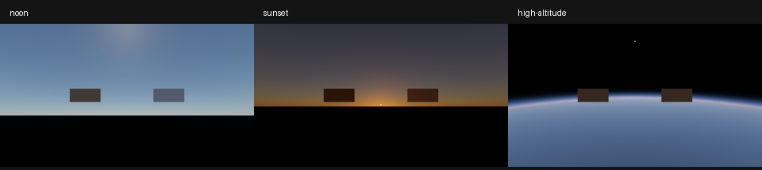

# M14.7 大气质量与性能基线（2026-10-13）

固定质量集通过，三预设与CPU/GPU/API端到端、冷/热LUT及显存证据已归档。**1080p大气增量GPU p95≤1.5ms候选目标未达到**；本次交付是可复现基线，不声明性能达标。

复现见[指南](../guides/atmosphere-benchmark.md)，[质量原始数据](2026-10-13-atmosphere-quality.json)和[性能证据](2026-10-13-atmosphere-evidence.json)包含每轮统计、来源摘要与原始文件SHA256。
原始18进程、2538个计时帧、18张PPM及日志：`out/benchmarks/atmosphere-20261013-121828-a16bd1e6`。每进程另有一个不计时显存诊断帧。

## 环境与测量边界

Windows x64；NVIDIA GeForce RTX 4070 Laptop GPU，驱动596.49；MSVC 19.51.36260.0、RelWithDebInfo `/O2 /Ob1 /DNDEBUG`，Slang 2026.18。
大气算法/质量atmosphere_v1，shader指纹`fnv1a64:fb97c111419f22bb`，T256×64 / MS32×32 / Sky192×108 / 两张AP64×64×128，均RGBA32F。
性能运行validation OFF、Tracy编译OFF（Memory宏设置为ON但随总开关失效），独立GPU timestamp OFF/ON配对；timestampPeriod=1ns、validBits=64。
质量另用required Khronos及同步validation。测试子进程临时禁用冲突的AMD switchable隐式层。无依赖升级。
基线父提交`97f0d13a1918512589fbff0065dd024344fe0b2b`，当时为M14.7工作区；manifest源码/exe/DLL摘要标识实际被测版本。

三轮各40稳态样本，排除冷帧和5帧预热，物理重建每轮仅3次；先逐轮nearest-rank，再取三轮中位数。p95范围保留轮间漂移。
CPU区间是wall时间；prepare包含同步LUT等待/读回，record_submit包含建图/驱动提交，API端到端从快照提取到RGBA8 CPU读回。
不包含GUI上传/呈现、IPC排队或文件发布；编辑器CPU读回再上传的额外成本仍未量化。未采集Tracy轨迹。
冷指新进程/renderer，不清空驱动/OS缓存。GPU频率和功耗未锁定，mode顺序固定，跨mode比较包含时间漂移。不同区间的中位数不保证相加等于端到端中位数。

## 数值质量

| 项目 | 本次最大值 | 冻结门槛 |
| --- | --- | --- |
| Sky六场景×单散射/MS nRMSE | 0.459072% | ≤3% |
| Sky p99 | 1.40604% | ≤8% |
| T离网格双线性绝对误差 | 0.000279509318 | ≤0.002 |
| 显式地平线/天顶参考误差 | 6.26165109% | ≤8% |
| 新增地平线邻接变化残差，1m/10km/100km/150km×单散射/MS | 4.50389718% | ≤8% |
| AP五场景nRMSE / p99 | 0.0134668% / 0.0763697% | ≤3% / ≤8% |
| AP边缘/地平线最大误差 | 0.121125% | ≤8% |
| RGB T分段绝对误差 | 0.0001455496 | ≤0.002 |
| MS闭合对独立4096方向CPU参考 | 7.32941789% | <15%（既有独立门槛） |

Sky全图单通道最大归一化误差10.1371%，出现在150km顶外用例；AP全图最大0.30488%。单点最大值单列，不用平均误差掩盖；全图门槛为nRMSE/p99，边界另有显式射线与连续性测试。
太阳盘能量/遮光、真空、Lambert法线与双面、曝光/合成、缓存代次、分配/submit/预算失败、旧快照与在途寿命均通过。MS是各向同性闭合近似，不是多阶路径追踪真值。

## 1080p稳态及增量GPU

增量=同索引Sky-update的Sky LUT GPU+完整帧GPU−unlit完整帧GPU；顺序采样，动态视图有0.1m/帧高度偏移。
Submission父区间与Pass子区间不相加。下表为timestamp ON，单位ms。

| 预设 | static帧GPU p50 | Sky-update帧GPU p50 | Sky更新GPU p50 | AP Pass p50 | 合成Pass p50 | 增量p95中位数 | 三轮增量p95范围 | 1.5ms候选 |
| --- | --- | --- | --- | --- | --- | --- | --- | --- |
| noon | 3.349 | 3.213 | 0.137 | 1.957 | 0.254 | 2.709 | 2.677–2.713 | 未达 |
| sunset | 3.346 | 3.258 | 0.138 | 1.949 | 0.316 | 2.792 | 2.758–2.825 | 未达 |
| high-altitude | 2.453 | 2.076 | 0.110 | 1.092 | 0.073 | 1.593 | 1.579–1.611 | 未达 |

AP为主要大气GPU区间；本轮保留原质量、分辨率与128段积分，没有以降低质量换取达标。候选目标及本机实测值均冻结在证据中。

## CPU/API端到端与冷启动

以下为timestamp OFF各轮p50的中位数，端到端另列p95，单位ms。

| 预设/模式 | 快照提取 | 同步prepare | record/submit | wait | CPU读回 | 端到端p50 | 端到端p95 |
| --- | --- | --- | --- | --- | --- | --- | --- |
| noon/static | 0.012 | 0.008 | 0.909 | 8.337 | 0.510 | 9.779 | 10.892 |
| noon/sky-update | 0.012 | 0.453 | 0.890 | 8.066 | 0.511 | 9.918 | 10.580 |
| noon/physical-update | 0.013 | 27.973 | 1.062 | 7.003 | 0.521 | 37.034 | 41.328 |
| noon/unlit | 0.011 | 0.000 | 0.703 | 3.222 | 0.517 | 4.594 | 4.839 |
| sunset/static | 0.013 | 0.008 | 0.864 | 9.072 | 0.531 | 10.590 | 11.628 |
| sunset/sky-update | 0.013 | 0.461 | 0.856 | 8.096 | 0.528 | 9.919 | 10.475 |
| sunset/physical-update | 0.018 | 28.552 | 0.981 | 7.321 | 0.523 | 37.427 | 41.907 |
| sunset/unlit | 0.011 | 0.000 | 0.534 | 3.066 | 0.529 | 4.134 | 4.556 |
| high-altitude/static | 0.013 | 0.008 | 0.874 | 6.993 | 0.516 | 8.543 | 9.873 |
| high-altitude/sky-update | 0.012 | 0.429 | 0.888 | 6.528 | 0.519 | 8.415 | 9.099 |
| high-altitude/physical-update | 0.016 | 27.327 | 1.185 | 6.177 | 0.518 | 35.440 | 37.596 |
| high-altitude/unlit | 0.012 | 0.000 | 0.645 | 3.308 | 0.526 | 4.580 | 4.861 |

冷组件分别计时，不能只引用首帧GPU当冷启动。下表timestamp OFF、每预设3个新进程的中位数，ms：

| 预设 | Device/Queue创建 | Pipeline创建 | Atmosphere创建 | 冷T/MS/Sky准备 | 首帧record/submit（含lit/AP延迟编译） | 首帧API端到端（不含前三列） |
| --- | --- | --- | --- | --- | --- | --- |
| noon | 333.096 | 560.682 | 556.151 | 30.660 | 686.340 | 726.731 |
| sunset | 331.702 | 553.179 | 559.778 | 30.173 | 672.067 | 711.596 |
| high-altitude | 325.237 | 565.813 | 563.517 | 30.310 | 671.599 | 710.847 |

冷LUT各Submission GPU时长（timestamp ON，三轮中位数，ms）：

| 预设 | T | MS | Sky | 物理重建T/MS/Sky合计p50 |
| --- | --- | --- | --- | --- |
| noon | 0.073 | 25.098 | 0.113 | 27.257 |
| sunset | 0.073 | 25.098 | 0.112 | 27.198 |
| high-altitude | 0.073 | 25.098 | 0.094 | 25.980 |

timestamp ON相对OFF的static端到端p50，按同轮配对计算后取中位数：

| 预设 | 开销中位数 | 三轮范围 |
| --- | --- | --- |
| noon | -0.56% | -11.02%–+3.02% |
| sunset | -0.61% | -7.80%–+1.48% |
| high-altitude | +4.89% | -6.79%–+13.97% |

存在负差值和轮间波动；这是包含调度/设备动态频率的配对观察，不证明timestamp能加速或零开销。

## 显存与CPU内存

三预设同尺寸/资源布局；18次在途诊断均单独发帧且不计入性能样本。下表取18次最大值，MiB=2^20bytes。

| 采样状态 | device-local allocation | device-local block | host-visible allocation | host-visible block |
| --- | --- | --- | --- | --- |
| 在途帧（含AP/HDR/读回） | 101.016 | 116.375 | 7.911 | 64.000 |
| 帧释放后缓存/资产/管线驻留 | 0.641 | 32.000 | 0.000 | 64.000 |

CPU引擎heap峰值最大10.825MiB，18进程关闭后live allocations均为0。
所有引擎GPU资源释放后VMA allocation均回到设备初始值0；设备仍活着时VMA可能保留96MiB空闲block，随后随Device关闭。
AP两张逻辑体积合计16MiB；在途统计还包含深度、HDR、合成目标、RGBA8输出/读回及常量。
完成后采样只剩约17MiB，无法代表在途峰值，因此另设提交后、wait/collect前观测。device-local与host-visible类型允许重叠，不相加；
这里是安全点采样最大值，不是系统总显存、驱动私有内存或精确瞬时峰值。CPU heap不是进程RSS；冷LUT内部候选的瞬时峰值未另行捕获。

## 验收证据与范围

- CPU-only：`out/verify/20261013-120037-fa49ff6c`，7通过；Graphics/Slang选项均OFF，参考库单独ON。
- required GPU质量：`out/verify/20261013-120115-169eff8a`，14通过、1个额外样例未运行；补建后的`out/verify/20261013-121240-67e639e5`，该样例1通过。
- 最终优化采集/汇总：`out/verify/20261013-121611-be420e55`，2通过（汇总包含6个Python用例），0失败/跳过。
- 完整数值日志补采：`out/verify/20261013-121627-68da47d2`，天空/AP两项通过，保存LastTest完整输出以避免JUnit的1024字节截断。
- 环境GUI/IPC/Python/Luau闭环沿用[0099](../development/0099-environment-integration.md)已经验收的行为；本轮未改编辑器/命令/capture，不重复GUI全流程。

本轮未做全量测试、跨GPU/驱动矩阵或Tracy轨迹；普通场景Edit/capture之外的Simulation布片视口不含大气。
优化方向以本次AP Pass为依据：保留数值门槛，评估光程前缀复用和资源复用；这些优化尚未实现，不纳入已交付能力。
