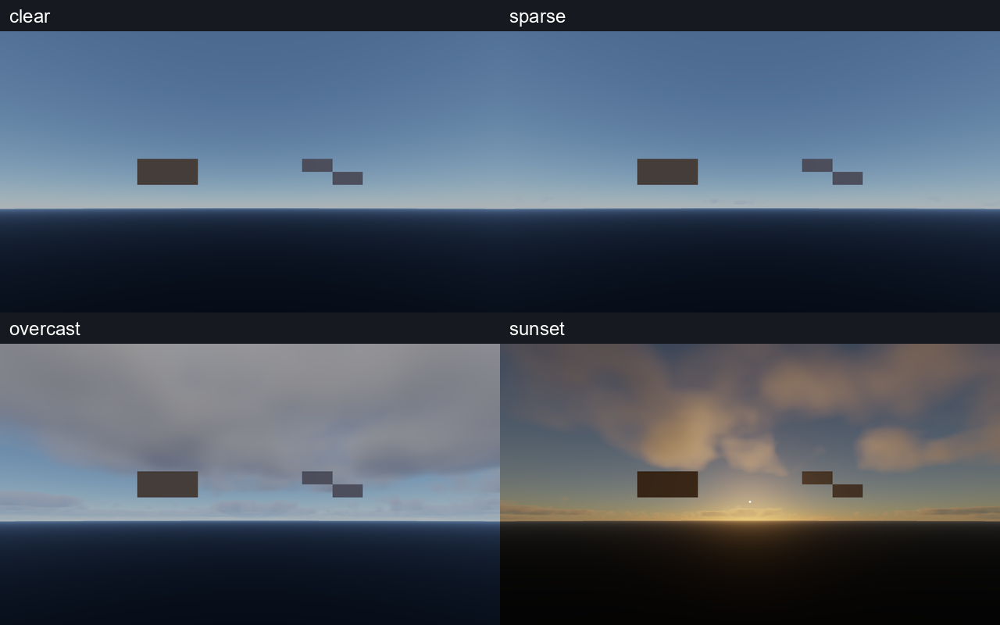

# M15.7 体积云与大气联合交付（2026-10-13）

四预设固定质量集与动态/失败回归通过，三轮 CPU/GPU/显存原始数据已归档。**非零云的 1080p 云增量 4ms、联合增量 5.5ms 和在途峰值 192MiB 候选均未达到；稳态资源 128MiB 候选达到。** 本次完成质量与可复现性能基线，不声明实时性能达标。

复现见[指南](../guides/cloud-benchmark.md)，协议见[云设计](../design/render-clouds.md#m157-质量与性能采集协议)，[质量证据](2026-10-13-clouds-quality.json)和[性能证据](2026-10-13-clouds-evidence.json)保留逐例/逐轮指标、完整输入、源码/二进制与原始文件 SHA256。
原始目录 `out/benchmarks/clouds-20261013-200944-7b867323`：24 个独立进程、5040 个计时帧、288 个不计时显存诊断帧、24 张 PPM 及日志。

四张图来自第一轮 timestamp ON 的最后静态帧；每预设三轮和开关共六张原始图 SHA256 完全相同。人工核对接收体、mask、地平线与太阳位置正常；PPM 只用于查看，线性值负责数值验收。

## 环境、输入与观察范围

Windows x64；NVIDIA GeForce RTX 4070 Laptop GPU，驱动 596.49；MSVC 19.51.36260.0，RelWithDebInfo `/O2 /Ob1 /DNDEBUG`，Slang 2026.18。
shader 指纹 `fnv1a64:fccd5f5391aa159b`，算法标记含 `low-sun-32`；父提交 `963ec823756d3108b9a7b96b814748a28fe3300e`，实际被测工作区以 manifest 摘要为准。
性能 validation OFF、Tracy 编译/连接均 OFF，timestamp 独立 OFF/ON；本机 period=1ns、validBits=64。质量另用 required Khronos + synchronization validation，测试子进程临时禁用冲突的 AMD switchable 隐式层。无依赖升级。

复用编辑器与命令的 environment.preset v1，seed=1729、generator=1、128/128/32 天气/基础/细节纹理，MS 开启。
cloud_temporal_v1 使用半尺寸、96–256 主步、8 太阳步及低角度重建最低 32 太阳步；默认跳跃/早停/历史；云影 256²、256 步、center=0、extent=8192m。
曝光 8、FOV=1.15rad、near/far=1/10000m，相机 [0,100,0]、仰角 .16rad、yaw=0、time=0；固定世界接收面距离 500m/3000m，后者 checker alpha-mask。
运动稳态索引 1–20 对应 x=.25m/步、yaw=.0005rad/步、time=1/30s/步；同轮 air/unlit 基线输入逐项核对一致。

每模式首帧单列，combined 预热 32、baseline 预热 5，各测 20 稳态帧；三轮轮换预设和 timestamp 开关顺序，mode 顺序固定。
先逐轮 nearest-rank p50/p95，再取三轮中位数/范围，不混池，不删较慢轮次。20 样本 p95 不代表硬实时上限。
未锁定 GPU 频率/功耗，没有将时间漂移与 timestamp 自身开销分离。离屏同步 API 端到端含 CPU 读回，不含 GUI 上传/呈现、IPC 和文件发布；没有 Tracy 轨迹。

## 静态、动态与参考收敛

质量分辨率 31²：每预设静态 32 帧预热后 120 帧相邻变化；12 个连续运动/风时间样本；三个非零云预设另测云内 2200m、云上 5000m，共 58 个参考比较。
默认优化对 1024/256/256 主/太阳/空气参考；以 512/128/128 的差异检查收敛。高档分为至多 16² 四象限，保持原像素中心和 1Gi 单提交工作预算；中档完整/分块单独核验。
普通像素采用参考亮度 p95（下限 .001）归一，太阳盘由几何视线/角半径分类，以盘辐亮度独立归一；原始 JSON 同时保留未掩码全图误差。

以下是各预设所有静态/动态/高度样本最大值，RGB 项单位 %，Tc 为绝对差；最大值覆盖全部非太阳像素，因而也约束边缘和反遮挡。

| 预设 | 比较数 | RGB nRMSE | RGB p99 | 非太阳最大 | Tc 最大 | 静止帧差 nRMS |
| --- | --- | --- | --- | --- | --- | --- |
| clear | 13 | 0.00000 | 0.00000 | 0.00000 | 0.0000000 | 0.00000 |
| sparse | 15 | 0.00968 | 0.04954 | 0.10996 | 0.0001580 | 0.00000 |
| overcast | 15 | 0.23761 | 0.76846 | 2.11594 | 0.0052314 | 0.00000 |
| sunset | 15 | 0.31328 | 1.00394 | 7.12874 | 0.0044206 | 0.00000 |

冻结门槛分别为 RGB nRMSE≤5%、p99≤12%、非太阳最大≤12%、Tc≤.02、静止 nRMS≤1%。
全样本参考收敛最差 nRMSE=0.091519%、p99=0.218585%，低于 2%/4%；同档分块最差 nRMSE=0.000438%、p99=0.001805%，低于 .1%/.2%。
太阳盘最大归一误差 0.000102623，低于 .002。clear 逐位退化同空气路径；旧 M14 的独立大气参考验收仍适用。
时间回退/相机切换均拒绝旧历史；原有云影数值、表面直射隔离、反遮挡/投影边界、失败/关闭和在途寿命回归通过。

初次日落普通像素最大误差 12.9421%，超过既有 12% 门槛。将低角度重建自遮蔽最低 16 步改为 32 步后，静态最大降至 2.65579%，云内最差为 7.12874%。
调用者工作预算按最坏 32 步重新核算，默认/上限由 64Gi 调整至 128Gi 逻辑工作量；这是积分工作预算，不是显存字节。未降低采样、分辨率或数值阈值来获取性能达标。
初次太阳盘误差归一与离轴分块夹具的问题、失败数据及修正过程完整记录于[0107](../development/0107-cloud-delivery.md)。
这些是同低阶 MS 模型下的离散/重建检查，不是路径追踪真值，也不证明 1080p 全图像素误差或任意天气/视角的质量。

## 1080p GPU 与候选差距

逐样本总量 = 本帧新增 LUT + 云影 + 整帧 Submission；不累加重叠的 Pass 子区间。
云增量=combined−匹配 air，联合增量=combined−匹配 unlit；保留负差。候选取 motion 各轮 p95；下表单位 ms。

| 预设 | 云 p95 第1/2/3轮 | 云 p95 中位数 | 联合 p95 第1/2/3轮 | 联合 p95 中位数 | 4ms / 5.5ms 候选 |
| --- | --- | --- | --- | --- | --- |
| clear | 0.071 / 0.061 / 0.259 | 0.071 | 2.149 / 2.146 / 2.355 | 2.149 | 控制组通过 |
| sparse | 17.597 / 17.802 / 19.133 | 17.802 | 19.676 / 19.891 / 21.320 | 19.891 | 两项未达 |
| overcast | 28.102 / 52.463 / 30.123 | 30.123 | 30.190 / 54.545 / 32.215 | 32.215 | 两项未达 |
| sunset | 42.490 / 47.001 / 48.706 | 47.001 | 44.566 / 49.386 / 50.817 | 49.386 | 两项未达 |

clear 不执行云路径，差值反映串行空气基线的测量波动。厚云第二轮 52.463ms 云增量 p95 如实保留，未删样或挑轮；即使最小值也明显未达候选。
以下为三轮各自 p50 的中位数，动态 Pass 仅用于归因，不相加这些中位数来计算总量。

| 预设 | 静态总GPU | 动态总GPU | 半尺寸积分 | 保边重建 | 历史重投影 | 云影更新 | Sky更新 |
| --- | --- | --- | --- | --- | --- | --- | --- |
| clear | 2.660 | 2.756 | 不执行 | 不执行 | 不执行 | 0.000 | 0.116 |
| sparse | 19.028 | 19.965 | 8.298 | 9.598 | 0.115 | 0.766 | 0.116 |
| overcast | 29.166 | 29.833 | 15.009 | 12.790 | 0.226 | 0.768 | 0.116 |
| sunset | 43.785 | 44.102 | 18.943 | 23.260 | 0.198 | 0.779 | 0.122 |

成本主要在半尺寸积分与保边重建；日落重建约 23.26ms，历史重投影和云影不是主要区间。候选优化方向是减少重复介质/自遮蔽积分及全尺寸回退，必须继续满足固定误差门槛；本次没有将这些优化写成已实现。

## CPU、端到端和冷启动

以下 timestamp OFF，三轮各自 p50 的中位数，端到端另列每轮 p95 的中位数，ms。
prepare 是同步 wall（包含 LUT/云影 GPU 等待和读回），record/submit 包含建图与驱动；区间中位数之和未必等于端到端中位数。

| 预设/模式 | 提取 | prepare | record/submit | wait | 读回 | 端到端p50 | 端到端p95 |
| --- | --- | --- | --- | --- | --- | --- | --- |
| clear/combined-static | 0.033 | 0.021 | 1.277 | 6.693 | 1.421 | 9.483 | 9.793 |
| clear/combined-motion | 0.032 | 0.680 | 1.048 | 6.633 | 1.424 | 9.968 | 10.524 |
| clear/air-motion | 0.034 | 0.665 | 1.102 | 6.711 | 1.453 | 10.060 | 10.639 |
| clear/unlit-motion | 0.028 | 0.002 | 0.742 | 3.083 | 1.480 | 5.488 | 5.960 |
| sparse/combined-static | 0.034 | 0.034 | 1.760 | 25.644 | 1.442 | 28.872 | 30.270 |
| sparse/combined-motion | 0.035 | 4.726 | 1.372 | 25.816 | 1.519 | 33.417 | 35.983 |
| sparse/air-motion | 0.030 | 0.655 | 0.911 | 6.374 | 1.520 | 9.520 | 10.102 |
| sparse/unlit-motion | 0.029 | 0.001 | 0.674 | 2.820 | 1.492 | 5.169 | 5.531 |
| overcast/combined-static | 0.036 | 0.036 | 1.669 | 35.628 | 1.568 | 39.169 | 40.306 |
| overcast/combined-motion | 0.036 | 4.779 | 1.405 | 35.722 | 1.524 | 43.493 | 51.013 |
| overcast/air-motion | 0.027 | 0.668 | 0.866 | 6.585 | 1.486 | 9.610 | 9.950 |
| overcast/unlit-motion | 0.029 | 0.002 | 0.730 | 2.829 | 1.454 | 5.166 | 5.553 |
| sunset/combined-static | 0.038 | 0.037 | 1.663 | 49.768 | 1.574 | 53.476 | 65.758 |
| sunset/combined-motion | 0.039 | 4.791 | 1.324 | 50.291 | 1.521 | 58.036 | 60.774 |
| sunset/air-motion | 0.029 | 0.681 | 0.820 | 6.532 | 1.485 | 9.619 | 9.909 |
| sunset/unlit-motion | 0.029 | 0.002 | 0.808 | 2.726 | 1.505 | 5.204 | 5.622 |

新进程冷启动分项，timestamp OFF 三次中位数，ms；不清理 OS/驱动缓存，首帧不含前四列初始化：

| 预设 | 设备/队列 | 程序/几何 | CPU云场 | 纹理上传wall | 首帧API端到端 |
| --- | --- | --- | --- | --- | --- |
| clear | 349.419 | 1297.224 | 279.918 | 0.752 | 749.795 |
| sparse | 336.377 | 1252.295 | 266.649 | 0.768 | 1060.299 |
| overcast | 333.440 | 1258.042 | 268.349 | 0.822 | 1067.215 |
| sunset | 357.287 | 1266.816 | 277.820 | 0.760 | 1116.682 |

冷帧 GPU（timestamp ON，三次中位数，ms）另列如下；冷 API 首帧还包含延迟 shader 编译、提交与等待，不能仅以 GPU 区间代表冷启动。

| 预设 | T LUT | MS LUT | Sky LUT | 云影 | 完整帧 Submission |
| --- | --- | --- | --- | --- | --- |
| clear | 0.103 | 40.029 | 0.163 | 0.000 | 6.864 |
| sparse | 0.103 | 40.121 | 0.164 | 0.923 | 56.238 |
| overcast | 0.103 | 40.027 | 0.164 | 0.935 | 88.689 |
| sunset | 0.103 | 40.301 | 0.162 | 0.944 | 81.028 |

纹理上传的独立 GPU 时长未采集，raw 字段为 null；不能将上传 wall 当 GPU 时间。探针对 clear 也预生成云纹理，故其初始化和缓存统计包括这部分夹具成本。

timestamp ON/OFF 同轮 combined-motion 端到端 p95 比值减一，保留调度/频率波动：

| 预设 | 第1/2/3轮观察差值 | 中位数 |
| --- | --- | --- |
| clear | -2.24% / -0.53% / +4.14% | -0.53% |
| sparse | -2.66% / +2.27% / +21.49% | +2.27% |
| overcast | +2.23% / +44.71% / -16.39% | +2.23% |
| sunset | +1.44% / +5.27% / +0.73% | +1.44% |

负差不证明 timestamp 加速，厚云 +44.71% 也不能全部归因于采集；本次没有剔除波动或锁定硬件时钟。

## 显存、旧代与关闭

每段两个独立诊断帧：已完成外部旧 Frame 保活时提交下一帧，在 wait/collect 前采样；完成并释放两帧、poll 历史后采驻留缓存。
下表环境增量扣除程序/几何 device-local allocation 基线 896bytes，取各轮/开关/combined 模式的最大值，MiB=2^20bytes。

| 预设 | 稳态缓存/历史 | 含旧帧在途峰值 | CPU heap峰值 | 128 / 192MiB候选 |
| --- | --- | --- | --- | --- |
| clear | 2.734 | 111.547 | 9.190 | 通过 / 通过 |
| sparse | 31.359 | 247.922 | 13.327 | 通过 / 未达 |
| overcast | 31.359 | 247.922 | 13.327 | 通过 / 未达 |
| sunset | 31.359 | 247.922 | 13.327 | 通过 / 未达 |

非零云 combined-motion 的实际 VMA 安全点（未扣几何基线）：

| 采样状态 | device-local allocation | device-local block | host-visible allocation | host-visible block |
| --- | --- | --- | --- | --- |
| 旧帧+新帧在途 | 247.923 | 256.312 | 19.822 | 64.000 |
| 帧释放后缓存/历史 | 31.360 | 96.000 | 0.000 | 64.000 |

驻留历史满足 128MiB，约 247.922MiB 在途增量超出 192MiB 约 55.922MiB。旧帧和候选同时保活时的临时/输出资源不应被稳态数字掩盖。
allocation 是需求，block 是分配器保留块；device-local/host-visible 属性可能重叠，不能相加。此安全点峰值不是系统总显存或精确瞬时峰值，冷初始化内部临时资源、驱动私有分配未全面覆盖。
24 进程 CPU heap 关闭活分配均为 0；所有引擎资源释放后 VMA allocation 回到设备初值，随后设备正常关闭。CPU heap 不是进程 RSS。

## 验收和限制

- Debug `out/verify/20261013-200135-1371dde5`：17 项通过、0 失败/跳过，包含 CPU 工作预算、四预设、required GPU 数值/边界/历史/失败、真实 Python/Luau 序列和后台 GUI 一致性。
- RelWithDebInfo `out/verify/20261013-200810-78e3e75b`：聚合器（6 个 Python 用例）与 required GPU smoke 共 2 项通过、0 失败/跳过。
- 三轮性能矩阵 24 进程均成功；原始帧完整、GPU 区间不重复、物理输入/缓存/历史匹配、源码/二进制稳定、图像可重现、关闭无泄漏。性能候选独立判断为上述未达。
- Debug `out/verify/20261013-201517-e3ea69ee`：Tc 非有限值拒绝、64Gi 调用者预算边界及四预设共 5 项复验通过、0 失败/跳过。只加强验证，不修改生产渲染或性能采集路径；相关版本摘要和复验见[0107](../development/0107-cloud-delivery.md)。

未做全量测试、跨 GPU/驱动矩阵、长时间压力或 GUI 呈现性能测量；未重新运行未修改的完整 M14 独立参考集。
单层程序云与低阶 MS、固定世界云影区、接收体范围等现有边界保持。编辑器是固定输入后台预览，M15.7 不增加实时动画或 60fps 承诺。
后续优化可依据本报告的积分/重建成本及在途资源持有范围展开，需要独立阶段重新比较质量与三轮原始性能。
