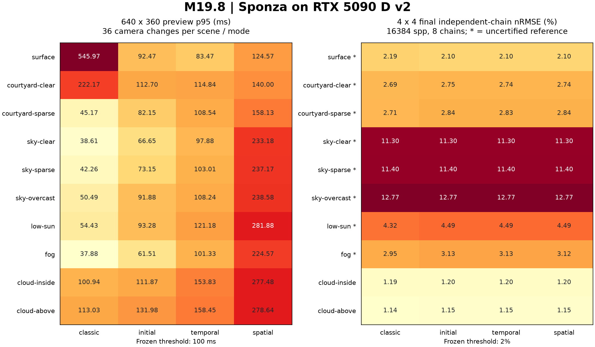

# M19.8 Sponza ReSTIR 质量与性能验收

本报告使用新机完整采集的 52 个进程：12 个性能进程（三轮 × 四模式）与 40 个质量进程（十场景 × 四模式）。
默认保持 **Classic MIS**，ReSTIR 保持显式可选；完成测量不表示所有质量、收益或交互目标达标。
十场景中仅云内/云上方参考通过 0.5% 认证；这两组四模式均在 16384 spp 达到 2%，但 ReSTIR 的等误差加速比仅 0.357–0.581×，未达 2× 目标。其余八组保持未认证。
保留的统计汇总、输入来源和验证摘要见[关键数据](2026-10-19-restir-sponza-5090/README.md)，
实施与定向验证见[0141](../development/0141-restir-sponza-acceptance.md)。
旧机 4070 的中间结论见下文历史说明，未拼入本报告。逐轮报告、完整图像和重复日志已按用户要求从当前目录清除。

## 设备与固定输入

Windows NT 10.0.26200、AMD Ryzen 9 9950X3D、NVIDIA GeForce RTX 5090 D v2（24 GiB）、驱动 610.88；
VS2026 18.9.1 / MSVC 19.51.36256.0、CMake 4.2.1、Release、Tracy OFF、Python 3.12.14。
Vulkan SDK/校验层 1.4.328.1，项目 Vulkan headers/loader 1.4.357.0；固定依赖基线不变。
仅在进程中禁用产生版本警告的 OBS 捕获层，required 测试仍开启 Khronos/sync；正式计时 validation OFF、GPU timestamp ON。
工具版本、运行库/源文件 SHA-256 见关键数据中的 environment.json，二进制、资产、shader 与 RTXDI 头文件见 manifest.json。

真实 Sponza 为 262266 个三角形、25 张实际使用纹理，metallic-roughness 材质；74 个素材文件逐一匹配旧机 SHA-256。
固定环境时间 17、4 次反弹、RR 从第 3 次开始、曝光 0、无去噪/重建。
远场边界 RGB=(0.3,0.4,0.6)，云单次反照率 0.9、g=0.6；surface 使用 model 3/sampler 1，其余为 Scene media model 4/sampler 2。
实际相机、环境、几何/完整输入指纹和云场 hash 在采集时随每场景记录；当前保留范围见关键数据说明，固定输入仍可从基准源码重建。
RTXDI-Library 固定为 3.1.0 / f12037fa8e97ebc08e9e3edfd2de528ed1772a4b。

| 模式 | 初始候选 | 时间历史 | 空间邻域 |
| --- | --- | --- | --- |
| classic | 不适用 | 无 | 无 |
| initial | 8 | 无 | 无 |
| temporal | 8 | age≤8，来源 M≤64 | 无 |
| spatial | 8 | age≤8，来源 M≤64 | 4 次尝试、半径 2、来源 M≤64 |

## 测量与门槛

- 性能固定 640×360、tile 64、batch 1、seed 101，连续 1–4 spp，四模式各三轮独立进程串行运行。
- 热相机同为 640×360，12 次每次平移 0.01；每次完整显示后取消一个在途候选并排空，最后停动恢复至 16 spp。
- 质量为 **4×4**，每模式 8 条独立链，seed=101+7919*i，从空历史延续 64/256/1024/4096/16384 spp。
  独立 Classic 参考 seed 再加 104729，N/4N=16384/65536；模式共享参考数据，不共享历史。
- 质量 batch 16；Classic 每批 16 spp，ReSTIR 逐 epoch 提交 2/3/4 个 pass。每次微小提交最多主动 poll 1ms 后回退 wait。
  质量 wall 包含主动占用一个 CPU 线程；全尺寸性能/运动/取消仍阻塞等待。
- 参考认证为 N/4N 均值 nRMSE≤0.5%，候选独立链图像 nRMSE≤2%；收益候选为等误差至少 2 倍。
  参考未认证时达到时间/加速比为 null；有限阶梯未达不插值、不降低门槛。
- RGB 均值同时要求偏差≤2%×abs(reference)+1e-4 和≤5×联合标准误差+1e-4，以整条链作为统计单位。
- 交互门槛：首个完整显示/取消排空 p95≤100ms，tile GPU p95≤8ms。所有额外 pass 与当前可见性校正均计入。

采样 wall 不包含配置、显式读回、设备创建和冷准备；显示延迟从相机配置前计到 GPU 显示提交完成，不是 GUI 输入到屏幕光子的延迟。
冷编译/管线、资产导入、CPU 场景、GPU 上传/AS 单列；设备创建和云场生成/上传未单列，冷表不是完整启动分解。
owned peak 为 renderer 累计额度高水位，VMA block 为采样到的最大保留块，两者不相加，也不等同系统显存峰值。

## 640×360 三轮性能



图中左右两组使用不同尺寸与计量单位；右侧星号标记未认证参考，不能将其误差解释为认证质量结果。

每项为三轮共 12 个 spp 增量的中位数，单位 wall / GPU 毫秒；同 spp 开销不等于等误差收益。

| 场景 | classic | initial | temporal | spatial |
| --- | --- | --- | --- | --- |
| surface | 40.797 / 7.703 | 82.312 / 20.137 | 74.484 / 32.023 | 115.242 / 58.455 |
| courtyard-clear | 31.419 / 17.734 | 69.644 / 34.795 | 100.960 / 54.345 | 131.954 / 77.848 |
| courtyard-sparse | 42.484 / 28.834 | 68.400 / 39.257 | 103.460 / 60.759 | 139.582 / 86.528 |
| sky-clear | 32.517 / 17.312 | 56.125 / 28.857 | 92.904 / 50.052 | 136.725 / 79.840 |
| sky-sparse | 34.337 / 20.896 | 62.588 / 32.801 | 97.429 / 53.686 | 142.815 / 82.493 |
| sky-overcast | 45.282 / 29.427 | 69.366 / 41.139 | 103.123 / 61.811 | 151.611 / 92.824 |
| low-sun | 50.922 / 36.418 | 77.881 / 51.100 | 112.974 / 70.543 | 155.384 / 97.740 |
| fog | 33.691 / 19.981 | 59.226 / 32.668 | 98.521 / 55.108 | 138.044 / 81.359 |
| cloud-inside | 96.314 / 77.391 | 108.128 / 77.960 | 144.715 / 99.498 | 186.170 / 126.354 |
| cloud-above | 99.552 / 80.468 | 111.731 / 80.343 | 143.864 / 101.120 | 190.035 / 129.332 |

## 全尺寸运动、取消与资源

每场景合计 36 次相机变化，下表为完整显示 p95 毫秒，目标≤100ms。

| 场景 | classic | initial | temporal | spatial |
| --- | --- | --- | --- | --- |
| surface | 545.967 | 92.472 | 83.469 | 124.569 |
| courtyard-clear | 222.170 | 112.697 | 114.844 | 139.996 |
| courtyard-sparse | 45.167 | 82.154 | 108.540 | 158.125 |
| sky-clear | 38.612 | 66.652 | 97.885 | 233.179 |
| sky-sparse | 42.260 | 73.153 | 103.013 | 237.165 |
| sky-overcast | 50.494 | 91.875 | 108.240 | 238.583 |
| low-sun | 54.429 | 93.282 | 121.180 | 281.879 |
| fog | 37.882 | 61.506 | 101.327 | 224.571 |
| cloud-inside | 100.939 | 111.871 | 153.826 | 277.475 |
| cloud-above | 113.031 | 131.975 | 158.446 | 278.635 |

| 模式 | 三项交互均达标 | 最坏 tile p95 ms | 最坏取消 p95 ms | owned peak MiB | VMA block 观测峰值 MiB |
| --- | --- | --- | --- | --- | --- |
| classic | 6/10 | 2.436 | 11.775 | 869.217 | 580.017 |
| initial | 7/10 | 1.965 | 7.436 | 890.311 | 836.017 |
| temporal | 2/10 | 1.856 | 2.735 | 890.311 | 836.017 |
| spatial | 0/10 | 1.892 | 3.118 | 897.342 | 836.017 |

所有报告退出后 CPU heap/VMA 存活分配为 0、diagnostics warnings/errors 为 0，owned peak 均在 1GiB 额度内。
时间/空间模式运动时 epoch 连续，聚合核对每步来源，停动全部恢复到 16 spp；不将 M/age 计为额外 spp。

三轮存在明显波动：Classic surface 第 1/3 轮预览约 18–22ms，第 2 轮前六次为 367–626ms，导致合并 p95 为 545.967ms；spatial low-sun 第 1 轮约 239–286ms，第 2/3 轮约 145–155ms。未删除、重采或替换这些轮次，现有证据不足以归因到某个系统组件。这些结果不支持跨运行稳定达到预览门槛；tile 与取消指标则全部满足。

## 4×4 参考认证与最终误差

候选列为 16384 spp 的跨独立链 nRMSE；参考未认证仍展示原始差异，但不能认证达到时间或均值。

| 场景 | 参考 N/4N | 认证≤0.5% | classic | initial | temporal | spatial |
| --- | --- | --- | --- | --- | --- | --- |
| surface | 0.595% | 未认证 | 2.186% | 2.103% | 2.103% | 2.104% |
| courtyard-clear | 1.087% | 未认证 | 2.687% | 2.754% | 2.743% | 2.744% |
| courtyard-sparse | 1.098% | 未认证 | 2.708% | 2.836% | 2.828% | 2.841% |
| sky-clear | 2.834% | 未认证 | 11.300% | 11.300% | 11.300% | 11.300% |
| sky-sparse | 2.544% | 未认证 | 11.404% | 11.404% | 11.404% | 11.404% |
| sky-overcast | 3.396% | 未认证 | 12.772% | 12.772% | 12.772% | 12.772% |
| low-sun | 2.089% | 未认证 | 4.319% | 4.489% | 4.491% | 4.493% |
| fog | 0.975% | 未认证 | 2.946% | 3.129% | 3.126% | 3.118% |
| cloud-inside | 0.374% | 通过 | 1.186% | 1.198% | 1.198% | 1.198% |
| cloud-above | 0.372% | 通过 | 1.138% | 1.151% | 1.151% | 1.151% |

## 等误差与等时间

下表仅对认证参考寻找首个达到 2% 的实测档位，单元格为 spp / 累计 wall 中位数毫秒；括号为相对 Classic 的加速比。

| 场景 | classic | initial | temporal | spatial |
| --- | --- | --- | --- | --- |
| surface | 参考未认证 | 参考未认证 | 参考未认证 | 参考未认证 |
| courtyard-clear | 参考未认证 | 参考未认证 | 参考未认证 | 参考未认证 |
| courtyard-sparse | 参考未认证 | 参考未认证 | 参考未认证 | 参考未认证 |
| sky-clear | 参考未认证 | 参考未认证 | 参考未认证 | 参考未认证 |
| sky-sparse | 参考未认证 | 参考未认证 | 参考未认证 | 参考未认证 |
| sky-overcast | 参考未认证 | 参考未认证 | 参考未认证 | 参考未认证 |
| low-sun | 参考未认证 | 参考未认证 | 参考未认证 | 参考未认证 |
| fog | 参考未认证 | 参考未认证 | 参考未认证 | 参考未认证 |
| cloud-inside | 16384 / 7732.446 (1.000×) | 16384 / 13306.183 (0.581×) | 16384 / 16238.724 (0.476×) | 16384 / 19042.551 (0.406×) |
| cloud-above | 16384 / 6643.359 (1.000×) | 16384 / 12996.862 (0.511×) | 16384 / 15733.706 (0.422×) | 16384 / 18608.484 (0.357×) |

等时间只使用四模式共同实测 wall 预算内的最高完整档位。单元格为 spp / nRMSE / 实际毫秒；未认证场景仅作诊断，4×4 成本不外推全屏。

| 场景 | 共同预算 ms | classic | initial | temporal | spatial |
| --- | --- | --- | --- | --- | --- |
| surface | 1469.665 | 16384 / 2.186% / 1469.665 | 1024 / 6.906% / 439.676 | 1024 / 6.905% / 671.490 | 1024 / 6.901% / 841.707 |
| courtyard-clear | 2201.641 | 16384 / 2.687% / 2201.641 | 4096 / 5.560% / 1897.007 | 1024 / 10.560% / 711.337 | 1024 / 10.360% / 875.370 |
| courtyard-sparse | 2896.288 | 16384 / 2.708% / 2896.288 | 4096 / 5.490% / 2238.344 | 1024 / 10.525% / 759.274 | 1024 / 10.339% / 922.787 |
| sky-clear | 1344.730 | 16384 / 11.300% / 1344.730 | 1024 / 38.170% / 462.265 | 1024 / 38.170% / 668.029 | 1024 / 38.170% / 827.973 |
| sky-sparse | 1464.382 | 16384 / 11.404% / 1464.382 | 1024 / 38.395% / 502.357 | 1024 / 38.395% / 746.550 | 1024 / 38.395% / 844.360 |
| sky-overcast | 1488.615 | 16384 / 12.772% / 1488.615 | 1024 / 42.325% / 493.558 | 1024 / 42.325% / 743.959 | 1024 / 42.325% / 861.912 |
| low-sun | 2848.642 | 16384 / 4.319% / 2848.642 | 4096 / 9.087% / 2386.370 | 1024 / 14.849% / 752.957 | 1024 / 14.844% / 935.358 |
| fog | 2542.180 | 16384 / 2.946% / 2542.180 | 4096 / 6.166% / 2276.761 | 1024 / 10.962% / 718.782 | 1024 / 10.807% / 901.368 |
| cloud-inside | 7732.446 | 16384 / 1.186% / 7732.446 | 4096 / 2.253% / 3343.102 | 4096 / 2.253% / 4049.578 | 4096 / 2.253% / 4762.487 |
| cloud-above | 6643.359 | 16384 / 1.138% / 6643.359 | 4096 / 2.330% / 3279.178 | 4096 / 2.330% / 3959.992 | 4096 / 2.330% / 4684.001 |

## 长链均值与收敛

单元格为最终链均值图像 nRMSE / RGB 双界限 / 4096→16384 跨链误差趋势。未认证场景的界限结果为描述性检查。

| 场景 | classic | initial | temporal | spatial |
| --- | --- | --- | --- | --- |
| surface | 1.484% / 满足 / 下降 | 1.430% / 满足 / 下降 | 1.429% / 满足 / 下降 | 1.430% / 满足 / 下降 |
| courtyard-clear | 1.169% / 满足 / 下降 | 1.107% / 满足 / 下降 | 1.102% / 满足 / 下降 | 1.131% / 满足 / 下降 |
| courtyard-sparse | 1.129% / 满足 / 下降 | 1.067% / 满足 / 下降 | 1.060% / 满足 / 下降 | 1.104% / 满足 / 下降 |
| sky-clear | 5.020% / 满足 / 下降 | 5.020% / 满足 / 下降 | 5.020% / 满足 / 下降 | 5.020% / 满足 / 下降 |
| sky-sparse | 5.013% / 满足 / 下降 | 5.013% / 满足 / 下降 | 5.013% / 满足 / 下降 | 5.013% / 满足 / 下降 |
| sky-overcast | 5.509% / 满足 / 下降 | 5.509% / 满足 / 下降 | 5.509% / 满足 / 下降 | 5.509% / 满足 / 下降 |
| low-sun | 1.918% / 满足 / 下降 | 1.923% / 满足 / 下降 | 1.925% / 满足 / 下降 | 1.924% / 满足 / 下降 |
| fog | 1.277% / 满足 / 下降 | 1.273% / 满足 / 下降 | 1.269% / 满足 / 下降 | 1.298% / 满足 / 下降 |
| cloud-inside | 0.472% / 满足 / 下降 | 0.474% / 满足 / 下降 | 0.474% / 满足 / 下降 | 0.474% / 满足 / 下降 |
| cloud-above | 0.390% / 满足 / 下降 | 0.392% / 满足 / 下降 | 0.392% / 满足 / 下降 | 0.392% / 满足 / 下降 |

完整五档误差、上/下半 ROI、RGB 均值/偏差/联合标准误差、GPU/wall 聚合统计与选定历史计数保留在 summary.json；逐链原始数据不再随当前目录保存。

40 个模式/场景组合的 4096→16384 跨链误差均下降，RGB 均值均满足两项数值界限；仅两组认证参考可支持正式均值结论，其余八组仍需更收敛的参考。有限阶梯趋势和均值界限不替代估计器推导或全尺寸质量认证。

## 冷准备与计时限制

每列按第 1/2/3 轮列出毫秒；CPU heap 为三轮最高值，不是进程工作集。

| 模式 | 编译/管线 ms | 资产导入 ms | 首次 CPU 场景 ms | 首次 GPU 准备 ms | CPU heap peak MiB |
| --- | --- | --- | --- | --- | --- |
| classic | 1264.96 / 2713.22 / 1233.57 | 299.50 / 901.48 / 293.98 | 173.00 / 308.33 / 169.81 | 966.58 / 1535.20 / 931.13 | 363.318 |
| initial | 3420.20 / 3429.60 / 1222.00 | 540.57 / 593.29 / 291.25 | 277.97 / 254.76 / 169.74 | 1512.16 / 1070.91 / 934.67 | 363.318 |
| temporal | 1272.75 / 1254.20 / 1154.18 | 292.61 / 311.38 / 297.41 | 170.69 / 172.38 / 177.15 | 947.24 / 936.28 / 950.55 | 363.318 |
| spatial | 1223.96 / 1233.65 / 1257.74 | 290.81 / 312.49 / 299.34 | 169.39 / 171.88 / 171.77 | 928.65 / 932.97 / 939.42 | 363.318 |

三轮固定模式顺序，没有随机交错；桌面调度、温度、频率变化可能影响 wall 时间。GPU tracking 步数未暴露，明确为 null；
current_visibility_rays 仅为空间阶段已有阴影诊断，不代表其他模式没有阴影射线。
低分辨率表面匹配稀少，复用率不能外推至全尺寸；640×360 的同 spp 完整图像只作画面诊断，不认证等成本画质。

## 默认策略与下一步

保持 Classic MIS 默认。认证场景的 ReSTIR 等误差耗时为 Classic 的约 1.72–2.80 倍，未达到至少减半的候选目标；共同实测 wall 预算内，ReSTIR 最高完整档位的误差在十个场景中均高于 Classic（其中八组仅作未认证诊断）。三项交互同时达标为 6/10、7/10、2/10、0/10，预览指标限制了稳定交互结论。
下一步优先提高未认证场景的参考收敛并定位额外 pass、提交与显示成本，再决定新的采样/调度方案。不能以较低噪声的单幅图代替等误差收益。
本次未引入降质、关闭校正、去噪/DLSS 或新的 GI/PT/体积复用；后续算法选择需要新的设计与针对主导成本/噪声的证据。
验收覆盖本机和上述冻结负载，不承诺跨设备实时性，也不认证全分辨率收敛质量。

## 旧机历史结论与保留范围

RTX 4070 Laptop / 596.49 的换机前快照完成了 12/12 性能、28/40 质量进程，未完成最终质量验收。
其 Classic / initial / temporal / spatial 三项交互同时达标数为 10/10、10/10、1/10、0/10；owned peak 最大约 901.076 MiB。
这些结果与新机独立，保留为历史结论，不与上面的 5090 计时合并。

2026-10-20 按用户要求精简文件，保留本报告、概览图、统计/来源/验证摘要及独立 CPU 基线。
旧机完整进度证据可从提交 `3202043` 恢复，新机完整归档可从 `f1e5734` 恢复；当前关键数据目录只有摘要，不能直接执行 `--verify-archive`。
重新测量时将原始数据和可选完整归档留在 `out/`，按下面命令复算，不再批量加入版本库。

## 复现

新机配置见[构建指南](../guides/build.md#新机器接续)，素材恢复见[说明](../../projects/demo/assets/README.md)。
先构建并通过 required GPU 与聚合检查，然后串行采集；本机 Python 解释器路径保存在忽略的个人预设中。

```powershell
$previousObsLayer = $env:DISABLE_VULKAN_OBS_CAPTURE
try {
    $env:DISABLE_VULKAN_OBS_CAPTURE = '1' # 仅在 OBS 层实际产生版本警告的机器使用
    & ./scripts/verify.ps1 -BuildDir out/build/windows-editor -Configuration Release `
        -Target @('dk_pathmedia_benchmark', 'dk_pathtracing_probe') `
        -TestRegex '^dk\.pathtracing\.(restir_sponza_.*|media_benchmark_aggregation|restir_(numeric|temporal_numeric|spatial_numeric|medium_numeric|medium_cloud|medium_reuse|medium_state|medium_support)_gpu_required)$' `
        -Reason 'M19.8 Sponza smoke and direct numeric/state regression'
    if ($LASTEXITCODE -ne 0) { throw 'Verification failed' }
    $benchmarkArgs = @('--directory', 'out/restir-sponza-rerun',
        '--executable', 'out/build/windows-editor/bin/Release/dk-pathmedia-benchmark.exe',
        '--root', 'projects/demo', '--shaders', 'engine/render/pathtracing/shaders',
        '--rtxdi', 'out/build/windows-editor/_deps/dk_rtxdi_source-src/Include')
    python scripts/benchmark-restir-sponza.py @benchmarkArgs --collect performance
    if ($LASTEXITCODE -ne 0) { throw 'Performance collection failed' }
    python scripts/benchmark-restir-sponza.py @benchmarkArgs --collect quality
    if ($LASTEXITCODE -ne 0) { throw 'Quality collection failed' }
    python scripts/benchmark-restir-sponza.py --directory out/restir-sponza-rerun --summarize
} finally { $env:DISABLE_VULKAN_OBS_CAPTURE = $previousObsLayer }

python scripts/benchmark-restir-sponza.py --directory out/restir-sponza-rerun --archive out/restir-sponza-archive
python scripts/benchmark-restir-sponza.py --directory out/restir-sponza-archive --verify-archive
```

完整三轮和 8 seed 长链均在新机重采，未使用旧机 --resume；同机、同二进制和同输入才可接续原目录。
未运行全工程、Debug/Release 矩阵、独立 CPU-only 配置或本阶段 GUI/capture 回归；本阶段未修改生产渲染代码。
