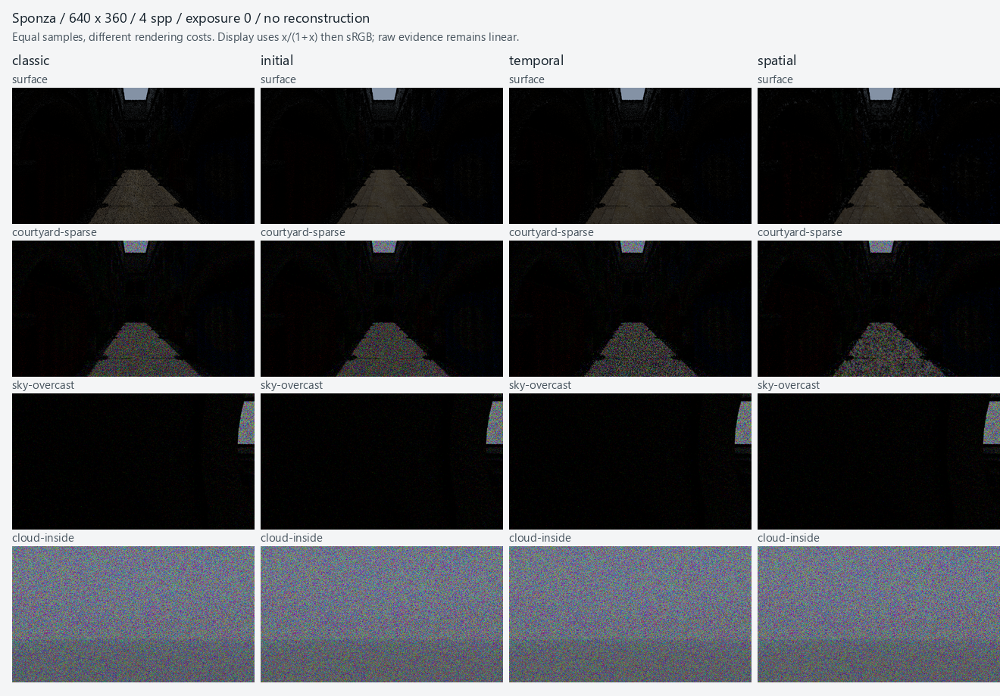

# M19.8 Sponza ReSTIR 质量与性能验收

进度快照，尚未完成验收。按用户换机要求，采集已停止：性能 12/12、质量 28/40；
[已完成数据归档及接续说明](2026-10-19-restir-sponza-progress/README.md)。最终质量表、聚合和默认策略结论待继续完成。设计协议见
[ReSTIR](../design/render-restir.md#m198-sponza-验收实施契约)，实现与验证见
[0141](../development/0141-restir-sponza-acceptance.md)。

## 固定工作负载

Windows NT 10.0.26200、AMD Ryzen 9 7940HX、NVIDIA GeForce RTX 4070 Laptop GPU、驱动 596.49；
MSVC 19.51.36260.0、Release、Tracy OFF。使用真实 projects/demo Sponza，262266 个三角形、25 张纹理，
metallic-roughness 材质，固定环境时间 17、4 次反弹、RR 从第 3 次开始、曝光 0，无去噪或重建。
远场边界 RGB 为 (0.3, 0.4, 0.6)，云单次反照率 0.9、相函数 g=0.6；这些参数由同一冻结基准程序固定。
surface 使用 model 3 / sampler 1，其余 Scene media 使用 model 4 / sampler 2；每幅图另记录实际 transport 来源。

十个输入为 surface、courtyard-clear、courtyard-sparse、sky-clear、sky-sparse、sky-overcast、low-sun、fog、
cloud-inside、cloud-above。实际相机、环境、几何/完整输入指纹、字段 hash、资产/着色器/SDK/程序 SHA256 保存在原始证据中。
单独选择场景时仍执行前面的环境设置，保持 revision 与整套运行一致。

| 模式 | 初始候选 | 时间历史 | 空间邻域 |
| --- | --- | --- | --- |
| classic | 不适用 | 无 | 无 |
| initial | 8 | 无 | 无 |
| temporal | 8 | age≤8，来源 M≤64 | 无 |
| spatial | 8 | age≤8，来源 M≤64 | 4 次邻居尝试，半径 2，来源 M≤64 |

RTXDI-Library 固定为 3.1.0 / f12037fa8e97ebc08e9e3edfd2de528ed1772a4b；实际阈值/工作预算另随每幅图记录。
所有模式保留当前可见性、支持校正、原物理介质和全部 pass。tracking 实测计数未由 GPU API 暴露，明确为 null；
current_visibility_rays 仅为已有空间阶段连续光源阴影诊断，不代表其他模式没有阴影射线。

## 测量口径与限制

- 性能：640×360，tile 64，batch 1，固定 seed 101，连续 1–4 spp；四种模式各三轮独立进程、串行运行，validation OFF、GPU timestamp ON。
- 热相机：同一 640×360 尺寸，12 次每次平移 0.01 的新视角；图像从 1 spp 开始，时间模式保留采样历史。每次提交候选后取消并排空，最后停动恢复到 16 spp。
- 质量：4×4，请求 batch 16（Classic 每批 16 spp，ReSTIR 按 epoch 逐样本提交 2/3/4 个 pass），每模式 8 条独立链，seed=101+7919*i，从空历史延续 64/256/1024/4096/16384 spp；独立 Classic 参考 seed 再加 104729，N/4N=16384/65536。四模式共享参考数据，不共享历史。
- 质量计时单独关闭 validation 并记录累计 wall/GPU 时间；required Khronos/sync 的烟测、解析/CPU oracle 和状态检查单列。仅在基准/验证进程临时设置已有 AMD switchable layer 兼容变量，不修改系统设置。
- 独立质量 worker 对每次微小提交最多主动轮询 1ms，再回退阻塞等待。此 wall 时间含主动占用一个 CPU 线程，不能视为 GUI/worker 延迟；全尺寸性能、运动与取消仍使用原阻塞等待。采集程序变化后整体使用新来源重采，不混用程序计时。
- 参考认证要求 N/4N 均值 nRMSE≤0.5%；候选要求 nRMSE≤2%。参考未认证时，达到时间和加速比为 null；有限阶梯未达不插值、不降低门槛。RGB 均值同时列出 2%+1e-4 与 5 联合标准误差+1e-4 的结果，以整条链为统计单位。
- 等时间采用四模式共有实测预算内的最高完整阶梯，保留实际耗时和误差，不补造采样点。4×4 质量时间不外推为全尺寸等误差耗时；同 spp 完整图像只是诊断。低分辨率下抖动后的表面匹配稀少，复用率也不能外推到全尺寸。

wall 时间包含采样提交、等待及 poll；不包含配置、显式图像读回、设备创建或冷准备。预览延迟从相机配置前开始，
到完整 GPU 显示提交完成为止，不含证据读回，也不是 GUI 输入到屏幕光子的延迟。冷编译/管线、资产导入、CPU 场景与 GPU 准备单列。
设备创建及云场生成/上传未单独计时，冷表不是完整启动时间分解；进程总耗时另保留在 collection.wall_seconds 中。
owned peak 是 renderer 额度追踪的累计高水位；VMA block peak 是采样到的最大块数值，不代表全程瞬时峰值，两者不相加。

## 640×360 三轮性能



图中是完整 640×360 原始图像的显示缩略图，统一曝光 0、4 spp，无重建；不用于等成本画质结论。
上望的 sky 场景仍包含 Sponza 屋檐/建筑遮挡；cloud-inside/above 另覆盖云层内部/上方。

每项为三轮共 12 个完整 spp 增量的中位数，单元格为 wall / GPU 毫秒；不是等误差加速比。所有额外 pass 均计入。

| 场景 | classic | initial | temporal | spatial |
| --- | --- | --- | --- | --- |
| surface | 57.445 / 29.107 | 92.653 / 38.642 | 150.821 / 61.869 | 153.684 / 57.515 |
| courtyard-clear | 38.450 / 19.274 | 66.094 / 32.122 | 97.107 / 48.834 | 141.000 / 69.035 |
| courtyard-sparse | 41.247 / 24.102 | 67.617 / 35.616 | 106.387 / 56.755 | 144.856 / 72.898 |
| sky-clear | 31.561 / 15.136 | 58.406 / 26.504 | 97.733 / 46.260 | 130.509 / 62.664 |
| sky-sparse | 34.776 / 17.837 | 62.248 / 29.273 | 100.271 / 49.268 | 135.573 / 67.011 |
| sky-overcast | 43.932 / 25.475 | 67.213 / 36.244 | 110.700 / 56.875 | 140.305 / 72.664 |
| low-sun | 50.393 / 33.502 | 77.473 / 45.386 | 130.791 / 69.606 | 151.956 / 82.067 |
| fog | 36.881 / 19.044 | 61.830 / 30.394 | 107.551 / 51.340 | 139.814 / 67.868 |
| cloud-inside | 74.539 / 56.282 | 91.951 / 59.597 | 132.062 / 79.884 | 161.342 / 96.228 |
| cloud-above | 74.980 / 56.910 | 93.057 / 60.178 | 134.080 / 80.487 | 163.464 / 94.709 |

## 全尺寸热交互与资源

每模式/场景合计 36 次相机变化。下表为首个完整显示 p95 毫秒；目标为 ≤100ms。

| 场景 | classic | initial | temporal | spatial |
| --- | --- | --- | --- | --- |
| surface | 49.048 | 58.908 | 93.544 | 128.526 |
| courtyard-clear | 41.945 | 64.242 | 112.514 | 153.363 |
| courtyard-sparse | 44.448 | 72.802 | 115.290 | 166.877 |
| sky-clear | 36.246 | 69.515 | 109.288 | 142.995 |
| sky-sparse | 39.550 | 66.831 | 109.550 | 148.338 |
| sky-overcast | 49.469 | 75.066 | 139.529 | 152.013 |
| low-sun | 53.934 | 79.822 | 159.047 | 169.578 |
| fog | 41.474 | 65.755 | 114.699 | 164.595 |
| cloud-inside | 78.652 | 96.806 | 152.188 | 193.792 |
| cloud-above | 79.162 | 99.485 | 165.612 | 190.521 |

| 模式 | 三项交互指标均达标的场景 | 各场景 tile p95 最大值 ms | 各场景取消排空 p95 最大值 ms | owned peak MiB | VMA block 观测最大值 MiB |
| --- | --- | --- | --- | --- | --- |
| classic | 10/10 | 1.461 | 1.105 | 872.951 | 580.017 |
| initial | 10/10 | 1.364 | 10.417 | 894.045 | 836.017 |
| temporal | 1/10 | 1.286 | 8.759 | 894.045 | 836.017 |
| spatial | 0/10 | 1.212 | 7.775 | 901.076 | 836.017 |

tile 的 8ms 和取消的 100ms 指标全部满足；预览指标分别为 10/10、10/10、1/10、0/10。
三轮所有模式退出后 CPU heap/VMA 存活分配均为 0，无 GPU 诊断 warning/error。owned peak 全部低于 1GiB。
时间/时空模式相机移动后 sampling_first_epoch 按 0..11 继续，历史 epoch 为前一完整帧；停动后均恢复到 16 spp。
停动图像与有限历史过期计数保留在原始报告，不把历史 age/M 当成额外 spp。

## 冷准备与 CPU heap

各单元格按第 1/2/3 轮列出毫秒。GPU 首次准备包含上传/AS；后续环境输入复用几何，不能把这些小计当作打开 Editor 总耗时。

| 模式 | 编译/管线 ms | 资产导入 ms | 首次 CPU 场景 ms | 首次 GPU 准备 ms | CPU heap 峰值 MiB |
| --- | --- | --- | --- | --- | --- |
| classic | 1491.81 / 1445.92 / 1595.46 | 386.08 / 382.18 / 414.06 | 226.54 / 216.55 / 220.05 | 1377.07 / 1263.22 / 1459.91 | 363.318 |
| initial | 1436.81 / 1454.34 / 1499.43 | 366.82 / 382.32 / 391.87 | 215.84 / 216.38 / 217.45 | 1325.83 / 1263.62 / 1351.73 | 363.318 |
| temporal | 1437.17 / 1442.65 / 1550.94 | 395.05 / 396.56 / 404.92 | 216.02 / 216.27 / 220.08 | 1350.91 / 1262.45 / 1317.59 | 363.318 |
| spatial | 1436.48 / 1464.82 / 1681.58 | 383.32 / 390.29 / 432.85 | 216.73 / 216.23 / 232.88 | 1344.27 / 1271.65 / 1515.09 | 363.318 |

CPU heap 峰值只覆盖被 MemorySystem 追踪的 heap，不等同操作系统进程工作集。
三轮按固定模式顺序串行执行，没有随机交错；桌面 CPU 调度、温度与频率变化仍可能影响 wall 时间。
初始 RIS 最慢场景的预览 p95 为 99.485ms，贴近 100ms 门槛，不宣称跨负载或跨运行稳定达标。

## 复现

[采集与严格聚合](../../scripts/benchmark-restir-sponza.py)、[GPU 基准](../../tests/integration/PathMediaBenchmark.cpp)、
[报告拒绝测试](../../tests/integration/RestirSponzaBenchmarkTest.py)。构建及 smoke 使用：

```powershell
$previousAmdLayer = $env:DISABLE_LAYER_AMD_SWITCHABLE_GRAPHICS_1
try {
    $env:DISABLE_LAYER_AMD_SWITCHABLE_GRAPHICS_1 = '1'
    & ./scripts/verify.ps1 -BuildDir out/build/windows-editor -Configuration Release `
        -Target dk_pathmedia_benchmark -TestRegex '^dk\.pathtracing\.restir_sponza_' `
        -Reason 'Sponza 四模式与质量/运动/报告检查'
} finally { $env:DISABLE_LAYER_AMD_SWITCHABLE_GRAPHICS_1 = $previousAmdLayer }
```

正式采集使用新的输出目录；已成功的相同来源运行可以用 --resume 接续，改变程序/资产/SDK/着色器后必须使用新目录。

```powershell
$previousAmdLayer = $env:DISABLE_LAYER_AMD_SWITCHABLE_GRAPHICS_1
try {
    $env:DISABLE_LAYER_AMD_SWITCHABLE_GRAPHICS_1 = '1'
    $benchmarkArgs = @('--directory', 'out/restir-sponza-rerun',
        '--executable', 'out/build/windows-editor/bin/Release/dk-pathmedia-benchmark.exe',
        '--root', 'projects/demo', '--shaders', 'engine/render/pathtracing/shaders',
        '--rtxdi', 'out/build/windows-editor/_deps/dk_rtxdi_source-src/Include')
    python scripts/benchmark-restir-sponza.py @benchmarkArgs --collect performance
    if ($LASTEXITCODE -ne 0) { throw 'Performance collection failed' }
    python scripts/benchmark-restir-sponza.py @benchmarkArgs --collect quality
    if ($LASTEXITCODE -ne 0) { throw 'Quality collection failed' }
    python scripts/benchmark-restir-sponza.py --directory out/restir-sponza-rerun --summarize
} finally { $env:DISABLE_LAYER_AMD_SWITCHABLE_GRAPHICS_1 = $previousAmdLayer }
```

验收未覆盖其他设备、Release/Debug 矩阵、全工程回归、DLSS 或新的 GI/PT/体积复用算法。
