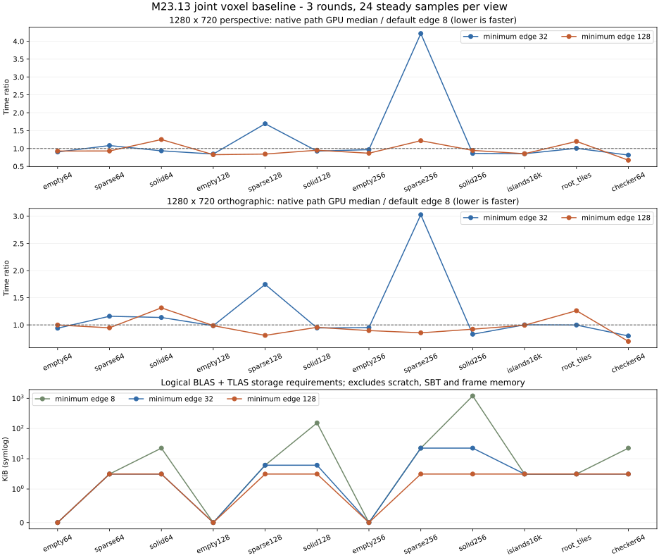

# M23.13 稀疏体素联合交付

[0171 开发记录](../development/0171-voxel-joint-delivery.md)与[实施契约](../design/render-voxels.md#m2313-联合交付实施契约)对应本报告。M23.13 已完成：required 质量矩阵、三轮 Release 联合基线、资源回收与 Slang/CPU/非 RT 入口/RT 回归均通过，M23 父阶段关闭。默认 RT 布局保留 8，32/128 作为显式可选策略。

## 输入与测量协议

沿用固定 OpenVDB 12.0.1#0、NanoVDB/PNanoVDB 32.7.0、Slang 2026.18，无 CUDA 依赖。Windows x64、MSVC 19.51.36260.0 Release、NVIDIA GeForce RTX 4070 Laptop GPU、驱动 596.49；设备/编译器枚举保存在原始 JSON。
源码基于 `7d4b207774909ecd1515884f12adfd03de489588` 加本阶段变更。[来源清单](data/2026-11-12-voxel-joint/manifest.json)记录完整引擎/相关测试/脚本 SHA-256、程序 SHA-256、shader 闭包指纹和每轮命令及时间。
采集前后检查源码与二进制未变化，三轮不得混入不同设备、构建或 shader。

矩阵 v2 共 12 输入：64³/128³/256³ 的空域、每 32 格一个 8³ 岛、实心 8³ tile；64³ 棋盘 leaf；16384×8×8 包围域内两座 8³ 岛；两块相邻 4096³ 常量 root tile。
每项固定相同 NanoVDB、调色板与相机，世界域归一化，640×480 / 1280×720 各自透视/正交。RT 比较最小边长 8、32、128：8 保留原 leaf/tile 划分；32/128 保守扩大并去重小块，大 tile 保持原尺度，命中仍由共享 HDDA 判断。
不生成每格 mesh。块数按合并后计入预算，失败候选不修改旧网格或路径快照；实际块内容参与几何指纹。

相较 [M23.7 光栅矩阵](2026-11-12-voxel-raster.md)，原 131072 格跨度超出路径浮点子格偏移契约，联合矩阵改用 16384，并单独验证原输入明确拒绝、无资源泄漏。
这是能力边界，不把原输入算作 RT 通过；M23.7 原光栅数据仍独立有效。大域采用解析参考，不展开同尺寸稠密数组。

每个进程固定预热 64 个光栅帧和 32 个路径 epoch，原始耗时全部保留。每视图首帧、2 次预热、8 次稳态；三轮串行合并 24 个稳态样本，p95 为 nearest rank，不剔除慢样本。
性能关闭 validation，Tracy 不连接；required Khronos/synchronization validation 另跑相同 Release 程序质量矩阵。未锁定 GPU 时钟，不认证跨设备时限。

光栅为 Unlit、曝光 1，GPU submission 包含合成/tone/读回，CPU 分别记录 submit/wait/readback。
路径为环境光、固定 seed 2313、最多 4 反弹、RR 从第 3 次开始，每 epoch 增加 1 spp，最终 11 spp；分块 256、每提交 4 tile，GPU 时间求完整 epoch 所有提交之和。路径 tone 与线性读回另记，不混进采样 epoch。
两者着色与测量工作不同，不能用比值宣称两后端等质量加速，也不是 Editor 窗口 FPS。该矩阵不测文件解码、Editor 交互或 ReSTIR/介质性能。

## 质量与资源门槛

每输入、每布局用 1024 条固定射线同时验证 compute 与原生 RT，参考为独立稠密 DDA 或解析盒体。
命中、cell、value、face 必须相同，距离误差不超过 `1e-4*max(1,abs(t))`，法线 1e-4；compute 比较外几何法线，路径比较朝向法线，内部起点也适用。
小网格每视图抽查 1024 个全尺寸颜色样本与 1024 个同宽高比诊断深度样本，阈值为 1 byte / 2e-6；大跨度光栅只运行帧与解析射线，不伪称稠密像素参考。
完整路径图像固定随机输入，在全部尺寸/投影下比较合并布局对默认布局，阈值 `2e-4*max(1,abs(reference))`。

独立多反弹参考使用外露面三角化 CPU 与 triangle GPU，对照原生体素 GPU。Lambert/GGX、体素首击/mesh 首击、3 布局、8 个 seed，每 seed 4096 spp、4 反弹、RR 关闭。
逐 seed RGB 均值差门槛 .006、二阶矩 .008；保留每 seed 原值、8 seed 均值及 df=7 的 95% t 区间（系数 2.364624251）。区间用于描述采样波动，不替代逐项门槛；RR 的专门验收沿用 M23.9，不由本项覆盖。

内存分别记录 OpenVDB 源树/规范化树、NanoVDB、节点/tile、palette、块、AABB 输入、BLAS/TLAS storage 与 scratch 要求、主 Classic/ReSTIR SBT region，以及 VMA allocation/block 和 owned budget。
AABB 字节为实际创建的输入 buffer，读统计时可能已退休；AS scratch 是构建要求之和，SBT 不包含 padding 或可选 signal program。逻辑 payload 不等于实时驻留或驱动总显存。
Windows 1 ms 进程 working/private 采样覆盖建源与转换，属于观察下界；不宣称 OpenVDB/TBB 内部 scratch 精确峰值。
持有上一几何时记录新建资源；持有完整旧帧时提交/取消下一 epoch，验证旧结果稳定。每个输入退出后 VMA 计数/字节恢复，最终 CPU tracked allocations 为零。
几何缓存命中只报告 prepare/cache-hit，不重复使用旧 submission 的 GPU BUILD 时间；空场景不伪造 AS 时间。

## 实测结果

required 质量门禁包含 9 输入、双投影，以及 sparse64/128/256、solid256 的两分辨率 11 spp 长采样回归；Khronos/sync 错误/警告均为 0。
最终三轮共 12 输入 × 4 视图 × 4 路线/布局，保留 6336 个首帧/预热/稳态记录，另保留进程预热。192 行汇总各含 24 个稳态样本。
全部布局的完整路径图像差异 **0**，独立 CPU 均值最大逐 seed RGB 差 **6.4487e-5**，二阶矩最大差 **3.4572e-5**；每输入与最终进程的资源回收均通过。

| 路线 / 最小块边长 | 48 视图 GPU 中位数范围 ms | 各视图 p95 最大 ms |
| --- | --- | --- |
| 光栅 Unlit | 0.181–1.002 | 1.282 |
| 原生路径 / 8 | 0.410–7.618 | 8.561 |
| 原生路径 / 32 | 0.368–16.789 | 20.777 |
| 原生路径 / 128 | 0.361–6.509 | 6.983 |

这些 GPU 区间按上述不同工作定义测量，不能相互换算同质量速度。完整 CPU submit/wall、分辨率/投影、逐帧和统计对应关系见[生成表格](data/2026-11-12-voxel-joint/summary.md)及[机器可读摘要](data/2026-11-12-voxel-joint/summary.json)。
三个进程 device/queue 创建为 454.172 / 429.352 / 439.407 ms，显式程序创建为 5641.574 / 5731.917 / 6075.359 ms；光栅预热合计 2389.330 / 2928.621 / 3200.655 ms，路径预热合计 107.924 / 106.398 / 108.378 ms，均不藏入稳态中位数。



**保留默认 8，不自动合并。** sparse256 的块数 8/32 策略都为 512，32 只扩大了候选空区；1280×720 透视 GPU 中位数从 3.985 ms 增至 16.789 ms，640×480 透视比值达到 5.060。
128 策略在 checker64 / 640×480 正交降至默认的 0.610，但 sparse256 / 1280×720 透视仍为 4.858 ms（默认的 1.219）。它有特定输入收益，没有全面替代默认的证据。
每轮布局顺序固定为 8→32→128；相同几何的 root_tiles 在 1280×720 透视也出现 1.357→1.628 ms 的差异，说明预热未排除设备状态/顺序波动。不能把所有小幅比值都归因于布局，也不从这三轮宣称跨机器时限。

| 输入 | 块数 8 / 32 / 128 | BLAS+TLAS bytes 8 / 32 / 128 | GPU prepare submission 中位数 ms 8 / 32 / 128 |
| --- | --- | --- | --- |
| solid256 | 32768 / 512 / 8 | 1229952 / 23040 / 3200 | 0.314 / 0.130 / 0.104 |
| sparse256 | 512 / 512 / 8 | 23040 / 23040 / 3200 | 0.184 / 0.154 / 0.082 |
| checker64 | 512 / 8 / 1 | 23040 / 3200 / 3200 | 0.203 / 0.111 / 0.098 |
| root_tiles | 2 / 2 / 2 | 3200 / 3200 / 3200 | 0.076 / cache hit / cache hit |

AS prepare 的 GPU 区间包含其提交内工作，不能解释为纯硬件 BUILD 指令耗时；原始 zone 保留可供细分。转换中位数范围 1.099–13.771 ms。
root_tiles 的 137438953472 个非零格只用 864 bytes NanoVDB，checker64 为 1402816 bytes；solid256 的 NanoVDB 为 542080 bytes，默认 AABB 输入为 786432 bytes，块表为 1048576 bytes。
主 Classic/ReSTIR SBT region 合计 448 bytes。旧完成帧+在途 epoch 的最大观察 owned/current 为 **227.70 MiB**，VMA allocation 为 **228.21 MiB**；旧几何+新构建最大观察 VMA 为 **6.34 MiB**。
转换期间进程 private 采样最大 1407.68 MiB，包含编译器、驱动、前序帧与分配器保留，不能归因于单个网格的 scratch。

默认 8 的独立统计示例（RGB 均值 ± 95% t 区间半宽）；32/128、CPU/triangle GPU 的全部原值与区间见摘要：

| 材质 / 首击 | 原生 GPU RGB 均值 | RGB 区间半宽 | 独立 CPU RGB 均值 |
| --- | --- | --- | --- |
| Lambert / voxel | (0.258356, 0.168663, 0.081083) | (0.002048, 0.001557, 0.000853) | (0.258364, 0.168668, 0.081086) |
| Lambert / mesh | (0.324073, 0.281017, 0.235568) | (0.002277, 0.002674, 0.002898) | (0.324074, 0.281018, 0.235569) |
| GGX / voxel | (0.184330, 0.116974, 0.055545) | (0.001981, 0.001243, 0.000608) | (0.184335, 0.116978, 0.055547) |
| GGX / mesh | (0.269785, 0.237195, 0.202152) | (0.002143, 0.001995, 0.001856) | (0.269786, 0.237197, 0.202153) |

## 边界修复与被拒候选

初轮完整矩阵发现原块入口重定位令 sparse64 的 1280×720 像素 432032 得到不同辐射值；短质量流未覆盖该 seed 区间。
统一原点但保留块裁剪、扩大 t 区间、网格入口重定位的尝试也分别触发图像差异或数值拒绝。失败日志与首轮部分数据归档于[候选记录](data/2026-11-12-voxel-joint/rejected/diagnose.log)，从最终统计排除；这些诊断快照不是每个尝试的完整可执行源码归档。
最终保留硬件 AABB 剔除、将 broad-phase 盒外扩一 ULP；所有候选对同一 object ray 运行统一网格 HDDA 前缀，命中 cell 决定唯一所属块。HDDA 同 t 的整数格面前进仍受区域上限约束。
这修复了布局引入的表面遗漏，代价是候选可能重复遍历前缀。本报告量化最终实现的成本，没有证明比旧裁剪实现更快；进一步块内裁剪属于后续优化，必须通过同一完整图像门禁。

## 最终能力与限制

| 路径/能力 | 支持与证据 | 明确边界 |
| --- | --- | --- |
| CPU 稠密与稀疏 | 稠密正确性参考，Int32 OpenVDB 规范化/NanoVDB 转换、查询、版本化文件资产；M23.2/5 和本次 CPU-only 回归 | 不接受任意 VDB fog/SDF/速度场语义，无 CUDA 要求 |
| 光栅后端 | compute HDDA、mesh/voxel 深度与 HDR 合成、Unlit/方向光、曝光/tone、透视/正交；M23.3/4/7 与本次联合门禁 | 不提供体素 raster sequence 或光栅空气/云组合 |
| 原生 GPU 路径 | AABB BLAS/TLAS + NanoVDB intersection/shared HDDA；mesh/voxel Classic、Lambert/GGX、已有灯光与多反弹；M23.8/9 与本次 | 需要设备 RT；受浮点坐标/变换、32-bit buffer 地址及现有资产/实例/块/内存额度约束 |
| ReSTIR 与信号 | 四 DI、类型化表面身份、表面信号 v2 与失效/预算保护；M23.10 | 信号生产不等于 M20 降噪滤波器已实现；不提供体素面光源 |
| 空气/云 | 既有 Scene media 到体素/mesh 表面、条件 RIS、四 DI 与历史失效；M23.11 | 实体体素不是 VDB 密度介质；Scene media 不提供表面降噪信号 |
| Editor/自动化 | 同资产双后端、拾取/Frame/Gizmo、GUI/Console/IPC、冻结输入的独立 capture；M23.6/12 | 无编辑笔刷、流式世界、USD 或透明体素；原有命令版本/预算仍适用 |
| 平台能力 | 本机 required RT GPU；同设备显式禁用 RT 时路径拒绝、光栅可用；无 VDB mesh 配置保持 | 没有非 RT 物理显卡或跨厂商/跨平台认证 |

## 验收证据与复算

本阶段定向复验：CPU-only 稀疏/稠密 oracle、合并布局预算/旧快照、Slang compute/intersection 编译和 SPIR-V、真实 GPU 查询/intersection/光栅基线/Classic 数值与光照/状态、后台 Editor RT 禁用、无 VDB mesh 回归。
本次已复验 ReSTIR/信号/Scene media 的全部 8 项体素 GPU 专项；历史 CPU 长测及完整 Editor capture 证据分别见 [0168](../development/0168-voxel-restir-signals.md)、[0169](../development/0169-voxel-scene-media.md)、[0170](../development/0170-voxel-path-consumers.md)，本次未重跑历史 CPU 长测、完整 Editor capture 或全引擎测试。
新增选项默认值保持 8；既有调用者因此沿用原布局。本次新增显式块布局比较入口与只读资源统计，修复了 RT 按块裁剪的边界舍入，并补充完整图像回归；资产协议、命令及采样器保持。

[检查清单](data/2026-11-12-voxel-joint/checks.json)保存 CPU-only 10 项、无 VDB GPU 2 项、最终跨链路 19 项与 Release 聚合 1 项的实际选择和结果；新增 CPU 布局/旧快照检查另见 0171。
同源码/同 Release 程序的[required 质量数据](data/2026-11-12-voxel-joint/quality.json.gz)与[第 0 轮](data/2026-11-12-voxel-joint/round-0.json.gz)、[第 1 轮](data/2026-11-12-voxel-joint/round-1.json.gz)、[第 2 轮](data/2026-11-12-voxel-joint/round-2.json.gz)无损 gzip 归档，来源清单同时保存压缩/解压后 SHA-256。纯文本归档遵循仓库 LF，复算表格按 LF 归一逐字节匹配；源码 SHA 保留采集工作区原始字节（包括换行），gzip 内原始 JSON 未改写。

采集命令见[体素指南](../guides/voxels.md#联合质量资源与性能基线)。归档后无需 GPU 即可复算；图形导出额外需要 matplotlib：

```powershell
python scripts/benchmark-voxel-joint.py --output out/benchmarks/voxel-joint-recomputed --quality spec/benchmarks/data/2026-11-12-voxel-joint/quality.json.gz --aggregate spec/benchmarks/data/2026-11-12-voxel-joint/round-0.json.gz spec/benchmarks/data/2026-11-12-voxel-joint/round-1.json.gz spec/benchmarks/data/2026-11-12-voxel-joint/round-2.json.gz --plot
```
