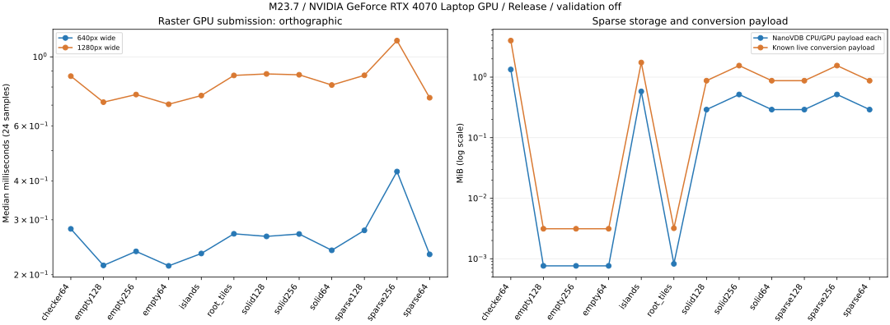

# M23.7 稀疏体素光栅基线

[0165 开发记录](../development/0165-voxel-raster-baseline.md)完成光栅阶段的质量、转换/上传、帧耗时、内存和 HDDA 调优评估。
最终三轮全部通过，输入、查询语义和重复画面摘要一致，资源回收至初始计数。M23 父阶段保持开放，下一阶段为原生路径底座 M23.8。

## 机器、输入与协议

Windows x64、AMD Ryzen 9 7940HX、RTX 4070 Laptop（报告 8188 MiB）、驱动 596.49；MSVC 19.51.36260.0 Release。
OpenVDB 12.0.1、NanoVDB 32.7.0、Slang 2026.18，固定 vcpkg 基线不变，无 CUDA/RT 要求。
源码基于 `41844ec74942d041604faf40911d76cd05a22e86` 加本阶段变更；[来源清单](data/2026-11-12-voxels/manifest.json)记录实际源码与程序 SHA-256。

矩阵 v1 共 12 输入：64³/128³/256³ 的空域、每 32 格一个 8³ 岛、实心 8³ tile；64³ 交错 leaf；
131072×8×8 包围域内两座 8³ 岛；两块相邻 4096³ 常量 root tile。
两个视口 640×480 / 1280×720，各自透视/正交，每轮 48 个视图。世界域映射到固定盒体，调色板固定为线性 RGB (0.125,0.5,1)，Unlit、曝光 1；完整生成器随代码版本化。
这里只测程序夹具和生产 OpenVDB→NanoVDB 转换、上传及离屏光栅，不计文件解码、资产缓存或 Editor GUI 成本。

最终测量协议 v2：每个独立进程先固定 64 帧 1280×720 设备预热，全部耗时保留；随后每视图首帧、2 帧预热、8 帧采样。
三轮串行，合并每视图 24 个采样，不剔除慢样本；p95 使用排序后的 nearest rank。
设备预热帧端到端合计为 3374.375 / 3431.939 / 2986.414 ms，含首次懒编译；设备/队列与显式 pipeline 创建成本另外保存。
每视图的 `cold` 标签表示该视图首帧，不表示重新创建了设备或全部 shader。

性能关闭 validation，GPU 原生时间戳必须 ready、完整且无 dropped zones；Tracy 未连接。
正确性另跑 required Khronos 与 synchronization validation，零错误/警告；只禁用无关 AMD implicit layer，不修改系统配置。
没有锁定 GPU 时钟；预热减少了本机首输入的慢态，保留全部原始区间和跨轮波动，不宣称跨机器稳定时限。

## 质量与生命周期

每输入/轮 1024 条固定射线，小域对独立 DenseGrid DDA，大域对解析盒体；hit/cell/value/face 一致，距离/法线沿用 M23.3 门槛。
GPU 旧转换与单轴优化逐射线数值相同，访问区域数相同；逐格消融使用同样 32 条射线，大域 t 上限明确为 4096。
三轮完整矩阵共 36864 条独立参考射线；每个小域视图抽查 1024 全尺寸颜色像素和 1024 深度像素，共各 122880 个样本。
深度沿用生产 65536 像素诊断限额，使用同投影/宽高比的 256 宽帧；阈值仍为颜色 1 byte、深度 2e-6。
反投影精确平行格面的双精度舍入残差按原正侧单元规则处理，计数并比较所有样本，没有扩大边缘遮罩。
既有 64³/640×480 全像素参考、混合 mesh 深度/HDR、寿命及 Editor/独立 capture 门禁亦通过。

每帧完整像素摘要重复一致；接受新上传时保留旧查询，完成后销毁旧帧、两代网格及 cache，再检查 VMA allocation 数/字节恢复。
所有用例和最终进程都通过回收检查，tracked CPU live allocations 为零。测试不只观察析构成功。

## 测量结论

最终 48 个视图的 GPU submission 中位数范围 **0.212–1.127 ms**，端到端中位数 **1.883–6.907 ms**；
各视图 GPU p95 最大 **1.249 ms**。这些是本矩阵离屏提交/等待/读回成本，不是 Editor 窗口 FPS 或复杂场景保证。
输入规模、分辨率、投影、CPU 提交、首帧和 p95 的完整对应关系见[生成表格](data/2026-11-12-voxels/summary.md)及[机器可读摘要](data/2026-11-12-voxels/summary.json)。



HDDA 工作量收益明确：大跨度局部区间由逐格 131104 区域降至 1504，root tile 由 131104 降至 64。
这是同射线区域访问数，不能直接当作整帧加速倍数。逐格消融的 GPU 原始单次区间也保留，但不作为经过相同预热的稳态速度结论。

本次单轴命中省去已知为空邻格的重复读取；边角仍走原外露面选择。
最终旧/新查询 GPU 中位比为 **0.996–1.010**，差异在约 1% 内，不宣称可靠提速。
[第一候选](data/2026-11-12-voxels/initial-candidate/summary.md)还含每次转换前的无跨格判断，root tile 比值 1.055，但多岛为 0.967；已去掉该额外判断。
第一候选与最终实现使用不同 shader 指纹，初版数据不混入最终汇总。

设备预热也有单独证据：[未做设备预热的最终算法](data/2026-11-12-voxels/unconditioned/summary.md)中，empty64 的 1280×720 GPU 时间跨轮从约 0.67 ms 变为 6–7 ms，
清屏、HDDA、合成、读回同时变慢。该现象与启动/设备状态相关，尚未由运行时频率追踪确定根因；保留数据并采用固定预热后重新采集，未将它归因于网格复杂度或删除异常样本。

## 内存口径与限制

报告分别记录源树、规范化树、NanoVDB CPU 字节、GPU 上传、palette、节点/tile 数、非零比例及 dense oracle 字节。
两块 root tile 覆盖 137438953472 个非零单元，NanoVDB 仅 864 bytes；checker64 的 NanoVDB 为 1402816 bytes。
源树/规范化树/NanoVDB 同时存活的已知 payload 单列；Windows 1 ms working set/private bytes 采样及 OS 生命周期峰值另列，包含运行时、分配器保留和前序用例影响。
这些样本是内部暂存峰值的观测下界，未认证 OpenVDB/TBB scratch 的精确峰值或进程 RSS 上限。

本矩阵观察到的旧帧+新帧 VMA allocation 最大 **90.87 MiB**，旧代查询+新代上传最大 **4.19 MiB**。
VMA allocation/block、device-local/host-visible 分别保存，后两者可能重叠，不能相加；该统计不覆盖驱动全部显存和编译器内存。
AS/AABB/SBT 标为不适用，原生路径资源将在 M23.8/9 及 M23.13 单独验收。
本阶段不包含跨厂商/跨平台性能认证、1280×720 以上视口、流式世界或 RT 路径，不由本基线推导 60 FPS 承诺。

## 复算

最终[第 0 轮](data/2026-11-12-voxels/round-0.json.gz)、[第 1 轮](data/2026-11-12-voxels/round-1.json.gz)、[第 2 轮](data/2026-11-12-voxels/round-2.json.gz)原始 JSON 以 gzip 无损归档，摘要保存其 SHA-256。
无需 GPU 即可复算表格；加 `--plot` 可生成 SVG/PNG，需要 matplotlib。采集和统计本身只依赖 Python 标准库。

```powershell
python scripts/benchmark-voxels.py --aggregate-only spec/benchmarks/data/2026-11-12-voxels/round-0.json.gz spec/benchmarks/data/2026-11-12-voxels/round-1.json.gz spec/benchmarks/data/2026-11-12-voxels/round-2.json.gz --output out/benchmarks/voxels-recomputed --plot
```

重新运行 GPU 矩阵见[体素指南](../guides/voxels.md#光栅质量与性能基线)。原始数据缺失、轮次/设备/指纹不匹配、计时/质量/回收失败或预热缺失时，聚合程序必须失败。
