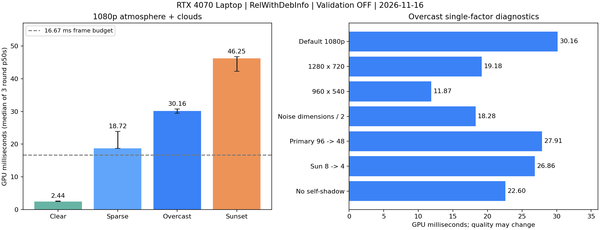
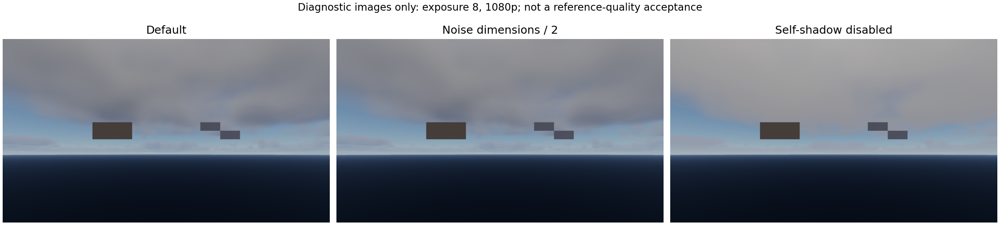

# 大气与体积云性能归因（2026-11-16）

**主要瓶颈是云的积分与重建，以及编辑器每次请求重新进行 33 帧细化。纯大气的稳定帧明显便宜；当前云是程序化密度场上的体积光照积分，并没有运行流体模拟。**

在 RTX 4070 Laptop GPU 上，1080p 静态 clear / sparse / overcast / sunset 的 GPU 总时间分别为 **2.44 / 18.72 / 30.16 / 46.25 ms**。厚云的半尺寸积分和全尺寸重建分别约占 52% 和 43%；三维纹理容量只有约 2.06 MiB，显存容量不是本场景的主要问题，但密集采样的成本很高。

本次只扩展诊断工具，**没有修改生产 shader、默认质量或编辑器调度**。质量降档是归因实验，尚未通过正式线性 HDR 质量验收。

## 证据与复现边界

- [逐轮汇总与输入](2026-11-16-environment-performance.json)、[原始证据包](2026-11-16-environment-evidence.zip)、[开发记录 0175](../development/0175-atmosphere-cloud-profiling.md)。证据包包含逐帧 JSON、manifest、日志、Tracy 轨迹/CSV、验证摘要、分析脚本及唯一图像；重复图像用摘要映射去重。
- Windows x64，AMD Ryzen 9 7940HX；NVIDIA GeForce RTX 4070 Laptop GPU / 8188 MiB，驱动 596.49；MSVC 19.51.36260.0，Slang 2026.18，RelWithDebInfo。被测父提交 `c5cc847575dd36face9d936757734031fe08c0d5`，工作区改动及实际源码/二进制 SHA256 在 manifest 中；没有升级依赖。
- 性能使用 validation OFF、Tracy 编译 OFF，原生 timestamp ON；厚云另有三轮 timestamp OFF 对照。正确性另跑 required GPU/synchronization validation。计时 period=1ns、validBits=64。
- 云：42 个独立进程，14 个条件 × 3 轮，轮换执行顺序。每模式取 20 稳态帧；combined 单列首帧、预热 32 帧，air/unlit 预热 5 帧。四种基线均含静态/运动、纯大气与 unlit 对照。每轮 p50/p95 使用 nearest-rank，表格报三轮中位数及轮间范围。
- 大气：18 个独立进程，3 预设 × 3 轮 × timestamp OFF/ON，普通模式各 40 稳态样本，物理参数更新每轮 3 样本。不能把该更新模式的 p95 当成可靠尾延迟估计。
- 编辑器：实际 `EnvironmentPreview` worker，`projects/demo` 默认相机及朝天空相机，1280×720，3 个独立进程。场景/构图不同于离屏基准，不能将它的最终帧时间与离屏厚云直接作同输入比较。没有启动可见窗口。
- 离屏端到端包含同步等待和 RGBA8 读回，不包含 GUI 上传/呈现、IPC、图片写盘。编辑器延迟包含 worker 请求到结果取得，但不包含 UI 最终显示。额外工作量诊断帧启用统计读回，放在计时和显存采样之后，不计入性能样本。
- 未锁定频率或清空系统/驱动缓存。云矩阵 500ms 周期的整卡遥测：显存 2068–2974 MiB、温度 60–91°C、graphics clock 210–2565MHz、功耗 5.06–151.9W、GPU busy 0–100%。这些包含进程启动、等待和其他桌面应用，不能解释为 shader 的 SM occupancy，也不能由它们单独判定热降频。轮间波动保留在表中，不删除慢轮次。

复现命令见[云基准指南](../guides/cloud-benchmark.md#性能归因与-tracy)。原始采集目录为 `out/benchmarks/environment-{cloud,atmosphere,editor}-20261116`，成功轨迹为 `out/benchmarks/environment-tracy-20261116-connected`。

## 稳态 GPU 与 CPU 成本

下表为云固定场景 1920×1080，单位 ms。GPU 总量为本帧新生成的 LUT、云影和帧 Submission 非重叠时间之和；CPU 端到端是 wall time，**其中包含等待 GPU，不是 CPU 忙时间**。

| 预设 | 静态 GPU p50 | p50 三轮范围 | 静态 GPU p95 | 运动 GPU p50 | 静态端到端 p50 |
|---|---:|---:|---:|---:|---:|
| clear / 零云 | 2.443 | 2.431–2.616 | 2.655 | 2.545 | 9.580 |
| sparse | 18.720 | 18.698–23.886 | 19.734 | 19.713 | 28.896 |
| overcast | 30.159 | 29.416–30.751 | 33.602 | 31.608 | 40.210 |
| sunset | 46.253 | 42.243–46.735 | 51.012 | 44.329 | 57.267 |

同一厚云进程中的 air-static 为 2.425ms，unlit-static 为 0.671ms。仅 GPU 时长，厚云约相当于 33fps、日落约 22fps 的预算上限；**不是编辑器实际 FPS**。独立 timestamp OFF 的厚云端到端 p50 为 40.085ms，ON 为 40.210ms，差约 0.3%；在本次噪声下没有观察到足以改变瓶颈排序的计时开销。

| GPU pass（静态，独立 p50） | sparse | overcast | sunset |
|---|---:|---:|---:|
| half resolution cloud transport | 8.373 | 15.529 | 20.118 |
| depth preserving cloud reconstruction | 9.433 | 12.968 | 24.462 |
| completed cloud history reprojection | 0.116 | 0.230 | 0.201 |
| tone mapping | 0.161 | 0.161 | 0.160 |
| readback（GPU copy） | 0.623 | 0.624 | 0.624 |

Pass 是父 Submission 的子区间，不能再次加到 GPU 总量；独立 p50/p95 相加也不是总量分位数。表中已足以看到积分/重建远大于历史混合、色调映射、几何和读回。

厚云 CPU 阶段 p50 分别为：extract 0.047、prepare 0.083、record/submit 1.554、wait 36.716、RGBA8 readback 1.627ms。等待占 wall time 的主体；它还受驱动调度/同步影响，不应把全部 wait 解释为 GPU shader 执行。

## 两种“分辨率”与采样质量

厚云静态、相同物理预设、相机、seed、曝光，每次只改变表中一个设置。噪声缩放同时缩放 weather/base/detail 三个场，属于一个统一质量设置；尚未隔离三个纹理各自的贡献。

| 诊断设置 | GPU p50 | p50 三轮范围 | p95 | 相对默认耗时减少 |
|---|---:|---:|---:|---:|
| 默认 1920×1080 | 30.159 | 29.416–30.751 | 33.602 | — |
| 输出 1280×720 | 19.184 | 16.939–19.228 | 20.868 | 36.4% |
| 输出 960×540 | 11.871 | 11.815–12.946 | 12.185 | 60.6% |
| weather 128²→64²、base 128³→64³、detail 32³→16³ | 18.281 | 17.649–19.758 | 22.157 | 39.4% |
| 配置主步数 96→48 | 27.908 | 25.213–28.546 | 29.411 | 7.5% |
| 配置太阳步数 8→4 | 26.861 | 25.545–26.933 | 28.336 | 10.9% |
| 关闭云自阴影 | 22.597 | 22.410–22.852 | 24.588 | 25.1% |

**输出尺寸有显著影响，但耗时不按像素数线性缩放。** 默认云已经以宽高各半积分，随后全分辨率重建；不同输出尺寸也会改变边缘覆盖和回退比例，还有固定准备/调度成本。

**噪声场缩小效果明显，但不是显存不足。** 场数据从 2,162,688 降至 274,432 bytes；CPU 首次生成从 284.486 降至 34.786ms。诊断帧的主步数只减少约 0.6%、直接密度采样只减少约 2.2%，GPU 却减少约 39%。这支持“小纹理改善重复采样局部性/访问成本”的推断；场的数值和空区分布同时发生变化，未采硬件 cache miss，因此不能宣称已经证明缓存是唯一原因。

**主步数减半不等于实际工作减半。** [联合积分实现](../../shaders/render/cloud-reconstruction.slang) 对云段采用 `max(configured_steps, min(256, ceil(segment_length/200)))`；步长超过 100m 又改为每步 4 次密度采样。诊断帧主步数从 174.20M 降至 102.13M，但直接密度采样只从 170.82M 降至 169.08M，因而提速有限。

太阳光透射嵌套调用 [cloudSunlightOptical](../../engine/render/clouds/shaders/CloudTransport.slang)，低太阳角度还有最低 32 步。配置的 8→4 并不能把所有太阳射线减半。默认优化路径使用大气透射 LUT；昂贵的逐点空气积分主要属于 reference 路径，不应归因给本次默认模式。

厚云一次诊断帧的半尺寸像素为 518,400，全尺寸回退 210,513（全图约 10.15%），其余重建 1,863,087；历史接受 272,251（半尺寸约 52.52%）。重建 pass 对边缘/太阳盘/深度不匹配等像素重新执行完整积分，且包含邻域检查，所以不是便宜的图像缩放。上述单帧计数发生在稳态之后，不是20帧平均值。

`cloud_lighting_steps=18.05M` 实际表示进入云光照计算的主采样点数量，**不计内层太阳采样次数**；`density_samples=170.82M` 只计主射线直接密度采样，不含自阴影密度查询。关闭自阴影后这些计数可以不变，GPU 时间仍会下降，不能误读为开关无效。全局统计原子操作亦存在于生产 shader 中，本次没有独立测定其成本。

运动厚云的地面云影对照：默认 31.608ms，关闭 30.313ms，云影尺寸 256²→128² 为 30.263ms，云影步数 256→64 为 29.395ms。最后一项 p95 为39.261ms且有明显轮间波动；这些小收益不能按精确比例外推。地面云影不是本场景最大的 GPU 热点。

同一条件的三轮图像 SHA256 一致。相对默认厚云，缩小场纹理的 LDR RGB 平均绝对差为 0.00233，关闭自阴影为 0.03567（归一化到0–1）。曝光/色调映射会隐藏 HDR 差异；这仅证明图像发生变化，**不能替代太阳盘、透射、动态历史和线性参考验收**。

## 大气：稳定帧与参数更新不同

独立大气场景也为1080p，表中帧 GPU、LUT GPU 是分别统计的 p50，不把分位数之和冒充总体分位数。

| 预设 | 静态帧 GPU | 更新天空时帧 GPU / LUT GPU | 改物理参数时 LUT GPU | 物理更新端到端 |
|---|---:|---:|---:|---:|
| noon | 2.786 | 2.188 / 0.116 | 25.643 | 37.575 |
| sunset | 2.941 | 2.633 / 0.117 | 25.649 | 38.297 |
| high-altitude | 2.038 | 1.739 / 0.103 | 25.626 | 37.518 |

常规相机/天空更新便宜；使 Transmittance / Multiple Scattering 等物理 LUT 失效的参数更新，需要额外约25.6ms GPU和同步准备，表现为参数变化时的顿挫。它与每帧云积分的30–46ms是不同成本。静态与运动的差异也含频率/顺序噪声，不能推断“移动比静止总是更快”。

## CPU 初始化、显存与编辑器延迟

厚云进程三轮中位初始化：设备/队列461.113ms，程序/几何1384.916ms，CPU场生成284.486ms，纹理上传wall 0.871ms；首个计时帧另需1257.232ms，其中record/submit 1082.817ms，包含懒编译/管线准备。上述是冷路径，不是每帧重新生成噪声或做流体模拟。

| 1080p 厚云 VMA 采样状态 | allocation 总量 | device-local | host-visible | VMA 保留 block 总量 |
|---|---:|---:|---:|---:|
| 帧释放后，仅缓存/历史 | 31.238 MiB | 31.110 MiB | 0.128 MiB | 160.000 MiB |
| 保留旧 Frame，同时有下一帧在途 | 263.623 MiB | 247.673 MiB | 15.949 MiB | 320.312 MiB |

这些是整个探针渲染域的采样值，包含程序/几何，不是纯云纹理，也不是设备全部使用量。各内存属性可重叠，不应将 device-local 和 host-visible 普遍相加。保留 block 不等于活资源；峰值只是明确采样时刻，不覆盖驱动私有分配及所有瞬时峰值。CPU受跟踪 heap 峰值14.70MiB，包含额外诊断，不是进程RSS。所有进程退出前检查GPU分配数回到初始值、CPU活分配为零。

缩小噪声场只令在途 device-local 由247.673降至245.853MiB，说明全尺寸/半尺寸浮点帧资源和历史比噪声纹理占用大得多。若优化显存，应先审查临时图像生命周期、跨帧复用和历史数量；本次没有测量实际硬件带宽或寄存器占用。

编辑器测量遵循既有真实worker流程：首次clear随后sparse、overcast，再朝天空；第一种云需要懒编译，后续预设已热身。重复请求每进程各3次，共9样本，以下为合并样本中位数；单次预设每进程1次，共3样本，不与云基准的分位统计混用。

| 编辑器1280×720条件 | 首次结果 | 完整结果 | 最后一个帧 GPU | 发布次数 |
|---|---:|---:|---:|---:|
| 进程首次clear | 3175.479ms | 3175.487ms | 5.786ms | 1 |
| clear重复请求 | 29.179ms | 29.186ms | 5.731ms | 1 |
| 首次sparse（首次云路径） | 1128.910ms | 1705.083ms | 3.097ms | 9 |
| sparse重复请求 | 29.855ms | 466.390ms | 2.805ms | 9 |
| overcast重复请求 | 30.095ms | 463.786ms | 2.832ms | 9 |
| 朝天空overcast（已热身） | 27.944ms | 666.445ms | 7.603ms | 9 |

[EnvironmentPreview](../../engine/editor/src/EnvironmentPreview.cpp) 每次接受新请求释放该view的历史，非零云设`warmup_frames=32`并执行0..32共33帧，每4帧及末帧发布，逐帧同步等待。即使最后单帧只要数毫秒，重新细化也要约半秒。这里的“32”是额外预热帧，不是总帧数；不能把最终帧 GPU 时间乘33当成实测总 GPU 时间。

此 worker 的厚云 device-local 采样为134.111MiB，与1080p离屏探针的场景、尺寸及Frame保活方式不同。最近的默认最大化会增加屏幕工作量，源码环境viewport上限1600×1200；本次worker只测1280×720，未宣称完成全部最大化桌面布局的实测。

## Tracy 的实际价值与限制

已有接入可用。用`windows-graphics-profiling`构建实际cloud benchmark，Tracy0.14.1连接本地TCP采集，得到**518 GPU zones、2059 CPU zones**。逐个匹配**431个计时原生GPU叶pass**，与Tracy时间误差不超过2ns。原始`cloud.tracy`约94KiB，和导出的CPU/GPU CSV一并归档。

该轨迹中16次`Shader.compile`累计2160.856ms，`CloudBenchmark.field_prepare`263.015ms；61次`graphics.wait`累计2379.855ms，62次`graphics.submit`累计仅4.333ms。Tracy可以明确区分首次编译、一次性场生成、提交、等待和各GPU pass，并通过submission编号关联。CPU区间可能嵌套，累计值不能简单相加解释为总时间。

正式性能矩阵没有编译Tracy；连接轨迹单独采集，用于归因。单次连接运行稳态GPU中位数约33.6ms，不能和三轮OFF基线直接相减并声称是Tracy开销；本次没有完成锁频、交错采集的Tracy ON/OFF开销实验。native timestamp开销的OFF/ON对照则已经完成。

普通构建中Tracy宏关闭，打开Tracy程序不会自动得到数据。当前轨迹没有开启内存分配追踪；显存证据来自VMA。Tracy提供时间线，不提供真实warp occupancy、寄存器压力、L1/L2命中率、texture吞吐。本次没有运行Nsight等硬件计数器工具，因此这些只能列为下一步归因问题。

## 按实测排序的优化方向

1. **编辑器请求与历史复用**：为连续相机/参数变化保留可验证的完成历史，避免每次固定重跑33帧；采用交互时预算、停止交互后渐进细化，复用资源并减少同步/CPU读回。验收首图/完整延迟、陈旧结果丢弃、反遮挡和历史污染。
2. **云全尺寸回退与积分预算**：减少约10%回退像素触发的昂贵重复工作，改进边缘分类/分级采样或稀疏更新；同时审查联合空气积分、4倍密度采样触发和低太阳32步下限。必须保留太阳盘、透射和几何边缘误差阈值。
3. **提供明确质量档和动态尺寸**：720p/540p及小场纹理都有实测收益。先完成线性HDR/运动质量对照，再选择交互档默认；不直接把低档替换现有高质量参数。
4. **密度与光照查询复用**：分别测weather/base/detail缩放、纹理格式/缓存行为，考虑预计算太阳透射或分层空区跳跃。用硬件计数器区分带宽、cache和ALU，不仅凭纹理大小推断。
5. **冷启动与LUT更新**：缓存已编译shader/pipeline，异步准备物理LUT、保留最后完成代次；CPU噪声生成并非稳态热点，但首次约285ms可后台处理。先证明缓存失效键和失败保护正确。

仅降低地面云影质量、优化色调映射或减少命令提交本身，无法解决当前最大热点。下一阶段应以**同质量下的GPU积分/重建时间、编辑器请求延迟、显存活资源**分别验收，避免只改善其中一个指标就宣称整体流畅。

## 验证状态

通过：大气/云聚合契约、required GPU/sync基准验证、profiling构建的云GPU验证、编辑器worker GPU验证、自定义低档参数GPU/sync验证、超预算与profiling-OFF采集拒绝；42云+18大气性能进程、3编辑器进程、1成功Tracy采集，输出均检查诊断与资源释放。

保留失败证据：首次编译参数名冲突、首次统计读回未开启diagnostics，均修复后定向重验通过；Tracy第一次在沙箱内本地TCP连接超时，结束进程并保留日志，允许本地TCP后采集成功。没有自动重试或丢弃性能矩阵轮次。

未运行：完整质量参考集、完整引擎回归、实际GUI最大化交互帧率、路径追踪Scene媒体性能、硬件occupancy/cache分析。生产渲染代码未变，本次结论主要针对光栅大气/体积云与对应worker。
