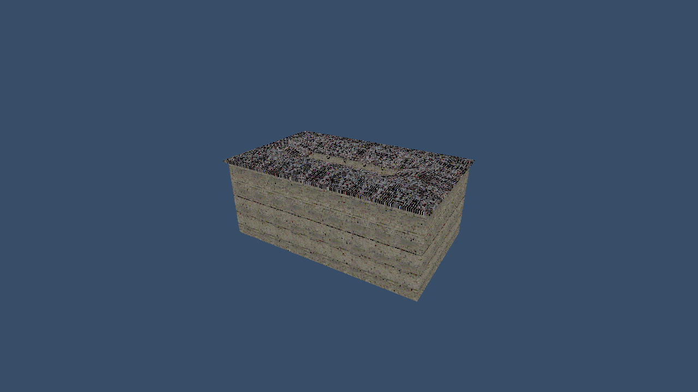
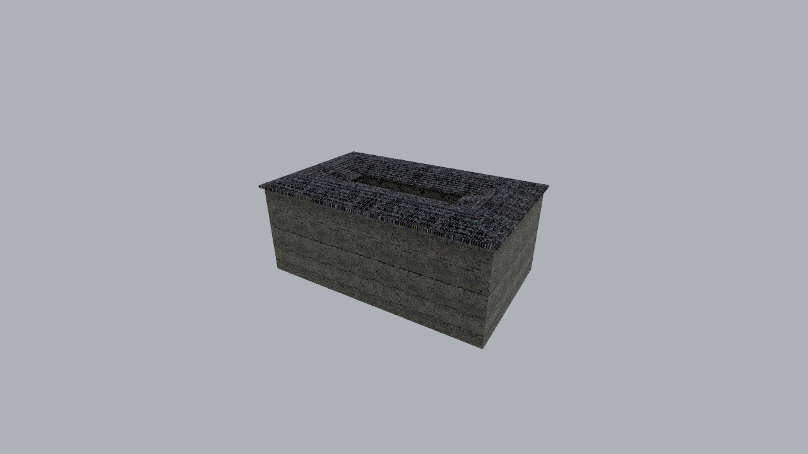

# OpenVDB 网格体素化：Sponza 实测

[0172 开发记录](../development/0172-mesh-voxelization.md)对应本次扩展。转换与双后端真实 GPU 测试完成；原始输入保持不变，全部九轮通过。

## 输入与测量口径

本地 `projects/demo/assets/gltf/Sponza/glTF/Sponza.gltf`，262267 个三角形，unit-scale 0.008；按最长轴 64/128/256 生成表面壳，UV0 基础颜色与 Alpha MASK，4 bit/通道线性调色板。输出空腔不填充；不展开 node 层级、不烘焙法线/发光/金属粗糙贴图。

Windows x64、MSVC 19.51.36260.0 Release、OpenVDB 12.0.1#0 / NanoVDB 32.7.0、Slang 2026.18；NVIDIA GeForce RTX 4070 Laptop GPU，驱动 596.49。没有 CUDA 依赖。源码基于 `e414e07ad49194b985354f39d7d42fe43bdf99f3` 加本次变更，见[来源清单](data/2026-11-16-sponza-voxels/manifest.json)。

每档三个独立转换进程和 GPU 进程，串行执行，性能关闭 validation；128 短测和 256 完整长测另开 required validation。文件资产归一化并旋转为固定外部视角；两分辨率、透视/正交均用同一网格与相机。每进程先 1280×720 路径预热 32 spp，再为每视图保存首帧、2 预热、8 个稳定阶段样本，最终 11 spp；三轮合并每行 24 样本，不删慢样本，p95 为 nearest-rank。预热标签不保证 GPU 时钟恒定。

光栅为 Unlit（包含 HDDA、深度/HDR 合成、tone 与读回的 submission 时间）。原生路径为 metallic-roughness、Classic MIS、最多 4 次反弹、RR 从第 3 次、seed 2313、常量环境 (0.7,0.8,0.9)、无太阳/介质；路径 GPU 时间为增加 1 spp 的完整 epoch，tone/最终线性读回另记。两列画质与工作量不同，不能直接比较同画质速度或换算 Editor FPS。CPU 墙钟和逐提交数据均保留在原始 JSON。

## CPU 转换与存储

转换本身包含 OpenVDB 距离场、颜色/占用烘焙及 VDB 序列化；链路时间额外包含 glTF 导入、NanoVDB 编译和工程准备，止于最终发布前。三轮取均值。进程峰值覆盖整个 CPU 进程，用 1 ms PSAPI 采样及进程生命周期峰值观测；不是 OpenVDB scratch 精确上限。

| 最长轴 | 占用格数 | 调色板 | 转换 ms | 链路 ms | NanoVDB MiB | 同域稠密 Int32 MiB | 进程工作集峰值 MiB |
| --- | --- | --- | --- | --- | --- | --- | --- |
| 64 | 39276 | 109 | 143.95 | 671.38 | 1.902 | 0.299 | 218.7 |
| 128 | 164916 | 153 | 237.60 | 801.86 | 4.170 | 2.209 | 248.5 |
| 256 | 802223 | 187 | 659.10 | 1352.50 | 15.165 | 17.057 | 343.3 |

同域稠密列只计算完整有限 domain 的 Int32 数组载荷，没有实际分配或把它用于本次 GPU 渲染。小网格的树层级开销较大：64/128 的 NanoVDB 比该数组更大，不能把稀疏格式等同必然省内存；256 时两者接近。NanoVDB 不包含 AS、图像、descriptor、驱动和其他缓冲。

| 最长轴 | OpenVDB 距离 ms | 烘焙 ms | Nano 编译 ms | 上传 GPU ms | AS GPU ms | AS storage KiB |
| --- | --- | --- | --- | --- | --- | --- |
| 64 | 104.55 | 18.84 | 120.85 | 0.601 | 0.988 | 11.88 |
| 128 | 139.08 | 69.69 | 152.32 | 0.655 | 0.664 | 51.38 |
| 256 | 268.41 | 320.31 | 266.12 | 4.706 | 1.643 | 242.62 |

## GPU 时间

各格为中位数 / p95，单位 ms。设备未锁频，部分视图波动明显，尤其 64/128 的短任务；完整范围和墙钟时间见[摘要 JSON](data/2026-11-16-sponza-voxels/summary.json)。

| 最长轴 | 图像 | 投影 | 光栅 GPU ms | 路径 GPU ms / 增量 spp |
| --- | --- | --- | --- | --- |
| 64 | 640×480 | 透视 | 0.240 / 0.554 | 3.582 / 13.257 |
| 64 | 640×480 | 正交 | 0.278 / 0.556 | 6.600 / 13.091 |
| 64 | 1280×720 | 透视 | 0.764 / 1.741 | 6.592 / 11.176 |
| 64 | 1280×720 | 正交 | 0.802 / 0.925 | 8.860 / 12.730 |
| 128 | 640×480 | 透视 | 0.257 / 0.562 | 12.911 / 33.462 |
| 128 | 640×480 | 正交 | 0.274 / 0.322 | 13.504 / 18.717 |
| 128 | 1280×720 | 透视 | 0.725 / 0.736 | 11.832 / 13.147 |
| 128 | 1280×720 | 正交 | 0.824 / 0.865 | 27.368 / 29.850 |
| 256 | 640×480 | 透视 | 0.641 / 1.174 | 24.911 / 37.855 |
| 256 | 640×480 | 正交 | 0.281 / 0.379 | 36.981 / 45.738 |
| 256 | 1280×720 | 透视 | 0.708 / 0.742 | 35.292 / 43.313 |
| 256 | 1280×720 | 正交 | 0.860 / 1.280 | 78.734 / 97.152 |

本次外部视角下，增大体素分辨率对光栅时间影响较小，而原生多反弹路径明显变慢；并不证明相机进入建筑、其他材质/光照或更高采样数具有相同表现。128 可用于快速检查，256 保留更多几何细节；这些是本机输入的观测。

## 正确性与显示证据

128 短测及 256 完整长测 Vulkan validation 错误/警告均为 0；各进程释放资源后 VMA 计数/字节恢复、tracked CPU allocations 为零。每档三轮 NanoVDB 内容 hash 一致、重复光栅 checksum 一致，路径输出有限非负。源 glTF/外部 buffer/贴图 SHA-256 前后不变。

Sponza 本身没有独立逐像素正确图像参考；使用小规模解析/稠密与原生数值门禁保证基础求交，再检查文件输入稳定性和资源。真实 256 输入暴露两类 HDDA 浮点问题，均有解析盒最小用例证明旧代码失败、最终代码通过；最终 compute、原生数值/光照/状态与 GUI/capture 共 5 项全部通过。全部失败阶段和复验入口保存在开发记录，不纳入性能均值。

256 透视光栅 Unlit：



同视图 11 spp 路径结果仍有 Monte Carlo 噪声；纹理量化和有限分辨率表面壳也会丢失细节：



## 复现与范围

```powershell
$env:DISABLE_LAYER_AMD_SWITCHABLE_GRAPHICS_1='1'
python scripts/benchmark-mesh-voxels.py --assetc out/build/windows-voxel-editor/bin/Release/dk-assetc.exe --benchmark out/build/windows-voxel-editor/bin/Release/dk-voxel-joint-benchmark.exe --output out/sponza-benchmark-new
```

输出目录必须尚不存在。脚本要求本地 Sponza glTF 及依赖齐全；独立 CLI 另支持 GLB，见[命令参考](../commands/assetc.md)。本报告不认证 512、任意场景、内部视角、实时交互 FPS、ReSTIR/介质或其他设备的性能。

[转换原始数据](data/2026-11-16-sponza-voxels/conversion.json.gz)、[128 validation](data/2026-11-16-sponza-voxels/validation-128.json.gz)、[256 validation](data/2026-11-16-sponza-voxels/validation-256.json.gz)；各轮 `64/128/256-r0/r1/r2.json.gz` 与校验和在来源清单中。性能输出工程保留在本机 out，未将原始 Sponza 或生成 VDB 资产加入版本库。
