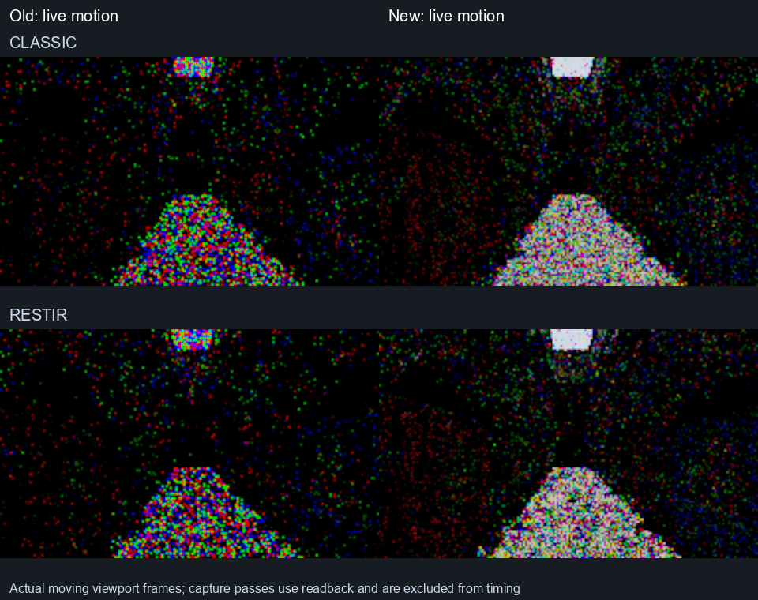
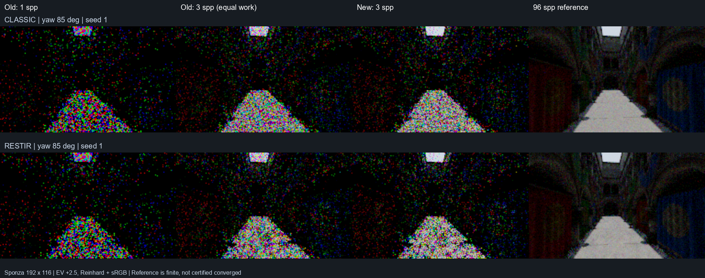

# Sponza Scene media 移动预览实测（2026-11-17）

对应[0181开发记录](../development/0181-media-preview-color.md)。验证对象为sampler3、每批3 spp和等待完整预览后合并相机请求的策略。

实测结论：天空开口的RGB花斑明显减少，受光地面与间接光区域仍有大量彩色噪点，不能视为已经解决Sponza运动花屏。192×116预览的输入交付中位数保持约30–31ms，稀疏云/ReSTIR更新率下降约9.8%，停动后首个全尺寸批次增加约111ms。本次未继续修改积分器或加入降噪。

## 运动结果

24个性能进程：2天气×2算法×2策略×3轮，全部完成。箭头为旧→新，每列为三轮对应统计的中位数。

| 天气 / 算法 | 新视角更新 / 秒 | 输入交付p50 / ms | 输入交付p95 / ms | 停动至全尺寸 / ms |
| --- | --- | --- | --- | --- |
| 无云 / Classic MIS | 79.30 → 77.27 | 30.36 → 30.51 | 36.43 → 36.42 | 273.60 → 290.74 |
| 无云 / ReSTIR DI | 78.94 → 78.29 | 30.30 → 30.21 | 36.17 → 36.31 | 326.78 → 402.12 |
| 稀疏云 / Classic MIS | 78.60 → 75.13 | 30.34 → 30.75 | 36.37 → 37.37 | 273.76 → 329.19 |
| 稀疏云 / ReSTIR DI | 78.13 → 70.50 | 30.31 → 30.50 | 36.32 → 36.65 | 317.39 → 428.53 |

GUI帧间隔p50约6.05–6.11ms、p95约6.54–7.63ms；这不是完整光追图像的帧率。worker请求至交付p50约17.95–18.32ms，其余输入延迟包含事件/GUI周期。新策略的下一全尺寸累积批次在停动后约364/583/433/637ms完成（按表格顺序）。正常冷准备首张图无云约7.4–7.6秒、稀疏云约11.1–11.7秒，不计入稳态延迟。

实际运动发布的旧Classic主要为1/2 spp，新Classic为3/6 spp；新ReSTIR均为3 spp。逐帧数据完整保留，没有删弃慢帧。百分比变化不能外推到其他设备、轨迹、分辨率或复杂介质。



## 颜色结果

32张固定相机线性图像全部完成。以下为2机位×2 seed均值；色度指标的共同有效区域只占图像约13%，因此同时列出全图RGB误差与正辐亮度覆盖率。

| 算法 / 策略 | 色度RMSE | 单通道主导 / % | 全图相对RGB RMSE | 正辐亮度像素 / % |
| --- | --- | --- | --- | --- |
| Classic / 旧1 spp | 0.853 | 100.00 | 1.876 | 15.85 |
| Classic / 旧3 spp | 0.733 | 59.60 | 1.082 | 32.99 |
| Classic / 新3 spp | 0.634 | 46.28 | 0.702 | 33.02 |
| ReSTIR / 旧1 spp | 0.852 | 100.00 | 1.931 | 15.21 |
| ReSTIR / 旧3 spp | 0.730 | 59.41 | 1.117 | 31.31 |
| ReSTIR / 新3 spp | 0.634 | 48.23 | 0.743 | 31.38 |

共同有效区域色度误差比旧1 spp降低约25.6%，等样本旧3 spp对照降低约13.1–13.5%；但该区域仍有46–48%的像素被单通道主导。新3 spp整图约67–69%像素尚无正辐亮度贡献，间接光收敛仍不足。图像上最清楚的改善是天空开口恢复白色，地面和暗部尚不能稳定显示正常材质颜色。96 spp也不是无噪声真值。



## 方法与范围

- RTX 4070 Laptop / 8188 MiB / 驱动596.49，`windows-voxel-editor` Release；完整demo Sponza glTF、纹理与材质。自动化使用`--background`，正常最大化窗口，未改为小型夹具。
- 同一可执行文件的显式验收开关复现旧sampler2、batch1及100ms替换策略；当前侧为sampler3、batch3、完成后合并。这是同程序策略A/B，不是两个历史二进制比较。旧策略与0912270父提交的调度代码核对。
- 实际视口1629×989，连续移动长边192、实际192×116；target64、seed1、4反弹/RR3、EV+2.5、time17；ReSTIR为8候选、temporal/spatial开启。分别运行clear和sparse环境，环境完整快照与资产摘要随原始证据保存。
- 相机eye=(8,1.8,0)，初始yaw90°、pitch=-0.954841°、FOV65°。通过真实SDL事件队列注入右键Fly相对鼠标，正弦位移幅度30像素、周期2秒，约±5.16°水平转动。先完成全分辨率冷启动，再运动预热2秒，计时6秒，最后释放右键并等待全尺寸首批和下一累积批。
- 每种算法/天气新旧各3轮，轮次交错顺序old/new、new/old、old/new，所有GPU进程串行。计时禁用validation与图像读回；required Vulkan/Khronos及同步validation单独运行。未锁GPU频率或电源档位，结果限于本机与这条轨迹。
- 输入延迟从SDL事件入队到包含该相机图像的GUI GPU提交完成，包含事件消费、相机合并、worker、图像导入及GUI提交；不包含显示器扫描输出。请求延迟另从worker请求计起。完整新视角更新率与GUI帧率分别统计；重复显示旧图不算新预览。表中p50、p95与速率均取三轮各自统计的中位数，不把所有帧混池。
- 停动恢复为释放右键到全尺寸第一批完成，包含现有200ms停动判定。新侧首批3 spp，旧侧1 spp，因此这一项不是同质量的耗时对比。运动时worker可能在GUI取图前完成额外一批，逐帧实际spp保存在原始记录。

## 图像与颜色指标

真实窗口另外运行图像读回轮次，保留运动帧的线性RGB与来源，不把这些轮次纳入性能统计。图示采用EV+2.5、Reinhard、线性RGBA8量化/双线性放大后sRGB编码，便于查看低分辨率图像。

固定相机质量采集在相同Sponza/clear下，对yaw85°/95°与seed1/17分别比较旧1 spp、旧3 spp、新3 spp及96 spp参考。固定相机使用near1m；真实窗口自动near为0.05m。该质量实验用于同机位的新旧对照，不声称与运动帧逐像素相同。各质量模式显式reset，避免跨案例残留ReSTIR历史；运动轮次则保留正常运行的历史策略。

颜色指标先选参考RGB总和>1e-5、最大通道占比<0.8的像素，再取旧1/旧3/新3图像RGB总和都>1e-5的交集。零辐亮度没有定义的色度；共同有效区域避免把大片黑像素记为低彩噪。令c=RGB/sum(RGB)，报告相对96 spp参考的sqrt(mean(sum((c-c_ref)^2)))，另报最大通道占比>0.95的百分比。共同有效区域占整图Classic 13.28%、ReSTIR 12.74%；不能将其改善率当作整图比例。

全图相对RGB RMSE=sqrt(sum((I-R)^2)/sum(R^2))，同时包含亮度与颜色误差；正辐亮度覆盖为RGB总和>1e-5的整图比例。四组机位/seed分别计算后取均值。

96 spp为有限样本代理，和低样本使用相同seed的部分随机流，不是独立真值或收敛认证；指标不能替代亮度误差、时间闪烁或全场景画质评估。旧3 spp是等样本工作量对照，可区分增加样本数与RGB分层本身的作用。

## 复现

```powershell
python scripts/benchmark-media-preview.py `
  --editor out/build/windows-voxel-editor/bin/Release/dk-editor.exe `
  --worker out/build/windows-voxel-editor/bin/Release/dk-editor-render-benchmark.exe `
  --project projects/demo --output out/benchmarks/20261117-media-preview `
  --mode all --seconds 6 --rounds 3
python scripts/summarize-media-preview.py out/benchmarks/20261117-media-preview `
  --output out/benchmarks/20261117-media-preview/summary
```

输出目录须未存在。`--mode validate/performance/images/color`可分开运行；validate自动使用唯一子目录。只对子进程禁用既有AMD switchable隐式层。验收入口要求一次性工程上的`.dk-editor-smoke`及显式JSON配置，普通GUI与公开设置不暴露旧策略。

## 验证与限制

已完成定向构建和Sponza真实窗口required validation验收：1/1通过，0失败/跳过，Vulkan错误/警告及退出live allocations均为0，见[构建验证](../../out/verify/20261117-144742-4cacf776/summary.json)。完整脚本共31个串行进程全部通过：1个独立validation、24个性能、4个真实运动取图、2个固定机位质量进程。质量与性能轮次关闭validation，不把它们记为验证层检查。

既有ReSTIR worker与media GUI/capture回归2/2通过，见[回归验证](../../out/verify/20261117-150028-1b3bb6c1/summary.json)。聚合读取全部32张质量图像并检查有限非负，44张总采集图像均保留；默认策略的测试没有启用旧采样器。

逐轮汇总与完整指标见[结构化报告](2026-11-17-media-preview.json)，原始帧、线性RGB、输入快照、测量源码/二进制SHA及验证日志见[证据包](2026-11-17-media-preview.raw.zip)。证据包不含Sponza外部资产或可执行文件；资产逐文件SHA在manifest中。解压后将`matrix`目录传给包内`source/scripts/summarize-media-preview.py`可复算，依赖NumPy与Pillow。源码保存实际测量字节；Git可能规范化换行。

证据包927份文件全部通过逐项SHA-256和ZIP完整性校验；已独立解压并运行归档聚合器，性能/质量数值及两张PNG均与归档输出完全一致。

未执行全引擎、Debug、其他GPU、手动主观延迟盲测、显示器光子延迟或高分辨率长期收敛验证。这里恢复的是完整尺寸的首批，不是64 spp最终收敛。使用版本化demo与clear/sparse预设，没有用户截图中未保存环境状态，不能声称完全复现截图的光照与机位。

实测说明低spp下需要进一步处理路径/光照采样方差，或单独设计交互重投影/降噪，才能让地面和暗部更稳定；单纯完成RGB覆盖不足。该后续方案尚未实现或验证。
