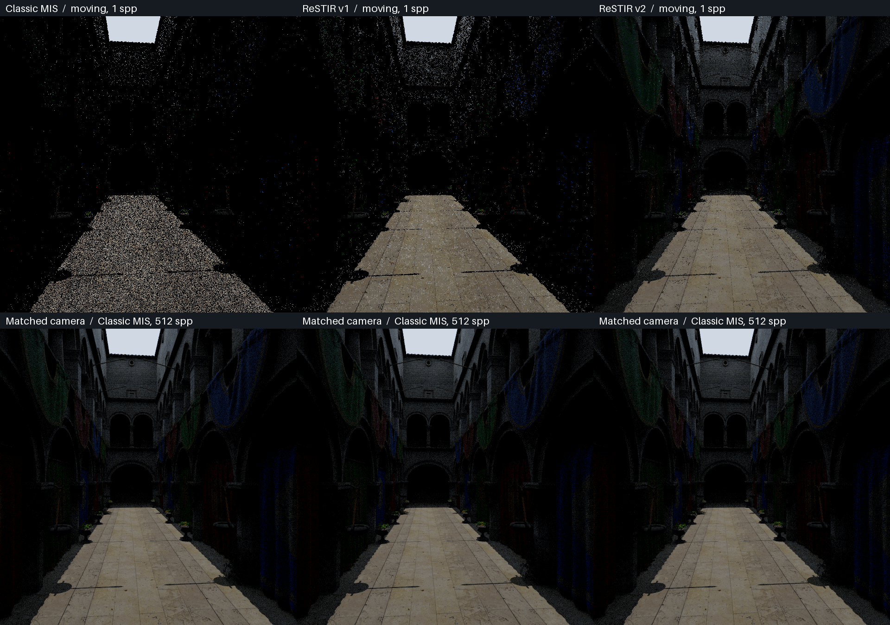

# Sponza 移动视角下的 RGB 表面直接光

2026-11-17 在 RTX 4070 Laptop GPU（8188 MiB，驱动 596.49）上采集，2026-11-19 复算。640×640 的三个运动机位中，ReSTIR v2 相对 v1 的线性 RGB 归一化误差降低 36.6%，显示色度误差降低 30.5%。两者在此尺寸均约每秒交付 41 个新视角。原生 1629×989 下，v2 每秒交付 15.5 个新视角，输入延迟中位数为 84.6 ms。

## 移动画质

每种算法采集三张 640×640 的真实窗口运动帧，每张为 1 spp，比较对象为逐帧重放相机的 512 spp Classic MIS。表中为三帧指标的算术平均。各算法跟随同一输入轨迹，实际交付时刻有差异，因此分别匹配参考机位。

| 算法 | 线性 RGB NRMSE | 显示 RGB RMSE | 显示色度 RMSE |
| --- | ---: | ---: | ---: |
| Classic MIS | 0.3893 | 0.1434 | 0.01657 |
| ReSTIR v1 | 0.1520 | 0.0757 | 0.01414 |
| ReSTIR v2 | 0.0964 | 0.0435 | 0.00982 |

上排从左至右为 Classic、v1、v2 的第二张运动帧，下排为各自机位的 512 spp 参考。暗部仍可见残余噪声。v2 三帧的采样历史分别从 epoch 33、41、51 开始。



线性 NRMSE 为 RGB 误差平方和与参考平方和之比的平方根。显示指标统一使用 EV +2.5、Reinhard 和 sRGB 编码。色度误差在每个像素的三个通道误差中减去该像素的平均通道误差，以排除共同亮度偏移。运动图用 seed 1，参考图用 seed 104730。256 spp 和 512 spp 参考共用前 256 个样本，两者的线性 NRMSE 为 0.0170–0.0172。该差值描述参考随样本数的变化。单条轨迹、单个运动 seed 和三帧取样只支持描述性画质比较；时间闪烁和原生分辨率画质未单独量化。

## 交互性能

每格为三轮各自统计的中位数。新视角更新率只统计实际交付的新相机画面。延迟从 SDL 输入入队计至 GUI 的 GPU 提交完成，显示器扫描输出在计时范围之外。时间复用率按每张图接受时间来源的次数除以像素数与 spp 的乘积，再按帧平均，分母包含背景、拒绝和过期样本。

| 分辨率 | 算法 | 新视角/秒 | 输入 P50 / ms | 输入 P95 / ms | 停动至当前视角 / ms | 时间复用率 |
| --- | --- | ---: | ---: | ---: | ---: | ---: |
| 640×640 | Classic MIS | 68.16 | 30.71 | 37.01 | 30.42 | — |
| 640×640 | ReSTIR v1 | 41.13 | 42.36 | 42.90 | 36.66 | 68.7% |
| 640×640 | ReSTIR v2 | 40.96 | 42.54 | 43.30 | 30.61 | 93.1% |
| 1629×989 | Classic MIS | 39.50 | 42.38 | 48.74 | 40.93 | — |
| 1629×989 | ReSTIR v1 | 16.17 | 81.45 | 88.05 | 93.71 | 77.0% |
| 1629×989 | ReSTIR v2 | 15.50 | 84.60 | 91.79 | 71.84 | 95.3% |

在原生尺寸，v2 相对 v1 的更新率下降 4.1%，输入 P50 增加 3.2 ms。640×640 的三张 v2 运动帧每张记录约 157–162 万条 ReSTIR 可见性射线，v1 每张约 40 万条。时间复用率表示通过接收点筛选并进入合并的比例，遮挡和权重仍决定所选光样本的实际贡献。

## 采集与复现

- 使用 Release 构建、demo Sponza、clear 环境、Surface only、完整 RGB、一个反弹。太阳与环境共同照明，未加入间接光、介质或降噪。两个 ReSTIR 模式均为 32 候选并开启时空复用，v1 由验收探针选择。
- 固定运动分辨率，使用正常后台窗口和 SDL 相对鼠标输入。相机初始位置为 (8, 1.8, 0)，水平朝向 90°，FOV 65°。水平转动周期两秒，预热至少两秒及 20 个已交付相机更新，之后各轮计时六秒。三种算法交错串行运行，计时中关闭 validation 和线性图像读回。
- 单独运行 v2 Vulkan/同步 validation 和三个带读回的质量进程。原始目录 `out/restir-direct-sponza-20261117` 内含 18 轮性能记录、运动图和相机、参考 RGB32F、场景文件摘要与执行日志。正式参考位于 manifest 的 `references` 字段指定目录。采集时 renderer、editor、demo 输入与复核时的对应摘要一致。
- 设备未锁频。这组结果涵盖 Sponza 的相机运动及静态几何，Scene media 的体积散射、多次反弹和论文多灯场景需要各自的测量。

```powershell
python scripts/benchmark-restir-direct.py --editor out/build/windows-voxel-editor/bin/Release/dk-editor.exe --worker out/build/windows-voxel-editor/bin/Release/dk-editor-render-benchmark.exe --project projects/demo --output out/restir-direct-repeat --mode all
python scripts/summarize-restir-direct.py out/restir-direct-repeat --output out/restir-direct-repeat/summary
```

逐轮统计、逐图误差与来源见[机器可读结果](2026-11-17-restir-direct.json)。实现与回归证据见[开发记录 0182](../development/0182-restir-surface-direct.md)。
