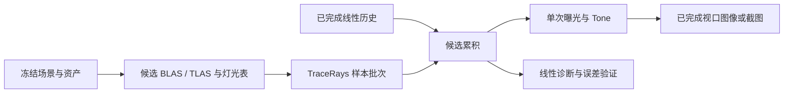

# 渐进式路径追踪管线设计

编辑器worker在tile提交后以≤1ms的GPU完成票据等待推进，不在每块间固定sleep；GUI不等待该票据。
更快的提交调度保持tile≤64、batch=1和原样本序号、累积、取消与1GiB预算；性能证据见[0122](../development/0122-editor-render-performance.md)。

## 目标与范围

用户选择先建立正确性参考，再接入编辑器和截图。M16 交付静态三角形场景的渐进式表面路径追踪：
CPU 数值参考、Vulkan RT、直接/间接光、受限金属粗糙度材质、确定性样本编号、每视图累积、
后台交互预览和固定 spp 截图。M16.1、M16.6、M16.7.1/2、M16.8、M16.9和M16.10实施契约见下文；capture集成契约见M16.10，阶段状态见[Roadmap](../roadmap.md)。

## M17 大气、云与表面路径的统一传输

M17补齐世界空间介质；当前Editor仍执行M16表面模式，不能把本节规划理解为已可联合渲染。
分阶段状态统一见[Roadmap](../roadmap.md#m17大气云与路径追踪集成)，介质基础见[0123](../development/0123-path-media-foundation.md)，
CPU体积积分与统计验收见[0124](../development/0124-volume-path-reference.md)，GPU空气与渐进验收见[0125](../development/0125-gpu-air-pathtracing.md)，GPU云见[0126](../development/0126-gpu-cloud-pathtracing.md)。

### 模型与接入顺序

目标覆盖主射线、任意表面反弹、介质散射和朝光源的阴影射线，而非把M14/M15视点相关图像叠在路径结果上。
物理输入继续来自冻结EnvironmentDescription及CloudFieldData；SI米、scene-linear RGB/D65、显式风时间。
空气使用现有Rayleigh、Mie、吸收剖面；云复用确定性密度场，以消光、单次散射反照率和HG相函数描述。
M15的三项多散射增亮及常量天空源不进入物理路径积分；实际多次散射由介质事件产生。
现有M14/M15参考可对照透射及限制到单次散射的实验，不能把近似模型与完整路径的差异当成数值误差。

太阳最终统一为已有角半径/辐照度对应的有限圆盘，NEE和命中使用同一能量/PDF，并计入大气、云、行星和场景几何遮蔽。
不得同时叠加方向太阳与圆盘的完整能量；M16常量环境/方向太阳保留原模型版本，M17新增模型和采样版本。
大气顶外的边界辐射与介质散射分开，不能把含太阳或多散射的Sky LUT作为额外全能量源。
地球表面作为有明确反照率的Lambert边界，取最近的网格或行星交点；穿地网格不使整个Sponza场景被拒绝。
相机地下返回可恢复错误；阴影长度由采样光源决定，不能受相机far截断。主射线几何far与介质边界语义在M17.2冻结并单列测试。

先完成独立双精度介质查询和透射参考（M17.1），再完成CPU体积路径、相函数/光源MIS及多次散射（M17.2）。
CPU参考首选逐路径随机RGB通道、按选择概率补偿的标量估计器，避免把RGB最大消光当作无权重的三通道自由程。
先用保守全局majorant验证null-collision与阴影ratio tracking；null事件不消耗物理反弹次数。
随机编号包含路径事件、null事件和用途，不能复用BSDF/NEE/RR维度；达到工作上限拒绝整个候选，不能截断路径冒充收敛样本。
M17.2先冻结估计器与统计验收，再分别接入GPU晴空（M17.3）和非均匀云（M17.4），随后统一Editor/capture（M17.5）。
原有raygen迭代、BLAS/TLAS、Graph、tile、completed_spp发布机制继续使用；本轮不新增wavefront、异步队列或去噪依赖。

采样与透射估计依据：[PBRT介质与majorant](https://pbr-book.org/4ed/Volume_Scattering/Media)、
[PBRT体积积分器](https://pbr-book.org/4ed/Light_Transport_II_Volume_Rendering/Volume_Scattering_Integrators)。
这些是算法依据，不是本机正确性、性能或已实现能力的证据。

### M17.1 世界空间介质参考契约

在现有pathtracing模块新增CPU `PathMediumReference.hpp`，只依赖Scene/Math和CloudFields，不依赖Graphics/Editor。
`PathMediumSnapshot::create`复制并规范化环境与显式时间、云反照率/各向异性，持有不可变云场owner；
有实际非零云时要求匹配的field key及有效数据，零云无需创建场。失败不改变调用者输入、缓存current或旧snapshot。
快照不包含GPU/LUT/视图历史，也不负责修改场景或生成云场；field缓存/预算继续由原CloudFieldCache管理。

公开操作：世界点查询Rayleigh/Mie/云散射及总RGB消光；保守全局消光上界；有限射线空气/云有序区间；
按区间积分的双精度RGB Beer–Lambert透射及光学厚度。它不计算入射光或散射辐亮度，不是体积路径积分器。
总消光为三种空气消光与云密度乘extinction之和；云散射为云消光乘显式反照率，避免把散射和吸收重复相加。
上界取空气各剖面的全局峰值与云density硬上界之和并向上舍入；后续优化majorant可以更紧，但不能低估或静默clamp真实密度。

支持域沿CPU云几何参考：R∈[1,1e7]米、空气厚度≤1e6米、中心各轴绝对值≤1e8米，
世界坐标绝对值≤1e9米，射线长度有限[0,2e7]米，方向非零有限并稳定归一化；地下起点拒绝。
时间∈[-1e9,1e9]秒，云反照率∈[0,1]，HG g∈[-.95,.95]，model_version=1。
区间先裁到空气顶/最近地面/调用者距离，再按云壳分为最多5段；无云空气段和混合云段按实际位置标记。
地面命中单独返回距离和标志：透射T只描述到地面前的介质，不把不透明地面伪装成介质T=0；调用者负责边界遮蔽。
两种介质均关闭时返回真空且不引入隐式行星；已启用介质的零系数不关闭其边界。

参考按空气段余弦分布/云段均匀中点积分，不做时域/随机抖动/早停；每段steps∈[1,8192]，
实际采样总数先按区间数检查max_samples（≤40960），再计算，取消在采样循环安全点检查且不返回部分结果。
默认512步/段；步数只是数值设置而非画质承诺，真实云必须用步数翻倍检查收敛。
零长度/真空T=1、光学厚度0；返回全RGB，不能压缩为单个alpha；有限结果和T∈[0,1]须验证。

M17.1验收：独立垂直指数/三角吸收解析解、反向/分段乘积、近地与双壳/切线/地面裁剪、
真实云对M15独立参考透射、空气与云消光叠加、系数/上界、固定时间/旧场寿命、非法输入/工作预算/取消。
不在此阶段移除surface-only限制，也不更改capture schema或宣称Editor完成联合渲染。

### M17.2 CPU体积路径实施契约

`VolumePathReference.hpp`提供单射线estimate与≤64×64线性图像render入口，消费同一冻结环境的PathTraceScene和PathMediumSnapshot。
另用VolumePathSettings（model=4、sampler=2），不改变M16的model=3/sampler=1或surface-only拒绝行为。
每路径均匀选一个RGB通道，使用该通道的介质系数/BSDF/光源值，输出乘3；这是离散RGB参考，不是光谱渲染。
真实碰撞以analog delta tracking选择散射/吸收/null；吸收终止，null不消耗物理反弹，散射选择Rayleigh/Mie/云的混合相函数。
已知无云壳段使用空气全局上界，混合壳段使用空气加云全局上界；不引入密度估计或低估上界的空间跳跃。
混合概率按该通道散射系数归一化，方向PDF为完整混合PDF；HG采用正前向余弦dot(来路方向,新方向)，Rayleigh解析逆CDF采样。
相函数与BSDF共用物理事件深度（0..32），max_bounces=0可诊断无散射透射；RR可关闭，启用时按真实事件深度处理。
到达深度上限仍评价终端发光/边界，但不产生下一个散射顶点；这是明确的有限路径模型，不宣称无穷阶收敛。

直接光在常量边界、均匀太阳圆盘和opaque发光三角形中等概率选类；太阳L=E/(πsin²α)，圆锥PDF=1/(2π(1-cosα))，
用sin(α/2)计算小角度的1-cosα。环境和太阳重叠方向分别计贡献及其选择PDF，不能重复使用总光源PDF或把太阳当成delta。
表面BSDF/体积相函数采样与显式NEE用power heuristic互补权重，bsdf_only关闭NEE用于均值对照。
NEE阴影用独立ratio tracking估计RGB选中通道的T，并检查网格/mask及行星遮挡；不复用radiance射线的null随机序列。
MIS按方向PDF分配权重；analog存活与ratio估计都包含同一段T，互补权重不重复乘/除存活概率。
大气、云和表面多次散射沿同一迭代循环，禁止加入M14/MS或M15低阶增亮。

主射线near/far只裁剪最初的网格查询；介质从相机起点到实际物理边界积分，不把far当作大气顶。
第一次表面或介质散射后及NEE使用完整光源距离。行星启用条件为环境空气或云enabled，与消光是否为0无关；
行星为ground_albedo的Lambert边界，与网格取最近交点，相等时保留网格；两者关闭时不添加行星。
表面偏移复用原几何误差偏移，行星接触位置再外推到可表示的外侧，避免数值误差把合法二次射线变成地下相机。
媒体路径计算完整空气外球出口（不固定裁到2e7）；实际需要的积分距离超过M17.1支持的2e7米则明确not_supported。
M17.1所有系数/密度支持域继续适用；主射线沿用表面参考的各轴坐标绝对值≤1e6米、单位方向和有限near/far。
相机地下仍拒绝，不能把物理不支持域当真空。

采样v2独立哈希seed高低位、pixel、sample、physical_event、用途stream和该stream的counter；
固定pixel/channel/light/BSDF/phase/RR/自由程/碰撞类型/阴影用途，跨壳区间延续null计数，不因取消/分批重排随机维度。
样本区间仍在[0,65536)；报告均值、二阶矩和实际geometry rays/triangle tests/tracking steps/null/scatter/absorption/ground统计，
另计发生至少两次真实介质散射的路径数。tracking step包含越过区间终点的自由程draw，不能只计命中的候选碰撞。
几何保守工作上界在分配前校验（≤2^24 rays、≤2^29 triangle tests），tracking按实际draw次数计费（请求≤2^28、每路径≤2^20）。
任何工作上限耗尽、非有限值、majorant低估或取消使整个请求失败；不能截断null循环、clamp负概率或把部分图当完成。
空路径/真空同样检查取消；参数/环境/视图一致性先验证，图像在全部像素完成后才返回拥有型结果；失败不改变scene/medium/旧图。
图像provenance包含环境全量、云场hash、介质设置、模型/采样、材质模型、来源指纹、相机和样本区间，不借旧表面指纹省略环境信息。
闭合heap拒绝新图，已完成图可读；本阶段只新增CPU文件与测试，不接入GUI/命令/GPU。

验收包括相函数归一化/矩、采样序列、真空与表面白炉/面积灯、太阳圆盘能量和遮蔽、纯吸收解析与参考、
无云单次散射对独立数值积分、保守散射白炉及多次散射/深度收敛、真实云阴影、MIS对continuation-only及RR开关，
固定seed集合与样本分区、环境不匹配、非法/额度/活动取消/分配失败/旧输入寿命。阈值沿M17统计协议，新增具体夹具记录在[0124](../development/0124-volume-path-reference.md)。

### M17.3 GPU空气实施契约

在PathTraceRenderer新增submit_air_rays、submit_air_view、configure_air_view，显式消费PathMediumSnapshot和VolumePathSettings。
复用M17.2 model=4/sampler=2的RGB通道、analog自由程、Rayleigh/Mie混合相函数、真实多次散射、有限太阳、NEE/ratio tracking/MIS/RR。
只接受clouds.enabled=false；空气关闭可作真空对照，旧surface入口仍用model=3并保留surface-only规则。
返回既有GPU帧类型，info.medium显式记录完整环境、介质和体积设置；公共settings同步模型/采样/反弹等公共字段，不能误报表面模型。
空几何用空气compute入口执行相同积分，不创建虚假BLAS/TLAS；有几何复用原RT/radiance/visibility/mask/GGX与Graph。

几何GPU owner与场景来源wrapper分开；prepare_scene可复用两个弱缓存中完全相同的已消费几何/材质/纹理。
几何指纹排除revision/环境，保留实际消费内容；命中指纹后再逐内容校验，环境变更不重建AS或纹理。
缓存不保活无消费者的GPU资源；新wrapper持有最新CPU场景来源。准备失败保留旧owner，缓存只在准备成功后更新。

不要求shaderFloat64。主起点先量化到GPU float位置，再在CPU双精度计算径向单位向量和离地高度。
GPU沿路径传播径向向量/高度，以差平方表达式求球壳交点和高度增量，避免世界坐标减去地球半径丢失近地高度。
自由程使用小参数稳定log、补偿距离累加，并先以剩余光学距离判断出界，避免稀薄介质除法溢出或短步被float距离吞掉。
网格/行星取最近边界，地面起点作显式数值外推；near/far只限制主网格，任意反弹与阴影持续到物理边界。
太阳小角度采样用1-cos和sin的稳定形式，圆盘命中用叉积角度判定；不能因float的cos舍入把小太阳膨胀成大圆盘。
支持域沿M17.2；原点float量化导致地下、非有限或不可前进路径明确拒绝，不伪装成真空或静默clamp概率。

每路径tracking上限沿VolumePathSettings；max_tracking_steps在GPU按一次dispatch计费（渐进时为单tile）。
原子计数及错误标志由本次提交独占，候选超限或出现无效值就整体失败；不会用截断后的样本推进completed_spp。
无历史读回也携带错误诊断；渐进延续既有4字节状态读回、整批发布、generation、取消、迟到丢弃及1GiB预算机制。
空气参数上传/状态/读回等资源沿同一AllocationBudget计费，GPU在途与外部完成图继续保活。
空气物理内容、算法/采样设置进入历史身份；曝光/调度不重采样，预算变动仅影响下一批，非法配置不替换旧视图。
本阶段不接Editor/capture schema；GPU代码与CPU参考通过后才推进后续上层集成。

验收：空场/有限太阳与纯吸收解析、近地/切线/行星/远景、低太阳单次散射、表面与GGX反射、几何/mask阴影，
8 seed CPU/GPU均值与标准误差、同设备批次/tile连续样本，环境改变复用AS且重置历史，曝光保留，
GPU额度/取消/迟到/错误候选/外部owner寿命，required RT与validation/sync零警告错误。证据见[0125](../development/0125-gpu-air-pathtracing.md)。

### M17.4 GPU云实施契约

新增submit_medium_rays、submit_medium_view、configure_medium_view接收同一PathMediumSnapshot，覆盖空气、云和表面。
原air入口继续明确拒绝clouds.enabled；统一结果字段改为info.medium，记录完整环境/介质/体积设置及field_hash。
PathMediumSnapshot只读公开已有CloudFieldData owner；不增加生成职责或GPU依赖。
GPU把原始RG8/R8场压入一个uint storage buffer并显式执行repeat线性插值，复用CPU texel中心与密度公式。
选择buffer是为了统一AllocationBudget及CPU/GPU插值精度，不借M15光照/重建历史，也不要求新纹理功能。
renderer保留最近成功使用的场，并检查视图/在途owner，按不可变key及hash复用；视图持有旧场，提交由queue保活buffer。
上传候选使用renderer工厂；成功submit/configure后才替换缓存。失败保留旧缓存/视图/完成帧，候选全部计费。
时间、覆盖率、密度、光源改变复用同一场；seed或分辨率改变才上传新场，所有物理变化重置历史。

球壳裁剪拆分最多5个有序区间；空气段用空气majorant、云段用空气加density*extinction上界并向上舍入。
跨段延续null随机counter；云关闭或零密度/覆盖/消光退化为空气，云enabled仍保留行星边界。
自由程和NEE均采样真实非均匀云消光；散射以Rayleigh/Mie/HG云系数混合概率和完整PDF进行，真实事件推进深度。
密度硬界来自原云模型，禁止用采样网格最大值代替保守上界；任何低估/无效/预算耗尽仍拒绝整个候选。
径向高度沿M17.3；初始噪声周期坐标在CPU双精度中去中心、扣固定风时间后归一化，沿每次位移传播周期相位。
GPU非零云支持R>=1000米、weather/shape尺度>=100米、detail尺度>=10米；壳厚和正系数须在float中保持非零。超域明确拒绝，零云不受此附加限制。
不要求shaderFloat64；倒尺度高低float及乘法余项减少长距离周期坐标舍入，不能把GPU结果声称为双精度逐位一致。

验收在实现前冻结：8个seed=101+7919*i，透射对独立确定性积分，GPU/CPU汇总nRMSE<=2%，
通道均值偏差同时<=2%（黑场绝对地板1e-4）及5倍联合标准误差+1e-4；N/4N参考集合误差需下降。
覆盖云下/内/上、双壳/切线、零云、固定风时间/周期、近地、混合空气、多次散射/MIS/RR、表面反射与云/几何阴影。
同GPU不同批次/tile逐值一致；场复用/更换、在途旧代、外部完成帧、额度拒绝/恢复和required validation/sync一并验证。
本阶段保持Editor/capture与Sponza优化的M17.5/6边界，证据归[0126](../development/0126-gpu-cloud-pathtracing.md)。

### 状态、接口演进与优化约束

M17新增介质设置、算法/采样版本、显式时间、场内容hash及环境物理内容进入积分身份；曝光/暂停/目标spp不进入。
相机变化只重置视图历史，太阳变化不重建纯密度场，风时间变化复用噪声纹理并重置积分，seed/场分辨率变化才生成新云场。
M17.3/4将几何GPU所有权与介质候选拆开，环境编辑不得无条件重建大场景BLAS/TLAS；保留明确的几何/资产失效键。
GPU介质纹理、majorant、上传/暂存与外部旧帧沿renderer预算计费；跨renderer共享的owner不能漏计或重复计费。
prepare完成资源候选、configure通过准入、GPU完成且generation仍匹配后才能发布；取消/失败保留旧完成图并标注旧来源。
不能以显示旧图、首个tile、GUI present次数作为新视角完成或新样本计数。

Editor最终用Surface only/Scene media明确选择，后者读取场景环境，无需勾选忽略介质；能力不足显示原因。
capture在M17.5增加版本化设置、命令发现/文档、Python/Luau用例和线性provenance，与GUI调用同一积分链路。
尚未实现前，旧命令只接受现有字段；不提前登记不可调用能力。

M17.6优化以同模型/同质量为前提：保守空间majorant及空区跳跃、太阳/环境重要性采样、
按已测GPU时间调节tile工作量和交互分辨率（必须显式显示并在静止恢复完整尺寸）、缓存失效细分。
屏幕空间云历史不用于任意反弹；如后续采用LUT或多散射近似，须作为另一个明确模式记录模型偏差，不混入无偏参考。
限制单个GPU提交的工作量以保持交互；timeout只是诊断，不保证GPU硬抢占。运行时预算拒绝不得静默减反弹或丢弃样本。

验收固定Sponza庭院/抬头、远景雾、粗糙与近镜面材质、低太阳、云下/内/上、几何及mask遮蔽，
另以小场景CPU参考/解析量约束正确性。固定seed集合/物理时间/曝光/尺寸/反弹预算，保存线性输出、方差和输入摘要。
先冻结CPU参考收敛，再比较GPU：解析透射误差≤1e-4；统计量8 seed均值误差≤2%且落在5标准误差加1e-4内，
参考N/4N集合均值差≤0.5%；无法满足时明确记录失败，不能以调曝光/改物理参数代替修正。
每个模式分别记录冷初始化、首个完整新视角、稳态每spp、达到固定质量耗时、GUI响应/取消p50/p95和VMA额度峰值。
三轮串行性能关闭validation，正确性另跑required RT/sync validation；保留M16 surface基线作为开销对照，不用其帧率承诺体积性能。
交互候选目标为输入到首个完整预览p95≤100ms、取消响应p95≤100ms、稳态tile GPU p95≤8ms；
仅在明确尺寸/模型/硬件下测量，不宣称完整体积路径60fps。性能未达不关闭性能阶段；正确性阶段可以独立验收。

## M16.9 GPU 显示与编辑器消费者

PathTraceRenderer::display接受已完成线性帧和曝光EV，异步生成RGBA8 UNORM显示图像与提交票据。
16×16 compute通过Reinhard转换；sRGB交换链前保持线性，非sRGB交换链前显式编码一次。
显示图像和参数沿用renderer的AllocationBudget；不改样本计数或积分键，不隐式等待或读回。
图像完成后可通过ImageTransfer封存交接，消费者保活期间仍计入原renderer额度。
worker合并请求、GUI控件、版本/手势隔离与关闭契约统一见[编辑器设计](editor.md#m169-编辑器路径追踪接入契约)。

## M16.8 渐进会话实施契约

PathTraceRenderer增加configure_view/submit_batch/poll/reset/release_view/status/completed_frame，
队列及会话由单一外部串行所有者访问。两个稳定uint64 view_id槽，整个renderer最多一个逻辑在途批次；
批次由多个矩形tile串行提交，poll只收集当前tile，下一次submit_batch推进下一tile，不隐式等待。
只有最后tile完成且诊断有效、generation匹配才交换completed并推进completed_spp。
批次首个及当前tile的stop_token均保留至收集；poll不申请命令槽，满队列时仍可回收。
取消、重置、释放或任意tile失败均丢弃整个candidate，下一批从旧completed_spp重新开始。
同输入configure不重置；相机/尺寸、冻结GPU场景身份（重新prepare也保守重置，含资产版本）、积分设置、session/gesture generation变更重置。
frame序号、批量/目标、暂停和曝光（有限且绝对值≤32）属于调度/显示设置，不进入积分键；曝光仅在消费者显示阶段应用。
配置校验及必要分配在配置提交前完成，submit失败保留旧完成帧，迟到票据只回收。

GPU完整历史每像素128字节：线性mean/second moment/首样本命中及法线，加sum/correction/moment sum/correction；
整数count存于sum.w位模式。每像素唯一写者逐sample继续Kahan求和，不平均批次均值。
shader以全局xy/pixel及连续sample采样，tile仅改变调度，不改变相机射线或计数式随机维度。
completed_frame返回拥有型只读GPU缓冲，显示无需读回；显式read_linear才提交全帧读回。
poll仅读4字节tile错误标志，非有限/负辐射或历史样本计数不一致均拒绝发布。

冻结尺寸1..2048、batch 1..16、target 1..65536，tile边长1..64（默认64）；
按max_rays及保守visibility上界自动缩小tile，每次提交不超过2^24射线；
整个目标的保守工作量不超过2^32，超限拒绝，无静默降低spp/反弹/尺寸。
CPU参考仍限制64²，GPU不以CPU暴力三角测试额度限制硬件遍历。
renderer自有VMA分配默认上限1GiB，可在create时收紧，至少1MiB；
资源工厂共享额度按驱动memory requirements先预留、分配失败回滚，实际owner销毁后释放；
几何、纹理、AS storage/scratch、SBT、候选/历史、读回、在途及外部旧帧全部计入。
统计报告额度当前/峰值及host-visible/device-local分配字节；VMA全设备block/allocation统计单列，
共享池block无法归属单个renderer，driver管线/descriptor隐藏分配不纳入可观测额度。
最大尺寸不是保证任意场景/双视图/外部保留帧均能同时装入额度；准入失败保留已完成结果。

验证：不等批次/非整除tile与一次GPU及CPU参考比较、双视图/重置矩阵、重复/降目标/曝光、
迟到/取消/后续tile提交故障、错误配置保留、工作额度及实际资源owner寿命与预算回收，required RT/sync validation。
GPU显示与Editor消费者见M16.9契约；固定spp文件capture见M16.10契约。

## M16.7.2 metallic-roughness GGX实施契约

create的末参数PathTraceMaterialModel显式选择lambert（默认、保持既有解析参考）或metallic_roughness；
选择随scene冻结并进入指纹与帧报告。Lambert仍拒绝metallic非零，GGX接受metallic/roughness的[0,1]有限值，
缺材质沿CpuData默认metallic=1/roughness=1解释为金属，不能隐式变成漫反射。model_version升级3，sampler仍1。
baseColor纹理、mask/双面与发光规则沿M16.7.1；仅使用几何法线，不引入法线或metallic-roughness贴图。

冻结各向同性单次散射GGX：感知粗糙度r转alpha=max(r*r,0.0025)，r=0明确映射有限窄叶而非delta镜面。
D使用GGX分布，G使用高度相关Smith，F使用Schlick，介质F0=0.04，金属F0=baseColor；
混合金属度m的漫反射为(1-m)*(1-F_dielectric(NoV))*(1-F_dielectric(NoL))*baseColor/pi，镜面F0=lerp(0.04,baseColor,m)。
这是保守的介质层近似，保持互易性；初始glTF半程F混合在掠射白炉增能，故不宣称完整glTF BRDF。
不做多次微表面能量补偿或亮点截断。wi/wo都从表面指向外界，背向/零余弦返回零值与零PDF。
可见GGX法线采样与cosine漫反射混合，镜面选择概率q=(1+m)/2；复用维度6作选择并在分支内重映射，维度7作方位。
无效反射方向返回零贡献，不重采样；eval返回完整混合BRDF和同一混合PDF，throughput乘f*cos/pdf。
NEE与BSDF命中使用该PDF计算MIS，delta太阳不参与竞争；黑色介质仍保留Fresnel镜面，不能按baseColor=0早退。
CPU双精度与GPU独立float实现；先冻结CPU正确性，再验GPU。场景候选完成校验/复制后发布，GPU提交点与旧帧保护不变。

验收门槛：CPU解析端点/互易性误差1e-10；独立半球积分（中点规则加倍网格验证收敛）误差≤0.5%，
白炉反射率≤1+0.005（单次散射允许能量损失），sample估计与积分差≤2%且≤5标准误差（加积分离散误差）；
包含metallic=0/0.5/1、roughness=0/0.05/0.2/0.5/1、法线/掠射、无效方向、黑色介质与默认材质。
CPU/GPU确定性太阳量相对误差≤1e-3（绝对底限1e-5）；8 seed积分线性nRMSE≤2%，
N/4N均值差≤0.5%，MIS/BSDF-only及RR均值与独立面积/半球积分保持既有2%/5标准误差门槛。
纹理/mask与GGX组合、材质突变/指纹、非法参数旧代保护、连续样本区间和required validation/sync一并检查。
公式参考[glTF BRDF](https://registry.khronos.org/glTF/specs/2.0/glTF-2.0.html#appendix-b-brdf-implementation)；
可见法线与Smith参考[PBRT微表面](https://pbr-book.org/4ed/Reflection_Models/Roughness_Using_Microfacet_Theory)。
## M16.7.1 纹理与mask实施契约

纹理层支持当前CpuAsset的baseColor纹理与opaque/mask，不接受blend；Lambert模式仍拒绝metallic非零。
冻结被引用纹理的身份、origin、RGBA8、sampler及三角形UV；纹理按资产包/纹理ID去重，
最多64份、单边2048、默认总RGBA8字节64MiB，desktop显式配置允许128MiB；允许调用者下调额度。缺纹理、重复ID、缺失/非有限UV、
非法sampler/数据长度/alpha cutoff在创建候选时拒绝。消费的纹理内容、采样器、UV和mask参与指纹，
资产原始内存或文件变化不能改变旧scene/image。报告纹理数与未纳入NEE的mask发光三角形数。

采样版本保持随机源v1，材质语义在M16.7.1为model v2，现由M16.7.2升级为v3；只接受当前版本，不以旧版本解释新材质。
纹理top-row-first、UV不翻转；明确LOD=0，空间过滤采用mag_filter（缺省linear），GPU两种filter设为同一值；
min_filter及mip模式保留来源但在本阶段不参与采样。nearest取floor(uv*extent)，linear在uv*extent-0.5处
双线性插值，RGB每个texel先按IEC sRGB解码，alpha不解码；repeat/clamp/mirrored_repeat按各轴独立处理。
GPU上传前解码为RGBA32F线性纹理，再用硬件过滤；这与sRGB先解码再过滤的数学语义一致。
实测本机RGBA8-sRGB硬件解码误差超过冻结nearest门槛，故保留门槛并采用显式标准解码，
不将近似误差吞入容差。GPU图像与上传各为源RGBA8的四倍，desktop上限各512MiB；M16.8统一实际显存准入仍为1GiB，最大纹理与几何额度不保证同时装入。
UV准入绝对值不超过1e6，避免整数转换溢出；CPU使用double作为数值参考，GPU使用float。
alpha乘factor后以float比较，严格小于cutoff才剔除，等于保留；opaque忽略alpha。
radiance和visibility使用同一mask/背面规则。mask发光面light PDF为0，BSDF命中权重1，
不进入面积灯CDF；opaque有纹理面仍按未纹理化emissive提供面积灯。

Device增加独立SampledImageIndexingMode的disabled/if_available/required请求及支持/启用查询，
只启用shaderSampledImageArrayNonUniformIndexing，不要求runtimeDescriptorArray、partiallyBound或updateAfterBind。
shader产物从实际SPIR-V反射ShaderNonUniform和SampledImageArrayNonUniformIndexing需求，
设备未启用时在创建shader前拒绝。renderer按已启用能力编译64个image与sampler固定数组变体，
布局沿现有Device逐set/per-stage limits检查；全部槽绑定有效实际或默认白纹理。
无能力时仍可创建无纹理renderer，prepare_scene拒绝纹理输入，不静默丢失贴图。
Slang使用NonUniformResourceIndex；纹理upload与AS BUILD在同一Graph提交，trace声明全部可能采样图像，
pending保留image/view/sampler及冻结输入。失败不发布scene/frame，外部旧代及已完成图像保持。

验证先冻结CPU独立解析采样/过滤/wrap/alpha与背面案例，再做required RT/validation/sync GPU对照。
非边界nearest RGB绝对误差≤3e-3，linear≤5e-3（float计算与硬件子texel精度）；alpha拓扑测试避开过滤阈值歧义，
另用精确0/1及factor=cutoff测试等号。灯光统计仍用8 seed、2%与5标准误差、N/4N≤0.5%旧门槛。
包含多纹理同批发散、64/65容量、disabled/required/limits、负缩放/双面、主与阴影mask、mask发光、
输入突变/失败/在途释放；使用现有glTF导入/CPU产物再加载一条受支持磁盘资产链路证明来源。
非一致索引依据[Vulkan features](https://docs.vulkan.org/spec/latest/chapters/features.html)与
[Slang NonUniformResourceIndex](https://docs.shader-slang.org/en/stable/external/core-module-reference/global-decls/nonuniformresourceindex-03ai.html)。

## M16.6 GPU无历史Lambert实施契约

独立默认OFF的DK_BUILD_RENDER_PATHTRACING启用dk::render_pathtracing，同时提供纯CPU reference；
PUBLIC依赖reference和graphics_device，PRIVATE依赖graphics_graph/graphics_shaders，不反向依赖Runtime或编辑器。
PathTraceRenderer::create编译固定shader目录的RT与空场景compute程序，失败不发布半套管线。
prepare_scene复制已冻结PathTraceScene的世界三角形/材质/光源CDF，构建单BLAS与恒等TLAS，
保留稳定三角形到Entity/Asset/primitive/triangle的映射。完整仿射效果在CPU冻结时已应用；
本阶段不做按资产BLAS复用或实例变换优化。float转换造成的退化/非有限几何、无法表示的正面积/光源权重、
超出float范围的相机参数明确拒绝，不能静默丢失三角形或提交含Inf的输入。
所有GPU数据不可变，Graph提交upload→BLAS→TLAS；空场景不创建非法空AS。

submit_view与submit_rays分别接受已冻结RenderView和固定世界射线集合，返回拥有型PathTraceFrame及Submission，
均不等待GPU。调用者串行使用同一队列；frame.read仅查询完成状态并在完成后发布独立CPU HDR结果，
未完成/错误/取消不发布部分结果，旧scene/frame/image可继续持有。Graph/pending保留资源，提前丢弃frame不取消GPU。
frame不持有裸queue地址；读取时通过票据核对提交域，显式wait/close沿用Device契约。
取消在CPU准备、编译和submit前检查，已提交工作不可抢占；读取前的取消拒绝发布。

GPU复用CPU model v3材质、sampler v1样本维度/连续编号、深度、NEE三类等概率选光、面积×亮度CDF、power MIS与RR。
raygen循环散射；两种静态SBT射线类型分别用于最近命中和visibility，hit仅返回距离/重心/三角形索引，
any-hit按冻结的单/双面标志和mask拒绝候选；纹理/alpha遵循上文M16.7.1契约。geometry normal、world area和发光保持一致，
GPU使用float误差尺度偏移并逐分量向外取下一可表示值，有限面光源阴影同时偏移两端；无firefly clamp。
计数hash保持uint32，GPU输出24位样本的float近似并保持开区间，不承诺CPU/GPU逐位相同。
空场景由compute写常量环境和诊断，仍使用Graph写入/读回与提交契约。

首版沿用≤64×64图像/≤4096条固定射线、4096三角形、1..65536样本、1..32反弹和CPU冻结工作预检，
这些无历史接口继续用于数值参考；M16.8的渐进接口扩展分块、交互批次与显存额度。GPU几何、表、输出均在这些上限内有界，
不将CPU triangle_tests计数冒充硬件遍历统计。结果包含线性RGB、二阶矩、实际trace射线数、
首个样本的主射线命中距离/重心/法线/来源，以及scene/revision/fingerprint、camera/settings/sample区间。
路径shader显式启用precise_floating_point编译，保护补偿求和不被浮点重结合消除；输出按像素使用补偿求和；NaN/Inf/负辐亮度及非法诊断在读回时拒绝整帧。

验收使用required RT+validation/sync：黑场/常量环境/发光、太阳遮挡、单/双面和缩放/剪切、
面积灯独立积分、8 seed CPU/GPU线性nRMSE≤2%、N/4N均值差≤0.5%、64/256/1024集合误差下降、
MIS对BSDF-only及RR起点比较、多反弹颜色、连续样本区间、失败保留旧帧、timeout/pending/关闭回收。
确定性量与非边界几何沿用1e-4门槛；小图高样本参考先证明收敛，不能用未收敛参考放宽阈值。

## M16.1 CPU参考实施契约

本阶段仅实现 `dk::render_pathtracing_reference`，开关 `DK_BUILD_RENDER_PATHTRACING_REFERENCE` 默认OFF，
要求RenderData/Scene/Math/Memory，自动提供asset_data头接口，不依赖导入器、Geometry实现、Vulkan或Slang。
Geometry BVH只在测试中作为独立求交对照；CPU参考独立双精度暴力遍历，避免让同一求交实现同时充当被测方和oracle。

`PathTraceScene::create(heap, RenderScene, assets, limits)`从借用的CpuAsset指针span复制被引用的世界三角形/材质，
返回不可变共享快照；不保留输入地址或读取磁盘。按RenderScene实体/引用、primitive和triangle顺序稳定编号，
保留EntityId/AssetId/primitive/triangle来源。重复实例允许、重复资产包ID/缺失mesh/material拒绝。
非mesh实体引用沿RenderData约定忽略，不能猜成材质覆盖。资产unit_scale已由导入器应用，不二次缩放。
消费opaque/mask的baseColor/emissive、baseColor纹理及metallic/roughness；Lambert模式要求metallic=0且不消费roughness。
缺材质沿CpuData默认metallic=1，Lambert模式拒绝，显式GGX模式按金属处理。几何法线来自世界顶点绕序，
明确不使用顶点法线；纹理UV按重心插值。双面可翻转法线，单面背面被剔除，负缩放翻转绕序。退化三角形跳过并报告计数。
场景指纹为稳定字节序FNV-1a64诊断摘要，覆盖消费的世界几何、材质、来源和冻结太阳，不作安全验证/缓存相等证明。

默认CPU场景额度为4096个输入资产/实例primitive引用及4096个展开前计数的三角形（退化也占额度）。
显式desktop_path_scene_limits允许100万三角形、64张纹理/128MiB RGBA8，用于编辑器硬件遍历；
单primitive顶点受所选三角形额度的三倍约束，位置绝对值≤1e6米；非法矩阵/不可逆实例/非有限数在候选内拒绝。
CPU逐射线/逐三角测试工作预算仍独立拒绝超额计算。调用者不能放大desktop硬上限。
创建/图像输出使用调用者Memory，预算失败不发布候选；
旧快照和已完成图像可在输入销毁/Memory closing后读取，新建仍要求open heap。

`PathTraceSettings`固定model版本3（M16.7.2显式材质模式）/sampler版本1，seed为uint64，max_bounces=8、范围1..32；
反弹数指最多多少次BSDF散射，末次散射后的射线仍评估emission/miss但不继续NEE/散射。
rr_start=3，0表示诊断用关闭RR，其余须≤max_bounces；存活率clamp(max(throughput),0.05,0.95)，
在指定散射次数后执行并除以存活率。模式为MIS或bsdf_only；后者仍单独估计delta太阳，避免漏掉不可由BSDF命中的光。
环境默认常量黑色，太阳默认none，可显式选冻结Scene太阳；空气/云开启时须显式surface_only=true确认表面参考范围。
不可用的模式/枚举/版本、负值、辐亮度/辐照度>1e6均拒绝。曝光不进入积分设置。

计数随机映射使用固定32位无符号混合，输入为seed高低32位、pixel/sample/bounce/dimension；
输出24位开区间样本，CPU/GPU可重现。维度0/1为主射线亚像素，2为选光类、3为选发光三角形、
4/5为光源坐标、6/7为余弦半球BSDF、8为RR；路径长短不改变其他样本。黄金序列固定在测试。
有效样本区间[first_sample, first_sample+sample_count)位于[0,65536)，允许分批后加权合并，不提供持久历史。
光源在非零环境/太阳/面光源三类间等概率选类；面光源内部按世界面积×发光亮度选三角形。
环境均匀球面、三角形均匀面积，PDF含完整离散概率/面积到立体角雅可比；power heuristic指数2。
无光源分布合法，delta太阳用权重1；相机直见发光/背景用权重1，BSDF命中用互补MIS权重。

`estimate_path_reference`对固定归一化世界射线返回RGB均值、二阶矩与实际射线/相交计数；
`render_path_reference`按RenderView透视针孔生成≤64×64图像，返回拥有型线性RGB和完整设置/样本区间/输入摘要。
相机须刚体、右手朝-Z、Vulkan深度0..1、有限near/far的透视矩阵（允许离轴和Y翻转）；正交/逆Z在本阶段拒绝。
主射线按near/far平面计算距离，次级射线不继承far。原点沿几何法线按世界坐标/顶点误差尺度偏移并nextafter外扩，
面光源阴影同时偏移两个端点；不使用固定世界epsilon。极近退化/共享边测试单列，不宣称任意病态几何鲁棒。

每请求上界`pixels*samples*(2*max_bounces+1)`条射线，硬上限2^24；
再乘max(1,triangle_count)的候选求交工作硬上限2^29，均可下调且在分配/计算前检查溢出。
每样本/反弹检查stop_token，取消返回独立context，不发布部分图像/均值；超额不自动降质。
NaN/Inf结果视为错误，禁用firefly clamp。此处是CPU参考额度，GPU渐进批次/显存额度见M16.8实施契约。

冻结验收：解析量绝对误差≤1e-4；8个独立seed均值误差≤2%且落在5倍标准误差加1e-4内；
面积灯独立二维数值积分收敛≤0.1%，高样本参考N/4N集合均值差≤0.5%。
64/256/1024样本只要求seed集合均方误差下降，不要求单像素/单seed单调。
覆盖黑场/常量环境/太阳解析遮挡/白炉/面积灯及间接颜色传播、MIS对BSDF-only、RR开关、几何仿射/尺度、
样本分区/输入旧代/取消/额度/Memory失败/CPU-only链接。可执行CPU示例输出PPM和线性数值报告，不增加命令服务。

光源为常量RGB环境、显式方向太阳和发光三角形；材质显式选择Lambert或GGX。
已消费当前资产的baseColor纹理、metallic/roughness标量、emissive、opaque/mask与单/双面。
首轮不支持透射/折射、alpha blend、法线贴图、完整 glTF PBR 扩展、HDRI 导入、景深、运动模糊、
形变/蒙皮/布片接入、去噪、自适应采样、时域重投影、ReSTIR、wavefront 或实时帧率承诺。
CPU renderer 是小场景参考，不作为硬件不支持时的静默交互回退。

M14/M15 的视点相关天空/空气透视和云历史不能直接充当任意反弹射线的介质积分。
M16 不复用其 screen-space 合成到路径追踪结果，也不把太阳、天空发光或衰减重复计算。
设置需显式指定 `environment_mode=constant` 和常量辐亮度；太阳可选择 none 或读取冻结 Scene 的方向/辐照度。
空气/云开启的场景只有明确选择表面模式才可请求路径追踪，UI/结果注明未模拟介质；
请求 atmosphere/clouds 模式明确返回 unsupported，不自动忽略。体积路径追踪及其多重散射按M17单独推进；完成上层接入前本约定保持。

## 现状、模块与依赖

[RenderScene/View](render-data.md)已有不可变快照、完整仿射变换、投影与 revision；
[CpuData.hpp](../../engine/assets/data/include/dk/assets/CpuData.hpp)已有材质标量与 baseColor 纹理，
当前 GPU 网格没有 RT usage；[CPU BVH](geometry-query.md)只做双面最近命中，不包含 alpha/材质遍历。
现有 [ScenePipeline](render-pipeline.md)是 depth/opaque/tone 管线，不改写其光栅默认行为。

| 模块/入口 | 依赖和职责 |
| --- | --- |
| `engine/render/pathtracing` 的 `dk_render_pathtracing_reference` / `dk::render_pathtracing_reference` | 已实现纯 CPU：PUBLIC render_data、asset_data、render_cloud_fields，通过其传递依赖Math/Memory；独立求交、采样、Lambert/GGX及世界空间介质系数/透射参考，不链接Geometry实现/Vulkan/Slang |
| 同目录 `dk_render_pathtracing` / `dk::render_pathtracing` | PUBLIC render_pathtracing_reference、graphics_device；PRIVATE graphics_graph、graphics_shaders；不可变GPU场景、Lambert/GGX积分、双视图渐进会话、异步帧与HDR诊断 |
| RenderDisk / Editor / CaptureService装配 | 读取/冻结资产并调用 renderer；Render 不反向依赖 Framework/Editor；公开路径不暴露其类型 |

reference开关默认OFF，已支持无GPU依赖构建与测试，使用见[CPU参考指南](../guides/pathtracing-reference.md)。
GPU开关DK_BUILD_RENDER_PATHTRACING独立默认OFF，启用时检查Device/Shader/Graph并构建reference；
用法与required探针见[GPU指南](../guides/pathtracing-gpu.md)。GpuAssets 不统一加 RT usage；
M16.6从冻结PathTraceScene建立自己的世界顶点、材质/光源表及单BLAS/TLAS，尚不复用资产BLAS。
M16.7.1纹理独立上传为线性RGBA32F，来源保留CPU资产身份/采样器/内容；重复GPU载荷计入额度，不宣称零拷贝。

## 数据与接口

`PathTraceScene` 是场景 revision、CPU 资产内容摘要、稳定实体/primitive 映射及灯光表的不可变版本；
从已拥有输入构造，不在积分器中读可变 Scene 或重新访问磁盘。实例保留完整世界仿射矩阵，不重新分解 TRS。
几何表把 instance/primitive/triangle 映射到顶点、法线、UV、材质和原资产身份，GPU 整数索引不是持久 EntityId。
RT 场景键须含资产内容/缓存身份与代次，不能只用 Scene revision 或 AssetId；浮点矩阵需验证有限和可逆。

`PathTraceSettings` 为会话/请求设置，首轮不写进 Scene，不增加 Scene 格式版本或 Undo 操作。
PathTraceSettings包含 model/sampler 版本、seed、max_bounces、rr_start、预算、
constant_rgb/sun_mode；material_mode随scene冻结，目标/批次/tile/session/gesture/暂停/曝光属于PathTraceSchedule。
renderer默认max_bounces=8、rr_start=3、每批1 spp、目标256 spp；capture要求显式目标spp。
允许范围为 max_bounces 1..32、目标 spp 1..65536，rr_start 不超过 max_bounces。
工作预算不能仅看这些单项上限；所有乘积预检，总路径段/候选 GPU 内存超额则入队/提交前拒绝。

| 操作 | 成功与失败语义 |
| --- | --- |
| `prepare_scene` | CPU 先解析/验证/预算，GPU 构建候选；返回拥有型版本与提交票据，失败保留旧版本 |
| `submit_batch(view_id, view, scene, settings)` | 从该视图已完成样本数分配连续区间，返回 pending 帧；不等待、不推进 completed_spp |
| `poll` / `completed_frame` | 完成且 generation/key 仍匹配时发布新的线性累积和 completed_spp；返回实际状态/原因 |
| `reset` / `release_view` | reset 使旧代不再可发布，release 停止新工作；已提交资源仍待完成回收 |
| `read_linear` / 显示输出 | 只读取已完成、尺寸匹配的帧；未完成/失败不得部分覆盖调用者输出 |

此表概括当前职责，完整C++签名见[PathTraceRenderer.hpp](../../engine/render/pathtracing/include/dk/render/PathTraceRenderer.hpp)。
configure_view先接受配置，submit_batch/poll由调用者串行驱动；无历史submit_view/submit_rays与PathTraceFrame::read继续可用。

## 参考积分、几何和材质

CPU 参考先完成，GPU 的随机维度、相机、光源与 BSDF 定义与其一致；验证不能只比较两份共享错误的代码。
初始参考通过暴力三角形求交核验小场景，随后可复用 Geometry BVH；alpha 命中筛选需要按候选交点继续遍历，
不能把当前仅返回最近几何命中的拾取 API 当作完整可见性。数值 oracle 的固定射线单独避开共面/共享边决胜差异。

相机使用同一 RenderView 的像素/Y/Vulkan z=[0,1] 约定，以逆投影构造透视主射线，
亚像素样本位于各像素面积内；主射线以 near/far 对应的射线参数裁剪，次级射线使用独立非负距离域，
不能把相机 far 当作所有反弹的截断距离。首版透视针孔，非法投影拒绝。
世界射线归一化、距离单位米；实例求交保持仿射 t 的可比性。法线用逆转置并处理负行列式、剪切和 front-face。
几何法线负责侧别、自相交偏移和射线半球约束；着色法线修正不能让路径穿到几何背面。
采用随位置误差变化的原点偏移，光源距离减去端点偏移；固定大 epsilon 不是跨尺度正确性方案。

单路径在 raygen 迭代：命中/发射 → 直接光采样及 visibility ray → BSDF 采样 → 更新 throughput → 下一反弹。
Lambert 为 `baseColor / pi`；CPU 先验证常量天空白炉、黑场和单灯解析/高精度积分。
光源集合将环境、方向太阳、发光三角形统一为显式离散分布。三角形按世界面积和发光亮度选择，
面积采样转换为 solid-angle PDF，含选灯概率；实例缩放改变面积/分布。零能量/零面积项不进入分布。
太阳是 delta 光源，常量环境不含太阳盘；背景 miss 只评估常量环境，不重复加入方向太阳。

直接光与 BSDF 命中发光面/环境用 power-heuristic MIS 组合，PDF 均包含策略选择概率；
相机直接看到发光面、delta 事件与普通反弹分别处理权重。Russian roulette 在 rr_start 后按 throughput
选择存活概率并以其倒数补偿；max_bounces 是显式截断，标入 provenance，不宣称有限反弹结果无截断偏差。
核心方法依据 [PBRT 路径追踪推导](https://pbr-book.org/4ed/Light_Transport_I_Surface_Reflection/A_Better_Path_Tracer)，
这是项目选择的积分器方案，不移植其 renderer 或引入运行时依赖。

材质任务分两步，均先扩展CPU参考再核对GPU；两步的当前实施契约见上文：

1. baseColor sRGB 纹理在采样时解码为线性 RGB，alpha 保持线性，使用明确 LOD=0；
   复用当前 sampler/wrap/UV 定义，不假装已有 mip/ray differential。opaque 忽略 alpha，mask 按 alpha*factor/cutoff 拒绝命中，
   radiance/visibility 两类射线都执行相同 any-hit 规则。double_sided 和负缩放正反面独立测试。
   发光 mask 面首轮允许 BSDF 命中发光，不进入 NEE 三角灯分布；其命中权重按灯策略 PDF=0 处理并报告此限制。
2. 引入明确版本的 metallic-roughness 子集：GGX 单次散射、Smith masking、Schlick Fresnel，
   dielectric F0=0.04、metal F0=baseColor，漫反射随 metallic/Fresnel 分配能量；采样/eval/PDF 必须使用同一混合概率。
   粗糙度到 alpha 的映射和最小值在 CPU 阶段冻结并写入模型版本；不得为隐藏亮点临时改变。
   metallic=0/1、粗糙度端点、掠射、双面/几何法线与能量测试约束当前支持的资产；顶点/贴图法线仍未支持。

微表面分布与masking的参考依据为[PBRT微表面模型](https://pbr-book.org/4ed/Reflection_Models/Roughness_Using_Microfacet_Theory)；
本项目选择的金属混合、Fresnel近似和粗糙度下限须独立版本化，不能把参考书的具体材质实现等同于本模型。

Lambert 参考用例显式设置 metallic=0，不能把当前 MaterialData 默认 metallic=1 当作漫反射。
首轮不做 firefly clamp 或曝光后平均；NaN/Inf 是失败并保留诊断，不用置零隐藏错误。
GGX 子集不宣称完整 glTF 能量/扩展兼容；有限粗糙度、多散射能量损失与跨设备误差均记录在报告。

## Graph 数据流与累积

Graph 显式声明 build、SBT/几何/材质/灯光读取、trace 写、累积读写、tone、readback；
底层依赖与同步见[光追底座](graphics-raytracing.md)。路径输出为曝光前线性 RGB，复用当前 Reinhard/sRGB 显示约定。
首版使用 RGBA32F 线性累积和整数样本数；每像素只有一个写入者，按样本索引稳定加和，无跨像素浮点原子。
独立 candidate buffer 从 completed 内容初始化并按样本顺序续加，GPU 处理中不覆盖已发布历史。
不同 batch/tile 分割使用同一像素全局索引，保证不重号/漏号，允许受限浮点误差但不更换随机样本。

随机源为无可变全局状态的计数式映射 `(seed,pixel,sample,bounce,dimension,sampler_version)`。
固定随机维度分配，路径提前结束不影响其他像素/样本；参考保留黄金随机序列。
capture 每次从 sample=0 开始、精确到目标 spp；交互最终与同输入/样本区间的 capture 比较。
同设备重复测试和跨设备容差分开；不承诺跨编译器/驱动 bit-exact。

历史键包含 scene/session 身份与渲染内容、资产内容摘要/RT 代次、camera/projection/尺寸、
integrator/material/sampler/shader 版本、seed、灯光/环境参数、max_bounces/rr_start、手势预览 generation。
保守以 revision 重置允许多做工作；不能遗漏资产重载、未提交手势或相机变化。每个稳定 view_id 单独拥有历史。

| 变化 | 历史处理 |
| --- | --- |
| 相机/投影/尺寸、场景/资产/材质/灯光、seed/积分模型、手势变化 | 创建新 generation，completed_spp 从 0 开始；旧 pending 完成后只回收 |
| exposure/tone/诊断显示 | 复用曝光前历史并重做显示，不改变样本序列 |
| batch 大小/提高 target_spp/暂停恢复 | 输入键不变时继续连续样本；暂停停止后续提交 |
| target_spp 降到 completed_spp 以下 | 交互可暂停并显示实际样本数；精确 capture 重新从零开始 |
| 同输入重复请求 | 不重复提交同一区间；返回当前 completed/pending 状态 |
| 失败/取消/退出 | 不推进样本数、不发布候选；停止新提交，按 GPU 票据安全回收 |

每视图最多一个 pending 批次，renderer同时最多一份执行中的渐进GPU批次；首轮最多两个视图历史槽，
另限制上一完成显示帧和当前候选，完成通知采用有界槽，不能让快速拖动积累无限任务。
CPU 接受新配置只发布新 generation；GPU 完成后 owner 复核 generation/key/取消再交换 completed。
该交换和截图文件提交是不同提交点，均须在所需分配完成后发生；无变化配置不重建。
帧借用/共享遵守底层 owner 寿命，显存预算含外部仍保留的旧帧和旧 AS，不能只计算 cache 当前值。

## 预算、取消与交互

M16.8冻结限制：GPU渐进图像≤2048²，CPU 参考≤64²；每批 1..16 spp，但默认 1；
单提交路径段上界按像素数×batch_spp×max_bounces，并保守增加每次表面的一条 visibility ray。
默认单提交上限2^24条射线，整个目标上限2^32；超限先分 tile/批次或拒绝，
不自动降低 spp、反弹数或尺寸。单条 trace 的实际耗时仍与几何/any-hit 数有关，不能将计数预算视为毫秒硬上限。
固定descriptor数组容量64，受实际设备 limits 限制，超出资产须明确拒绝，不截断纹理。

renderer自有GPU分配预算冻结为1GiB，包含几何复制、AS、scratch、纹理、历史/候选/读回及在途旧代。
每像素历史128字节，单张2048²为512MiB；新旧两张已占1GiB，故此尺寸续批需明确报告额度不足，
不能保证所有维度、场景和外部持有组合均可用。GPU显示图像与参数沿同一额度，外部显示owner也继续计费。
记录owned allocation当前/峰值及host-visible/device-local（可重叠）；全设备VMA allocation/block单列。
CPU输入沿资产/Memory额度；driver隐藏pipeline/descriptor开销不可观测。额度是准入上限，未证明交互性能。

预览复用 Editor 既有 worker/owner 交接模式：owner 不做长编译/AS build/等待；worker 串行拥有队列。
编辑器设备创建可请求 RT if_available，后台使用同逻辑设备的已启用能力；切模式前检查 enabled，
不重建正在被 UI 使用的设备。GPU-only 图像经已有完成图像交接进入显示；不得反复 CPU 读回上传。
单原生队列时UI与worker各自独占ledger，native submit/present/idle使用同一个Device gate串行。
关闭先拒绝新任务、取消并 join，再释放 worker/视口资源；旧图可保留显示但必须标出来源和过期状态。

取消在资产/编译/构建阶段之间、tile/样本批次之间检查，已提交 GPU 工作不可硬抢占。
冷启动 driver/Slang 调用的不可取消窗口单独测量，不用稳态响应结果掩盖。
device_lost 终止会话并报告实际错误，不自动循环重试或宣称旧帧安全。

## 编辑器与自动化接入

普通场景视口增加明确的 raster/pathtrace 选择、spp/目标/进度、暂停/重置、seed/反弹/曝光和能力缺失原因；
切换/调参复用同一会话模型。场景编辑仍走原 Commands/Services，trace 不修改 revision/dirty/undo。
拖动期间不断重置样本，松手后在同一最终输入继续累积；不把旧代清晰图当作新场景结果。
独立模拟布片视口保持原职责。

在现有 `render.capture` 添加显式 renderer 和版本化 pathtrace 设置，默认旧光栅行为不变；
精确 spp 请求进入现有 Job 查询/等待/取消体系。既有 `quality` 表示大气/云质量，不能借它隐式切换 renderer。
有限任务进度公开 queued/preparing/building/rendering/readback/publishing 及 unit=spp的completed/total，
submitted 单列，不能作为已完成进度。GPU 不可用时明确失败，不自动换成光栅图。

捕获冻结 SceneSnapshot、完整相机/设置及导入后的资产内容摘要；保留当前“资产在 worker 开始时读取”边界，
不声称磁盘文件在接受请求时已经冻结。worker 一旦完成输入准备，整个样本循环不再读取可变文件。
PNG/EXR 不是本轮依赖：复用单 PPM 输出和已有有界线性报告机制，报告为单独任务产物。
每份 PPM/报告仅在 owner drain 最后原子替换一次，取消先接受则旧文件保持，发布后取消不再接受；
多个文件不承诺整体事务。Job 摘要沿用≤4096字节，完整 provenance/线性数据进入有界报告。

provenance 至少保存 scene/revision、输入摘要、camera/尺寸、环境与材质模式、shader/integrator/sampler 版本、
seed、实际 spp、max_bounces/rr_start、曝光、设备/驱动/构建、计时范围与预算；缺测计时为 null。
Python/Luau/IPC 调用同一服务。对应阶段应用 command-development，同步 schema、commands.list/describe、
命令参考及可执行示例；M16.10复用现有命令，不引入M13布料实验格式。

## 验收集、阈值与性能基线

固定场景：空常量天空、单三角/遮挡板、Lambert 白炉、Cornell 风格封闭盒与面积灯、
镜像/剪切实例、metallic/roughness 球组、alpha-mask 栅栏、资产重载和交互变换序列。
程序化夹具先验收，随后选当前格式支持的固定磁盘场景；Sponza 只有材质/纹理容量满足时才纳入，不能预设必过。

| 检查 | 初始验收目标与方法 |
| --- | --- |
| 几何 | 固定非边界射线命中身份一致；距离误差≤1e-4×max(1,距离米)，重心绝对误差≤1e-4；边界/退化另列可接受规则 |
| 解析/能量 | 黑场为零、常量背景/发光面确定值；白炉反射能量不增益；确定性量≤1e-4，随机估计用多 seed 置信区间 |
| CPU/GPU 积分 | 同模型小图，nRMSE 候选≤2%；固定不少于8个 seed，先确认参考置信区间和收敛；差异同时看均值偏差和空间误差 |
| 高 spp 参考 | 在小图用 N 与 4N 检查收敛，参考误差预算候选≤0.5%；未收敛不得作为黄金图或关闭阶段 |
| 渐进采样 | 固定多个 seed 的 64/256/1024 spp 集合误差趋势下降；不要求每个像素或每个 seed 单调；重置后与全新会话一致 |
| MIS/RR | 与无 NEE、高样本参考和不同 RR 起点比较均值；不通过亮点截断掩盖 PDF/权重问题 |
| 界面/截图 | 相同版本/相机/seed/spp 的线性结果容差一致；曝光改变不重采样；保存重载保留物理输入，累积历史不持久化 |
| 失败/寿命 | 预算/能力/材质拒绝、编译/AS/录制/submit失败、旧代迟到、取消竞争、resize/关闭/在途卸载；状态与旧文件均核验 |

nRMSE 定义为 `sqrt(sum((I-R)^2) / max(sum(R^2), pixel_count*3*1e-12))`，在线性 RGB 上计算，
黑场另用绝对误差；小亮灯、掠射、mask 边缘单列 ROI，仍保留全图指标。置信区间按独立 seed 均值计算，
避免把相关像素当独立样本。M16.1 先冻结采样/解析门槛，材质扩展在 CPU 参考成立后冻结新增门槛，
不得 GPU 结果失败后随意放宽。CPU/GPU 共用公式仍须用解析解或独立积分检查偏差。

性能交付先建立可复现基线，无未经测量的 60fps 或毫秒承诺。分别报告冷设备/编译/上传/AS build、
热每 spp、达到固定质量所需 spp/时间、CPU owner/worker、GPU build/trace/accumulate/tone/readback、
端到端、取消接受/最终回收和显存稳态/峰值。固定设备/驱动/构建/场景/seed，至少三轮独立进程，
性能区间不重复累加父子计时；1080p 1 spp/8 bounces 为候选负载，超预算时报告拒绝而非静默降质。
正确性用 required validation/同步验证，性能关闭验证并记录开关；CPU-only 与真实 RT GPU 分开验收。
没有适用 GPU 时相关项目为未验证，不能把 CPU 参考通过作为整个 M16 完成证据。

## 取舍、风险与下一步

选择 KHR RT pipeline + SBT，便于直接覆盖用户所需底座并明确命中阶段；首版不同时维护 ray-query 后端。
先完整 BUILD、无历史重投影/去噪，以有限小场景建立可复现积分基准，再根据实际热点立项优化。
主要风险为设备间RT/非一致纹理索引能力差异、Slang payload/反射适配、Graph AS 内容依赖、
浮点自相交/材质能量和长驱动调用；每项已有对应前置任务/验收，不用假定库 feature 已实现来跳过。
CPU参考的输入/采样/积分模型与解析验收已冻结；后续任务顺序以[Roadmap](../roadmap.md)为准。

[架构](architecture.md)、[光追底座](graphics-raytracing.md)、[渲染资源](render-resources.md)、
[截图](render-capture.md)、[编辑器](editor.md)、[0108规划记录](../development/0108-pathtracing-plan.md)、
[0109 CPU参考实现与验证](../development/0109-pathtracing-reference.md)、[0114 GPU积分与验收](../development/0114-gpu-pathtracing.md)。

## M16.10 实施接口

固定capture后端/参数、进度、原子PPM或单线性JSON报告和测试专用GUI读回见[截图契约](render-capture.md#m1610-固定路径追踪-capture)。
使用现有 gpu_progressive 积分和GPU tone，不引入第二条积分算法；capture计算shader源闭包摘要用于输入版本保护。

M16.10将输入摘要算法明确为v2：纹理绑定使用确定性遍历槽与内容/采样/来源，不包含导入器临时生成的纹理UUID；Scene/实体/mesh持久身份和revision仍参与摘要。相同冻结场景重复导入必须得到相同摘要，像素/采样/UV变动必须改变摘要。

## M16.11 质量与性能交付协议

新增独立PathBenchmark，固定三种输入：程序化Lambert面积灯、带彩色墙/面积灯的GGX盒、磁盘render-disk纹理/mask。
程序化Scene/entity/mesh身份固定，磁盘输入只读；报告保留完整线性数据、相机/材质/环境/版本、shader和源码/二进制hash。
质量在4×4、4反弹、RR=3、8个seed（101+7919*i）运行。CPU参考N=16384、4N=65536；
8 seed平均图N/4N nRMSE≤0.5%，并报告按seed均值计算的95%置信区间（t7=2.365），不把像素当独立样本。
相同seed/65536样本CPU与GPU的汇总nRMSE≤2%；64/256/1024 spp误差使用各seed图对4N平均参考的合并平方误差，
要求集合误差随档位下降，允许1e-6数值地板。固定质量候选为2%，未到者明确记未达，不降低目标或伪造达到耗时。
上半/下半与超过图像均值两倍的高亮区域另报ROI（没有高亮像素则为null）；门槛在实测前冻结，不因噪声失败而事后提高。

动态重置沿已有progressive_state/failure/lost/budget与真实Editor/IPC/capture验收，另用新质量夹具验证相机变化、
reset及pending取消之后重采样与新视图逐像素一致。性能/质量数据不替代失败注入和CPU解析/独立积分oracle。

性能运行关闭validation，开启原生GPU timestamp；独立新进程至少3轮，固定设备/驱动/配置/输入/seed。
报告冷设备/编译、CPU输入准备、上传/BLAS/TLAS、各批CPU record-submit/wait-poll和GPU提交时长，
GPU trace与accumulate在同shader中，明确联合计时，不能拆出虚构耗时；另报tone和显式readback。
只读pending_submission返回当前tile票据供显式观测，默认不启用profiling、不改变调度/发布/取消。
热负载1920×1080、8反弹、1 spp/批，首帧与后续至少6批；测在途旧图保活峰值、稳态、取消调用/最终回收与释放后VMA。
默认1GiB额度保持，拒绝即记拒绝，不自动降分辨率。16.67ms/1spp只作对照候选，不构成既定实时承诺。
达到固定质量的时间在上述4×4/4反弹/8seed负载实测，不能外推1080p收敛；原始样本和未达状态一起保存。
CPU所有者与GPU worker角色同现有独占队列，此独立探针的CPU时间属于worker；不冒充GUI owner延迟，后者保留IPC验收结果。
汇总器拒绝缺失/重复轮次、缺像素/非有限值、验证层误开、输入/hash不一致、丢失timestamp、泄漏和失败文件；保留失败原因与原始报告。

[复现指南](../guides/pathtracing-benchmark.md)与[交付实测](../benchmarks/2026-10-15-pathtracing.md)保留固定门槛、原始线性/计时数据和未达候选。归档由verify-pathtracing-evidence.py校验hash并重算三轮汇总，不能用旧数据替代当前GPU测试。
