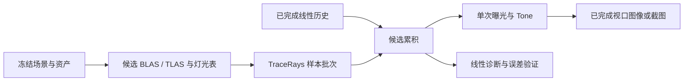

# 渐进式路径追踪管线设计

## 目标与范围

用户选择先建立正确性参考，再接入编辑器和截图。M16 交付静态三角形场景的渐进式表面路径追踪：
CPU 数值参考、Vulkan RT、直接/间接光、受限金属粗糙度材质、确定性样本编号、每视图累积、
后台交互预览和固定 spp 截图。M16.1、M16.6与M16.7.1实施契约见下文；其余拟议接口/额度仍是规划，阶段状态见[Roadmap](../roadmap.md)。

## M16.7.1 纹理与mask实施契约

在Lambert参考上加入当前CpuAsset的baseColor纹理与opaque/mask，不接受blend或metallic非零。
冻结被引用纹理的身份、origin、RGBA8、sampler及三角形UV；纹理按资产包/纹理ID去重，
最多64份、单边2048、总RGBA8字节64MiB，允许调用者下调额度。缺纹理、重复ID、缺失/非有限UV、
非法sampler/数据长度/alpha cutoff在创建候选时拒绝。消费的纹理内容、采样器、UV和mask参与指纹，
资产原始内存或文件变化不能改变旧scene/image。报告纹理数与未纳入NEE的mask发光三角形数。

采样版本保持随机源v1，材质语义版本升级为model v2；只接受当前版本，不以旧版本解释新材质。
纹理top-row-first、UV不翻转；明确LOD=0，空间过滤采用mag_filter（缺省linear），GPU两种filter设为同一值；
min_filter及mip模式保留来源但在本阶段不参与采样。nearest取floor(uv*extent)，linear在uv*extent-0.5处
双线性插值，RGB每个texel先按IEC sRGB解码，alpha不解码；repeat/clamp/mirrored_repeat按各轴独立处理。
GPU上传前解码为RGBA32F线性纹理，再用硬件过滤；这与sRGB先解码再过滤的数学语义一致。
实测本机RGBA8-sRGB硬件解码误差超过冻结nearest门槛，故保留门槛并采用显式标准解码，
不将近似误差吞入容差。GPU图像与上传各最多256MiB，CPU冻结仍为64MiB RGBA8；M16.8再统一显存准入。
UV准入绝对值不超过1e6，避免整数转换溢出；CPU使用double作为数值参考，GPU使用float。
alpha乘factor后以float比较，严格小于cutoff才剔除，等于保留；opaque忽略alpha。
radiance和visibility使用同一mask/背面规则。mask发光面light PDF为0，BSDF命中权重1，
不进入面积灯CDF；opaque有纹理面仍按未纹理化emissive提供面积灯。

Device增加独立SampledImageIndexingMode的disabled/if_available/required请求及支持/启用查询，
只启用shaderSampledImageArrayNonUniformIndexing，不要求runtimeDescriptorArray、partiallyBound或updateAfterBind。
shader产物从实际SPIR-V反射ShaderNonUniform和SampledImageArrayNonUniformIndexing需求，
设备未启用时在创建shader前拒绝。renderer按已启用能力编译64个image与sampler固定数组变体，
布局沿现有Device逐set/per-stage limits检查；全部槽绑定有效实际或默认白纹理。
无能力时仍可创建无纹理renderer，prepare_scene拒绝纹理输入，不静默丢失贴图。
Slang使用NonUniformResourceIndex；纹理upload与AS BUILD在同一Graph提交，trace声明全部可能采样图像，
pending保留image/view/sampler及冻结输入。失败不发布scene/frame，外部旧代及已完成图像保持。

验证先冻结CPU独立解析采样/过滤/wrap/alpha与背面案例，再做required RT/validation/sync GPU对照。
非边界nearest RGB绝对误差≤3e-3，linear≤5e-3（float计算与硬件子texel精度）；alpha拓扑测试避开过滤阈值歧义，
另用精确0/1及factor=cutoff测试等号。灯光统计仍用8 seed、2%与5标准误差、N/4N≤0.5%旧门槛。
包含多纹理同批发散、64/65容量、disabled/required/limits、负缩放/双面、主与阴影mask、mask发光、
输入突变/失败/在途释放；使用现有glTF导入/CPU产物再加载一条受支持磁盘资产链路证明来源。
非一致索引依据[Vulkan features](https://docs.vulkan.org/spec/latest/chapters/features.html)与
[Slang NonUniformResourceIndex](https://docs.shader-slang.org/en/stable/external/core-module-reference/global-decls/nonuniformresourceindex-03ai.html)。

## M16.6 GPU无历史Lambert实施契约

独立默认OFF的DK_BUILD_RENDER_PATHTRACING启用dk::render_pathtracing，同时提供纯CPU reference；
PUBLIC依赖reference和graphics_device，PRIVATE依赖graphics_graph/graphics_shaders，不接入Runtime或编辑器。
PathTraceRenderer::create编译固定shader目录的RT与空场景compute程序，失败不发布半套管线。
prepare_scene复制已冻结PathTraceScene的世界三角形/材质/光源CDF，构建单BLAS与恒等TLAS，
保留稳定三角形到Entity/Asset/primitive/triangle的映射。完整仿射效果在CPU冻结时已应用；
本阶段不做按资产BLAS复用或实例变换优化。float转换造成的退化/非有限几何、无法表示的正面积/光源权重、
超出float范围的相机参数明确拒绝，不能静默丢失三角形或提交含Inf的输入。
所有GPU数据不可变，Graph提交upload→BLAS→TLAS；空场景不创建非法空AS。

submit_view与submit_rays分别接受已冻结RenderView和固定世界射线集合，返回拥有型PathTraceFrame及Submission，
均不等待GPU。调用者串行使用同一队列；frame.read仅查询完成状态并在完成后发布独立CPU HDR结果，
未完成/错误/取消不发布部分结果，旧scene/frame/image可继续持有。Graph/pending保留资源，提前丢弃frame不取消GPU。
frame不持有裸queue地址；读取时通过票据核对提交域，显式wait/close沿用Device契约。
取消在CPU准备、编译和submit前检查，已提交工作不可抢占；读取前的取消拒绝发布。

GPU复用CPU model v2材质、sampler v1样本维度/连续编号、深度、NEE三类等概率选光、面积×亮度CDF、power MIS与RR。
raygen循环散射；两种静态SBT射线类型分别用于最近命中和visibility，hit仅返回距离/重心/三角形索引，
any-hit按冻结的单/双面标志和mask拒绝候选；纹理/alpha遵循上文M16.7.1契约。geometry normal、world area和发光保持一致，
GPU使用float误差尺度偏移并逐分量向外取下一可表示值，有限面光源阴影同时偏移两端；无firefly clamp。
计数hash保持uint32，GPU输出24位样本的float近似并保持开区间，不承诺CPU/GPU逐位相同。
空场景由compute写常量环境和诊断，仍使用Graph写入/读回与提交契约。

首版沿用≤64×64图像/≤4096条固定射线、4096三角形、1..65536样本、1..32反弹和CPU冻结工作预检，
先建立数值参考；M16.8再扩展分块、交互批次与显存额度。GPU几何、表、输出均在这些上限内有界，
不将CPU triangle_tests计数冒充硬件遍历统计。结果包含线性RGB、二阶矩、实际trace射线数、
首个样本的主射线命中距离/重心/法线/来源，以及scene/revision/fingerprint、camera/settings/sample区间。
输出按像素使用补偿求和；NaN/Inf/负辐亮度及非法诊断在读回时拒绝整帧。

验收使用required RT+validation/sync：黑场/常量环境/发光、太阳遮挡、单/双面和缩放/剪切、
面积灯独立积分、8 seed CPU/GPU线性nRMSE≤2%、N/4N均值差≤0.5%、64/256/1024集合误差下降、
MIS对BSDF-only及RR起点比较、多反弹颜色、连续样本区间、失败保留旧帧、timeout/pending/关闭回收。
确定性量与非边界几何沿用1e-4门槛；小图高样本参考先证明收敛，不能用未收敛参考放宽阈值。

## M16.1 CPU参考实施契约

本阶段仅实现 `dk::render_pathtracing_reference`，开关 `DK_BUILD_RENDER_PATHTRACING_REFERENCE` 默认OFF，
要求RenderData/Scene/Math/Memory，自动提供asset_data头接口，不依赖导入器、Geometry实现、Vulkan或Slang。
Geometry BVH只在测试中作为独立求交对照；CPU参考独立双精度暴力遍历，避免让同一求交实现同时充当被测方和oracle。

`PathTraceScene::create(heap, RenderScene, assets, limits)`从借用的CpuAsset指针span复制被引用的世界三角形/材质，
返回不可变共享快照；不保留输入地址或读取磁盘。按RenderScene实体/引用、primitive和triangle顺序稳定编号，
保留EntityId/AssetId/primitive/triangle来源。重复实例允许、重复资产包ID/缺失mesh/material拒绝。
非mesh实体引用沿RenderData约定忽略，不能猜成材质覆盖。资产unit_scale已由导入器应用，不二次缩放。
只消费opaque/mask、metallic=0的baseColor/emissive及baseColor纹理；roughness保留但不参与Lambert。
缺材质沿CpuData默认metallic=1，因此拒绝而不是静默变成漫反射。几何法线来自世界顶点绕序，
明确不使用顶点法线；纹理UV按重心插值。双面可翻转法线，单面背面被剔除，负缩放翻转绕序。退化三角形跳过并报告计数。
场景指纹为稳定字节序FNV-1a64诊断摘要，覆盖消费的世界几何、材质、来源和冻结太阳，不作安全验证/缓存相等证明。

限制固定为最多4096个输入资产/实例primitive引用及4096个展开前计数的三角形（退化也占额度），
单primitive最多12288个顶点，位置绝对值≤1e6米；非法矩阵/不可逆实例/非有限数在候选内拒绝。
调用者可下调额度，不能放大硬上限。创建/图像输出使用调用者Memory，预算失败不发布候选；
旧快照和已完成图像可在输入销毁/Memory closing后读取，新建仍要求open heap。

`PathTraceSettings`固定model版本2（M16.7.1扩展材质）/sampler版本1，seed为uint64，max_bounces=8、范围1..32；
反弹数指最多多少次BSDF散射，末次散射后的射线仍评估emission/miss但不继续NEE/散射。
rr_start=3，0表示诊断用关闭RR，其余须≤max_bounces；存活率clamp(max(throughput),0.05,0.95)，
在指定散射次数后执行并除以存活率。模式为MIS或bsdf_only；后者仍单独估计delta太阳，避免漏掉不可由BSDF命中的光。
环境默认常量黑色，太阳默认none，可显式选冻结Scene太阳；空气/云开启时须显式surface_only=true确认表面参考范围。
不可用的模式/枚举/版本、负值、辐亮度/辐照度>1e6均拒绝。曝光不进入积分设置。

计数随机映射使用固定32位无符号混合，输入为seed高低32位、pixel/sample/bounce/dimension；
输出24位开区间样本，CPU/GPU可重现。维度0/1为主射线亚像素，2为选光类、3为选发光三角形、
4/5为光源坐标、6/7为余弦半球BSDF、8为RR；路径长短不改变其他样本。黄金序列固定在测试。
有效样本区间[first_sample, first_sample+sample_count)位于[0,65536)，允许分批后加权合并，不提供持久历史。
光源在非零环境/太阳/面光源三类间等概率选类；面光源内部按世界面积×发光亮度选三角形。
环境均匀球面、三角形均匀面积，PDF含完整离散概率/面积到立体角雅可比；power heuristic指数2。
无光源分布合法，delta太阳用权重1；相机直见发光/背景用权重1，BSDF命中用互补MIS权重。

`estimate_path_reference`对固定归一化世界射线返回RGB均值、二阶矩与实际射线/相交计数；
`render_path_reference`按RenderView透视针孔生成≤64×64图像，返回拥有型线性RGB和完整设置/样本区间/输入摘要。
相机须刚体、右手朝-Z、Vulkan深度0..1、有限near/far的透视矩阵（允许离轴和Y翻转）；正交/逆Z在本阶段拒绝。
主射线按near/far平面计算距离，次级射线不继承far。原点沿几何法线按世界坐标/顶点误差尺度偏移并nextafter外扩，
面光源阴影同时偏移两个端点；不使用固定世界epsilon。极近退化/共享边测试单列，不宣称任意病态几何鲁棒。

每请求上界`pixels*samples*(2*max_bounces+1)`条射线，硬上限2^24；
再乘max(1,triangle_count)的候选求交工作硬上限2^29，均可下调且在分配/计算前检查溢出。
每样本/反弹检查stop_token，取消返回独立context，不发布部分图像/均值；超额不自动降质。
NaN/Inf结果视为错误，禁用firefly clamp。此处是CPU参考额度，GPU批次/显存额度仍待M16.8落实。

冻结验收：解析量绝对误差≤1e-4；8个独立seed均值误差≤2%且落在5倍标准误差加1e-4内；
面积灯独立二维数值积分收敛≤0.1%，高样本参考N/4N集合均值差≤0.5%。
64/256/1024样本只要求seed集合均方误差下降，不要求单像素/单seed单调。
覆盖黑场/常量环境/太阳解析遮挡/白炉/面积灯及间接颜色传播、MIS对BSDF-only、RR开关、几何仿射/尺度、
样本分区/输入旧代/取消/额度/Memory失败/CPU-only链接。可执行CPU示例输出PPM和线性数值报告，不增加命令服务。

首轮光源为常量 RGB 环境、显式方向太阳和发光三角形；参考先使用 opaque Lambert 与无纹理发光面。
随后扩展当前资产已有的 baseColor 纹理、metallic/roughness 标量、emissive、opaque/mask、单/双面。
首轮不支持透射/折射、alpha blend、法线贴图、完整 glTF PBR 扩展、HDRI 导入、景深、运动模糊、
形变/蒙皮/布片接入、去噪、自适应采样、时域重投影、ReSTIR、wavefront 或实时帧率承诺。
CPU renderer 是小场景参考，不作为硬件不支持时的静默交互回退。

M14/M15 的视点相关天空/空气透视和云历史不能直接充当任意反弹射线的介质积分。
M16 不复用其 screen-space 合成到路径追踪结果，也不把太阳、天空发光或衰减重复计算。
设置需显式指定 `environment_mode=constant` 和常量辐亮度；太阳可选择 none 或读取冻结 Scene 的方向/辐照度。
空气/云开启的场景只有明确选择表面模式才可请求路径追踪，UI/结果注明未模拟介质；
请求 atmosphere/clouds 模式明确返回 unsupported，不自动忽略。体积路径追踪及其多重散射单独立项。

## 现状、模块与依赖

[RenderScene/View](render-data.md)已有不可变快照、完整仿射变换、投影与 revision；
[CpuData.hpp](../../engine/assets/data/include/dk/assets/CpuData.hpp)已有材质标量与 baseColor 纹理，
当前 GPU 网格没有 RT usage；[CPU BVH](geometry-query.md)只做双面最近命中，不包含 alpha/材质遍历。
现有 [ScenePipeline](render-pipeline.md)是 depth/opaque/tone 管线，不改写其光栅默认行为。

| 模块/入口 | 依赖和职责 |
| --- | --- |
| `engine/render/pathtracing` 的 `dk_render_pathtracing_reference` / `dk::render_pathtracing_reference` | 已实现纯 CPU：PUBLIC render_data、asset_data，通过其传递依赖Math/Memory；独立求交、输入转换、采样、Lambert、参考积分，不链接Geometry实现/Vulkan/Slang |
| 同目录 `dk_render_pathtracing` / `dk::render_pathtracing` | PUBLIC render_pathtracing_reference、graphics_device；PRIVATE graphics_graph、graphics_shaders；不可变GPU场景、无历史Lambert积分、异步帧与HDR诊断 |
| RenderDisk / CaptureService / Editor 装配（规划） | 读取/冻结资产并调用 renderer；Render 不反向依赖 Framework/Editor；公开路径不暴露其类型 |

reference开关默认OFF，已支持无GPU依赖构建与测试，使用见[CPU参考指南](../guides/pathtracing-reference.md)。
GPU开关DK_BUILD_RENDER_PATHTRACING独立默认OFF，启用时检查Device/Shader/Graph并构建reference；
用法与required探针见[GPU指南](../guides/pathtracing-gpu.md)。GpuAssets 不统一加 RT usage；
M16.6从冻结PathTraceScene建立自己的世界顶点、材质/光源表及单BLAS/TLAS，尚不复用资产BLAS。
M16.7.1纹理独立上传为线性RGBA32F，来源保留CPU资产身份/采样器/内容；重复GPU载荷计入额度，不宣称零拷贝。

## 数据与拟议接口

`PathTraceScene` 是场景 revision、CPU 资产内容摘要、稳定实体/primitive 映射及灯光表的不可变版本；
从已拥有输入构造，不在积分器中读可变 Scene 或重新访问磁盘。实例保留完整世界仿射矩阵，不重新分解 TRS。
几何表把 instance/primitive/triangle 映射到顶点、法线、UV、材质和原资产身份，GPU 整数索引不是持久 EntityId。
RT 场景键须含资产内容/缓存身份与代次，不能只用 Scene revision 或 AssetId；浮点矩阵需验证有限和可逆。

`PathTraceSettings` 为会话/请求设置，首轮不写进 Scene，不增加 Scene 格式版本或 Undo 操作。
包含 integrator/model/sampler 版本、seed、max_bounces、rr_start、目标 spp、每批 spp、预算、
environment_mode/constant_rgb/sun_mode、material_mode、可选诊断；曝光/tone 是独立显示设置。
默认值候选：max_bounces=8、rr_start=3、交互每批 1 spp、capture 目标 256 spp；
允许范围候选为 max_bounces 1..32、目标 spp 1..65536，rr_start 不超过 max_bounces。
工作预算不能仅看这些单项上限；所有乘积预检，总路径段/候选 GPU 内存超额则入队/提交前拒绝。

| 拟议操作 | 成功与失败语义 |
| --- | --- |
| `prepare_scene` | CPU 先解析/验证/预算，GPU 构建候选；返回拥有型版本与提交票据，失败保留旧版本 |
| `submit_batch(view_id, view, scene, settings)` | 从该视图已完成样本数分配连续区间，返回 pending 帧；不等待、不推进 completed_spp |
| `poll` / `completed_frame` | 完成且 generation/key 仍匹配时发布新的线性累积和 completed_spp；返回实际状态/原因 |
| `reset` / `release_view` | reset 使旧代不再可发布，release 停止新工作；已提交资源仍待完成回收 |
| `read_linear` / 显示输出 | 只读取已完成、尺寸匹配的帧；未完成/失败不得部分覆盖调用者输出 |

此表描述后续渐进式会话职责，不是已实现C++签名。M16.6正式入口为PathTraceRenderer的
prepare_scene/submit_view/submit_rays及PathTraceFrame::read，当前无历史与视图槽；细节见上文实施契约。

## 参考积分、几何和材质

CPU 参考先完成，GPU 的随机维度、相机、光源与 BSDF 定义与其一致；验证不能只比较两份共享错误的代码。
初始参考通过暴力三角形求交核验小场景，随后可复用 Geometry BVH；alpha 命中筛选需要按候选交点继续遍历，
不能把当前仅返回最近几何命中的拾取 API 当作完整可见性。数值 oracle 的固定射线单独避开共面/共享边决胜差异。

相机使用同一 RenderView 的像素/Y/Vulkan z=[0,1] 约定，以逆投影构造透视主射线，
亚像素样本位于各像素面积内；主射线以 near/far 对应的射线参数裁剪，次级射线使用独立非负距离域，
不能把相机 far 当作所有反弹的截断距离。首版透视针孔，非法投影拒绝。
世界射线归一化、距离单位米；实例求交保持仿射 t 的可比性。法线用逆转置并处理负行列式、剪切和 front-face。
几何法线负责侧别、自相交偏移和射线半球约束；着色法线修正不能让路径穿到几何背面。
采用随位置误差变化的原点偏移，光源距离减去端点偏移；固定大 epsilon 不是跨尺度正确性方案。

单路径在 raygen 迭代：命中/发射 → 直接光采样及 visibility ray → BSDF 采样 → 更新 throughput → 下一反弹。
Lambert 为 `baseColor / pi`；CPU 先验证常量天空白炉、黑场和单灯解析/高精度积分。
光源集合将环境、方向太阳、发光三角形统一为显式离散分布。三角形按世界面积和发光亮度选择，
面积采样转换为 solid-angle PDF，含选灯概率；实例缩放改变面积/分布。零能量/零面积项不进入分布。
太阳是 delta 光源，常量环境不含太阳盘；背景 miss 只评估常量环境，不重复加入方向太阳。

直接光与 BSDF 命中发光面/环境用 power-heuristic MIS 组合，PDF 均包含策略选择概率；
相机直接看到发光面、delta 事件与普通反弹分别处理权重。Russian roulette 在 rr_start 后按 throughput
选择存活概率并以其倒数补偿；max_bounces 是显式截断，标入 provenance，不宣称有限反弹结果无截断偏差。
核心方法依据 [PBRT 路径追踪推导](https://pbr-book.org/4ed/Light_Transport_I_Surface_Reflection/A_Better_Path_Tracer)，
这是项目选择的积分器方案，不移植其 renderer 或引入运行时依赖。

材质任务分两步，均先扩展 CPU 参考再核对 GPU；第1步当前实施契约见上文，第2步仍规划：

1. baseColor sRGB 纹理在采样时解码为线性 RGB，alpha 保持线性，使用明确 LOD=0；
   复用当前 sampler/wrap/UV 定义，不假装已有 mip/ray differential。opaque 忽略 alpha，mask 按 alpha*factor/cutoff 拒绝命中，
   radiance/visibility 两类射线都执行相同 any-hit 规则。double_sided 和负缩放正反面独立测试。
   发光 mask 面首轮允许 BSDF 命中发光，不进入 NEE 三角灯分布；其命中权重按灯策略 PDF=0 处理并报告此限制。
2. 引入明确版本的 metallic-roughness 子集：GGX 单次散射、Smith masking、Schlick Fresnel，
   dielectric F0=0.04、metal F0=baseColor，漫反射随 metallic/Fresnel 分配能量；采样/eval/PDF 必须使用同一混合概率。
   粗糙度到 alpha 的映射和最小值在 CPU 阶段冻结并写入模型版本；不得为隐藏亮点临时改变。
   metallic=0/1、粗糙度端点、掠射、双面/法线修正的能量测试通过后才接任意当前资产。

微表面分布与masking的参考依据为[PBRT微表面模型](https://pbr-book.org/4ed/Reflection_Models/Roughness_Using_Microfacet_Theory)；
本项目选择的金属混合、Fresnel近似和粗糙度下限须独立版本化，不能把参考书的具体材质实现等同于本模型。

Lambert 参考用例显式设置 metallic=0，不能把当前 MaterialData 默认 metallic=1 当作漫反射。
首轮不做 firefly clamp 或曝光后平均；NaN/Inf 是失败并保留诊断，不用置零隐藏错误。
GGX 子集不宣称完整 glTF 能量/扩展兼容；有限粗糙度、多散射能量损失与跨设备误差均记录在报告。

## Graph 数据流与累积

Graph 显式声明 build、SBT/几何/材质/灯光读取、trace 写、累积读写、tone、readback；
底层依赖与同步见[光追底座](graphics-raytracing.md)。路径输出为曝光前线性 RGB，复用当前 Reinhard/sRGB 显示约定。
首版使用 RGBA32F 线性累积和整数样本数；每像素只有一个写入者，按样本索引稳定加和，无跨像素浮点原子。
独立 candidate buffer 从 completed 内容初始化并按样本顺序续加，GPU 处理中不覆盖已发布历史。
不同 batch/tile 分割使用同一像素全局索引，保证不重号/漏号，允许受限浮点误差但不更换随机样本。

随机源为无可变全局状态的计数式映射 `(seed,pixel,sample,bounce,dimension,sampler_version)`。
固定随机维度分配，路径提前结束不影响其他像素/样本；参考保留黄金随机序列。
capture 每次从 sample=0 开始、精确到目标 spp；交互最终与同输入/样本区间的 capture 比较。
同设备重复测试和跨设备容差分开；不承诺跨编译器/驱动 bit-exact。

历史键包含 scene/session 身份与渲染内容、资产内容摘要/RT 代次、camera/projection/尺寸、
integrator/material/sampler/shader 版本、seed、灯光/环境参数、max_bounces/rr_start、手势预览 generation。
保守以 revision 重置允许多做工作；不能遗漏资产重载、未提交手势或相机变化。每个稳定 view_id 单独拥有历史。

| 变化 | 历史处理 |
| --- | --- |
| 相机/投影/尺寸、场景/资产/材质/灯光、seed/积分模型、手势变化 | 创建新 generation，completed_spp 从 0 开始；旧 pending 完成后只回收 |
| exposure/tone/诊断显示 | 复用曝光前历史并重做显示，不改变样本序列 |
| batch 大小/提高 target_spp/暂停恢复 | 输入键不变时继续连续样本；暂停停止后续提交 |
| target_spp 降到 completed_spp 以下 | 交互可暂停并显示实际样本数；精确 capture 重新从零开始 |
| 同输入重复请求 | 不重复提交同一区间；返回当前 completed/pending 状态 |
| 失败/取消/退出 | 不推进样本数、不发布候选；停止新提交，按 GPU 票据安全回收 |

每视图最多一个 pending 批次，renderer 同时最多一份执行中的 GPU 批次；首轮最多两个视图历史槽，
另限制上一完成显示帧和当前候选，完成通知采用有界槽，不能让快速拖动积累无限任务。
CPU 接受新配置只发布新 generation；GPU 完成后 owner 复核 generation/key/取消再交换 completed。
该交换和截图文件提交是不同提交点，均须在所需分配完成后发生；无变化配置不重建。
帧借用/共享遵守底层 owner 寿命，显存预算含外部仍保留的旧帧和旧 AS，不能只计算 cache 当前值。

## 预算、取消与交互

初始候选限制：GPU 图像≤2048²，CPU 参考≤64²；每批 1..16 spp，但默认 1；
单提交路径段上界按像素数×batch_spp×max_bounces，并保守增加每次表面的一条 visibility ray。
默认单提交候选上限 2^24 条射线，总 capture 上界候选 2^32；超限先分 tile/批次或拒绝，
不自动降低 spp、反弹数或尺寸。单条 trace 的实际耗时仍与几何/any-hit 数有关，不能将计数预算视为毫秒硬上限。
固定 descriptor 数组候选容量 64，受实际设备 limits 限制，超出资产须明确拒绝，不截断纹理。

首轮 renderer 自有 GPU 分配预算候选 1 GiB，含几何复制、AS、scratch、纹理、累积/候选/显示和在途旧代；
同时记录 VMA allocation/block、host-visible/device-local，CPU 输入单独沿用现有资产/任务额度。
Driver 隐藏开销另列不可观测范围。预算是准入上限，不是已测占用或性能达标；M16.1 冻结工作额度，
M16.8 在实际分配估算后冻结显存额度，有必要调整时保留原候选与理由。

预览复用 Editor 既有 worker/owner 交接模式：owner 不做长编译/AS build/等待；worker 串行拥有队列。
编辑器设备创建可请求 RT if_available，后台使用同逻辑设备的已启用能力；切模式前检查 enabled，
不重建正在被 UI 使用的设备。GPU-only 图像经已有完成图像交接进入显示；不得反复 CPU 读回上传。
单原生队列时沿用串行提交所有者/回退调度，不让 UI 和 worker 并发访问同一队列。
关闭先拒绝新任务、取消并 join，再释放 worker/视口资源；旧图可保留显示但必须标出来源和过期状态。

取消在资产/编译/构建阶段之间、tile/样本批次之间检查，已提交 GPU 工作不可硬抢占。
冷启动 driver/Slang 调用的不可取消窗口单独测量，不用稳态响应结果掩盖。
device_lost 终止会话并报告实际错误，不自动循环重试或宣称旧帧安全。

## 编辑器与自动化接入

普通场景视口增加明确的 raster/pathtrace 选择、spp/目标/进度、暂停/重置、seed/反弹/曝光和能力缺失原因；
切换/调参复用同一会话模型。场景编辑仍走原 Commands/Services，trace 不修改 revision/dirty/undo。
拖动期间不断重置样本，松手后在同一最终输入继续累积；不把旧代清晰图当作新场景结果。
独立模拟布片视口保持原职责。

拟在现有 `render.capture` 添加显式 renderer 和版本化 pathtrace 设置，默认旧光栅行为不变；
精确 spp 请求进入现有 Job 查询/等待/取消体系。既有 `quality` 表示大气/云质量，不能借它隐式切换 renderer。
有限任务进度公开 queued/preparing/building/rendering/readback/publishing 及 completed_spp/target_spp，
submitted_spp 单列，不能作为已完成进度。GPU 不可用时明确失败，不自动换成光栅图。

捕获冻结 SceneSnapshot、完整相机/设置及导入后的资产内容摘要；保留当前“资产在 worker 开始时读取”边界，
不声称磁盘文件在接受请求时已经冻结。worker 一旦完成输入准备，整个样本循环不再读取可变文件。
PNG/EXR 不是本轮依赖：复用单 PPM 输出和已有有界线性报告机制，报告为单独任务产物。
每份 PPM/报告仅在 owner drain 最后原子替换一次，取消先接受则旧文件保持，发布后取消不再接受；
多个文件不承诺整体事务。Job 摘要沿用≤4096字节，完整 provenance/线性数据进入有界报告。

provenance 至少保存 scene/revision、输入摘要、camera/尺寸、环境与材质模式、shader/integrator/sampler 版本、
seed、实际 spp、max_bounces/rr_start、曝光、设备/驱动/构建、计时范围与预算；缺测计时为 null。
Python/Luau/IPC 调用同一服务。对应阶段应用 command-development，同步 schema、commands.list/describe、
命令参考及可执行示例；本次规划不预注册新命令，不把 M13 布料实验格式当成已有渲染扫描器。

## 验收集、阈值与性能基线

固定场景：空常量天空、单三角/遮挡板、Lambert 白炉、Cornell 风格封闭盒与面积灯、
镜像/剪切实例、metallic/roughness 球组、alpha-mask 栅栏、资产重载和交互变换序列。
程序化夹具先验收，随后选当前格式支持的固定磁盘场景；Sponza 只有材质/纹理容量满足时才纳入，不能预设必过。

| 检查 | 初始验收目标与方法 |
| --- | --- |
| 几何 | 固定非边界射线命中身份一致；距离误差≤1e-4×max(1,距离米)，重心绝对误差≤1e-4；边界/退化另列可接受规则 |
| 解析/能量 | 黑场为零、常量背景/发光面确定值；白炉反射能量不增益；确定性量≤1e-4，随机估计用多 seed 置信区间 |
| CPU/GPU 积分 | 同模型小图，nRMSE 候选≤2%；固定不少于8个 seed，先确认参考置信区间和收敛；差异同时看均值偏差和空间误差 |
| 高 spp 参考 | 在小图用 N 与 4N 检查收敛，参考误差预算候选≤0.5%；未收敛不得作为黄金图或关闭阶段 |
| 渐进采样 | 固定多个 seed 的 64/256/1024 spp 集合误差趋势下降；不要求每个像素或每个 seed 单调；重置后与全新会话一致 |
| MIS/RR | 与无 NEE、高样本参考和不同 RR 起点比较均值；不通过亮点截断掩盖 PDF/权重问题 |
| 界面/截图 | 相同版本/相机/seed/spp 的线性结果容差一致；曝光改变不重采样；保存重载保留物理输入，累积历史不持久化 |
| 失败/寿命 | 预算/能力/材质拒绝、编译/AS/录制/submit失败、旧代迟到、取消竞争、resize/关闭/在途卸载；状态与旧文件均核验 |

nRMSE 定义为 `sqrt(sum((I-R)^2) / max(sum(R^2), pixel_count*3*1e-12))`，在线性 RGB 上计算，
黑场另用绝对误差；小亮灯、掠射、mask 边缘单列 ROI，仍保留全图指标。置信区间按独立 seed 均值计算，
避免把相关像素当独立样本。M16.1 先冻结采样/解析门槛，材质扩展在 CPU 参考成立后冻结新增门槛，
不得 GPU 结果失败后随意放宽。CPU/GPU 共用公式仍须用解析解或独立积分检查偏差。

性能交付先建立可复现基线，无未经测量的 60fps 或毫秒承诺。分别报告冷设备/编译/上传/AS build、
热每 spp、达到固定质量所需 spp/时间、CPU owner/worker、GPU build/trace/accumulate/tone/readback、
端到端、取消接受/最终回收和显存稳态/峰值。固定设备/驱动/构建/场景/seed，至少三轮独立进程，
性能区间不重复累加父子计时；1080p 1 spp/8 bounces 为候选负载，超预算时报告拒绝而非静默降质。
正确性用 required validation/同步验证，性能关闭验证并记录开关；CPU-only 与真实 RT GPU 分开验收。
没有适用 GPU 时相关项目为未验证，不能把 CPU 参考通过作为整个 M16 完成证据。

## 取舍、风险与下一步

选择 KHR RT pipeline + SBT，便于直接覆盖用户所需底座并明确命中阶段；首版不同时维护 ray-query 后端。
先完整 BUILD、无历史重投影/去噪，以有限小场景建立可复现积分基准，再根据实际热点立项优化。
主要风险为设备间RT/非一致纹理索引能力差异、Slang payload/反射适配、Graph AS 内容依赖、
浮点自相交/材质能量和长驱动调用；每项已有对应前置任务/验收，不用假定库 feature 已实现来跳过。
CPU参考的输入/采样/积分模型与解析验收已冻结；后续任务顺序以[Roadmap](../roadmap.md)为准。

[架构](architecture.md)、[光追底座](graphics-raytracing.md)、[渲染资源](render-resources.md)、
[截图](render-capture.md)、[编辑器](editor.md)、[0108规划记录](../development/0108-pathtracing-plan.md)、
[0109 CPU参考实现与验证](../development/0109-pathtracing-reference.md)、[0114 GPU积分与验收](../development/0114-gpu-pathtracing.md)。
