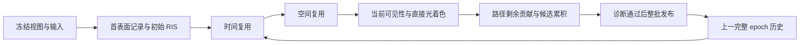

# ReSTIR 光照重采样接入计划

本文件是[路径追踪设计](render-pathtracing.md)的采样扩展草案。当前代码尚未实现 ReSTIR；
本次只规划，阶段状态、依赖和下一项统一见 [Roadmap M19](../roadmap.md#m19restir-直接光重采样)。
数值公式、数据布局与资源上限在对应阶段的 CPU 参考或接入验证完成后冻结，不把候选参数视为既有接口。

## 目标与范围

先交付显式可选的 **ReSTIR DI**：在相机可见的第一个表面上，用 reservoir 保存一个光源样本及其权重，
通过初始候选、时间复用和空间复用降低直接光方差。后续反弹继续执行现有路径追踪。
先覆盖 Surface only，再支持 Scene media 中符合条件的首表面直接光；原 MIS/BSDF-only 路径保留作独立对照。

首轮支持已有的 Lambert/GGX、baseColor/mask、单/双面、静态三角形、透视/正交相机。
候选光源使用已有发光三角形、常量环境；表面模式的 delta 太阳单独估计，介质模式的有限太阳圆盘后续纳入。
mask 发光三角形继续由 BSDF 命中估计，不扩大其 NEE 支持范围。
移动相机可复用匹配的静态表面历史；几何、材质、光源、介质内容变化先清空采样历史，
不承诺动态物体运动向量、跨光源重排映射或形变复用。

ReSTIR GI/PT、介质散射顶点/整条体积路径复用、ReGIR、去噪、HDRI、新材质、wavefront 与异步队列另行规划。
天空或云内部的主要噪声可能来自自由程和多次散射，首表面 DI 不能直接解决；M19 必须分别测量这类场景。
不以论文的速度倍数代替本引擎结果，不预先承诺实时或默认开启。

## 当前接入依据与模块边界

| 已有能力及入口 | 对本计划的约束 |
| --- | --- |
| [CPU 场景与灯光表](../../engine/render/pathtracing/src/PathTraceScene.cpp)、[CPU 表面积分](../../engine/render/pathtracing/src/PathTraceReference.cpp) | 复用冻结三角形/材质/纹理与面积乘亮度分布，增加可独立检验的 reservoir 数学；CPU-only 仍可运行 |
| [表面 shader](../../engine/render/pathtracing/shaders/pathtrace.slang) 的 directLight/tracePath | 当前逐路径迭代 NEE/MIS；需要显式拆出首表面直接光，不能在原结果上叠加 DI |
| [介质 CPU](../../engine/render/pathtracing/src/VolumePathReference.cpp)、[介质 shader](../../engine/render/pathtracing/shaders/path-air.slang) | hero RGB 通道、analog 自由程、ratio tracking 阴影与有限太阳保持物理模型；复用须先处理条件概率与随机维度 |
| [Renderer](../../engine/render/pathtracing/include/dk/render/PathTraceRenderer.hpp)、[会话实现](../../engine/render/pathtracing/src/PathTraceRenderer.cpp) | 当前两视图、一个在途批次、tile 串行；最后 tile 才发布 completed_spp。已有首样本 hit/normal 诊断不足以充当完整复用记录 |
| [Editor](../../engine/editor/src/PathPreview.cpp)、[面板](../../engine/editor/src/PathPanel.cpp)、[捕获设计](render-capture.md) | 复用 worker/取消/来源与显式模式，不引入 Scene 持久状态；GUI 和独立捕获需各自拥有历史 |

实现仍归 `engine/render/pathtracing`：纯数学/参考进入 `dk::render_pathtracing_reference`，
GPU passes 与会话进入 `dk::render_pathtracing`，公开接口置于 `include/dk/render/`。
Graphics 仅提供资源、RT、Graph 与同步，不承载 reservoir/BSDF/光源策略；Render 不反向依赖 Editor/Framework。
沿用现有 BLAS/TLAS、单队列和 Slang，不创建另一套设备所有者。

优先用项目内 C++ 参考和 Slang 实现小范围 DI，RTXDI 用于算法与集成核对。
本计划不新增依赖。若实施时改用 RTXDI-Library，先验证 Slang/SPIR-V、桥接、许可与 CPU 对照，
按三方库规则核验接入方式并固定版本/commit；不顺带导入示例框架、DLSS 或 NRD。

## 估计器与光能分工

### 初始 RIS 与样本域

M19.1 先冻结以下契约并以双精度参考验证：

- 光样本含光源种类、冻结光表身份、三角形及重心坐标或世界方向；不能只存一个跨版本可能变化的 GPU 下标。
  三角形采用面积测度，环境/有限太阳采用立体角测度，种类标签组成互斥的积分分量；PDF 含种类和光源选择概率。
  跨接收点仍保存同一个光源点/方向，重新计算几何项、BSDF 与目标函数；禁止混用面积/立体角 PDF。
- `F_x(y)` 是接收点 x 对光样本 y 的 RGB 直接光贡献密度，初始标量目标 `p_hat_x(y)` 取非负亮度，
  首版不含遮挡，必须在有贡献处具有正支持。最终着色重新查询当前几何/mask 可见性。
- 对同一完整支持 proposal q 产生的 M 个候选，权重 `w_i = p_hat_x(y_i) / q(y_i)`，
  reservoir 按 `w_i / sum(w)` 替换所选样本；最终估计为 `F_x(y) * sum(w) / (M * p_hat_x(y))`。
  此式只定义初始 RIS；不同来源的时空合并须另推归一化，不能直接套用。
- 已生成的零权重候选仍计入 M；全零 reservoir 返回零贡献而不做 0/0。非有限、负权重、溢出或工作超限拒绝候选帧。
  单候选退化为相同 proposal 的普通直接光估计。reservoir 的 M 与 age 均不代表图像 spp 或独立样本数。
- 计数式随机维度独立覆盖候选编号、替换抽签、邻居选择和历史轮次；不占用已有 BSDF/RR/介质 null/阴影随机流。
  新采样模式有显式版本，不更改旧模式相同输入的结果。

### 与现有路径追踪组合

首版采用可审计的光路分区：ReSTIR 独立估计首表面到受支持光源的直接项，关闭该项的旧 NEE；
该表面一次 BSDF 延伸直接命中同一受支持发光分量时不再累加它。
相机直见发光/背景仍完整计入，未纳入 DI 的 mask 发光命中保留完整权重，delta 太阳仍单独估计。
到达下一散射顶点后，其 NEE、后续 emission/MIS/RR 沿原算法执行。
抑制标记只作用于这一段的直接发光分量，不能丢掉下一顶点反射的间接光。

这一路线牺牲首表面直接光的 BSDF proposal，粗糙度很低时可能方差较高；M19.1 单列 GGX 掠射/窄高光对照。
若实测需要 BSDF 候选，先把它加入完整 proposal 混合并推导权重，再更新本设计；
不能把所选 reservoir 的目标值、原 proposal PDF 或 W 当成其最终边缘 PDF，直接套现有 power heuristic。
每一光源分量的“由谁估计、命中是否计入、使用何种权重”必须有表格和数值测试后才能进入 GPU。

## GPU passes、历史与资源

### 完整采样轮次

新模式把一个 epoch 定义为每像素一个新的相机/路径样本及其重采样流程，顺序为：

各阶段仍可按 tile 提交，跨阶段必须有完整输入面及 Graph 依赖/屏障。
空间 pass 从冻结的输入 reservoir 平面读，向独立平面写，不能原地读取邻居刚更新的数据。
旧完整历史、当前初始/时间结果与空间输出的活跃期分别计入内存；具体复用布局在 M19.2 冻结。
首表面记录与该 epoch 的抖动主射线一致，记录位置、几何/着色法线、接收材质/primitive、观察方向与有效性，
不直接使用光栅深度或累积图像的旧首样本 hit。路径尾部可以保存状态或确定性重放，M19.2 比较成本后确定。

`batch_spp` 仅打包多个顺序 epoch，不改变复用拓扑；tile 大小和遍历顺序不影响样本编号或邻接输入。
包内 epoch 作为私有候选推进，整批通过才一起提交；取消后从最后已发布状态重算。
先验证这些性质再支持多 epoch 批次，不能把单 tile 的多个样本循环视为全屏空间复用。

### 时间、空间复用与失效

时间复用对静态几何使用当前命中世界位置和前视图投影寻址，保存前视图与前表面记录。
检查越界、有效深度、世界位置/法线、材质/primitive、投影与 disocclusion；失配使用新候选。
视角变化后以当前观察方向重算 GGX 目标；透视/正交分别验证，正交按各像素近面起点建射线。
邻域阈值、邻居数、历史长度与 age 上限先冻结小范围候选，随后以边缘/高光/运动测试决定默认值。

空间与时间合并同时保存来源接收点/目标支持信息，推导支持感知的归一化和必要的可见性校正。
最终光线可见性始终重新查询；不能仅靠深度/法线相似就宣称没有能量偏差，
也不能在最终遮挡后把 reservoir 清空并继续当正常历史复用。
历史 M 截断、age 淘汰和候选拒绝必须与权重更新成套定义；不靠 firefly clamp 掩盖问题。
首版以有正确性推导的校正模式为交付条件；任何近似模式以后单独命名、报告偏差和验证。

| 变化 | 线性累积 | reservoir 历史 |
| --- | --- | --- |
| 同一冻结输入的下一 epoch | 继续 | 复用上一完整 epoch |
| 仅相机姿态变化，尺寸/镜头不变、静态几何 | 从新视图样本 0 开始 | 满足重投影校验才复用；不得把旧辐亮度混进新视图 |
| 投影种类、FOV/正交高度、裁剪、尺寸或预览分辨率变化 | 重置 | 首版清空 |
| 几何/材质/纹理/光源/环境、介质参数/时间变化 | 重置 | 清空；保持原有几何/云场缓存可复用的边界 |
| estimator/seed/算法版本/复用配置变化或显式 reset | 重置 | 清空 |
| 曝光、暂停、目标 spp、tile/打包调度变化 | 按原调度语义保留 | 保留，下一批消费新调度 |

线性图像身份、可复用采样身份与提交 generation 分离。可复用历史持有自己的来源视图，
不能修改旧 frame 的来源以伪装成当前视图；多视图与多个独立捕获任务互不共享 reservoir。
保留历史的相机移动只重置线性 spp，采样历史的 epoch/随机计数继续推进；显式清空历史才从约定起点重启。
两种计数均只随完整提交推进，来源报告分别保存，避免视图切换重复使用同一抽签序列或无法重放。
有限历史、持续注入新候选和独立历史链统计是验收的一部分；递归复用引入相关性，
不能用普通像素二阶矩直接推断独立样本标准误差或承诺无限积累必然按 1/spp 收敛。

### 提交与失败保护

Renderer 拥有当前/前一完整表面及 reservoir、候选输出、工作计数与 GPU 票据；外部完成帧仍是不可变拥有型结果。
验证、分配、各 pass 完成、诊断有效且 generation 匹配后，才同时发布图像、reservoir、epoch 和 completed_spp。
配置拒绝、分配失败、任一 tile/pass 故障、取消或迟到结果均保留上一完整状态，不推进计数；device lost 沿现有终态处理。
重投影允许相机间复用不意味着允许旧代在途工作发布。

继续遵守实际 owner 计费的 1 GiB 默认额度：旧完成帧、候选、首表面、所有 reservoir 面、AS/纹理、读回及仍在途资源都纳入。
M19.2 给出精确 bytes/pixel 和两视图/外持旧帧的峰值公式，预检所有尺寸与乘法溢出；
不得沿用旧分辨率上限就推定新模式有足够显存，也不静默降分辨率或关闭校正。
最坏射线预算覆盖初始查询、最终阴影、校正射线与路径尾部，介质接入后还包括 tracking；
保留有界 tile 与取消点，完整 pass 屏障不能退化成阻塞 GUI 的全屏等待。

## Scene media 接入边界

M19.5 先在 CPU 推导，再由 M19.6 接入 GPU。只对相机路径在首次真实散射前到达的首表面应用 DI；
若先发生体积散射，该路径继续普通体积积分，后续表面/介质顶点均不使用屏幕 reservoir。
行星首表面需要独立表面种类/身份与重投影规则，不把它伪装成网格 triangle。

首表面候选记录原则上由同一抖动几何射线生成，独立于 hero 通道和自由程抽样，
避免“仅未散射路径生成 reservoir”引入未计入的条件选择概率；这也可能带来额外几何查询成本，必须测量。
目标采用确定性的完整 RGB 未遮挡贡献，选样随机流与 hero 通道、analog 存活、ratio tracking 阴影分离。
最终着色用当前路径通道/吞吐量与全新阴影透射估计，网格/mask、行星、空气、云均参与可见性/透射。
不能缓存随机透射率当作确定的 PDF，也不能从 RGB 权重直接推定 hero 通道估计无偏。

有限太阳圆盘按现有角半径、辐照度及方向密度进入样本域；常量边界环境不包含太阳，
不引入 Sky LUT/M15 云多散射 boost。首段 BSDF 延伸中若发生体积散射，就结束首表面直接事件的抑制标记，
保证后续散射的发光/MIS 完整；无事件直达受支持光源时按前述分工处理。
零介质退化、纯吸收、强彩色消光、云遮蔽、多次散射、太阳圆盘与行星均值检验必须先成立。
M19.5 若发现条件概率/支持域无法满足，先修订推导与范围，再进入 GPU，不通过静默降级关闭介质。

## 接口与消费者计划

候选接口为独立的 `direct_lighting = classic_mis / restir_di` 设置及 `RestirDiSettings`，
包含初始候选数、时间/空间开关、邻居配置、历史界限和算法版本；具体名称与合法组合在 M19.1 冻结。
与 Surface only/Scene media 正交，不复用介质模式开关表达算法；旧请求默认保持原行为。
BSDF-only 对照与 ReSTIR 同时请求的非法组合显式拒绝。设置不进入 Scene 文件/Undo。

M19.7 扩展 Editor、worker、独立 `render.capture` 请求/来源与版本化 schema，同步命令参考和示例。
显示实际采样算法、完成 spp、历史 age/复用诊断与重置原因；M/候选数不能显示成额外 spp。
固定捕获从空历史按确定 epoch 顺序运行，记录 seed、版本、配置、输入指纹与历史起点；不能借用 GUI 隐藏历史。
暂不提供从任意 first sample 随机跳到一个有历史结果的语义；续算必须拥有完整会话状态或从起点重放。
固定射线列表入口可验证无复用 RIS；请求时空复用必须提供完整视图/像素对应关系，否则明确拒绝。
时间复用相机序列先由专用测试夹具重放。现有 `render.sequence` 是光栅入口，M19 不默认为它增加路径后端。

## 验证与测量计划

按 Roadmap 逐阶段运行定向检查；下面是待执行协议，不是本轮结果。

| 层次 | 最小证据 |
| --- | --- |
| CPU 数学 | 可枚举离散灯分布的期望/选择频率；M=1、零权重/全黑、极端权重、来源支持不重合、合并/归一化；独立面积/半球积分、光路分工与 GGX 均值 |
| GPU 表面 | 初始/时间/空间逐项开关；独立 CPU 均值、黑场/环境/多面积灯、mask/双面、窄高光/遮挡边界；required RT 与同步 validation |
| 时域状态 | 透视/正交平移旋转、遮挡显露/镜头跳转、灯亮灭、材质/资产变化、双视图、曝光、暂停恢复；失败/取消后重放、外持旧帧与预算拒绝 |
| 介质 | 真空退化、独立透射/单次散射参考、彩色消光、空气/云/行星/有限太阳；先散射与先表面分支、固定风时间与变化失效 |
| 端到端 | 同设备相同历史起点下改变 tile/遍历/批次结果一致；GUI/capture 同模式来源一致；后台窗口、取消/退出、非法请求不覆盖旧图/旧文件 |

至少 8 条独立 seed/历史链进行均值验证，以链为统计单位；复用链内部的相关样本不能充当独立观测。
沿用现有 `max(2% 相对误差, 5 标准误差 + 暗部绝对项)` 类型门槛，具体暗部界、像素/ROI 与收敛阶梯在 M19.1 预先冻结。
统计误差检查配合解析/可枚举的期望与支持域反例；仅“落在误差条内”不能代替估计器推导。
增加长链、有限历史刷新、N/4N 的多链误差趋势及镜头停动后恢复，避免短期低噪声掩盖能量偏差或样本停滞。

复用 [PathBenchmark](../../tests/integration/PathBenchmark.cpp)、[介质基准](../../tests/integration/PathMediaBenchmark.cpp)
与已有[性能记录](../benchmarks/2026-10-16-path-media.md)的冻结输入/线性输出/原始报告原则。
基准包含单灯、约百灯、约千灯的发光三角形程序场景及 Sponza；分别测漫反射、GGX、几何阴影、
空气/稀疏云、云内与天空。比较原 MIS、仅 RIS、加时间、再加空间，保持相机、物理输入、分辨率、反弹与曝光一致。
不加去噪，报告等时间线性误差及达到同误差的 wall/GPU 时间，单列冷准备、热交互、校正射线数、tracking 和峰值显存。
同 spp 只作诊断，不能代表相同成本；CPU/GPU 未收敛参考不认证为真值，达不到阈值的时间记未达。

多灯表面场景的候选收益目标为等误差耗时至少降低一半；M19.1 测定基线后冻结场景/阈值/设备协议，
M19.8 至少三轮独立计时，不能验收时降低目标。单灯、天空和厚云允许无收益，但必须公开结果，
未达收益目标时保持显式可选并记录未达，不能据此宣布实时或替代默认 MIS。
沿用热相机首个完整预览/取消 p95 ≤100ms、tile GPU p95 ≤8ms 作为交互候选目标，额外 pass 成本一并计算。

## 决策依据与未决问题

以下资料于 2026-10-19 核对；本文的阶段与工程选择是针对当前代码的规划。

- [Bitterli 等，ReSTIR DI（2020）](https://research.nvidia.com/publication/2020-07_spatiotemporal-reservoir-resampling-real-time-ray-tracing-dynamic-direct)：
  直接光候选的时空重采样；论文区分有偏/无偏估计，本项目以能量和均值检验为先。
- [Lin 等，GRIS / ReSTIR PT（2022）](https://research.nvidia.com/publication/2022-07_generalized-resampled-importance-sampling-foundations-restir)：
  相关样本、不同域和路径 shift mapping 需要独立理论，DI 完成不等于全路径复用或自动获得渐进收敛保证。
- [RTXDI 集成说明](https://github.com/NVIDIA-RTX/RTXDI/blob/main/Doc/Integration.md)：
  核对光表、接收面、reservoir 与 passes 的职责；本项目保留自己的资源与调度系统。
- [RTXDI 噪声与偏差说明](https://github.com/NVIDIA-RTX/RTXDI/blob/main/Doc/NoiseAndBias.md)：
  核对目标支持、复用归一化和可见性复用的偏差风险，不将基本归一化等同完整校正。

M19.1 需解决首表面光能分工、跨接收点支持校正、有限历史的估计器约束及窄高光 proposal 选择；
M19.2 冻结布局/容量、路径状态保存方式；M19.5 单独解决介质条件采样。
这些是实现阶段的明确产物，不在本规划中伪称已有证明或实测结论。
M19 验收后，再依据直接/间接/介质噪声占比决定下一步采用 ReSTIR GI/PT、ReGIR 或体积重要性采样。

## 相关设计与已有证据

- [路径追踪](render-pathtracing.md)、[Vulkan RT](graphics-raytracing.md)、[Graph](graphics-graph.md)、[相机交互](editor-interaction.md)。
- [0117 渐进状态与额度](../development/0117-pathtracing-progressive.md)、[0128 介质性能](../development/0128-path-media-performance.md)、
  [0132 路径正交与捕获](../development/0132-pathtrace-orthographic-capture.md)。
- 本轮仅检查规划文档；实施时各 M19.x 分别创建开发记录、验证并本地提交。
