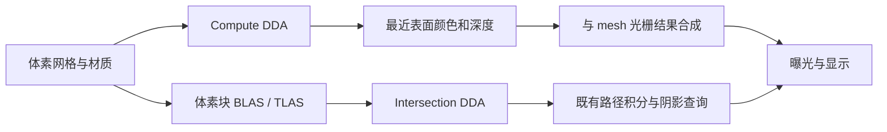

# 实体体素渲染设计

## 目标与本次范围

采用规则三维网格表达不透明实体体素，以 CPU 射线参考和 GPU 逐格遍历直接渲染可见表面，
支持透视/正交相机、网格模型混合遮挡、版本化资产、Editor 拾取及可等待截图。
采用两条后端路线：光栅侧的 compute DDA/深度合成，以及现有 GPU 路径追踪器中的原生 AABB/intersection 求交。
阶段、依赖和实施状态由 [Roadmap M23](../roadmap.md#m23实体体素渲染)维护。
本文 accepted 表示采用方案；本次只有设计落档，尚无体素类型、target、shader、命令或功能验收。

数据为静态稠密网格，可整份替换。光栅侧采用 Unlit/显式简单方向光，不新增完整 PBR 或几何阴影系统；
路径侧复用现有 Lambert/GGX、MIS/RR、环境/太阳/mesh 面积灯，使体素参与主射线、反弹和阴影。
ReSTIR DI、已有空气/云的路径组合及表面信号适配分别验收，不能因 Classic 可用就隐含宣布支持所有模式。
烟雾密度体素积分、透明体素、体素发光面采样、网格体素化、编辑笔刷、SVO/LOD、无限地形和流式世界不在 M23 范围。
不引入物理求解器，不等待 M20 的降噪滤波器或 M21 流体；复用 M20.2 已有信号生产契约。
OpenVDB/NanoVDB/USD/第三方体素文件导入另行设计。

## 模块边界和依赖方向

所有新增路径/target 均为拟新增，公开接口位于各模块 `include/dk/`，实现位于 `src/`。

| 模块 | 计划职责与依赖 |
| --- | --- |
| `engine/geometry/voxels`，`dk_geometry_voxels` / `dk::geometry_voxels` | 网格视图、校验、CPU 表面求交；仅依赖 Geometry/Math/Core，不依赖资产、Scene 或 GPU |
| 现有 `assets/types`、`data`、`importers`、`runtime` | 增加体素资产种类、拥有型网格/调色板、版本化读写与缓存；保持 CPU-only，不持有 GPU 对象 |
| `engine/render/voxels`，`dk_render_voxels` / `dk::render_voxels` | 程序化输入、GPU 遍历与诊断；依赖 geometry_voxels、RenderData、Device，Graph/Shaders 为内部依赖；不依赖 Framework/Editor |
| 现有 `render/resources`、`data`、`pipeline` | 上传/资源代际、快照提取及表面深度/HDR 合成；GPU 缓存继续归 Render 所有，pipeline 负责组织 Pass |
| 现有 `graphics/device`、`shader-types`、`shaders`、`graph` | 增加通用 AABB BLAS、intersection 编译/反射、procedural hit group 和 SBT/同步校验；Graphics 不认识体素材质或 DDA |
| 现有 `render/pathtracing` | CPU 参考扩展混合几何查询；GPU 以体素 intersection/closest-hit 接入既有路径循环，统一表面身份、材质、历史和信号；不建立第二套积分器 |
| 现有 Services/Operations、Editor/Capture | 资产与实体操作、会话显示设置、拾取及捕获；通过统一服务装配，不绕过 Scene 的提交规则 |

CPU 求交使用只读网格视图，由调用者保活数据；M23.2 程序化夹具拥有数组，M23.5 后由 Assets 拥有型快照提供。
几何查询只返回单元索引/面/参数，不认识颜色或 Vulkan。Render 消费调色板，不把材质放入 Geometry。
`DK_BUILD_RENDER_VOXELS` 拟默认 OFF，实施时明确依赖选项并接入 graphics preset；CPU 参考须可无 GPU 独立验证。
不新增三方依赖或浮动版本。光栅侧仅要求 compute/3D 图像，不要求 RT；路径侧要求现有 RT/BDA 功能启用和 M23.8 扩展。
CPU PathReference 只依赖纯 CPU 体素查询；GPU Pathtracing 私有消费体素 GPU 数据/共享 Slang DDA，体素模块不反向依赖 Pathtracing。

## 接口与数据设计

### 网格与实例

- 网格保存 `dimensions=(Nx,Ny,Nz)` 和紧密 `uint32` 单元数组；X 最快，索引为 `x + Nx*(y + Ny*z)`。
  三轴必须非零，乘加和字节数先以受检算术校验；全空网格合法。
- 单元值 0 表示空；非零值为调色板索引加一，必须在有效范围内。调色板保存线性 baseColor、metallic、roughness，均有限且在 `[0,1]`；默认 metallic=0、roughness=1，alpha 固定为 1、emission=0。
  Lambert 模式仍拒绝非零 metallic；GGX 沿用既有粗糙度映射与 BSDF/PDF，光栅显示不伪称实现这些物理材质。
  GPU 使用 R32_UINT 原生 3D image 的整数 Load，不对占用/材质索引线性过滤，不把 2D array 当作 3D image。
- 局部空间为 `[0,Nx]×[0,Ny]×[0,Nz]`，每格边长为 1；世界尺寸/位置由实体完整仿射变换决定。
  保留非均匀/负缩放和父级剪切。渲染输入拒绝不可逆或非有限变换，不静默漏画整个实例。
- 场景实例绑定 EntityId、AssetId、不可变内容版本、世界变换；GPU generation 只用于当前缓存内诊断。
  多实例共享网格数据；光栅侧先逐实例包围盒剔除，RT 侧使用 BLAS/TLAS；不做跨实例 CSG。
- 程序化输入先作为独立入口，M23.5 再接入资产提取；网格和调色板的所有者须覆盖 CPU 查询或 GPU 上传消费期。

### 射线与表面语义

沿用 [几何查询](geometry-query.md) 的 `origin + t*direction` 与闭区间语义。
逆变换射线后不重新归一化局部方向，使不同实例的 t 可比较；世界方向归一化时 t 为世界距离。
主射线按现有 Vulkan 深度 `[0,1]` 约定构造透视/正交射线并应用近远裁剪；反弹/阴影射线使用自身 t 区间，不能套用相机 far。

CPU/GPU 均在包围盒内使用 DDA 访问单元，表面定义为空/实占用的交界；相邻实心单元间不生成内部面，
即使材质不同也不产生新的表面。射线起点或近裁面位于实心区域时寻找首个离开该区域的表面，
不把近裁面或起点当作伪命中；命中颜色取表面实心侧的材质。

平行轴不做除零；整数网格边界按射线前进方向选择初始单元。边/角同时越界时同时推进对应轴，
法线面按固定 X、Y、Z 优先级决胜；零长度的擦边接触不算穿入体素。
法线经逆转置变换并归一化，保留负缩放语义。CPU/compute 相同 t 时按稳定 EntityId、单元索引决胜。
硬件 RT 对不同 primitive 精确同 t 的选择不承诺遍历顺序；共面重叠案例检查等价最近集合，不要求与光栅 tie-break 一致。
循环有由三轴尺寸推导的有限步数上界；达到异常上界须报诊断/错误，不能将不完整遍历当作正常背景。

独立 CPU oracle 对小网格枚举外露单元面并逐面求交，避免 CPU/GPU 复制同一 DDA 后互相证明。
边界用例单独验收，不能在看到误差后通过扩大边缘掩码隐藏错误。

### 光栅侧：compute DDA 与深度合成

这是一条混合光栅路线：mesh 仍由三角形光栅化，体素由每像素射线寻找表面，随后合入同一颜色/深度目标。
DDA 每次走到下一网格边界并访问下一个单元，属于逐格射线遍历，不是以固定距离采样密度并积累透射的体积 ray marching。
不生成体素表面三角网格，也不为每格提交一个立方体 draw；默认仅做一次最近表面查询，不计算路径反弹。

GPU 输出命中有效性、距离/投影深度、法线、材质及实例标识等诊断，并产生线性 HDR 表面颜色。
具体中间资源布局在 M23.3 随能力/额度检查固定；设备格式、3D extent、分配量和视口尺寸在提交前验证。

M23.4 首期 Pass 顺序为：清除 → mesh depth/opaque → 体素 compute 遍历 → 体素深度/HDR 合成 → tone → readback。
遍历先不依赖 mesh 深度；合成使用全屏图元的片段深度输出与现有 D32 做 Less/test/write，
只在体素更近时覆盖颜色/深度，精确同深度时 mesh 保留。不能从 compute 向 D32 storage 写入，
也不能在同一 Pass 同时采样并写入该深度附件。由 Graph 声明所有访问并建立同步。

Unlit 与显式方向光使用同一可见表面，颜色复用已有曝光/tone/sRGB 规则；不会暗中启用大气或云。
光栅大气/云组合仍后置；路径追踪/ReSTIR 按下节独立接入，不通过最终图像叠加冒充光照参与。
尚未完成对应阶段的组合必须明确拒绝并说明支持范围，不能成功返回缺失体素的画面。
现有不含体素的场景维持原行为。体素深度、HDR 和拾取使用一致的实例/投影版本。

### 路径侧：AABB/intersection 原生体素求交

M23.8–13 将体素作为既有路径追踪器的一种几何输入；不先转 mesh，也不把光栅侧最终颜色作为路径结果。
正式机制依据 [Vulkan 自定义命中组](https://docs.vulkan.org/refpages/latest/refpages/source/VkRayTracingShaderGroupTypeKHR.html)
与 [intersection 阶段](https://docs.vulkan.org/spec/latest/chapters/shaders.html#shaders-intersection)。

1. 按体素块生成局部 AABB，非空块进入 BLAS，实例进入与 mesh 共存的 TLAS；单块覆盖全网格可作为正确性基线。
   块大小/布局在 M23.9 冻结并进入构建指纹，不能让性能调参改变体素表面语义；不为每个体素建立 BLAS。
2. intersection shader 重新检查实际包围盒和当前射线区间，在块内运行共享 Slang DDA，报告真实空/实交界的 t 与单元/面属性。
   块边界不是实体表面，须查询全网格邻格避免假面；边界面有唯一块所有权，不能漏面或重复报告。
   内部起点寻找离开实心区域的真实表面；不得把 AABB 命中直接当成体素命中。
3. intersection 只报告交点和 hit attributes，不读写 ray payload；对应 closest-hit 将属性写入通用命中记录。
   辐射与 visibility 射线都使用 procedural hit group；阴影的提前终止只能基于真实体素表面，不能跳过 AABB 几何。
4. Triangle 与 Voxel 的命中适配器共同提供 kind、实例/内容版本、primitive 或 cell/face、t、世界位置、几何法线与材质。
   三角重心坐标仅属于 triangle 分支；不得把体素 ID 塞进原三角索引再访问 triangle buffer。
5. 现有 raygen 循环继续执行 NEE、BSDF 采样、MIS/RR 和累积；体素参与每次反弹和可见性查询。
   几何法线/侧别及误差相关的原点偏移须兼容极小单元、非均匀/负缩放，不能用固定大 epsilon 掩盖自相交。

共享数据层须支持 voxel-only、mesh-only 和混合场景；是否为空由全部几何决定，不能仍按 triangle_count==0 走空场景 shader。
CPU 路径参考消费同一资产/材质并独立查询小网格外露面，提供直接光、遮挡、间接反弹和 GGX 的统计 oracle。
首期体素不自发光，沿用既有环境、太阳和 mesh 面积灯分布；体素可接收/反射/遮挡这些光源，不增加未定义的体素灯 PDF。

M23.10 将首表面身份与 ReSTIR reservoir/guide/reference 解耦于三角索引：
使用类型化稳定身份与完整内容/材质版本判定来源，局部 GPU 索引由当前帧映射，不能把哈希碰撞当作身份相同。
几何、占用、材质或实例变更按既有策略失效累积/采样历史；相机运动仅在现有规则允许时复用。
表面 fresh/lobe/guide/运动信号重组保持 M20.2 契约，布局/来源版本在实施时显式升级并核对预算；不新增降噪算法。

M23.11 把已有空气/云路径中的最近表面和阴影查询接入混合几何，保持自由程、透射和首表面条件 RIS 的分工，
体素不是新的密度介质。表面信号适配不自动放开 Scene media 降噪组合，仍遵循 M20.10 的能力边界。
M23.12 接入同一资产的两种视口/独立截图，复用既有相机和采样服务；后端/算法/介质/信号组合按已完成阶段报告能力。

### 资产与上层入口

M23.5 扩展 [资产种类](assets-types.md)、[资产运行时](assets-runtime.md) 和 [Scene](scene.md) 的引用校验。
原生体素资产采用显式格式标识/版本、维度、调色板和单元数据；不得直接 dump C++ 对象布局。
字节序、字段宽度、摘要、文件/内存额度、尾部/截断处理和旧数据兼容在该阶段实施前写入相关设计并冻结 v1。
读取未知版本、索引越界、非法颜色、尺寸/字节溢出或预算超限时拒绝整份候选；不覆盖原资产/旧缓存。
内容哈希用于缓存失效，不能仅凭 mtime；复用现有元数据/产物发布契约，不承诺跨文件原子事务。

Scene 只保存持久资产引用和实体变换，不保存体素数组、GPU 对象或上传状态。
CPU-only 能加载/保存描述和 CPU 资产；GPU 模块关闭时不能声称可捕获体素图像。
必要的资产/场景协议变更、旧场景迁移和旧 reader 的明确拒绝在 M23.5 定义并测试，禁止静默丢弃未知 kind。

M23.6 先接入光栅侧资产加载/替换、实体绑定/变换、显示设置、CPU 拾取和 `render.capture`；M23.12 扩展原生路径后端及其算法组合。
优先扩展已有服务/命令；只有现有入口无法表达行为时才新增命令，届时同步注册/schema、参考页与示例。
持久修改走 Scene/Assets 的 guard、effect、undo 契约；显示会话设置不修改 Scene revision/dirty/撤销历史。
拾取比较体素与 mesh 的最近命中，支持现有 Gizmo 操作整体实例，不提供单体素绘制或雕刻。
GUI、Console/IPC 与独立 capture 消费同版本快照；截图任务保留自己的输入/输出，不借用不断变化的视口图像。

## 生命周期、并发和错误处理

复用 [RenderData](render-data.md)、[GPU 资产](render-resources.md)、[Graph](graphics-graph.md) 的所有权及提交规则。
CPU 资产构建、上传、网格/调色板替换均先准备完整候选；失败保留旧 Scene、资产快照和 GPU generation。
GPU 成功提交后才发布新缓存快照，区分 submitted、completed 和队列健康；不能将 submitted 写成 Ready 图像。
旧快照与在途帧继续保活旧代资源；卸载只移除缓存引用，不提前销毁 GPU 正在消费的对象。
device_lost 按既有队列失效契约处理，不承诺旧资源在设备失败后仍可用。

首期采用现有单队列和 owner 串行发布，不新增异步 compute、后台资源可变共享或热重载线程。
3D 图像访问按完整 mip 声明；不能把 z 切片当作独立同步子资源。静态替换先全量上传，不引入局部更新的未初始化区域。
Memory closing 后拒绝新构建/上传/渲染，已有只读快照、等待和读回保持其既有寿命规则。
超时不丢弃帧，失败/取消不改写用户读回输出；后台迟到结果不能覆盖更新版本的视口。
RT 的 AABB/build 输入、BLAS/TLAS、SBT、网格/材质和通用命中映射形成同代候选，提交失败保留整套旧代。
构建输入寿命与着色数据寿命分开：BLAS 完成后可释放的 AABB buffer，不代表 intersection 消费的体素数据也可释放。
首次仅支持 BUILD；形状/占用变化按内容版本重建，palette-only 复用 AS 必须证明几何不变，但仍失效相关累积/历史。

## 实施步骤和验证计划

按 [M23.1–13](../roadmap.md#m23实体体素渲染)逐阶段推进；每阶段先更新直接受影响模块设计，再实现和独立提交。
保留 M23.1–7 编号：M23.3 为首个光栅侧离屏成果，M23.6/7 完成该路线的使用闭环与基线；
M23.9 为原生混合几何路径成果，M23.12 接通上层，M23.13 完成两条路线联合交付，不能在 M23.7 关闭父里程碑。

| 层级 | 计划验收 |
| --- | --- |
| CPU 数据/查询 | 全空/实心/空心/单格/棋盘、平行轴、内部起点、边角并进、裁剪、非均匀/负缩放/剪切；DDA 对独立外露面 oracle；非法输入/溢出/额度拒绝 |
| GPU 遍历 | required 真实 GPU 探针，格式/extent 检查、上传往返、与 CPU 对照的命中/距离/法线/材质；validation 与同步检查；失败提交/在途释放 |
| 混合表面 | mesh/voxel 前后交错、同深度规则、多体素实例、近远裁剪、透视/正交、viewport resize；原网格与 tone 回归 |
| 资产/状态 | 保存重载、版本拒绝、内容失效、整份替换、旧快照保活、CPU-only、无效引用、提交失败、unload/closing/取消 |
| Editor/capture | 三入口设置一致、拾取/Gizmo、Scene/Undo 边界、固定输入截图、迟到结果拒绝；自动化 Editor 使用 `--background` |
| 原生 RT 底座 | AABB/triangle 混合 BLAS/TLAS、intersection 反射/属性/SBT、radiance/visibility、区间/块边界与提交失败；required validation/sync |
| 原生路径 | voxel-only/mesh-only/混合场景、直接光遮挡、双向间接反弹、GGX/透视/正交、近裁与次级 t 域、内部起点/自相交、参考均值与样本区间 |
| ReSTIR/信号 | 初始/时间/空间/组合 DI 对 Classic/独立参考、类型化身份与遮挡更新、fresh 分量重组、guide/运动/reference 和内容变更失效；不以外观替代数值 |
| Scene media | 空气/云到 mesh/voxel 最近表面、表面/体积事件排序、阴影透射、首表面条件 RIS、无/零介质退化、失败保留完成帧 |
| 性能/交付 | 固定输入与相机，GPU 时间、CPU 提交/上传时间、显存及在途峰值、重复帧稳定性；说明机器/配置/预热与样本数 |

非边界解析夹具要求命中、单元和材质完全一致；候选距离容差为 `1e-4 * max(1, abs(t))`，
Unlit 最终颜色候选容差为 1 byte。M23.3 在运行前固定用例尺度、法线容差与图像比较规则，并记录依据；
不能因失败事后放宽阈值。边/角退化输入单列语义检查，不承诺跨设备逐位一致。

初始性能矩阵选择 64³/128³/256³、空/稀疏/稠密网格及 640×480/1280×720 视口；
每项先核对设备能力和预算，拒绝/跳过单列，不能算作通过。首个 required 基线至少完成 64³、640×480。
光栅分块/空区域跳过在 M23.7 按测量选择；RT 的块布局在 M23.9 固定，M23.13 比较块尺度、AS 构建/上传及路径耗时。
原生路径使用解析/独立 CPU 参考与相同外露面的三角化 oracle 做统计交叉验证；三角化只用于验证，不是交付后端。
数值门槛沿用既有 Lambert/GGX/MIS/ReSTIR/介质契约，在每阶段运行前固定 seed、样本数、置信区间和误差阈值。
RT 路线 required 用例不得以缺少硬件静默跳过；非 RT 配置另外验证光栅侧可用、路径侧能力拒绝，不要求两者光照结果一致。
本计划不预宣称 FPS、加速倍数或跨厂商性能；功能验收与性能候选达成情况分开报告。

## 决策、取舍与未决问题

采用稠密整数网格与直接逐格遍历，先获得独立可验证结果，避免首期同时引入网格化、稀疏树和流式管理。
显式保留体素种类与网格资源边界，不将每个实心体素转换成 Scene 实体或独立 draw call。
目前未决的原生文件细节在 M23.5 冻结，包含两后端共同材质；中间资源布局/精度在 M23.3 固定，
intersection 属性/SBT 与 shader 产物版本在 M23.8 固定，RT 块布局/通用命中在 M23.9 固定，信号身份版本在 M23.10 固定；
这些事项不阻塞 M23.2 CPU 网格与求交参考。阶段开始若发现底座缺口，应更新设计和必要前置，不隐式扩成全引擎重构。

## 相关记录

- [0159 M23.1 体素渲染正式计划](../development/0159-voxel-rendering-plan.md)
- [架构](architecture.md)、[场景管线](render-pipeline.md)、[3D 资源](graphics-resources.md)、[Slang](graphics-shaders.md)
- [原生 RT 底座](graphics-raytracing.md)、[路径追踪](render-pathtracing.md)、[ReSTIR](render-restir.md)、[信号](render-denoising.md)
- [0095 体积图像底座](../development/0095-volume-images.md)：已有资源能力的历史证据，不是体素渲染实现证据。
