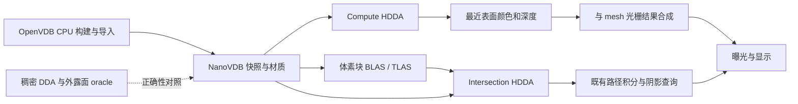

# 实体体素渲染设计

## 目标与本次范围

采用 OpenVDB + NanoVDB 稀疏规则网格表达不透明实体体素，以 CPU 射线参考和 GPU 层级遍历直接渲染可见表面，
支持透视/正交相机、网格模型混合遮挡、版本化资产、Editor 拾取及可等待截图。
采用两条后端路线：光栅侧的 compute HDDA/深度合成，以及现有 GPU 路径追踪器中的原生 AABB/intersection + HDDA 求交。
阶段、依赖和实施状态由 [Roadmap M23](../roadmap.md#m23实体体素渲染)维护。
本文 accepted 表示采用方案；CPU、GPU compute 查询与 mesh 合成的实施证据分别见 [0160](../development/0160-voxel-cpu-sparse.md)、[0161](../development/0161-voxel-gpu-hdda.md)、[0162](../development/0162-voxel-raster-composition.md)。M23.5 文件资产、缓存和 Scene/GPU 资源接入见 [0163](../development/0163-voxel-assets.md)；原生 RT 与上层命令闭环继续分阶段推进。

OpenVDB 负责 CPU 稀疏构建和 `.vdb` 导入，NanoVDB 连续缓冲区作为 CPU/GPU 运行时快照；首期静态拓扑、整份替换。
保留稠密整数网格、逐格 DDA 和独立外露面 oracle 作为正确性参考，生产渲染不将稀疏数据展开成完整 3D 纹理。
光栅侧采用 Unlit/显式简单方向光，不新增完整 PBR 或几何阴影系统；
路径侧复用现有 Lambert/GGX、MIS/RR、环境/太阳/mesh 面积灯，使体素参与主射线、反弹和阴影。
ReSTIR DI、已有空气/云的路径组合及表面信号适配分别验收，不能因 Classic 可用就隐含宣布支持所有模式。
烟雾密度体素积分、透明体素、体素发光面采样、网格体素化、编辑笔刷、SVO/LOD、无限地形和流式世界不在 M23 范围。
不引入物理求解器，不等待 M20 的降噪滤波器或 M21 流体；复用 M20.2 已有信号生产契约。
M23 包含显式占用/材质整数网格的 OpenVDB 导入；不把任意 `.vdb` 中的 SDF、fog density、速度或点网格视为实体体素。
USD 和其他体素文件格式仍后置。库版本、打包限制和接入状态见[三方库说明](../third-party-libraries.md#m23-openvdbnanovdb-稀疏网格选型)。

## 模块边界和依赖方向

公开接口位于各模块 `include/dk/`，实现位于 `src/`；已落地的 CPU/GPU 查询 target 见下方实施契约，上层职责按阶段接入。

| 模块 | 计划职责与依赖 |
| --- | --- |
| `engine/geometry/voxels`，`dk_geometry_voxels` / `dk::geometry_voxels` | 厂商无关查询契约、稠密参考和 CPU 稀疏查询；公共依赖仅 Geometry/Math/Core，NanoVDB accessor 为可选 PRIVATE 实现；不依赖 OpenVDB、资产、Scene 或 GPU |
| 现有 `assets/types`、`data`、`importers`、`runtime` | 体素种类、拥有型 NanoVDB 字节快照/元数据/调色板、版本化产物与缓存；OpenVDB 和转换器仅由可选 CPU 导入实现 PRIVATE 消费，不进入 asset_data 公共接口 |
| `engine/render/voxels`，`dk_render_voxels` / `dk::render_voxels` | NanoVDB buffer 上传、PNanoVDB/Slang accessor、共享 HDDA 与诊断；PUBLIC 为 geometry_voxels_sparse/Device，Graph/Shaders 为 PRIVATE；场景装配后续消费 RenderData，不依赖 Framework/Editor |
| 现有 `render/resources`、`data`、`pipeline` | 上传/资源代际、快照提取及表面深度/HDR 合成；GPU 缓存继续归 Render 所有，pipeline 负责组织 Pass |
| 现有 `graphics/device`、`shader-types`、`shaders`、`graph` | 增加通用 AABB BLAS、intersection 编译/反射、procedural hit group 和 SBT/同步校验；Graphics 不认识体素材质或 DDA |
| 现有 `render/pathtracing` | CPU 参考扩展混合几何查询；GPU 以体素 intersection/closest-hit 接入既有路径循环，统一表面身份、材质、历史和信号；不建立第二套积分器 |
| 现有 Services/Operations、Editor/Capture | 资产与实体操作、会话显示设置、拾取及捕获；通过统一服务装配，不绕过 Scene 的提交规则 |

CPU 求交使用带表示类型的只读视图，由调用者保活稠密数组或 NanoVDB 快照；不暴露 OpenVDB tree 类型。
M23.2 先提供测试用转换/查询适配，M23.5 接入正式 Assets。Geometry 返回有符号单元坐标/面/参数和离散值，不解释材质或 Vulkan。
`DK_BUILD_RENDER_VOXELS` 默认 OFF，`windows-voxels-gpu` 显式启用 VDB/Device/Graph/Shaders；CPU 参考可无 GPU 独立验证。
M23.2 接入可选 OpenVDB/NanoVDB 依赖，核验最新官方 vcpkg port 并固定基线；不引入浮动版本或 CUDA 必需条件。
稠密参考可在关闭 VDB/GPU 的配置下单独验证；启用 VDB 的 CPU-only 转换/查询也必须无 Vulkan/CUDA。
光栅侧要求 compute/storage buffer，不要求 RT；路径侧要求现有 RT/BDA 功能和 M23.8 扩展。
CPU PathReference 只依赖纯 CPU 查询；GPU Pathtracing 私有消费 NanoVDB 数据/共享 Slang HDDA，体素模块不反向依赖 Pathtracing。

## 接口与数据设计

### 稠密参考、稀疏网格与实例

- 稠密参考保存 `index_min`、`dimensions=(Nx,Ny,Nz)` 和紧密 `uint32` 数组；X 最快，局部索引为 `x + Nx*(y + Ny*z)`。
  三轴非零，坐标、乘加和字节数先以受检算术校验；全空网格合法。仅小夹具/有界裁块允许展开，不能按稀疏网格总包围盒分配数组。
- 首期 OpenVDB 输入选定命名 `Int32Grid`，背景必须为 0，值域为 `0..INT32_MAX`；正值为调色板索引加一，负值/越界拒绝。
  占用语义由引擎输入描述声明；未分类的整数 grid 可在显式声明后接受，不能将 OpenVDB `GRID_UNKNOWN` 枚举本身误当成非法数据类型。
  对应 NanoVDB Int32 布局必须在 M23.2/3 验证，稠密参考使用同一受限值域。占用由值定义，不能把导入源的 active mask 当作实体掩码。
  导入校验涵盖 active/inactive voxel、常量 tile 和背景；规范化快照设非零值 active、零值 inactive，保留值和可压缩 tile，禁止逐单元展开巨大常量块。
  规范化之后才可利用 active bbox/mask 加速；空区域跳过仍须证明值为零，不能漏掉源中的 inactive 非零区域。
- 调色板保存线性 baseColor、metallic、roughness，均有限且在 `[0,1]`；默认 metallic=0、roughness=1，alpha 固定为 1、emission=0。
  Lambert 模式仍拒绝非零 metallic；GGX 沿用既有粗糙度映射与 BSDF/PDF，光栅显示不伪称实现这些物理材质。
  GPU 读取连续 NanoVDB storage buffer 与独立 palette，不对离散值过滤。稠密 R32_UINT 3D image 仅作为可选诊断对照。
- 稀疏坐标为有符号 int32 三元组；显式有限索引域包含所有非零 tile/leaf，域外为零，非零背景拒绝。
  非空边界由规范化后的占用求得或由包含它的显式域提供，不能只取源 active bbox；全空资产保留合法描述。
  引擎单元 q 的角域为 `[q,q+1]`、中心为 `q+0.5`。VDB 整数坐标代表采样中心，故角坐标 p 的资产局部位置为 `M_grid * (p - 0.5)`，再乘实体变换。
  导入和程序化夹具必须固定此半格转换并只应用一次；首期只接收可逆有限仿射 grid map，拒绝非线性 map。
  合成 grid/entity 变换保留非均匀/负缩放与剪切；包围盒、射线、法线、拾取使用同一映射。声明可精确遍历的坐标/尺度范围，超界拒绝而非丢精度漏面。
- 场景实例绑定 EntityId、AssetId、不可变内容版本、世界变换；GPU generation 只用于当前缓存内诊断。
  多实例共享网格数据；光栅侧先逐实例包围盒剔除，RT 侧使用 BLAS/TLAS；不做跨实例 CSG。
- 程序化输入先作为独立入口，M23.5 再接入资产提取；网格和调色板的所有者须覆盖 CPU 查询或 GPU 上传消费期。

### 射线与表面语义

沿用 [几何查询](geometry-query.md) 的 `origin + t*direction` 与闭区间语义。
逆变换射线后不重新归一化局部方向，使不同实例的 t 可比较；世界方向归一化时 t 为世界距离。
主射线按现有 Vulkan 深度 `[0,1]` 约定构造透视/正交射线并应用近远裁剪；反弹/阴影射线使用自身 t 区间，不能套用相机 far。

稠密参考使用逐格 DDA，CPU/GPU 稀疏查询使用层级 DDA（HDDA）跨过已证明为空的节点，在必要层级细化并读取整数值。
常量实心 tile 可直接定位其外边界，但仍检查邻域占用；不能把 tree/tile/leaf 边界当作实体表面。
不直接复用面向 SDF 零交叉或 density 积分的示例算法。表面定义为空/实占用的交界；相邻实心单元间不生成内部面，
即使材质不同也不产生新的表面。射线起点或近裁面位于实心区域时寻找首个离开该区域的表面，
不把近裁面或起点当作伪命中；命中颜色取表面实心侧的材质。

平行轴不做除零；整数网格边界按射线前进方向选择初始单元。边/角同时越界时同时推进对应轴，
法线面优先在实心侧单元的实际外露邻面中按 X、Y、Z 决胜，避免把同时穿越的内部格面当作表面法线；
若退化的对角空/实交界没有该单元的单一外露邻面，按同时跨轴 X、Y、Z 兜底。零长度的擦边接触不算穿入体素。
法线经逆转置变换并归一化，保留负缩放语义。CPU/compute 相同 t 时按稳定 EntityId、单元坐标字典序决胜。
硬件 RT 对不同 primitive 精确同 t 的选择不承诺遍历顺序；共面重叠案例检查等价最近集合，不要求与光栅 tie-break 一致。
循环须单调推进 t，边界步数采用受检算术；M23.2/3 固定有限域/层级对应的工作额度和超限诊断，不因稀疏跨度大而溢出或无界循环。
达到异常上界须报错误，不能将不完整遍历当作正常背景。

独立 CPU oracle 对小网格枚举外露单元面并逐面求交，避免 CPU/GPU 复制同一 DDA 后互相证明。
边界用例单独验收，不能在看到误差后通过扩大边缘掩码隐藏错误。

### 光栅侧：compute HDDA 与深度合成

这是一条混合光栅路线：mesh 仍由三角形光栅化，体素由每像素射线寻找表面，随后合入同一颜色/深度目标。
compute 通过 PNanoVDB/Slang 适配器读取 NanoVDB，以 HDDA 跳过空节点、在有效区域逐格确定交界。
这是离散表面遍历，不是固定步长采样密度并积累透射的体积 ray marching；稠密 DDA 只提供对照结果。
不生成体素表面三角网格，也不为每格提交一个立方体 draw；默认仅做一次最近表面查询，不计算路径反弹。

GPU 输出命中有效性、距离/投影深度、法线、材质及实例标识等诊断，并产生线性 HDR 表面颜色。
具体中间资源布局在 M23.3 随能力/额度检查固定；buffer 字节数/地址模式/绑定范围、分配量和视口尺寸在提交前验证。

M23.4 首期 Pass 顺序为：清除 → mesh depth/opaque → 体素 compute 遍历 → 体素深度/HDR 合成 → tone → readback。
遍历先不依赖 mesh 深度；合成使用全屏图元的片段深度输出与现有 D32 做 Less/test/write，
只在体素更近时覆盖颜色/深度，精确同深度时 mesh 保留。不能从 compute 向 D32 storage 写入，
也不能在同一 Pass 同时采样并写入该深度附件。由 Graph 声明所有访问并建立同步。

Unlit 与显式方向光使用同一可见表面，颜色复用已有曝光/tone/sRGB 规则；不会暗中启用大气或云。
光栅大气/云组合仍后置；路径追踪/ReSTIR 按下节独立接入，不通过最终图像叠加冒充光照参与。
尚未完成对应阶段的组合必须明确拒绝并说明支持范围，不能成功返回缺失体素的画面。
现有不含体素的场景维持原行为。体素深度、HDR 和拾取使用一致的实例/投影版本。

### 路径侧：AABB/intersection 原生体素求交

M23.8–13 将体素作为既有路径追踪器的一种几何输入；不先转 mesh，也不把光栅侧最终颜色作为路径结果。
正式机制依据 [Vulkan 自定义命中组](https://docs.vulkan.org/refpages/latest/refpages/source/VkRayTracingShaderGroupTypeKHR.html)
与 [intersection 阶段](https://docs.vulkan.org/spec/latest/chapters/shaders.html#shaders-intersection)。

1. 按规范化占用的 tile/leaf 聚合体素块并生成资产局部 AABB，非空块进入 BLAS，实例进入与 mesh 共存的 TLAS；单块覆盖全网格可作为正确性基线。
   代理必须覆盖非零常量 tile，不能只枚举 leaf；巨大 tile 不展开为逐体素 AABB，变换后的盒取保守边界。
   块大小/布局在 M23.9 冻结并进入构建指纹，不能让性能调参改变体素表面语义；不为每个体素建立 BLAS。
2. intersection shader 重新检查实际包围盒和当前射线区间，通过同一 NanoVDB buffer/accessor 在块内运行共享 Slang HDDA，报告真实空/实交界的 t 与单元/面属性。
   块边界不是实体表面，须查询全网格邻格避免假面；边界面有唯一块所有权，不能漏面或重复报告。
   内部起点寻找离开实心区域的真实表面；不得把 AABB 命中直接当成体素命中。
3. intersection 只报告交点和 hit attributes，不读写 ray payload；对应 closest-hit 将属性写入通用命中记录。
   辐射与 visibility 射线都使用 procedural hit group；阴影的提前终止只能基于真实体素表面，不能跳过 AABB 几何。
4. Triangle 与 Voxel 的命中适配器共同提供 kind、实例/内容版本、primitive 或 cell/face、t、世界位置、几何法线与材质。
   三角重心坐标仅属于 triangle 分支；不得把体素 ID 塞进原三角索引再访问 triangle buffer。
5. 现有 raygen 循环继续执行 NEE、BSDF 采样、MIS/RR 和累积；体素参与每次反弹和可见性查询。
   几何法线/侧别及误差相关的原点偏移须兼容极小单元、非均匀/负缩放，不能用固定大 epsilon 掩盖自相交。

共享数据层须支持 voxel-only、mesh-only 和混合场景；是否为空由全部几何决定，不能仍按 triangle_count==0 走空场景 shader。
CPU 路径参考消费同一资产/材质并独立查询小网格外露面，提供直接光、遮挡、间接反弹和 GGX 的统计 oracle。
首期体素不自发光，沿用既有环境、太阳和 mesh 面积灯分布；体素可接收/反射/遮挡这些光源，不增加未定义的体素灯 PDF。

M23.10 已将首表面身份与 ReSTIR reservoir/guide/reference 解耦于三角索引：
使用类型化稳定身份、有符号 cell 坐标/face 与完整内容/材质版本判定来源，局部 GPU 索引由当前帧映射，不能把哈希碰撞当作身份相同。
NanoVDB 字节偏移、树节点序号或 RT 块 primitive 均不作为持久单元身份；重打包后仍须按版本正确拒绝旧历史。
几何、占用、材质或实例变更按既有策略失效累积/采样历史；相机运动仅在现有规则允许时复用。
表面 fresh/lobe/guide/运动信号重组保持 M20.2 契约，布局/来源已升级 v2 并核对预算；不新增降噪算法。

M23.11 将已有空气/云路径中的最近表面和阴影查询接入混合几何，保持自由程、透射和首表面条件 RIS 的分工，
体素不是新的密度介质。表面信号适配不自动放开 Scene media 降噪组合，仍遵循 M20.10 的能力边界。
M23.12 接入同一资产的两种视口/独立截图，复用既有相机和采样服务；后端/算法/介质/信号组合按已完成阶段报告能力。

### 资产与上层入口

M23.5 扩展 [资产种类](assets-types.md)、[资产运行时](assets-runtime.md) 和 [Scene](scene.md) 的引用校验。
源资产为 `.vdb` 加引擎版本化描述，显式选择 grid 名、占用语义、palette、有限域和 transform；不默认选择第一个 grid 或猜测 SDF 阈值。
产物 v1 封装 NanoVDB 快照、内容/材质版本、语义与坐标约定、构建器/布局版本和源摘要；不能只凭 `.nvdb` 扩展名绕过校验，也不 dump C++ 对象。
M23.2 先冻结 CPU 转换子集；M23.5 再固定文件字节序/字段宽度/摘要、完整依赖清单、截断/尾部规则和旧版本拒绝或重建策略。
文件、解压后 OpenVDB 树、转换临时内存、NanoVDB 输出及在途副本分别限额；不将压缩文件大小视为运行内存预算。
读取未知版本、索引越界、非法颜色、尺寸/字节溢出或预算超限时拒绝整份候选；不覆盖原资产/旧缓存。
内容哈希用于缓存失效，不能仅凭 mtime；复用现有元数据/产物发布契约，不承诺跨文件原子事务。

Scene 只保存持久资产引用和实体变换，不保存体素数组、GPU 对象或上传状态。
CPU-only 能加载/保存描述和 CPU 资产；GPU 模块关闭时不能声称可捕获体素图像。
必要的资产/场景协议变更、旧场景迁移和旧 reader 的明确拒绝在 M23.5 定义并测试，禁止静默丢弃未知 kind。

M23.6 先接入光栅侧资产加载/替换、实体绑定/变换、显示设置、CPU 拾取和 `render.capture`；M23.12 扩展原生路径后端及其算法组合。
优先扩展已有服务/命令；只有现有入口无法表达行为时才新增命令，届时同步注册/schema、参考页与示例。
持久修改走 Scene/Assets 的 guard、effect、undo 契约；显示会话设置不修改 Scene revision/dirty/撤销历史。
拾取比较体素与 mesh 的最近命中，支持现有 Gizmo 操作整体实例，不提供单体素绘制或雕刻。
GUI、Console/IPC 与独立 capture 消费同版本快照；截图任务保留自己的输入/输出，不借用不断变化的视口图像。

## 生命周期、并发和错误处理

复用 [RenderData](render-data.md)、[GPU 资产](render-resources.md)、[Graph](graphics-graph.md) 的所有权及提交规则。
CPU 资产构建、上传、网格/调色板替换均先准备完整候选；失败保留旧 Scene、资产快照和 GPU generation。
GPU 成功提交后才发布新缓存快照，区分 submitted、completed 和队列健康；不能将 submitted 写成 Ready 图像。
旧快照与在途帧继续保活旧代资源；卸载只移除缓存引用，不提前销毁 GPU 正在消费的对象。
device_lost 按既有队列失效契约处理，不承诺旧资源在设备失败后仍可用。

首期采用现有单队列和 owner 串行发布，不新增异步 compute、后台资源可变共享或热重载线程。
NanoVDB 上传为完整只读候选，Graph 跟踪 transfer-write 到 compute/intersection shader-read 的实际 buffer 范围。
稠密诊断图像仍按完整 mip 同步。首期整份转换/上传，既不在途修改值也不原地修改拓扑；这属于引擎快照策略，不声称 NanoVDB 永远不能更新值。
Memory closing 后拒绝新构建/上传/渲染，已有只读快照、等待和读回保持其既有寿命规则。
超时不丢弃帧，失败/取消不改写用户读回输出；后台迟到结果不能覆盖更新版本的视口。
RT 的 AABB/build 输入、BLAS/TLAS、SBT、网格/材质和通用命中映射形成同代候选，提交失败保留整套旧代。
构建输入寿命与着色数据寿命分开：BLAS 完成后可释放的 AABB buffer，不代表 intersection 消费的体素数据也可释放。
首次仅支持 BUILD；形状/占用变化按内容版本重建，palette-only 复用 AS 必须证明几何不变，但仍失效相关累积/历史。

## M23.2 CPU 实施契约

本阶段增加 `dk_geometry_voxels` 稠密拥有型网格与无新增第三方依赖的逐格查询，及可选 `dk_geometry_voxels_sparse` NanoVDB CPU 查询适配。
`dk_asset_voxel_importers` 私有消费 OpenVDB，提供程序化稀疏块输入和测试级 OpenVDB→NanoVDB 转换；正式文件/资产协议仍在 M23.5。
三者的公开接口不暴露 VDB 模板。CPU 查询使用 double 射线、整数 cell/face/value 和世界法线，t 保持原射线参数；每次查询显式受工作额度限制。
稠密构建检查维度乘法、数据长度、有限域和值域后复制数组；稀疏候选规范化所有已分配 voxel/tile 的状态，保留非零值并清除零 active 标记。
数据、转换器、查询和测试均在无 Vulkan/CUDA 配置构建；稠密配置不查找 OpenVDB。NanoVDB 私有数据由不可变快照保活，可只读借用字节供后续 GPU 上传。
源/规范化树、转换输出、访问工作量分别检查额度；失败不发布候选，不修改调用者输入或旧快照，异常转换为 Result 错误，不承诺进程级 OOM 恢复。
无 CUDA overlay 固定官方 port 及源码摘要，仅调整 NanoVDB CPU/header 配置；具体编译差异与验收证据记入 [0160](../development/0160-voxel-cpu-sparse.md)。
固定 OpenVDB 12.0.1 / NanoVDB 32.7.0；MSVC 消费者启用 `/Zc:__cplusplus`，C4702 仅在 SDK 头文件范围抑制，工程代码仍使用 `/W4 /WX` 验收。

- [Voxels.hpp](../../engine/geometry/voxels/include/dk/geometry/Voxels.hpp)：`DenseInput`/`DenseGrid`、闭整数 `Domain`、`Face`/`Hit`/`QueryResult`。局部三轴 cell 范围限制为 ±2^30，逆变换后射线原点限制为 ±2^40；数值不能推进时返回错误。
  稠密默认 16 Mi 单元，查询默认 1 Mi 个访问区域；尺寸乘法先检查额度再运算。零长度擦边不命中，平行外边界视为擦边，内部平行格面按正侧单元归属；精确同时穿轴按 X/Y/Z 选择面。
- [SparseVoxels.hpp](../../engine/geometry/voxels/include/dk/geometry/SparseVoxels.hpp)：不可变共享快照、只读 NanoVDB bytes、源/规范化树/输出大小及节点/占用统计。无公开任意字节反序列化入口；查询无需 OpenVDB。
- [VoxelBuilder.hpp](../../engine/assets/importers/voxels/include/dk/assets/VoxelBuilder.hpp)：程序化块大小为 1/8/128/4096，起点按块大小对齐，按输入顺序覆盖；值/active 分别保留给规范化，`sample_to_local` 表示 VDB 整数采样中心。
  可显式指定包含全部非零源的域，否则由占用推导；空网格采用合法单格域。默认最多 1 Mi 输入块、每棵树 256 MiB、NanoVDB 输出 256 MiB、16 Mi 次规范化值访问。
  源构建每次编辑前预留一条最坏节点路径，可能保守拒绝临界额度；转换前校验源树及访问量，精确输出大小由受限 NanoVDB allocator 在分配前检查。
  树/产物额度不等同于进程 RSS 上限：OpenVDB/TBB 内部 scratch、分配器开销尚未接管，统计不冒充完整 PMR 或进程峰值。
- `DK_BUILD_GEOMETRY_VOXELS` 与 `DK_BUILD_VOXEL_VDB` 默认 OFF；后者同时构建稠密参考、NanoVDB 查询和 CPU 转换。
  `windows-voxels-dense` 不选择 VDB，`windows-voxels` 选择 `voxel-vdb` feature；两预设均关闭 GPU、Scene、Editor、IO 与完整 glTF 导入。
  原固定 builtin-baseline 已包含最新 OpenVDB 12.0.1#0，因此保持基线及其他依赖版本。
- [CPU 测试](../../tests/unit/VoxelTests.cpp)对独立外露面 oracle；[稀疏测试](../../tests/unit/VoxelSparseTests.cpp)检查规范化/层级/快照；
  [PNanoVDB C32 读值](../../tests/unit/VoxelPortableTests.cpp)仅验证 CPU 布局互操作，不能替代 M23.3/8 的 Slang/GPU 门禁。

## M23.3 GPU 实施契约

本阶段新增可选 `dk_render_voxels`，PUBLIC 为 CPU sparse 查询与 Device，PRIVATE 为 Graph/Shaders；
程序化射线批次不消费 Scene/RenderData；M23.4 由 Pipeline 组合程序化实例，正式资产提取仍在 M23.5。
GPU 网格整份上传到只读 storage buffer，保留 CPU 快照、generation 和 upload submission；提交成功后发布候选，
等待完成与发布区分。缓存记录旧代直到调用者和在途工作均释放，失败不消耗 generation 或替换 current。
上传额度计算所有存活 GPU 网格、所有未完成上传的 staging payload 和本次候选/staging；
默认 512 MiB / 两代，最大可配置 2 GiB / 两代；尚有旧代时保守拒绝第三代。查询 payload 单次默认 256 MiB，
最多 1 Mi 条射线和每条 1 Mi 个区域；这些是 payload 限额，不含驱动分配对齐、编译器 scratch 或进程 RSS。
查询使用 Graph 导入实际 buffer ledger，建立 transfer→compute→copy→host 同步；异步结果保留 execution，
等待/读回可在 renderer/cache 释放后继续，超时不修改调用者输出，错误不会伪装成 miss。

固定 NanoVDB 32.7.0 / PNanoVDB 同源头与现有 Slang，HLSL 分支、32-bit 字节地址、uint storage stride 4。
上传仅接受 CPU 转换器或 M23.5 严格载入器发布的不可变 Int32 快照；检查对齐、版本、尺寸不超过 uint32 地址范围及 maxStorageBufferRange。
适配器显式检测访问越界并返回错误；shader/include 内容与宏进入 source_fingerprint，不修改安装的厂商头。
HDDA 放在无入口的共享 Slang 文件中，compute 使用它；intersection 兼容仍需 M23.8 单独验证。

首期 GPU 使用 float，不要求 shaderFloat64/RT/BDA。声明索引域与逆变换后射线原点不超过 ±2^20，
方向有限、非零分量绝对值在 [1e-8,2^20]；t 下界须可表示，超 float 上限的远端按无界转换（上述范围的 slab 交点不超过 2.1e14），数值不推进显式报错。
实例/半格变换在 CPU double 合成并将射线逆变换一次，保持 t；GPU 用上传的逆转置矩阵生成世界法线。
输出为每射线 64 字节：status/value/face、signed cell、normal/t、访问/跳过数与采样 dimension/active；
诊断采样直接读取 PNanoVDB，表面查询沿用 M23.2 的空/实交界、同时跨轴和擦边契约。
64³/640×480 的透视/正交离屏诊断以此 buffer 为依据，深度/HDR 与 mesh 合成见下文 M23.4 契约。

运行前固定门槛：非退化 hit/cell/value/face 完全一致，距离 `1e-4*max(1,abs(t))`，
法线逐分量绝对误差 ≤1e-4；解析边角单列，图像按每像素命中/材质及距离/法线比较，不用扩大边缘遮罩掩盖失败。
至少覆盖六类小网格对独立外露面 oracle、64³ 640×480、非零 inactive tile/零 active、所有树层级、
负坐标/半格/仿射/内部与裁剪、稀疏大跨度跳过、坏地址/额度/提交失败/旧代/在途释放与 closing。
验证要求真实 Vulkan GPU、validation 与同步检查；CPU/Slang 编译成功不能代替执行。记录见 [0161](../development/0161-voxel-gpu-hdda.md)。

## M23.4 合成实施契约

`ScenePipeline::render_voxels` 接受程序化实例列表（稳定 EntityId、共享 VoxelGpuGrid、仿射世界变换、线性 palette），
不新增 Scene 持久组件/文件协议。Pipeline 可选 PRIVATE 链接 render_voxels；未构建该模块时显式拒绝此入口。
最多 64 实例、1 Mi 像素，按 EntityId 排序并拒绝重复 ID；同 t 保留先前实例，mesh/voxel 相同 float 投影深度保留 mesh。
CPU 构建快照记录实际最大值，提交前检查 palette 覆盖整个网格，包含不可见值；palette 颜色/metallic/roughness 在 [0,1]，方向光拒绝 metallic。
实例先按八角包围盒保守视锥剔除；可见实例 GPU 使用 M23.3 共享 HDDA，按帧同一 Graph 内逐实例累积最近表面，禁止主机逐像素查询或读回后合成。
每像素 64-byte 中间结果包含线性颜色、投影深度、法线/t、cell、材质和稳定实例序号；每帧默认 256 MiB 的体素附加 payload 额度。
额度覆盖最近表面、状态/状态读回、每实例 224-byte 参数与 palette；不代替基础图像、NanoVDB 上传或进程峰值额度。

相机沿用有限 forward-Z、刚体世界变换和现有透视/居中正交支持域（含翻转 Y 和透视偏移）；
CPU double 合成逆 grid/entity/camera 变换及每像素步长，GPU 先计算相对视口中心的像素坐标，再生成索引射线；避免分别计算 NDC 导致同斜率轴产生不同舍入。
t 为相机前向距离，near/far 直接裁剪。
索引精度域/异常推进约束继承 M23.3。只接受显式 Unlit 或简单方向光，方向给出指向光源的单位向量，
mesh/voxel 同用 `baseColor * irradiance * max(dot(N,L),0) / pi`，mesh 仍叠加 emissive；方向光 mesh 要求顶点法线与非金属材质，退化插值法线的漫反射贡献为零。
不引入几何阴影、天空漫射或空气/云；启用环境的体素入口拒绝整帧。Unlit 原有 mesh 入口保持不变。

顺序固定为 clear → mesh depth/opaque → voxel HDDA → voxel D32/HDR composite → 可选深度诊断 → tone/readback。
合成采用全屏 fragment 的 SV_Depth 与 D32 Less/test/write，HDR Load 保留已绘 mesh；最终复用既有曝光/Reinhard/sRGB，alpha=1。
读回线性 HDR 与最终 D32 用于数值验收（最多 65536 像素）；D32 通过后续只读 sampled compute 导出，避免同 pass 读写深度或扩大底层传输接口。
GPU 地址/数值/工作量错误按 `1 << status_code` 汇总为帧状态，非有限或下溢为零的射线显式失败；wait、颜色发布和读回均检查，错误不能返回漏画的成功图像。
所有候选、回调及 Frame 容器在提交前准备；失败不提交半帧、不改变旧帧/CPU 场景/GpuAssets/VoxelGpuCache；在途 graph 与帧保活网格、palette、shader 和图像。
按需创建的 Pipeline shader 程序可缓存复用，即使后续输入校验失败；这不发布新的帧或修改资产代际。

运行前固定验收：两种投影均逐像素对 CPU 几何/显示参考，RGB 容差 1 byte、HDR 分量误差 2e-4×max(1,abs(value))、D32 绝对误差 2e-6；
边界采用解析用例，不追加遮罩。覆盖双向遮挡、精确同深度 mesh 优先、稳定实例 tie/输入乱序、近远裁剪/内部起点、半格/负缩放/剪切、
Unlit/方向光/曝光、空列表退化/旧 mesh/alpha mask、resize/重复帧、拒绝/submit/在途/closing。required GPU/validation/sync 禁跳过。
实施与真实证据见 [0162](../development/0162-voxel-raster-composition.md)。

## M23.5 资产实施契约

源入口为 `.dkvoxel` UTF-8 JSON（`DeckerVoxelSource` v1），显式保存工程内相对 `.vdb` 路径、唯一命名 grid、
`solid-material-index` 语义、闭整数 domain、`vdb-sample-center` 坐标变换策略及线性 palette（base_color/metallic/roughness）。
不接受裸 `.vdb` 的隐式默认值。只选 UNKNOWN Int32Grid、零背景；所有非零值必须落在 domain/palette 内。
VDB 自带线性采样中心变换先转换为 cell corner，再应用 meta 的 unit_scale 一次；Entity world 后续组合一次。
palette 的非金属/粗糙度字段供两后端共享，M23.4 Lambert 仍拒绝金属；不支持纹理、alpha 或介质参数。

AssetKind 新增 `voxel`，meta 使用 `voxel-vdb` v1 和唯一 `voxel/0` 输出；AssetId 在内容/描述/单位缩放变化时保持。
复用现有 compile/cache/登记的准备、meta 提交、current 提交与取消流程；源描述和完整 VDB 字节快照都进入 XXH3-128 内容键。
构建器版本、固定 OpenVDB/NanoVDB 版本及 NanoVDB 头文件摘要进入实现签名，缓存读取未知布局/签名时拒绝并可显式重建。
meta/current 沿用既有分步提交：current 写失败保持旧 current，但可能保留已提交 meta 与完整孤立产物，并在错误 context 报告。
旧 mesh meta/CPU 产物/缓存协议保持；旧 reader 因未知 importer/kind/产物 format 明确拒绝 voxel。
Scene/Project 仍只持久化 ID/kind/path/TRS；原版本字段结构不变，旧场景默认迁移沿用既有规则，不需要空转协议升级。

`DeckerVoxelAsset` v1 由 manifest.json + data.bin 组成：manifest 严格记录来源/依赖摘要、meta、语义、有限域、
corner-to-local double 矩阵、palette、构建签名、完整 NanoVDB 版本与 little-endian Int32 布局；data.bin 为单份对齐 NanoVDB 快照字节，摘要覆盖全长，禁止尾部。
读取先限额/验证 JSON 与摘要，再验证固定 Grid/Tree/root/节点区域、所有相对 child 地址、唯一树归属/坐标、值与 active 规范化及 domain；
在指针范围验证完成前不调用 NanoVDB accessor。完整校验通过后才构造不可变 SparseGrid，CPU 查询无需重新导入 VDB。

默认描述 2 MiB、VDB 64 MiB、累计输入 128 MiB、每棵/全部解码树 256 MiB、NanoVDB 256 MiB；
源树/规范化树/输出/输入快照额外受转换存活载荷额度约束，统计分别报告，不能把压缩大小当作树预算。
OpenVDB 流解码来自拥有型输入快照，禁延迟读和外部文件重读；多 grid 全部解码后检查累计树大小并按唯一名称选择。
OpenVDB 的流解码内部不提供硬分配器配额：解码树额度为完成解码后的拒绝门槛，scratch/进程 RSS 上限不作保证；转换输出分配仍在分配前限额。
IO/格式/转换/预算/取消失败丢弃候选并保留旧身份/current/CPU 快照；meta 已提交而 current 失败沿用既有明确的部分提交诊断。

CPU data 增加可选体素拥有型数据（共享 SparseGrid、palette/身份），普通 asset_data 不依赖 OpenVDB/GPU；可选 runtime/importer 才链接实现。
GPU 资源缓存提供按 AssetId 的体素版本、替换/卸载与 palette 保活，提交前完成全部返回容器分配；提交成功才切换当前版本。
旧快照及在途帧继续持有旧网格/材质；closing 后拒绝新工作。Pipeline 根据 Scene 引用装配体素实例，未提供支持的 mesh-only/路径入口明确拒绝体素，不能成功漏画。
服务/命令/Editor/capture 使用闭环见 M23.6，不新增后台线程或热重载机制。

M23.5 验收包括 CPU-only 描述→VDB→产物→缓存→Scene 保存重载，独立进程恢复；源/palette/grid/单位缩放/布局失效，稳定身份、无 CUDA/Vulkan依赖；
坏源/类型/背景/变换/重复 JSON/截断/尾部/地址/值/额度与提交冲突拒绝，旧快照/旧 current 不变；
真实 GPU 上传替换/卸载、旧帧与 palette 保活、失败提交、closing、旧 mesh 回归。证据见 [0163](../development/0163-voxel-assets.md)。

### M23.6 使用闭环实施契约

- `DiskScene` 只读装配 mesh 与 voxel：描述或 artifact 的 ID/kind 必须匹配 Project；先完成整个 CPU 候选，再分别上传 mesh/voxel 资源。
  无 VDB 构建遇到 voxel 返回 not_supported。可显式禁用提取快照中的环境用于 Unlit inspection，不修改 Scene。
- Editor 按文档身份、引用集合/Project 路径和显式 Retry 加载资产；仅 TRS/相机变化不重读文件。
  体素相机采用独立 forward-Z 解析：透视 far/near≤1e6、far≤1e6 m，保留刚体/有限/视域检查；
  支持 Editor 默认 .05/10000 镜头，大气仍限定 far/near≤10000，不因体素放宽。
  光栅射线生成端将方向中相对主分量不超过 32×double epsilon 的舍入残差归零（如 180° 相机的 sin 残差）；
  不放宽共享 HDDA 的极小非零方向/工作上限检查，避免正交轴对齐镜头错误失败。
  失败保留旧 GPU 快照并标记画面非 current；拾取只使用已完成画面的相机、变换和 CPU 网格。
  CPU 稀疏 nearest 与 mesh nearest 比较世界距离，等距按 EntityId；Frame bounds 包含体素有限域的变换后八角。
  选择与 Gizmo 复用现有整个实体的编辑、提交、undo/redo，不支持逐体素编辑。
- 共享 CPU `VoxelDisplaySettings` 保存 Unlit/方向光、世界单位光方向和 RGB irradiance；
  `editor.viewport.set` 的 `voxel_shading / voxel_light_direction / voxel_irradiance` 与 GUI 同走 viewport service。
  GUI 弹层保存完整草稿，Apply 用打开时的 viewport guard 一次提交，允许先编辑三个方向分量再校验单位长度；
  Cancel 丢弃草稿，期间其他入口改变视口则 Apply 返回 conflict，避免覆盖较新设置。
  显示设置只推进 viewport revision，不推进 Scene revision/dirty/history；guard、no-op、失败前校验沿用既有契约。
- `render.capture` 增加相同体素参数及 `unlit_inspection`，独立创建 GPU 设备/资源；不读取 Editor 当前画面或显示设置。
  含 voxel 的光栅任务在接受前冻结整个 DiskScene CPU 输入（最多 64 MiB，计入队列预算），后续源文件替换不会改变任务。
  Scene/Project/相机/显示参数和冻结资产属于该任务；提交不等于完成，仍由 owner pump 原子发布输出。
  普通 mesh capture 保留既有 worker 加载路径；pathtrace 继续明确拒绝 voxel。
- M23.6 的实体体素只接 Unlit/简单方向光；Scene atmosphere/cloud 组合仍拒绝，需显式 Unlit inspection。
  不自动降级，不宣称路径追踪、金属方向光或体积介质可用。
- 验收包含 CPU 守卫/预算/失败候选、真实 GPU 独立截图及冻结输入、后台 Editor 加载/选择/Frame/Gizmo/undo、
  GUI/Console/IPC 设置一致和旧 mesh 回归；39 CPU/8 GPU 定向检查和无 VDB 构建回归已通过，详见 [0164](../development/0164-voxel-editor-capture.md)。
  使用方式见[实体体素光栅工作流](../guides/voxels.md)，性能基线与原生路径仍按后续阶段推进。

### M23.7 光栅基线实施契约

固定版本化程序输入：64³/128³/256³ 的空域、低占用 8³ 岛、实心 tile，另设 64³ 交错 leaf、负坐标大跨度多岛与 4096³ 常量 tile。
每个输入记录域/占用比例、leaf/lower/upper 与 active tile 数；小域生成独立 DenseGrid，对照确定性非退化射线；大域使用解析盒体，不分配同尺度稠密数据。
640×480、1280×720 均测透视/正交。小域抽样像素对照独立稠密查询，完整尺寸检查颜色；受现有 65536 像素诊断读回上限约束，深度使用同投影/宽高比、宽 256 的诊断帧。
保持 1 byte 和 2e-6 深度门槛；既有 64³ 全像素 oracle 与 M23.4 混合合成门禁继续回归，不为基准放宽生产读回额度。
正交反投影恰在平行格面时，CPU 参考只归零不超过 64×double epsilon×坐标尺度的矩阵舍入残差，恢复既定正侧单元归属；计数这些射线但仍全部比较，不扩大浮点误差门槛或排除边缘像素。

基准复用 M11 Submission GPU profiling 与 VMA 统计，不引入新运行时服务/命令。Release 三轮串行，每视图首帧、2 帧预热、8 帧采样分列；validation 正确性运行与关闭 validation 的性能运行分离。
协议 v1 观察到首输入各 GPU 区间同时出现跨轮慢态，不能当作体素算法差异；v2 增加固定 64 帧 1280×720 设备预热，全部预热耗时另行保留，不剔除后续慢样本。不锁频，仍报告每轮分布与残余波动。
记录设备/驱动/构建/源码指纹、转换墙钟、上传 CPU/完成等待/GPU 时间、帧提交/等待/读回/端到端和 GPU 各区间，缺少计时/用例/质量/回收证据必须拒绝汇总。
转换内存列 source/normalized tree、NanoVDB 和三者同时存活的已知 payload；Windows 采样进程 working set/private bytes 及 OS 生命周期峰值另外列出，注明采样不能保证捕获所有内部暂存峰值。
GPU 列网格/调色板/查询/图像 payload、VMA allocation/block、旧帧+新帧/旧代+新代上传样本及释放后计数；AS/AABB/SBT 为本阶段不适用，不填作已验证的 RT 能力。

HDDA 调优限于不改变表面语义的冗余查值消除：单轴表面转换不再重复读取已知为空的邻格。
第一轮候选还在每次转换前检查无跨格点，但三轮测量显示稀疏多岛退化，移除该额外判断；候选与最终数据分别保留。
测试专用 shader 变体保留旧转换及逐格步进，对相同射线比较结果、区域数和 GPU 时间；大跨度逐格对照只测明确标记的有界局部区间。
不因噪声宣称速度提升，不以退化输入或增加误差容限掩盖失败；旧转换与新转换的 hit/cell/value/face 必须一致，距离/法线沿用 M23.3 门槛。
只修改每次查询私有状态，资源发布/失败/在途所有权不变。输入、结果/图像摘要在三轮一致，旧代保活后回收至初始 allocation 数。
基线和调优数据可复算后关闭 M23.7；M23 父阶段以及 M23.8/9 原生路径继续开放。
实际验收已完成：10 项最终定向检查、12 输入/48 视图的三轮协议 v2，以及原始数据独立复算；详见 [0165](../development/0165-voxel-raster-baseline.md)和[基线报告](../benchmarks/2026-11-12-voxel-raster.md)。

## M23.9 Classic 路径实施契约

- CPU `PathTraceScene::create` 消费已有 `CpuAsset::voxel`，冻结 grid/palette/实例变换；公开命中增加 geometry kind、voxel instance、signed cell/face/value。原 triangle 索引仅在 triangle 分支有效。共享材质/位置/法线适配器接入既有 NEE/BSDF/MIS/RR，不另建积分器。
- RT block layout v1：非零常量 tile 保留其 8/128/4096 尺度，非空 leaf 产生一个 8³ 保守块；按规范化 NanoVDB 树枚举，不展开 tile。块坐标与网格域取交集。块的表面所有权按命中实心侧 cell 判定；HDDA 使用全网格邻格语义与块裁剪后的 t 区间，跨块不产生内部面。
- 每个 grid 的角坐标 AABB 进入 BLAS，`entity * corner_to_local` 进入 TLAS；多个实例共享 CPU 不可变网格。GPU 打包 NanoVDB 为受限 32-bit 字节子区间，独立 instance/block/palette storage buffers，所有范围、数量与分配预算先验检查。每次内容替换整份重建，成功提交后才发布缓存候选。
- intersection 复用 `voxel-hdda.slang`，属性为 signed cell/face/value；radiance closest-hit 写入统一命中，visibility 只在真实表面提前终止。查询/地址/工作上限异常写入既有提交诊断，整帧失败，不当作背景。
- RT 块入口先重定位并吸附实际穿越的 slab 平面，避免旧原点加裁剪 t 的舍入令 HDDA 停滞；只有起点表面属于邻块时，使用共享查询 mode 2 跳过该起点转换，随后仍按全网格占用遍历。compute 的 mode 0/1 保持不变。
- CPU 稀疏查询对独立外露面/三角化 oracle 验证。GPU 原点偏移在角坐标中按命中面与浮点误差推进，再变换到世界；拒绝 float 中塌缩的实例/坐标，不用固定世界 epsilon 跳过小单元。
- CPU 体素上限及默认值为 256 个实例、256 MiB Nano 内容及 1M 代理块，可配置更低额度；每条稀疏查询最多 65536 regions，CPU 累计 region 工作另受现有 `max_triangle_tests` 额度约束。GPU 还受 AS/descriptor/storage 设备上限约束；域需可编码为 signed 21-bit，物体射线分量绝对值不超过 2²⁰，世界域不超过 1e6；float 往返误差不超过 1/16 cell，保守偏移需小于 1/8 cell，否则准备/整帧明确失败。这是数值域限制，编码范围不代表所有变换都受支持。
- 首命中诊断保持既有 64-byte pixel/128-byte history；voxel 使用负的 instance/face tag，两个 float 槽以位模式无损保存三个 signed 21-bit cell。CPU 解码为类型化命中，不能把编码槽做浮点数值检查或 triangle 寻址。此编码仅属于帧诊断，不是 M23.10 持久表面身份。
- voxel-only 以全部几何判断空场景；mesh-only 保持既有代码路径。Classic 固定射线、视图及渐进累积支持体素，内容/调色板/实例变化使累积失效。M23.9 交付时拒绝体素 ReSTIR、介质与表面信号；M23.10 已开放表面 DI/信号，M23.11 接入既有空气/云组合，上层 Editor/capture 装配见 M23.12 消费者契约。
- 验收包含 voxel-only/mesh-only/混合最近表面、两类射线和双向间接反弹，Lambert/GGX/环境/太阳/mesh 面积灯，tile/leaf/RT block 边界、负坐标/变换/内部起点/自相交、内容替换与提交失败保留旧结果。

## M23.10 ReSTIR 与信号实施契约

- 沿用同一 Classic/DI 积分器、混合 TLAS 和完整 epoch 发布点，开放 CPU initial RIS、GPU initial/temporal/spatial/combined Surface DI，以及 Classic/ReSTIR 的渐进表面信号。体素不成为发光体；Scene media 与体素组合在 M23.11 独立验收。
- 每份 CPU 冻结几何拥有不回绕的 64-bit `content_version`，create 创建新版本，rebind 共享原几何版本及 owner。版本不是内容哈希；消费端的哈希仍用于快速筛选，不能替代 owner/完整内容比较。持久表面身份由版本、kind、entity/asset、triangle primitive/triangle 或 signed cell/face/value 组成。
- GPU 局部身份为两组整数四元组：kind/index/face/value 与 signed cell.xyz/reserved。triangle index 与 voxel instance index 分属不同 kind，并通过当前冻结场景映射；Nano 地址、树节点及 AABB primitive 不进入身份。ReSTIR surface layout v2 为 6 float4（96 B/像素）：原 hit/normal/position/wo+epoch 加上述两组身份。时间复用比较完整单元身份与位置/法线；空间仍允许跨表面/材质，按各来源的真实 BSDF 重算目标和支持，最后在当前混合场景追踪可见性。
- 信号 layout/source v2 为 23 float4（368 B/像素）：原 21 槽语义保留，追加上述类型化整数身份；旧 triangle 槽在 voxel/miss 为 UINT_MAX。读回提供解析后的稳定身份。版本 1 reference 明确拒绝；reference 附带私有冻结几何 owner 凭据，不能仅靠改写 hash/version 把旧内容伪装为当前来源。凭据保活 CPU 快照，不保活 GPU history。
- ReSTIR temporal 完成平面为 256 B/像素（raw 128 + surface 96 + reservoir 32）；时间多 epoch 暂存同步增加，信号按 368 B 与 ping-pong/外持 owner 完整计费。先校验/分配候选，诊断成功且 generation 匹配后再同时发布 raw、采样历史和信号；取消/提交/预算失败保留最后完整 epoch。
- 验收包含四种 DI 配置对独立三角化/CPU 的均值和来源支持、Lambert/GGX、薄体素遮挡与显露、负 cell/跨种类身份、相机运动、占用/材质/实例替换、信号重组与透视/正交 motion、版本/预算拒绝、阶段失败/取消/旧帧保活；保留 mesh-only 和 M23.9 定向回归。

## M23.11 既有介质组合实施契约

- 空气/云 model 4、sampler 2 保持原有事件深度、hero channel、自由程和 ratio-tracking 随机域。最近表面及所有阴影统一查询 mesh/voxel；材质、偏移、发光与面积 PDF 按类型解释。体素为实体不透明表面，不是密度网格或发光体；行星 ground 仍作为独立解析端点，按距离与几何竞争。
- CPU Classic 与 initial RIS 共用类型化命中；`max_triangle_tests` 同时约束三角形测试和稀疏区域访问总量，统计追加 `voxel_regions`，RIS 追加 `prepared_voxel`，不将其计入 mesh。超限只返回失败，不发布部分图像。
- GPU 复用 surface v2 的 kind/index/cell/face/value；ground kind=3，不能解释成 triangle 或 voxel。首表面 RGB reservoir 在 hero channel/自由程前准备，仅无真实介质事件到达首表面时应用。续段真实散射解除发光抑制，最终混合阴影与透射使用独立 stream 11；复用阶段不追踪透射。
- 固定射线/单次视图开放 Classic 与 initial RIS，透视/正交渐进入口另支持 temporal/spatial/combined 三种 Scene media DI。固定射线读回使用介质 6 float4 步长；视图诊断使用 volume pixel 随机域及实际 sampling epoch 重建体素位置。无/零介质按现有 volume 采样器退化，不声称与 surface sampler 逐样本相同。
- 冻结几何/介质/场数据共同构成来源。占用、材质、变换、空气/云参数、field/time 变化清空累积与复用；完整 epoch 是唯一发布点。失败、取消、旧 generation 和外持 owner 沿用原保护。Scene media 仍不提供 M20 表面信号；Editor/Console/IPC/capture 装配见下节 M23.12。
- 验收：CPU 独立外露三角面 oracle、零介质、表面/体积/ground 顺序、彩色吸收散射和云阴影、条件 RIS；required GPU 固定射线数值、四 DI 透视/正交/分批一致、混合遮挡及编辑/失败/取消/旧 owner；旧 mesh 介质定向回归。

## M23.12 原生路径消费者实施契约

- Editor 使用同一 DiskScene 资产集合创建混合 PathTraceScene；路径 completed result 同时持有 mesh 拾取结构和 voxel CPU 快照，显示纹理、Scene、相机及拾取/Frame 数据只在匹配请求的完整完成帧处发布。切换光栅/路径不得沿用另一代体素查询。路径每次重新启用都携带单调启用代号（包括 worker 尚未观察到暂停的合并请求），配置成功后从空累积/复用历史开始；降低目标 spp 的同周期调度语义保持。持久编辑走既有 guard/undo，显示设置不修改 Scene revision/dirty。
- 继续使用 `editor.viewport.set/query`、相机命令和 Console/IPC 的同一注册表。Surface only 和 Scene media 支持 Classic 与四 DI，透视/正交保持既有相机语义；未装配/禁用 RT 时报告不可用、拒绝路径设置且光栅仍可用。无新增体素着色命令；体素光栅显示参数不控制路径 BSDF。
- `render.capture` 的 pathtrace v1/v2/v3 接受实体体素；含体素的全部 CPU 资产在接受 Job 前按 64 MiB 冻结并计入输入额度，worker 消费同一 owner，不重新读源文件。失败不创建票据/消耗 frame；接受后编辑或删除源文件不改变任务输入。每次 capture 从空采样历史运行固定 spp，不借用视口累积；取消/失败/关闭不覆盖输出，原子文件替换仍是唯一外部提交点。
- 保持 pathtrace quality/version，增加完成结果 `voxel_count`；来源报告 accepted 资产及字节量。输入/几何指纹覆盖体素内容/材质/变换，shader 指纹另覆盖原生 intersection、共享 HDDA/adapter/PNanoVDB。捕获前后核对 shader 闭包。路径模型不套用光栅的空气/云拒绝；体素 raster sequence/光栅介质及 Scene media denoising 信号边界保持。
- 验收使用后台真实 Editor GUI、Console、IPC 和独立 runner：同资产双后端、体素/mesh 混合拾取与 Frame/Gizmo/undo、透视/正交、四 DI/介质与固定 capture 线性结果对照、来源/内容替换失效、接受后源破坏、失败/取消/迟到/关闭保护。禁用设备 RT 验证能力拒绝及光栅可用，不能冒充非 RT 物理卡验收。同步命令参考和可执行示例，旧 mesh 与 M23.6 定向回归。

实施和五项定向 GPU 验收证据见 [0170](../development/0170-voxel-path-consumers.md)，联合性能交付继续由 M23.13 承担。

## Slang 兼容性门禁

[PNanoVDB v12.0.1](https://github.com/AcademySoftwareFoundation/openvdb/blob/v12.0.1/nanovdb/nanovdb/PNanoVDB.h)
提供 HLSL/GLSL/C99 访问器；这不是本工程 Slang → SPIR-V 的兼容性证明。优先采用其 HLSL 分支并封装最小 Slang 适配层，
不在 shader 中包含 OpenVDB 或 C++ NanoVDB。CPU 转换器、NanoVDB 布局和 PNanoVDB 头文件来自同一锁定来源，不能混用 master 头文件。

| 门禁 | 必须给出的证据 |
| --- | --- |
| M23.2 依赖/CPU | 最新官方 port 版本、修订、registry commit、NanoVDB 头文件来源/摘要；Windows x64 无 CUDA 构建与纯 CPU 转换/查询；Int32、背景/tile/leaf/负坐标和规范化前后值一致；稠密参考可关闭全部 VDB 依赖 |
| M23.3 compute 编译 | 使用工程固定 Slang 版本/target/profile，通过真实离线入口编译 PNanoVDB 包含和 HDDA；记录宏、buffer 类型/stride、descriptor 反射、布局/字节序和产物指纹；SPIR-V 校验及旧 compute 回归 |
| M23.3 compute 执行 | required Vulkan GPU 读回已知 background/tile/leaf/active/inactive 输入对应的规范化值；覆盖有符号坐标、节点边界/半格变换、空心/内部起点；HDDA 命中/距离/法线/材质对稠密 DDA 和独立面 oracle |
| M23.8 intersection | 同一 accessor/布局另行编译到 intersection，验证 descriptor stage、属性生产/消费和设备 maxRayHitAttributeSize；required GPU 在混合 triangle/procedural SBT 中读 NanoVDB 并报告解析交点，覆盖辐射/visibility；compute 通过不能替代本项 |
| M23.9 路径整合 | 共享 HDDA 接入真实多次反弹/阴影，与 CPU/三角化验证 oracle 对照；tile/leaf/RT 块边界保持同一实体表面，上传/AS/历史版本一致 |

M23.2 依赖/CPU 门禁见 [0160](../development/0160-voxel-cpu-sparse.md)；M23.3 compute 编译/反射、SPIR-V 和真实 GPU 门禁见 [0161](../development/0161-voxel-gpu-hdda.md)。M23.8 intersection/SBT 独立门禁见 [0166](../development/0166-procedural-raytracing.md)；M23.9 完整 Classic HDDA 路径实施与数值/光照/状态验收见 [0167](../development/0167-voxel-classic-pathtracing.md)。两者复用 PNanoVDB 32.7.0 适配、32-bit 地址/uint stride 4，经 ReportHit 向命中组传递属性。

首期优先验证 32-bit buffer 字节地址，网格长度和所有偏移必须同时受地址表示、descriptor/device 限制和预算约束；
不得将超范围 offset 截断后继续读。若需要 64-bit 地址，单独验证 Slang 整数操作、SPIR-V capabilities 和设备特性后再开放，
不能把 CPU 64-bit accessor 的结果等同于 GPU 支持。无论上游宏如何定义，均须验证实际 HLSL/Slang 访问边界，不能把 OOB 读零当作正确背景。
检查 PNanoVDB 宏/类型转换、位操作、inout/结构传递、资源参数与当前 Slang 反射的兼容；适配差异、license 和 include 摘要纳入构建/产物追踪。
兼容性失败时阶段保持未通过，先修复窄适配或有证据的打包问题；不以稠密展开、三角化、跳过 required GPU 或换用未锁定版本宣布稀疏路线完成。

## 实施步骤和验证计划

按 [M23.1–13](../roadmap.md#m23实体体素渲染)逐阶段推进；每阶段先更新直接受影响模块设计，再实现和独立提交。
保留 M23.1–7 编号：M23.3 为首个光栅侧离屏成果，M23.6/7 完成该路线的使用闭环与基线；
M23.9 为原生混合几何路径成果，M23.12 接通上层，M23.13 完成两条路线联合交付，不能在 M23.7 关闭父里程碑。

| 层级 | 计划验收 |
| --- | --- |
| CPU 数据/查询 | 稠密 DDA/外露面 oracle 对 OpenVDB→NanoVDB；全空/实心/空心/单格/棋盘，负坐标、非零 inactive tile、零 active voxel、跨节点/半格变换；平行轴/内部/边角/裁剪/仿射；非法网格类/背景/溢出/额度拒绝 |
| GPU 遍历 | 上述 M23.3 Slang 门禁；required GPU buffer 上传/访问/HDDA 对照；大跨度稀疏输入不密集化、validation/同步、失败提交/在途释放 |
| 混合表面 | mesh/voxel 前后交错、同深度规则、多体素实例、近远裁剪、透视/正交、viewport resize；原网格与 tone 回归 |
| 资产/状态 | `.vdb` grid 选择与描述/palette 保存重载，NanoVDB 产物版本/布局拒绝或重建；源/导入配置内容失效、整份替换、旧快照保活、CPU-only、额度/无效引用/失败/unload/closing/取消 |
| Editor/capture | 三入口设置一致、拾取/Gizmo、Scene/Undo 边界、固定输入截图、迟到结果拒绝；自动化 Editor 使用 `--background` |
| 原生 RT 底座 | AABB/triangle 混合 BLAS/TLAS、M23.8 Slang/NanoVDB 读取门禁、属性/SBT、radiance/visibility、区间与提交失败；required validation/sync |
| 原生路径 | voxel-only/mesh-only/混合场景、直接光遮挡、双向间接反弹、GGX/透视/正交、近裁与次级 t 域、内部起点/自相交、参考均值与样本区间 |
| ReSTIR/信号 | 初始/时间/空间/组合 DI 对 Classic/独立参考、类型化身份与遮挡更新、fresh 分量重组、guide/运动/reference 和内容变更失效；不以外观替代数值 |
| Scene media | 空气/云到 mesh/voxel 最近表面、表面/体积事件排序、阴影透射、首表面条件 RIS、无/零介质退化、失败保留完成帧 |
| 性能/交付 | 固定输入与相机，GPU 时间、CPU 提交/上传时间、显存及在途峰值、重复帧稳定性；说明机器/配置/预热与样本数 |

非边界解析夹具要求命中、单元和材质完全一致；候选距离容差为 `1e-4 * max(1, abs(t))`，
Unlit 最终颜色候选容差为 1 byte。M23.3 在运行前固定用例尺度、法线容差与图像比较规则，并记录依据；
不能因失败事后放宽阈值。边/角退化输入单列语义检查，不承诺跨设备逐位一致。

初始正确性/性能矩阵选择 64³/128³/256³、空/稀疏/稠密网格及 640×480/1280×720 视口；
每项先核对设备能力和预算，拒绝/跳过单列，不能算作通过。首个 required 基线至少完成 64³、640×480。
另设大索引跨度、低占用、多岛/大常量 tile 的稀疏用例，记录包围域、非零比例、tree/leaf/tile 数和跳过次数；
仅用局部裁块/解析几何对照，不分配同尺寸稠密数组。基础层级空跳过属于 M23.3 必交，M23.7 仅调优与量化。
RT 块布局在 M23.9 固定，M23.13 比较块尺度、AS 构建/上传及路径耗时。
内存报告分别列 OpenVDB 树/转换临时峰值、NanoVDB CPU/GPU 字节、AABB/AS/SBT、调色板和在途旧代，不只比较裸网格大小。
原生路径使用解析/独立 CPU 参考与相同外露面的三角化 oracle 做统计交叉验证；三角化只用于验证，不是交付后端。
数值门槛沿用既有 Lambert/GGX/MIS/ReSTIR/介质契约，在每阶段运行前固定 seed、样本数、置信区间和误差阈值。
RT 路线 required 用例不得以缺少硬件静默跳过；非 RT 配置另外验证光栅侧可用、路径侧能力拒绝，不要求两者光照结果一致。
本计划不预宣称 FPS、加速倍数或跨厂商性能；功能验收与性能候选达成情况分开报告。

## 决策、取舍与未决问题

采用 OpenVDB CPU 源与 NanoVDB 运行时稀疏结构，保留稠密 DDA/外露面 oracle；不自行另造稀疏树或加入流式世界。
显式保留体素种类与网格资源边界，不将每个实心体素转换成 Scene 实体或独立 draw call。
依赖的 CUDA 打包问题在 M23.2 解决，CPU 格式/语义先冻结；Slang compute 与 intersection 分别在 M23.3/8 设阻断门禁。
完整源描述/产物 v1 在 M23.5 冻结，包含两后端共同材质；中间资源布局/精度在 M23.3 固定，
intersection 属性/SBT 与 shader 产物版本在 M23.8 固定，RT 块布局/通用命中在 M23.9 固定，信号身份版本在 M23.10 固定；
CPU、GPU compute 与 mesh 深度/HDR 合成分别见 M23.2/3/4；文件资产、光栅闭环/基线见 M23.5/6/7。原生 intersection、Classic 路径与 ReSTIR/信号分别见 M23.8/9/10，后续介质、路径消费者与联合交付按 Roadmap 推进。
阶段开始若发现底座缺口，应更新设计和必要前置，不隐式扩成全引擎重构。

## 相关记录

- [0159 M23.1 体素渲染正式计划](../development/0159-voxel-rendering-plan.md)
- [0160 M23.2 CPU 体素参考与稀疏转换](../development/0160-voxel-cpu-sparse.md)
- [0161 M23.3 NanoVDB GPU 上传与共享 HDDA](../development/0161-voxel-gpu-hdda.md)
- [0162 M23.4 mesh/voxel 深度与 HDR 合成](../development/0162-voxel-raster-composition.md)
- [0163 M23.5 文件资产](../development/0163-voxel-assets.md)、[0164 M23.6 Editor/capture](../development/0164-voxel-editor-capture.md)
- [0165 M23.7 光栅基线与 HDDA 调优](../development/0165-voxel-raster-baseline.md)
- [架构](architecture.md)、[场景管线](render-pipeline.md)、[3D 资源](graphics-resources.md)、[Slang](graphics-shaders.md)
- [原生 RT 底座](graphics-raytracing.md)、[路径追踪](render-pathtracing.md)、[ReSTIR](render-restir.md)、[信号](render-denoising.md)
- [OpenVDB 数据/坐标语义](https://www.openvdb.org/documentation/doxygen/overview.html)、[NanoVDB FAQ](https://www.openvdb.org/documentation/doxygen/NanoVDB_FAQ.html)：上游能力说明不替代固定版本的引擎验收。
- [0095 体积图像底座](../development/0095-volume-images.md)：已有资源能力的历史证据，不是体素渲染实现证据。
