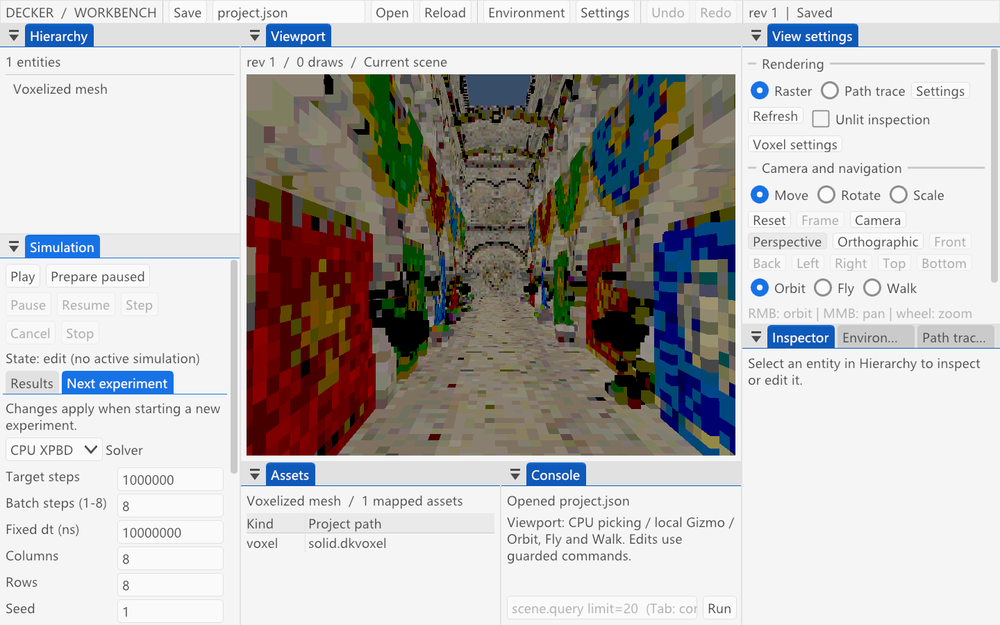
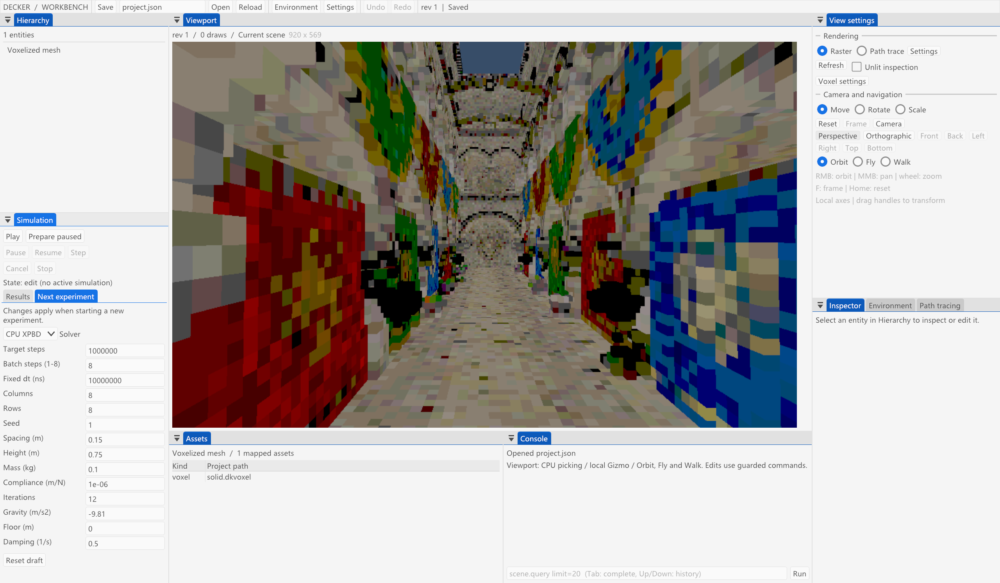

# 0173 右侧相机与渲染设置

## 目标与设计依据

按用户要求把中央 Viewport 上方的配置控件移到右侧功能区，扩大图像区域；依据 [editor](../design/editor.md)、[editor-interaction](../design/editor-interaction.md)。

## 实际变更

- WorkbenchUi 增加右上 View settings，分为 Rendering、Camera and navigation；右下保留 Inspector/Environment/Path tracing 标签。中央保留状态、图像和鼠标交互。
- 迁移 Raster/Path trace、Settings、Refresh、Unlit、Voxel settings、Move/Rotate/Scale、Reset/Frame、相机弹窗/投影/标准视图/导航入口。沿用服务、会话设置、guard 和草稿语义。
- SettingsCatalog/CameraSettingsUi 的搜索定位指向新面板；窄侧栏按钮换行。Inspector Apply/Revert 移到属性顶部，实体变化重置滚动；执行命令后重新获取可能被替换的 draft。
- NavigationSmoke 检查 Revert 后草稿确实清除；OrthographicSmoke 在扩大后的中央区域中先正交缩小再验证背景空点，避免原角落现在落到大背景平面。

## 验证记录

均使用后台编辑器与真实 RTX 4070 Laptop GPU；屏蔽机器自带的 AMD switchable 隐式层，Khronos validation 保留。

```powershell
$env:DISABLE_LAYER_AMD_SWITCHABLE_GRAPHICS_1='1'
./scripts/verify.ps1 -BuildDir out/build/windows-voxel-editor -Configuration Release -Target dk_editor_app -TestRegex '^dk\.editor\.settings_help_gpu_validation$' -Reason 'Sidebar settings locate, apply and cancel'
./scripts/verify.ps1 -BuildDir out/build/windows-voxel-editor -Configuration Release -Target @('dk_editor_app','dk_run','dk_ctl','dk_voxel_asset_process_probe','dk_voxel_gpu_probe') -TestRegex '^dk\.(voxels\.(gpu_numeric_required|path_consumers_gpu_required)|editor\.interaction_gpu_validation)$' -Reason 'All consumers rebuilt; sidebar and voxel GUI/capture acceptance'
```

- Settings help：`out/verify/20261116-143641-d076586f` 中对应测试通过，涵盖定位/字段编辑/Apply/Cancel。
- 旧 mesh 交互：Debug `20261116-145053-dd22ac0a` 与 Release `20261116-145900-0dcdd195` 对应测试通过，覆盖导航、Gizmo、拾取、透视/正交和草稿。
- 后一 Release scope 的 3 项全部通过，包含体素双后端与 GUI/独立 capture 一致性。体素光栅 capture 在 `20261116-141910-023ac2f3` 中对应项通过。
- 开发中实际失败：窄栏 Frame 被裁剪、Inspector 滚动位置和底部 Revert 不可见、扩大后的 viewport 角落不再为空背景；均修复后通过上述交互验收。
- 一次未完整重建消费端的 Debug scope 出现 temporal 图像不一致；不把该次测试算通过。完整构建 Release 消费端及夹具后通过相同验收。

实际生成的 256 Sponza 工程以 `--background --frames 120 --screenshot` 打开并截取完整工作台：viewport 704×549，当前 revision=1，validation 错误/警告和 live allocations 均为 0。截图确认右侧渲染/相机分组与中央图像，无顶部重复工具栏。



文档定向检查通过：14 个 Markdown、1177 个本地链接、元数据/表格/索引/测试入口/JSON 清单；`git diff --check` 通过。未运行全仓回归。

## 后续：默认最大化启动（2026-11-16）

按用户要求，Editor 在创建窗口时显式启用 WindowDesc.maximized；系统工作区决定启动大小，1440×900 保留为还原尺寸，通用 Platform 默认仍为普通窗口。Windows 后台窗口通过最大化样式、显示器工作区与 DPI 边框、NOACTIVATE 定位和保留 normal placement 实现；不使用会抢焦点的 ShowWindow/SetWindowPlacement 最大化路径，仍可由用户手动激活。

大屏初始布局将左右栏限制在 18/20 字体单位内；缩小后保留可用中央区域。原 resize-cancel 测试现在先 restore 再 resize，因为对最大化窗口仅设置尺寸不会产生实际大小变化。含体素的光栅预览采用编辑器 512 Ki 像素默认预算，等比例缩放，再等比例显示到面板；状态行显示实际图像尺寸。普通 mesh 与路径尺寸政策不变，底层光栅/HDDA/预算实现未修改。

验证：

- Release `dk.platform.windows`（`20261116-155120-4195605d`）通过：本机最大化客户区 2560×1494，Windows IsZoomed 成立，还原 320×240；三个生命周期 activation_events=0，可见/可聚焦/非置顶/后方 Z-order 与资源释放通过。
- Release `dk.editor.interaction_gpu_validation`（`20261116-155542-ac66c046`）通过：从最大化开始，拾取/Gizmo、相机、还原/resize/minimize 取消与后续正交/导航验收全部保留原判据。
- Release 旧 mesh 交互在 `20261116-162317-b9a11f97` 对应项再次通过；最终体素 `dk.voxels.editor_capture_gpu_required` 在 `20261116-163638-2589f22a` 全部通过：GUI/Console/IPC、拾取/Gizmo/撤回、透视/正交、双向遮挡、独立 runner/Python capture 及图像逐字节一致，未改变原断言。
- 最终 Sponza 256 工程以 `--background --validation --frames 120 --screenshot` 验收：客户区 2560×1494、体素预览 920×569、revision=1；validation errors/warnings/liveAllocations 均为 0。人工检查完整工作台截图，中央图像、右侧设置与实际尺寸标签可见。
- 文档定向检查通过：4 个 Markdown、215 个本地链接，以及元数据/表格/索引/测试入口/JSON 清单；`git diff --check` 通过。

开发中实际失败：直接最大化 placement 会激活后台窗口；仅设置最大化 style/位置会丢失还原尺寸；恢复 placement 后需再次放到后方。以上通过原生最大化尺寸/restore/focus/Z-order 检查收敛。交互测试先因最大化时 resize 不发生而提交手势，再因还原后的侧栏挤压导致 Gizmo 不可达，分别修复测试动作和布局。首次最大化 Sponza 截图因体素像素额度拒绝，未算作显示通过。曾尝试显式提高像素额度到 1600×1200，独立 GPU 合成/寿命用例通过（`20261116-160032-44b50b32`），但大尺寸 Sponza GUI 反复设备丢失；临时 4096/16 步限额与跳过 HDDA 的隔离实验仍复现。该扩大额度方案及所有临时诊断代码均撤回，不把独立用例结果算作大尺寸 GUI 支持。后端仍保留原 1 Mi 像素额度。1302×805 的 GUI 和单次独立 capture 可通过，但连续 capture 在两个完整 scope（`20261116-162317-b9a11f97`、`20261116-163232-976eaae2`）均在 Python 示例得到全黑图，后续提交出现设备丢失；不能将成功 job 状态视为正确图像。最小复现在同一 runner 先 directional 再 unlit 时重现，而 920×569 的相同序列全部正确。最终 Editor 默认预览限制为 512 Ki 像素，窗口最大化与预览采样尺寸分开，保留所有图像判据。更大尺寸连续体素渲染及异常后的失败上报尚待单独定位，未声称本次修复。

```powershell
$env:DISABLE_LAYER_AMD_SWITCHABLE_GRAPHICS_1='1'
./scripts/verify.ps1 -BuildDir out/build/windows-voxel-editor -Configuration Release -Target @('dk_platform_probe','dk_editor_app') -TestRegex '^dk\.platform\.windows$' -Reason 'Validate maximized placement, restore bounds and background Z-order'
./scripts/verify.ps1 -BuildDir out/build/windows-voxel-editor -Configuration Release -Target @('dk_editor_app','dk_run','dk_ctl','dk_voxel_asset_process_probe') -TestRegex '^dk\.voxels\.editor_capture_gpu_required$' -Reason 'Validate final maximized voxel preview with measured 512 Ki pixel UI budget and unchanged image equality assertions'
./out/build/windows-voxel-editor/bin/Release/dk-editor.exe --background --root out/sponza-voxel-benchmark-verified/sponza-256-r0 --manifest project.json --validation --frames 120 --screenshot out/editor-maximized-final.ppm
```



仅本机 Windows 显示器验收；未穷举多显示器与所有 DPI 组合，未重跑完整路径追踪/性能矩阵。

## 偏差与决策

不新增设置存储或命令，不改变模拟视图工具栏。为了避免短侧栏隐藏提交操作，额外调整 Inspector 按钮位置。
路径消费端 checkpoint 在 Windows 短暂文件占用时按原 deadline 重试 PermissionError，未放宽内容或图像判据；相关测试改动随体素扩展记录 [0172](0172-mesh-voxelization.md)。

## 遗留问题与下一步

窗口与布局修改完成。未宣称任意用户自定义停靠布局和所有窗口尺寸均做穷举验收。大尺寸连续体素渲染的设备异常和全黑输出需后续单独定位；默认预览采用上述已验收预算。

## 修改记录

- 2026-11-16T13:58:36+08:00：创建设计与记录。
- 2026-11-16T15:17:00+08:00：完成右侧分组与实际 GUI 回归，记录布局引起的失败与修复。

- 2026-11-16T16:38:57+08:00：完成默认最大化、后台焦点/还原和大视口回归；采用已验收的体素预览预算，保留大尺寸 GPU 异常记录。
