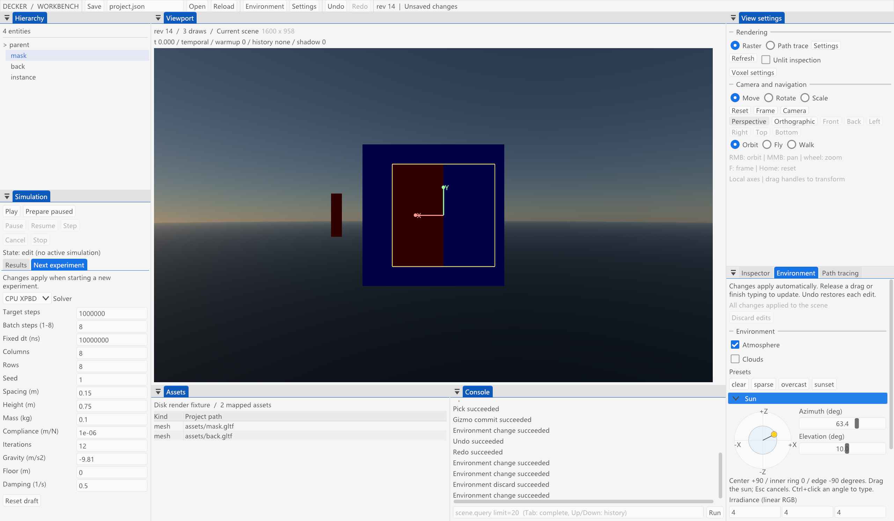

# 0174 环境面板即时应用与太阳方向盘

## 目标与设计依据

按用户请求修正环境开关还需 Apply 的操作，加入圆形太阳方向交互，并优化常用/高级分组、范围单位、状态和兼容性反馈。依据 [editor](../design/editor.md) 的环境面板契约。

## 实际变更

- EnvironmentPanel：大气/云开关和预设点击即提交；数值编辑结束、滑条和太阳盘松开自动提交。常规界面移除 Apply，保留 Discard edits，失败时显示原因和 Retry changes。所有提交仍使用 Workspace.apply_environment/environment.set。
- 太阳方向盘：世界 X/Z 方位、+90° 到 -90° 高度；拖出圆周夹取边界。使用高对比黄色点、地平线环、轴标签和方位/高度数字精调；宽侧栏并排，窄侧栏纵向，Esc 取消。拖动不逐帧提交，松开只产生一次历史项。
- 参数布局：开关与预设前置、预设自动换行，云覆盖率/密度使用有界滑条并优先展示高度和风速；太阳 XYZ、角半径和云纹理生成参数折叠。光栅曝光使用有界对数滑条，Path 模式禁用并指向其独立 EV。
- 本面板直接说明 Unlit inspection、Path Surface only、体素光栅与空气/云组合的消费限制，必要时提供显示环境/打开渲染设置入口；不自动切换渲染模式、不扩大兼容能力。
- SettingsCatalog、使用指南和命令参考中的 GUI 提交说明同步。新增内部 SunDirection 数学辅助及 CPU 边界/往返用例；ConsistencyDriver/EditorEnvironmentTest 验证即时提交、单步 Undo/Redo、Esc、数字精调、外部冲突和独立 capture 图像一致。PathSmoke 删除旧 Apply 点击。
- Scene/revision/history/文件契约未变；一次自动提交失败保留完整输入及旧 guard、真实 Scene/历史不变。提交推迟到面板绘制完成，避免 refresh 替换草稿后继续引用旧对象。



## 验证记录

- Release CPU：`20261116-170120-4a1ebf0b` 的 9 项全部通过，包括方向盘各象限/地平线/极点/越界拖动和往返、草稿 guard/no-op/失败/历史、帮助检索/模板/定位契约。
- Release 设置帮助真实 GPU：`20261116-170232-800363ef` 通过。该体素构建关闭 Luau，实际只注册帮助用例；未将缺少的环境/云测试算作通过，随后改用已启用 Luau 的完整 windows-editor 构建。
- Release 环境/云真实 GPU：`20261116-170341-c12443c7` 两项通过。最终紧凑布局及 Esc/数字精调扩展在 `20261116-170801-8e664fcc` 对应环境/云两项通过，分别 45.41 s / 135.69 s；20 个 GUI 检查点，开关/预设无 Apply、太阳拖动一次撤销/重做、取消不改历史、Enter 后自动提交、跨 IPC 冲突、保存重载、Python/Luau 和独立 capture 逐字节一致。RTX 4070 Laptop GPU；后台启动；Khronos validation/sync；编辑器零错误/警告/liveAllocations。
- 同一最终 scope 的 `media_pathtracing`、`restir_pathtracing`、`desktop_render` 三项通过，分别 42.56 s / 31.80 s / 31.04 s。5 项合计 286.50 s，原图像/状态判据保留。
- 最终体素编辑器重建及设置帮助 GPU 回归在 `20261116-171356-d12d25c3` 通过。文档检查通过：7 个 Markdown、273 个本地链接，元数据/表格/索引/测试入口/JSON 清单；`git diff --check` 通过。

```powershell
$env:DISABLE_LAYER_AMD_SWITCHABLE_GRAPHICS_1='1'
./scripts/verify.ps1 -BuildDir out/build/windows-voxel-editor -Configuration Release -Target @('dk_editor_tests','dk_editor_app','dk_run','dk_ctl') -TestRegex '^dk\.editor\.(sun direction disk|workspace environment|settings help)' -Reason 'Environment auto-apply and sun disk numerical/guard/help contracts after compile correction'
./scripts/verify.ps1 -BuildDir out/build/windows-editor -Configuration Release -Target @('dk_editor_app','dk_run','dk_ctl') -TestRegex '^dk\.editor\.(environment_consistency|cloud_consistency|media_pathtracing|restir_pathtracing|desktop_render)_gpu_validation$' -Reason 'Final sun widget layout, Esc/typed angles, and updated automatic environment toggle consumers'
./scripts/verify.ps1 -BuildDir out/build/windows-voxel-editor -Configuration Release -Target dk_editor_app -TestRegex '^dk\.editor\.settings_help_gpu_validation$' -Reason 'Refresh the voxel editor executable with the final Environment panel and check help navigation'
```

## 偏差与决策

拖动阶段只更新太阳盘和角度，松开自动应用，以保持一次操作一次撤销并避免每帧重建环境。
首次构建因验收代码把 std::array 方向当作 Eigen 向量调用 norm 而失败（`20261116-165813-3a7b3bd8`），修正后重新构建，未用旧二进制验收。截图检查后调整太阳点对比度及角度并排布局；首次环境/云结果保留为过程记录，最终布局重新验收。

## 遗留问题与下一步

本项完成。未增加体素光栅与空气/云的合成能力，也未改变 Path Surface only 的含义。拖动时更新控件、松开后更新视口；未实现逐帧环境草稿渲染。未跑全仓、全部显示器/DPI/自定义停靠布局组合或性能矩阵。

## 修改记录

- 2026-11-16T16:53:07+08:00：创建设计与验收计划。

- 2026-11-16T17:16:47+08:00：完成自动应用、太阳盘与面板整理，以及 CPU/真实 GPU/截图/文档验收。
