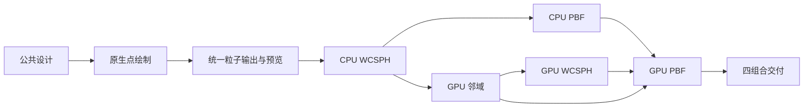

# 原生点绘制与 SPH/PBF 首期实施计划

依据：[水体调查报告](2026-10-23-water-simulation.md)及用户后续要求：点云需要添加点绘制支持，先实现 SPH、PBF。
本文保留首期方案形成依据，已纳入 [M21 Roadmap](../roadmap.md) 和
[粒子流体](../design/physics-fluids.md)、[点绘制](../design/render-particles.md)正式设计。
当前契约以模块设计为准，阶段状态只在 Roadmap 维护；落档记录见 [0147](../development/0147-particle-fluid-plan.md)。
`source_commit` 保留原调查时的代码基线，不表示后续正式设计已经实现。

## 1. 首期范围和完成条件

首期交付 **原生点绘制 + WCSPH CPU/GPU + PBF CPU/GPU + 编辑器/脚本实验闭环**。
GPU 使用现有 Vulkan Compute、Slang 和 Graph。SPH 先具体落为 WCSPH，后续其他压力解法单独扩展。

点云必须走 `vk::PrimitiveTopology::ePointList`，一个粒子对应一个点 primitive。
支持点大小、方形/圆形显示、深度测试和物理量着色。取消前一版调查中以三角形 billboard 作为首选的建议。
点绘制是图形底座能力；粒子渲染器在其上消费 CPU/GPU 输出，不能只在布料 renderer 中增加特殊分支。

物理首期限定三维单相、等温、固定粒子数、等质量粒子、静态盒状容器及单个流体域。
共用初始填充、单位、核/邻域基础、边界与诊断语义；算法拥有各自的工作数组。

MAC、场 ray marching、OpenUSD/OpenVDB 接入、恢复检查点、真实水面光学、发射器和双向固液耦合进入后续计划。
首期统一数据中保留单位、稳定 ID、时间和通道语义，使后续格式接入无需修改求解循环；不以 USD 安装或网格协议为前置。

完成条件：四种算法/后端组合都可准备、单步、有限步运行、暂停、取消、预览和导出；
CPU-only 数值运行不链接 Vulkan，GPU 预览无需全量粒子读回；原布料实验继续可用。

## 2. 已核实的改动入口

| 位置 | 当前约束 | 计划改动 |
| --- | --- | --- |
| [Device.hpp](../../engine/graphics/device/include/dk/graphics/Device.hpp)、[Device.cpp](../../engine/graphics/device/src/Device.cpp) | 未公开或启用 largePoints；工程 Vulkan 基线为 1.4 | 查询/启用点大小特性、公开能力与限制，覆盖独立和宿主共享设备 |
| [Pipeline.cpp](../../engine/graphics/device/src/Pipeline.cpp) | 只接受 triangle list/strip | 接受 point list，保留三角形路径与参数校验 |
| [CommandEncoder.cpp](../../engine/graphics/device/src/CommandEncoder.cpp) | 已有 draw/draw_indexed；零数量被拒绝 | 复用录制接口，验证点索引和范围；空点云在上层跳过 draw |
| [ShaderCompiler.cpp](../../engine/graphics/shaders/src/ShaderCompiler.cpp) | 使用 Slang 和既有产物/反射协议 | 核验 PointSize/PointCoord 内建语义通过完整编译与产物加载链 |
| [ClothRenderer.hpp](../../engine/render/simulation/include/dk/render/ClothRenderer.hpp) | 绑定规则布片与 GPU XPBD | 独立增加通用粒子点渲染，不要求布片拓扑 |
| [SimulationService.hpp](../../engine/framework/services/include/dk/services/SimulationService.hpp)、[AsyncSimulation.hpp](../../engine/framework/services/src/AsyncSimulation.hpp) | 配置、指标和 read 返回类型绑定布料/XPBD | 添加有类型的粒子流体分支，复用 owner/worker 控制与发布规则 |
| [FixedStepClock.cpp](../../engine/physics/api/src/FixedStepClock.cpp) | 外部固定拍至少 1 ms | 保持外部时钟语义，在流体求解器内实现可小于 1 ms 的内部子步 |

## 3. 原生点绘制的具体计划

### 3.1 设备和管线

区分硬件支持与逻辑设备启用，公开 `largePoints`、`pointSizeRange`、`pointSizeGranularity`。
沿用工程显式特性请求的模式；启用流体点预览的 editor 和独立 GPU 宿主在设备创建时提出请求，
不能等求解器启动后再尝试修改已创建的设备。

Vulkan 1.4 要求支持 largePoints，但应用仍须显式启用特性。
这意味着当前问题主要在工程接入，而不是默认把大型点当作不支持的能力。
见 [Vulkan 1.4 要求](https://docs.vulkan.org/features/latest/features/proposals/VK_VERSION_1_4.html)、
[特性启用规则](https://docs.vulkan.org/spec/latest/chapters/features.html)。

不启用 largePoints 的测试路径只使用 1 px 点；请求更大尺寸时返回清楚的能力错误。
非法尺寸、NaN、超出设备范围在提交前拒绝，UI 依据实际限制展示可调范围。
离散精度采用设备 granularity，图像验证允许规范内的光栅化差异。
不静默改成三角形绘制，也不将 `polygonMode=point` 当成 point-list 支持。

### 3.2 Shader 和点外观

vertex shader 输出 clip position 和 `SV_PointSize`；fragment shader 用 `SV_PointCoord` 生成圆形遮罩。
这两个语义是 Slang 提供的 SPIR-V 映射，仍需用项目锁定的 Slang 版本实测编译和运行。
见 [Slang SPIR-V 语义表](https://docs.shader-slang.org/en/latest/external/slang/docs/user-guide/a2-01-spirv-target-specific.html)。

首期点大小定义为 framebuffer 像素，便于一致检查；UI 若用逻辑像素输入，应在边界明确转换 DPI。
物理粒子间距、核支持半径和显示点大小独立，不修改求解参数来改变显示尺寸。
首期保留原生点的裁剪和单点深度语义，不把大圆点解释成有真实球面深度的球体。

粒子位置和颜色通道可从 storage buffer 通过 vertex ID 读取。
支持常量色、speed、density、densityError；WCSPH 可增加 pressure，PBF 乘子保持单独的诊断名称。
使用深度测试/写入和不透明点，圆外 discard；暂不引入透明排序。

### 3.3 独立验收

- 真实 point-list 管线绘制 1 px 和多个合法点尺寸，检查覆盖及点位置；检查方形/圆形遮罩、前后点遮挡。
- 检查透视、正交、近远裁剪、窗口/DPI 改变，颜色与 stable ID 对应一致。
- 检查 shader 产物中的 PointSize/PointCoord 映射；不能仅以编译无错误判定支持。
- Vulkan required validation 与同步验证；验证资源在途销毁和旧帧保留。
- 无特性启用、非法尺寸、空点云和 buffer 范围错误有明确结果；现有三角形绘制定向回归通过。

## 4. 公共物理数据与算法约定

### 4.1 最小公共数据

建立粒子流体公共描述：

```text
FluidDefinition = solver + backend + material + initialRegion + boundary + timePolicy + seed
ParticleState   = stableId[] + position[] + velocity[] + mass[] + optional quantities[]
FluidOutput     = runId + completedStep + simulatedTimeNs + generation + channels + owned storage
```

solver 与 backend 独立；内部采用有类型的配置/结果分支，不靠 `bool gpu` 或无类型字典承担算法选择。
数据使用 SI，通道记录单位、可用性和原生/派生来源。CPU 数据层不暴露 Vulkan/USD 类型；GPU 资源适配位于可选模块。
粒子不创建 ECS Entity。保留现有 XPBD 配置、命令用法和结果兼容路径。

邻域共用有界均匀网格、cell key/ranges 和稳定 ID；以实际核支持半径决定网格搜索范围。
先确定核及其梯度、质量初始化和边界权重，再做 CPU/GPU 对照；具体公式写入实现前的模块设计。
PBF 的密度约束梯度需与选定数值模型一致；若采用与密度核不同的梯度近似，必须单独记录并验证，不能混用验收公式。

容量以粒子数、邻域工作量和字节预算校验，不直接继承布料的 1024 粒子限制。
首个完整实验采用约 4k 粒子；16k、64k 用于后续规模测量，不作为未经测量的实时承诺。

### 4.2 WCSPH

实现邻域 → 密度 → EOS 压力 → 对称压力力/黏性/重力 → 积分 → 边界和数值检查。
固定核、参考密度、数值声速、EOS 参数和负压策略；非零黏性选择明确离散与单位。
静态边界对密度提供贡献，并以几何边界防止穿透，避免仅夹紧粒子位置。

外部一拍可分为多个内部子步；先用固定子步和稳定条件检查，按声速/速度/加速度/黏性确定可接受配置。
子步时长之和必须精确覆盖外部整数纳秒时刻，达到工作预算后明确失败，不丢弃剩余物理时间。
完整自适应子步作为后续优化，不影响 CPU/GPU 同一固定计划的验收。

### 4.3 PBF

实现外力预测 → 邻域 → 密度乘子 → Jacobi 位置修正/边界 → 速度重建。
首期固定迭代数、双缓冲、等质量；正确性版本逐轮更新邻域。
只有证明 skin/位移条件满足时，才允许复用候选邻域；禁止静默截断邻居或忽略迭代中新增邻居。

人工压力修正、XSPH 平滑分别提供显式开关并记录配置；原始基线可独立关闭这些增强项。
不把 XSPH 参数直接当作物理运动黏度，不把 constraintMultiplier 当 Pa 压力。
涡量增强不作为首个 PBF 通过条件，后续加入时单独验证其能量影响。

### 4.4 GPU 共用基础

GPU 邻域先完成整数 key、排序/前缀和、cell ranges 和所有关联通道的一致重排。
独立验证随机/重合/边缘位置及非 workgroup 整数倍粒子数，与 CPU 暴力邻域按 stable ID 对照。
优先每粒子 gather，避免无序浮点 scatter；关键阶段之间由 Graph 声明同步。
GPU 输出保持常驻，初始化上传一次；预览读取已完成代次，导出和全量诊断才明确请求读回。

提交数与完成数分开；设备错误保留真实提交记录和上一完成快照，不承诺撤销已经执行的 GPU 工作。
暂停/取消在有界子步或批次边界生效，不让邻域排序、PBF 迭代和初始化占住 UI 线程。

## 5. 分阶段实施与验收门槛

P0–P8 是原始工作包，现分别纳入 M21.1–9；正式前置、交付与状态以 [Roadmap](../roadmap.md) 为准。
下表保留方案映射，不独立维护进度；每个通过验收的小阶段单独本地提交。

| 阶段 | 内容 | 前置 | 验收结果 |
| --- | --- | --- | --- |
| P0 / M21.1：公共设计 | 粒子数据、单位、solver/backend、子步、状态与兼容策略；确定数值验证方法 | 现有模拟/图形底座 | 设计可指导实现，测试尺度和输出语义明确；可执行基线在 CPU 阶段建立 |
| P1：原生点绘制 | Device largePoints、point-list、Slang 内建语义和管线校验 | P0 | 离屏真实点绘制、尺寸/深度/拒绝路径、三角形回归 |
| P2：粒子输出和预览 | 公共数组/快照、PointCloudRenderer、CPU 上传/GPU buffer 输入、服务流体分支 | P0、P1 | 静态/合成 GPU 粒子显示，暂停换视角不改数据；原布料兼容 |
| P3：CPU WCSPH | 核、CPU 邻域、边界、子步、密度/压力和完整推进 | P2 | 静水与溃坝实验，有限性/近壁/质量/穿透指标；命令与点预览接通 |
| P4：CPU PBF | 密度约束、Jacobi、邻域刷新、重建速度、独立诊断 | P3 的公共基础 | 残差、退化和边界测试；可切换 CPU 算法并显示真实结果 |
| P5：GPU 邻域基础 | GPU 排序、ranges、ID/通道重排、预算与同步 | P3 的 CPU 参考、P2 | 暴力邻域集合对照和关联属性一致；required validation |
| P6：GPU WCSPH | GPU 阶段 Pass、常驻状态、健康诊断和点绘制连接 | P3、P5 | 同输入/固定子步的 CPU/GPU 短期对照；无全量回读预览 |
| P7：GPU PBF | 双缓冲迭代、动态邻域、速度修正和边界 | P4、P5、P6 的集成路径 | 与 CPU PBF 对照、修正后新增邻居、有限步和暂停/取消 |
| P8：统一交付 | 编辑器/脚本四组合、实验导出、性能报告与旧布料回归 | P3、P4、P6、P7 | 用户可以从配置到图像/数值完整复现；CPU-only 和真实 GUI 分别验证 |

推荐执行顺序是表中顺序；P5 在 P3 基础完成后已具备独立前置，不依赖 PBF 数学实现。
每个 CPU/GPU 求解器阶段都接入现有服务和最低可用预览，P8 集中完成 UI 易用性与跨入口验收，
避免求解器长期停留在孤立测试程序中。



## 6. 接入与验证要求

### 6.1 工作台和命令

用户选择求解算法、CPU/GPU、初始液体区域与容器、外部拍长/内部子步、材料参数和显示通道。
启动后参数归属于该 run；改变算法或物理参数先结束当前 run，再建立新状态，首期不做实时后端迁移。
显示点大小、色标和相机可在暂停/运行时改变，不触发物理重建。

服务保留准备/运行、单步、暂停/恢复、取消/停止、查询、显式采样和导出。
命令参数、能力发现、schema、参考页、Python/Luau 用例随各阶段同步；此处不提前登记尚不可用的命令能力。
导出保存版本化配置、稳定 ID 对齐的粒子数据、指标、图像及来源信息；大数组采用明确的二进制布局，
不将 JSON 巨型数组或 USD 依赖作为首期性能路径。该导出用于分析和从零重放，不称为恢复检查点。

### 6.2 数值与资源

| 类别 | 必须验证的行为 |
| --- | --- |
| 公共粒子 | 核/梯度、self contribution、重合退化、邻域暴力对照、ID 与所有通道重排、预算拒绝 |
| WCSPH | 静水趋势、成对内力、稳定步长、自由表面与近壁密度分别统计、质量和穿透 |
| PBF | 约束计算与单轮修正、迭代残差趋势、邻域有效性、速度重建、增强项独立开关 |
| CPU/GPU | 固定输入/seed/子步/迭代，短期逐 ID 比较位置/速度/密度，长期比较统计量 |
| 调度 | 精确 N 拍与内部子步计数、取消边界、过期 run、故障后不继续推进、旧完成快照可用 |
| 显示 | 原生点管线、深度、色标、透视/正交、DPI、暂停导航、GPU 写到 vertex 读的同步 |
| 交付 | CPU-only、四组合脚本、真实后台 GUI、导出失败保护、关闭无在途资源泄漏、旧 XPBD 定向回归 |

M21.1 定义验证方法，M21.4/5 建立可复算的小规模数值参考，按粒子间距、rho0 和速度尺度锁定容差；
后续 GPU 性能调整不得放宽这些容差。自由表面密度与内部密度分开，稳定不发散不等于数值验收通过。

按仓库 [定向验证选择表](../../.agents/skills/decker-build-verify/references/test-selection.md) 和
[verify.ps1](../../scripts/verify.ps1) 运行直接受影响测试；新增入口同步选择表。
自动化 editor 使用 `--background`。只做文档时运行 [check-spec.ps1](../../scripts/check-spec.ps1)，不构建引擎。

### 6.3 规模和性能

正确性从小 N 与约 4k 粒子开始，功能稳定后测量 16k/64k。
分别报告 CPU 求解、GPU 邻域/求解、上传/读回、点绘制、初始化和控制响应；GPU 时间不当作窗口 FPS。
显存统计包括排序临时数组、候选状态、迭代双缓冲和在途快照，不能只统计 position buffer。
有基准后再评估邻域复用、CPU 并行、批量提交等优化；首期计划不预设未经实测的实时粒子数。

## 7. 当前交付状态

原生点绘制要求、首期范围、实施依赖和验收标准已转入正式设计与 M21 Roadmap，
本文件保留研究计划依据。本次落档不修改源码、依赖或命令参考，也不代表任何求解器/点绘制已验收。
后续首个代码阶段是 M21.2 原生点绘制；最新完成状态和下一项以 Roadmap 为准。
