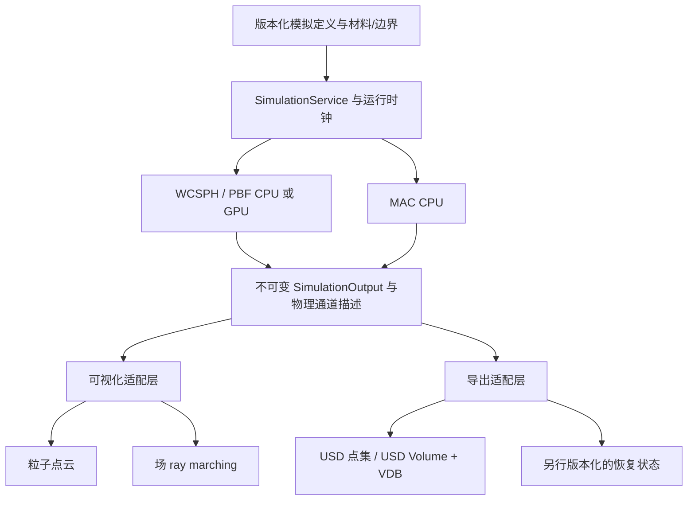

# 水体模拟、物理量可视化与 OpenUSD 格式调查

调查日期：2026-10-23。依据为 `source_commit` 所示仓库源码、模块设计、相关开发记录，以及原论文和官方文档。
本文保留技术选型依据；具体当前契约见后续正式设计，调查中的候选接口和远期阶段不代表已实现能力。

后续范围已按用户要求调整：点云新增原生点绘制，首期实现 WCSPH/PBF 的 CPU/GPU 双端。
首期已纳入 [粒子流体](../design/physics-fluids.md)、[点绘制](../design/render-particles.md)与 [M21 Roadmap](../roadmap.md)，
原始拆分见[首期计划](2026-10-23-sph-pbf-plan.md)；MAC、场 ray marching 和 USD/VDB 实际接入后置。

## 1. 结论与范围

整体技术路线可采用 **WCSPH CPU/GPU + PBF CPU/GPU + MAC 自由表面液体 CPU**，
共享物理量语义、材料参数、运行身份和输出快照，通过独立可视化层显示：粒子用点云，场用 ray marching。
GPU 路线沿用工程现有 Vulkan Compute + Slang + Graph。

**OpenUSD 可以作为统一的场景描述与模拟结果交换入口；建议组合 OpenUSD + OpenVDB + 版本化的 dk 物理约定。**
OpenUSD 原生能表达点集、时序和外部体积场引用，但不足以单独定义三种求解器的全部物理语义、MAC 状态和恢复检查点。
运行中仍使用引擎的连续数组/GPU 缓冲区；USD 位于导入、导出与缓存层。

本报告对需求作以下解释：

| 用户要求 | 建议落点 | 首期边界 |
| --- | --- | --- |
| SPH | 先实现弱可压缩 SPH，简称 WCSPH | CPU 参考和 GPU 实现；后续可扩展 DFSPH/IISPH |
| PBD 水体 | 使用 PBD 框架下的 Position Based Fluids，简称 PBF | CPU/GPU 密度约束；不把布料距离约束当作液体 |
| MAC 网格 | 交错网格上的不可压缩自由表面液体求解 | CPU，规则笛卡尔网格，压力投影与液面追踪 |
| 简单可视化 | 科学量着色与空间位置显示 | 点云、场的体绘制；不要求真实水面反射/折射 |
| 统一物理表达 | 统一语义和交换协议，保留离散位置及算法专属状态 | 不强制把网格转换为粒子，不要求不同算法输出相同轨迹 |

先限定单相、等温、固定参考密度、静态容器、固定粒子数及单个液体域。
多相、气液双向耦合、刚体/布料双向耦合、发射器、PIC/FLIP/APIC、GPU MAC 和写实水面可分别扩展。
“单相”仍须跟踪水与空气的界面；空气可只作为边界区域而不求解其动力学。

## 2. 当前工程基础与实际缺口

以下为本轮源码核查结果；已有开发记录的历史测试不等于本轮重新运行测试。

| 当前能力 | 证据入口 | 对本任务的意义 |
| --- | --- | --- |
| Edit/Play 隔离、固定时钟、run_id、暂停/取消、提交与完成计数 | [Physics API](../design/physics-api.md)、[SimulationService.hpp](../../engine/framework/services/include/dk/services/SimulationService.hpp) | 可复用服务生命周期；求解器参数和结果类型需要泛化 |
| CPU XPBD 距离约束和布料 | [Xpbd.hpp](../../engine/physics/xpbd/include/dk/physics/Xpbd.hpp)、[Xpbd.cpp](../../engine/physics/xpbd/src/Xpbd.cpp) | 当前上限 1024 粒子，固定约束图与分色；没有流体密度约束或动态邻域 |
| GPU XPBD、Graph Pass、候选输出与显式回读 | [GPU XPBD](../design/physics-xpbd-gpu.md)、[GpuXpbd.cpp](../../engine/physics/xpbd-gpu/src/GpuXpbd.cpp) | 可复用设备、同步和资源寿命模式；不能直接复用静态分色求解流体邻域 |
| worker 后端接口 | [AsyncSimulation.hpp](../../engine/framework/services/src/AsyncSimulation.hpp) | 已有 initialize/submit/poll；read 仍返回 XpbdSnapshot，capture 仍接受 ClothConfig |
| 布片可视化、CPU 上传、GPU 直接消费 | [ClothRenderer.hpp](../../engine/render/simulation/include/dk/render/ClothRenderer.hpp)、[模拟可视化](../design/render-simulation.md) | 当前要求规则布片拓扑，需要新的通用点云/场渲染器 |
| 三维纹理与体积采样 | [Resources.hpp](../../engine/graphics/device/include/dk/graphics/Resources.hpp)、[CloudTextures.cpp](../../engine/render/clouds/src/CloudTextures.cpp)、[cloud-reference.slang](../../engine/render/clouds/shaders/cloud-reference.slang) | 有 3D image 和 Texture3D 底座；云场是程序化输入，不是流体解算结果 |
| 基础正交模拟视口已完成 | [0131](../development/0131-camera-orthographic.md)、[SimulationViewport.cpp](../../engine/editor/src/SimulationViewport.cpp) | 新点云/体绘制需要同时适配透视和正交；不能只构造透视射线 |
| 依赖未包含 USD/OpenVDB | [vcpkg.json](../../vcpkg.json)、[三方库说明](../third-party-libraries.md) | 格式适配需要新增可选依赖，不能描述为现有支持 |

需要在设计阶段先解决的接口问题：

1. `SimulationService` 的 `ClothConfig`、`XpbdMetrics`、`XpbdSnapshot` 和 `bool gpu` 无法表示多种算法与网格状态。建议分开 `SolverKind` 和 `ExecutionBackend`，配置/指标使用有类型的分支。
2. [FixedStepClock.cpp](../../engine/physics/api/src/FixedStepClock.cpp) 限定外部固定拍至少 1 ms。WCSPH 的稳定子步可能小于此值，需引入内部子步，不能直接沿用布料默认 dt。
3. [Pipeline.cpp](../../engine/graphics/device/src/Pipeline.cpp) 当前只接受 triangle list/strip。按用户明确要求，首期新增原生 point list，并补齐设备特性、shader 语义和绘制验证。
4. 当前 `SimulationView` 只携带 view-projection 等信息；体绘制还需要可靠的逆变换、射线起点规则和深度信息。建议构造完整的只读可视化 View，避免各 shader 猜测投影类型。
5. 布料导出的 JSON 粒子数组适合小实验，不宜作为大规模粒子/网格逐帧缓存。物理数据应采用二进制或专用格式，JSON 保留描述和指标。

持续相机输入时保留最近完成图、标记真实视图序号和完成步数的既有规则应保留，详见 [0086](../development/0086-simulation-camera-progress.md)。

## 3. 三种模拟路线

### 3.1 SPH：以 WCSPH 建立可解释的 CPU/GPU 基线

SPH 是粒子离散方法家族，必须进一步确定压力处理。WCSPH 通过密度估计和状态方程建立压力，
实现相对直接，适合首个数值参考；提高刚度会缩小稳定时间步。
依据：[Müller 等，2003](https://matthias-research.github.io/pages/publications/sca03.pdf)、
[Becker 与 Teschner，2007](https://cg.informatik.uni-freiburg.de/publications/2007_SCA_SPH.pdf)。

建议基线：等质量粒子、固定核类型与支持半径、邻域密度、对称压力力、明确的黏性模型、重力、静态边界。
基本量为：

\[
\rho_i=\sum_j m_j W(\mathbf x_i-\mathbf x_j,h),\qquad
p_i=\frac{\rho_0 c_0^2}{\gamma}\left[\left(\frac{\rho_i}{\rho_0}\right)^\gamma-1\right].
\]

其中核的定义决定 `h` 与实际支持半径的关系；协议应分别记录二者，不能假设所有核的支持都是 `h`。
`c0` 是数值模型使用的声速，必须随配置导出；压力负值、截断和自由表面处理必须形成显式策略。

建议执行链：

```text
邻域构建 → 密度/压力 → 压力与黏性加速度 → 速度/位置积分 → 边界处理 → 健康检查/指标
```

工程要点：

- 时间步同时考虑声速、最大速度、加速度及显式黏性约束。先提供固定子步和配置校验，再增加有界自适应子步。
- 固定盒壁可以用边界粒子/边界体积贡献补足核支持，再用几何约束避免穿透。单纯夹紧位置无法解决近壁密度偏差。
- 核、梯度、质量、边界权重和压力策略在 CPU/GPU 一致；小规模 double 参考用于校验公式，实际双端可采用 float32。
- 首期不承诺高声速、任意 dt 或高分辨率下仍实时。若 WCSPH 的子步成本不可接受，再单独评估 DFSPH 等方法。

### 3.2 PBD 水体：采用 PBF，保留与 XPBD 的区别

PBF 对粒子密度施加位置约束，例如 `C_i = rho_i/rho0 - 1`，迭代计算位置修正后重建速度。
它仍使用 SPH 核估计密度；这里的“WCSPH 与 PBF”主要区别是压力/不可压缩约束求解方式。
依据：[Macklin 与 Müller，Position Based Fluids，2013](https://mmacklin.com/pbf_sig_preprint.pdf)。

建议执行链：

```text
外力/位置预测 → 邻域 → [密度约束乘子 → 位置修正 → 边界投影] × K → 速度重建 → 可选速度修正
```

建议首期先使用等质量、固定 K 的 Jacobi 式迭代；每个阶段读取上一阶段完整结果，采用双缓冲。
人工压力修正、XSPH 平滑、涡量约束作为独立参数和开关，基线验收分别说明启用状态。
这些数值控制参数不能未经标定映射为真实表面张力或黏度。

现有 XPBD 的预测/重建和资源模式可借鉴，但它求解的是静态布料距离约束。
PBF 的邻域随粒子位置变化，不能沿用布料分色表。XPBD 的 compliance 与约束力估计可在后续扩展，
但不应把“已有 XPBD”理解为“已具备 XPBD 液体”。参见 [XPBD 原论文](https://mmacklin.com/xpbd.pdf)。

**PBF 的原始约束乘子不是标准单位为 Pa 的流体压力。** 首期显示 density、densityError、speed、neighborCount、
constraintMultiplier；若以后提供 pressureEstimate，必须定义推导、尺度和适用范围，并与真实压力字段分开。
有限迭代下仍有密度误差、耗散及时间步依赖，不能仅凭不爆炸判定正确。

### 3.3 MAC：必须补齐自由表面液体算法

MAC 是交错采样布局，本身不是完整的水体求解器。压力位于单元中心，三个速度分量位于对应的面中心。
在此布局上使用压力投影，并以 level set 跟踪液面，才能形成首期网格液体方案。
依据：[Bridson 与 Müller-Fischer，Fluid Simulation 课程讲义，第 2、4、6 章](https://www.cs.ubc.ca/~rbridson/fluidsimulation/fluids_notes.pdf)。

建议保存：`u/v/w` 面速度、中心压力 `p`、液体 SDF `phi`（内部负）、solid/fluid/air 标记，以及压力求解工作区。
单相、常 `rho0` 时的投影可写为：

\[
\nabla^2p=\frac{\rho_0}{\Delta t}\nabla\cdot\mathbf u^*,\qquad
\mathbf u^{n+1}=\mathbf u^*-\frac{\Delta t}{\rho_0}\nabla p.
\]

以下是针对本工程的实现建议：

1. 用规则密集网格建立首版；静态轴对齐容器，先支持简单盒/球液体初始区域。
2. 将上一拍投影后的速度向空气窄带外推，再进行外力和半拉格朗日输运，更新速度与液面；重新分类液体区域。
3. 对液体单元组装压力方程，首选 matrix-free PCG + 简单预条件，达到残差要求后修正面速度。
4. 固壁施加法向速度条件；无表面张力时液面使用大气表压 `p=0`。全 Neumann 的封闭连通区域需分别处理压力常数零空间和右端兼容性。
5. 维护液面距离质量、速度有效范围和体积统计；重距离与输运引起的体积漂移要单独报告。

只做整盒速度投影和染料输运可作为内部算子测试，不能算作完成水体支持。
简单 level set 易丢失薄片、小液滴和总体积；首期测量该误差，后续再依据结果决定粒子 level set、VOF 或 PIC/FLIP。
无黏基线可以先验证，但需明确 `viscosity=0`；黏性非零只有在离散和验证完成后才应暴露为可用能力。

### 3.4 CPU/GPU 共用的粒子基础

推荐一个有界三维均匀邻域网格，cell size 取实际支持半径，访问相邻 27 格。
CPU 用排序后的 `(cellKey, stableParticleId)` 和 cell ranges；GPU 用整数 key、前缀和/排序与 ranges，
每粒子 gather 邻居，避免浮点 scatter 原子写。越界、整数 key 溢出和粒子容量必须显式拒绝或处理。

优先保证以下性质：

- 重排所有关联属性并保留稳定 ID，不能只重排位置；导出按稳定 ID 对齐。
- 用小 N 的 O(N²) 参考校验邻居集合；空间 hash 若发生 key 冲突，仍须校验真实 cell 坐标。
- 密度需明确包含 self contribution，距离梯度的零距离退化单独处理。
- PBF 位置迭代可能产生新邻居：正确性基线逐轮重建，优化时再采用有 skin 的候选表和位移失效检测。
- 不以固定邻居容量静默截断；超预算必须报告，或采用两遍计数分配。不能用“画面大致正确”掩盖漏邻居。
- Graph 负责 pass 间 RAW/WAR/WAW 屏障；不同 workgroup 之间不能靠组内 barrier 实现全局同步。

CPU/GPU 使用同一数值契约和输入数据，不要求同一份源代码或逐位一致。
先实现稳定可复现的 CPU 顺序，再核验 GPU 容差；长期湍动状态比较统计量，短期测试比较逐粒子结果。

## 4. 统一物理表达模式

统一应分成 **场景定义、物理语义、离散状态、存储与交换** 四层。
统一接口不意味着抹去粒子与 MAC 的离散差别，也不意味着一个巨大继承层次。



### 4.1 建议公共数据

| 层次 | 建议内容 | 约束 |
| --- | --- | --- |
| SimulationDefinition | 版本、solver kind、backend、seed、域、初值、材料、边界、时间策略 | 算法参数放独立分支；禁止仅用 bool gpu 区分求解方式 |
| PhysicalMaterial | rho0、动力/运动黏度的明确选择、重力；以后可加表面张力 | SI 单位；记录具体模型，避免同名参数具有不同物理意义 |
| SimulationOutput | run_id、completed step、整数模拟时间、内容代次、domain bounds、通道集合 | 只描述已完成输出；引用有拥有者和有效期 |
| QuantityDescriptor | semantic、单位/量纲、scalar type、components、sample location、validity、provenance | 描述原生值或派生值；缺失不能填零冒充结果 |
| ParticleState | ID、position、velocity、mass；可选 density/pressure/diagnostics | SoA/对齐数组；不为每个粒子创建 ECS Entity |
| GridState | resolution、spacing、origin、采样偏移、各场数组与有效域 | 三个面速度允许不同尺寸；记录 ghost 层、边界和背景值 |
| SolverPrivateState | PBF 乘子/预测位置、SPH 邻域、MAC PCG 工作区等 | 由算法拥有；通用渲染器不读取内部工作区 |

内部数据统一使用米、秒、千克；位置、速度、压力、密度分别为 m、m/s、Pa、kg/m³。
建议明确固定基底和坐标系，域变换只在导入/导出边界处理；首期拒绝会改变物理意义的非均匀缩放。
后续允许缩放时必须同时处理速度、距离、核半径与材料量纲，不能只变换位置。

`rho0` 与体积占据率、可视化 opacity 是三种不同量。
MAC 单相液体的材料密度接近常数，显示 density 通常缺乏信息；更适合显示 speed、pressure、divergence、vorticity、phi。

### 4.2 MAC 采样位置必须进入协议

令 origin 是最小网格角点，间距为 `(dx,dy,dz)`，中心网格尺寸为 `(Nx,Ny,Nz)`：

| 通道 | 数组尺寸 | 相对于整数索引的偏移 |
| --- | --- | --- |
| p、phi、cellType | Nx × Ny × Nz | (1/2, 1/2, 1/2) |
| u | (Nx+1) × Ny × Nz | (0, 1/2, 1/2) |
| v | Nx × (Ny+1) × Nz | (1/2, 0, 1/2) |
| w | Nx × Ny × (Nz+1) | (1/2, 1/2, 0) |

采样世界位置为 `origin + spacing * (index + offset)`。
渲染时可以把速度插值到中心形成临时显示纹理，但该数据必须标为 derived；
求解、精确导出和恢复仍保留原始面值。插值后的中心速度无法无损恢复全部面自由度。

### 4.3 跨方法通道对应

| 物理量/诊断 | WCSPH | PBF | MAC |
| --- | --- | --- | --- |
| position | 粒子位置 | 粒子位置 | 由网格布局确定采样位置 |
| velocity | 粒子速度 | 位置修正后重建速度 | 原生交错面速度 |
| density | 核估计 | 核估计 | 材料常数，或未来可变密度场 |
| pressure | EOS 压力 | 首期不可用；乘子另命名 | 投影压力，需记录表压/基准 |
| densityError | 可计算 | 主要约束诊断 | 常密度方案不作为求解残差 |
| divergence | 需定义 SPH 算子 | 需定义粒子算子 | 原生离散散度 |
| liquid occupancy / phi | 可选重建结果 | 可选重建结果 | 液面状态 |

质量、动量、能量和体积等比较必须指定积分方式和边界通量。
不同离散算子产生的同名诊断可以有不同误差，通道描述中应包含 evaluator/model 版本。
首期粒子默认直接画点；无需为了共享渲染器而每步先重建密度场。

## 5. 简单可视化方案

### 5.1 粒子：点云与物理量着色

按用户后续要求，新增原生 `ePointList` 绘制，每粒子一个点；vertex 输出点大小，fragment 使用点内坐标生成圆形遮罩。
用 storage buffer 按粒子索引读取位置和选中的标量；开启深度测试，先提供不透明点。
此前以三角形 billboard 为首选的建议已撤回。设备特性启用、尺寸限制和 Slang 语义验证详见[首期计划](2026-10-23-sph-pbf-plan.md)。
Vulkan 的原生点大小受设备特性与范围限制，参见 [Khronos 点光栅化规范](https://docs.vulkan.org/spec/latest/chapters/primsrast.html)。

需要区分“物理粒子半径”“核支持半径”“显示点半径”；显示调整不修改物理状态。
支持 speed、density、densityError、pressure（仅确实提供者）、neighborCount 等通道，显示色标、单位、范围及采样时间。
固定范围适合跨帧/跨求解器比较；自动范围是可选显示策略并应记录当前范围。

CPU 路径只在新完成输出或选中通道变化时上传；GPU 路径直接消费常驻输出 buffer。
相机变化不重新上传物理数据；暂停时允许换相机、颜色和点大小，完成步数保持不变。
按 ID 抽样可作为显式预览选项，但必须显示实际绘制数量，不能暗中丢点作为性能优化。

### 5.2 场：ray marching 物理量

建议从密集 3D 纹理开始：R32F 标量；速度可保留三个原生纹理分别按其采样偏移插值，
或生成明确标记的中心显示纹理。首期不依赖 RT 加速结构或光追硬件。

```text
相机射线 → 与域 AABB 求交 → 用不透明深度截断 → 按步长采样场 → 传递函数 → 前向合成
```

透视射线和正交射线使用各自的起点/方向；还需覆盖相机位于域内部、近远裁剪面、非等距体素、
域外样本和有效区域遮罩。MAC pressure 等只在其有效区域显示，空气中的未定义值不能当作物理零值。

按可视化消光系数 `sigma(q) >= 0`，每段使用 `alpha = 1 - exp(-sigma(q) * ds)`，
再以预乘颜色从前向后累积。传递函数改变采样步长后应保持相应不透明度含义；
这种着色是数据可视化，不代表水的真实光学参数。
依据：[GPU Gems 3 第 30 章](https://developer.nvidia.com/gpugems/gpugems3/part-v-physics-simulation/chapter-30-real-time-simulation-and-rendering-3d-fluids)、
[GPU Gems 第 39 章](https://developer.nvidia.com/gpugems/gpugems/part-vi-beyond-triangles/chapter-39-volume-rendering-techniques)。

建议先提供标量体绘制与速度模长；发散色图服务于 pressure/divergence 等带符号量。
裁切平面和沿射线最大值模式有助于查看内部数值，可随后添加。向量方向以后用 glyph/流线补充，
仅显示速度模长不能表示流向。

不要把任意物理场当成 SDF 做 sphere tracing；普通场没有安全距离界。
可先用约半个最小体素宽的步长作质量基线，并测试减半后的图像变化；
性能档可以降分辨率、增大步长或设置显式上限，但需要报告截断/质量状态。

现有云模块可提供相机、资源、采样和合成经验；其天气噪声、球壳、光照模型、缓存上限不能直接作为水体规则。
首期接入独立 Simulation 视口即可；与场景不透明几何联合显示时再明确导入同相机深度与合成顺序。

## 6. OpenUSD 可行性与推荐编码

### 6.1 标准能力和扩展边界

| 内容 | 标准承载能力 | 对 DeckerEngine 的结论 |
| --- | --- | --- |
| 粒子位置、速度、宽度、稳定 ID | UsdGeomPoints / PointBased | 适合粒子缓存；widths 是直径，不能写半径 |
| 逐粒子 density、pressure 等 | primvars 或自定义属性 | 可以存储，但字段命名、单位和物理含义仍需约定 |
| 多物理量体积 | UsdVolVolume + field relationships | 组织场集合，并通过字段资产引用实际数据 |
| 稀疏网格体素 | UsdVolOpenVDBAsset + 外部 .vdb | USD 保存引用；OpenVDB 保存数值、拓扑与变换 |
| 动画 | time samples；大缓存可用 Value Clips | 需要确定采样时间映射、加载策略和拓扑变化规则 |
| 物理世界/刚体相关描述 | UsdPhysics | 可以复用适用概念；不是完整的 SPH/PBF/MAC 求解规范 |
| 任意时刻恢复计算 | 需要专门协议 | 可借 USD 组织检查点，但标准几何缓存本身不足以保证恢复 |

依据：[UsdGeomPoints](https://openusd.org/release/api/class_usd_geom_points.html)、
[PrimvarsAPI](https://openusd.org/release/api/class_usd_geom_primvars_a_p_i.html)、
[UsdVol 总览](https://openusd.org/release/api/usd_vol_page_front.html)、
[UsdPhysics 范围](https://openusd.org/release/api/usd_physics_page_front.html)、
[Value Clips](https://openusd.org/release/api/class_usd_clips_a_p_i.html)。

目前读取的 UsdPhysics 官方说明以刚体共同概念为基础，没有给出本项目所需的通用 SPH/PBF/MAC 全套协议。
Omni PhysX 的 GPU PBD 粒子可以作为外部对照，但其扩展不能当成所有 USD 消费者通用的流体标准。
见 [NVIDIA 粒子模拟文档](https://docs.omniverse.nvidia.com/kit/docs/omni_physics/latest/dev_guide/particles/particles.html)。

另一个容易混淆的名称是最新在线文档中的 `UsdVolParticleField`：其说明针对 Gaussian splats 等光场表示，
不是物理液体粒子的替代接口。本方案使用成熟的 Points 与 Volume/OpenVDBAsset；
在线 release/dev 页面可能先于 vcpkg 包变化，实际接入仍须按固定版本核验。

### 6.2 粒子编码建议

- 一个流体对象对应一个 `UsdGeomPoints`，不为每粒子创建一个 prim。
- 使用 `points`、`velocities`、`ids`、`widths`；`widths` 对应明确的展示/几何直径，核半径另存。
- 逐粒子物理量用带前缀的 primvars，例如 `primvars:dk:density`；插值域采用逐点语义。
- 材料、solver 配置、seed、模型版本放流体对象或专门描述 prim 上；先用版本化 `dk:*` 属性，成熟后再决定是否生成正式 schema plugin。
- 稳定 ID 与数组索引分开。GPU 排序后导出应重排回稳定顺序，或完整记录该帧 ID 对应；不能假设 USD 自动按 ID 重排所有时序数组。

USD `velocities` 是位置单位/秒，不能误写成每帧位移；`timeCodesPerSecond` 负责时间码到秒的换算。
见 [PointBased 速度定义](https://openusd.org/release/api/class_usd_geom_point_based.html)。
建议显式写 `metersPerUnit=1`、`kilogramsPerUnit=1`、`upAxis`、时间码频率，并保存整数模拟纳秒和完成步数作为自定义来源信息。
USD 缺省长度单位为厘米，不能依赖默认值；见 [USD 线性单位](https://openusd.org/release/api/group___usd_geom_linear_units__group.html)。
质量单位约定见 [UsdPhysics 单位规则](https://openusd.org/release/api/usd_physics_page_front.html)；
自定义密度、压力等属性仍需显式声明 SI 语义，不能期待通用工具自动替它们做单位换算。

帧间插值只用于展示。粒子增删、重排时禁止把无对应关系的数组直接线性插值；
验证和恢复使用真实采样时刻的数值。首期固定粒子数使该约定更简单。

### 6.3 MAC 与 OpenVDB：可以保留交错信息，但要明确编码

OpenVDB 本身有 staggered grid；USD OpenVDBAsset 的 `fieldClass` 也允许 `staggered`。
因此不能简单断言“USD/OpenVDB 不支持 MAC”。
依据：[OpenVDBAsset fieldClass](https://openusd.org/release/api/class_usd_vol_open_v_d_b_asset.html)、
[OpenVDB VelocitySampler](https://www.openvdb.org/documentation/doxygen/classopenvdb_1_1v13__0_1_1tools_1_1VelocitySampler.html)。

建议首版的**保真交换配置**使用五个或更多独立 grid：`u`、`v`、`w`、`pressure`、`phi`，
另附 cellType/validity。三个标量速度 grid 分别保存第 4.2 节的尺寸、索引到世界变换和面偏移。
这避免打包 Vec3 时隐藏各分量不同有效边界；后续可增加原生 staggered Vec3 编码。

同时可输出一个**显示用配置**：中心 `velocity`/`speed`、液体占据率或 SDF，供普通查看器使用。
这些转换字段标为 derived，不允许用它们替代原始 MAC 面值恢复计算。

必须额外约定：

- finite domain 的完整尺寸、active/inactive 数值与背景值、ghost 层、边界类型和压力基准。
- VDB 的 index-to-world 变换与 USD Field prim 变换的组合，防止位置偏移被应用两次。
- `field:pressure` 等 relationship 的语义，与 VDB 内部 `fieldName` 的映射。
- 再采样是否有损、误差预算、未知字段保留策略和版本兼容规则。

一般消费者能读取 USD，不代表能识别 `dk:*` 物理含义或正确采样交错速度。
同样，识别 Volume prim 不代表其渲染器会自动显示 pressure 等科学量；材质/传递函数仍需适配。

### 6.4 缓存、场景与检查点分开

建议目录组织如下，仅为结构示意，尚未生成或验证 USD 资产：

```text
water-experiment/
  scene.usda              # 场景入口、材料、单位、配置与缓存引用
  particles/*.usdc        # 粒子时序数据；按规模选择分帧或分块
  fields/*.vdb            # 每个采样时刻的多个物理场
  manifest.json           # 协议版本、文件清单/摘要、原始整数时间
  metrics.json            # 验证与性能指标
  checkpoint/             # 仅在恢复协议另行实现后出现
```

Volume 的 `filePath` 可以按时间采样引用 VDB 序列；USD 自身不替代 VDB 数组存储。
大粒子缓存可以采用 USDC 和 Value Clips，避免不断改写一个巨大的文本层。
默认交付普通目录及相对资产路径；首期无需把 USDZ 打包作为前置。

若要恢复，除位置/速度外还需确定算法版本、精度、子步计划、边界、液面、计数、随机状态，
以及是否重建邻域、乘子是否跨步保存、MAC 工作区哪些可重建等。
只有同环境恢复后继续 N 步与不中断运行对照通过，才可称作检查点；跨 GPU 位级一致不作承诺。

### 6.5 格式选择结论

| 方案 | 适用性 | 建议 |
| --- | --- | --- |
| 单一 USD 文件强装全部运行状态 | 属性可扩展，但体积与恢复语义需大量自定义，逐步写入也增加耦合 | 不作为运行时核心格式 |
| USD + VDB + dk 约定 | 覆盖点集、场、时序与场景关系，保留扩展空间 | 作为首选交换方案做最小验证 |
| 自有二进制 + JSON 描述 | 容易精确保存内部数组，但生态互通较弱 | 作为早期实验/检查点候选，避免成为唯一对外格式 |

这是基于标准能力和项目边界的工程判断；本轮未进行 USD 编译、写入/读回或跨 DCC 验收。

## 7. 依赖与实现复用

### 7.1 OpenUSD/OpenVDB 接入成本

本轮读取官方 vcpkg 源文件得到：`usd 26.8#2`、`openvdb 12.0.1`（port 修订 0）。
公开包展示页仍可能显示旧版本，因此以下以源码读取结果作为调研快照；正式接入时重新核验并固定 registry baseline。
来源：[usd port](https://raw.githubusercontent.com/microsoft/vcpkg/master/ports/usd/vcpkg.json)、
[openvdb port](https://raw.githubusercontent.com/microsoft/vcpkg/master/ports/openvdb/vcpkg.json)。

实际限制需要计入计划：

- 当前 usd port 要求动态库，并关闭 Python、USD tools 和内置 OpenVDB 支持。它不意味着安装后自动获得 usdview/usdchecker 或 VDB 数据解码。
- USD 核心 schema 可以描述 VDB 资产引用；引擎自己的数值读写适配另行链接 OpenVDB。无需因此引入 Hydra 或另一个 Vulkan 渲染器。
- 项目现有 `x64-windows` 与动态库方向相容，但 DLL、plugin 目录发现、CRT/TBB 组合和打包仍需实际验收。
- 本轮所读 openvdb port 的 `nanovdb` feature 带入 CUDA。首期无需启用该 feature；Vulkan 下的密集纹理可视化也不依赖它。

usd 构建选项证据：[官方 portfile.cmake](https://raw.githubusercontent.com/microsoft/vcpkg/master/ports/usd/portfile.cmake)。
本轮不修改 [三方库说明](../third-party-libraries.md) 的已集成清单或项目 baseline。

### 7.2 可作为参照的项目

| 项目 | 调研价值 | 建议使用方式 |
| --- | --- | --- |
| SPlisHSPlasH | 多种 SPH 压力求解器，包括 WCSPH/PBF，边界模型与邻域接口 | 外部结果对照和实现参考；其整体 Simulation 单例组织不直接移入本工程 |
| PositionBasedDynamics | PBF 与其他位置约束实现 | 核对公式和退化处理，不等同于工程所需的 Vulkan 后端 |
| CompactNSearch | 固定半径邻域搜索、空间重排 | CPU 候选参照；如引入仍须依赖审核和具体测量 |

来源：[SPlisHSPlasH 架构](https://splishsplash.readthedocs.io/en/latest/architecture.html)与
[MIT 许可](https://raw.githubusercontent.com/InteractiveComputerGraphics/SPlisHSPlasH/master/LICENSE)、
[PositionBasedDynamics](https://github.com/InteractiveComputerGraphics/PositionBasedDynamics)、
[CompactNSearch](https://github.com/InteractiveComputerGraphics/CompactNSearch)。

建议核心求解保持项目自己的小型 CPU 参考和 Slang GPU 实现，使状态所有权、CPU-only 构建、
暂停/取消和输出协议与现有架构一致；可复用的算法代码另行按许可保留出处。

## 8. 建议模块边界与状态规则

以下名称仅为分工建议，未创建 targets 或目录。

| 模块 | 职责 | 依赖方向 |
| --- | --- | --- |
| physics/data | 定义、通道描述、CPU 数组与只读快照 | Core/必要数学；不链接 Vulkan/USD |
| physics/fluid-common | 核、邻域、静态边界和公共指标 | physics/data |
| physics/sph、physics/pbf、physics/mac | 各 CPU 求解器 | data/common；MAC 线性代数按实际需要私有链接 |
| physics/fluid-gpu | SPH/PBF 的 GPU 资源和 Pass | data、Graph、Shaders；不依赖 Render/Editor |
| render/physics-visualization | 点云、场采样、传递函数、图像 | 输出适配、Graphics/Graph/Shaders |
| assets/physics-usd | USD/VDB 导入导出 | data；PRIVATE USD/OpenVDB |
| SimulationService / Editor | 装配、控制、可视化请求、导出协调 | 组合以上模块，保持现有 owner/worker 边界 |

CPU 公共头文件不暴露 Vulkan 或 `pxr::*` 类型。GPU 适配层持有 typed resource handle，
渲染器通过只读描述消费数据，不向具体求解器索要可写内部状态。

状态建议沿用并补足现有契约：

- 外部固定拍仍决定精确模拟时刻；内部子步之和必须恰好覆盖一拍。输出同时报告拍数和子步数，禁止用遗漏物理时间换稳定性。
- 自适应策略记录实际子步计划或可复现输入；CPU/GPU 数值对照先使用同一个固定计划。超出子步预算则返回明确失败，不能无声截断剩余时间。
- CPU 候选状态通过检查后发布；失败保留上一完成输出。GPU 保留 submitted/completed 区别；提交后设备错误不能声称回滚。
- GPU 每批可产生小型健康/计数归约结果；这是显式设计的诊断同步，不需要全量粒子读回。是否等待该标记成为健康发布条件，需在实现设计中确定。
- 渲染与导出引用已完成代次；在途 buffer/image 由拥有者保活至消费完成。上次输出不能被下一批原地覆盖。
- 相机/色标变化不改 Edit、物理参数或步数；Stop 丢弃 Play，保留最新编辑态。
- 序列导出按冻结的采样身份写到 staging，文件完整后发布 manifest/目录。外部写入失败不破坏旧产物，也不撤销已完成模拟。

上述与 [既有物理状态规则](../design/physics-api.md) 对齐；未来实现时把具体约定写回相应设计，
再同步命令 schema、参考页和测试。报告不提前宣称新增命令已可调用。

## 9. 建议实施次序与独立验收

原跨粒子/网格/格式的工作包次序已由[原生点绘制与 SPH/PBF 首期计划](2026-10-23-sph-pbf-plan.md)替代。
首期依次推进公共设计、原生点绘制、粒子输出与预览、CPU WCSPH、CPU PBF、GPU 邻域、
GPU WCSPH、GPU PBF 和工作台交付；每项有独立验收，现已对应正式 Roadmap M21.1–9，状态以 Roadmap 为准。
MAC、场 ray marching、USD/VDB round trip、恢复检查点和写实水面不作为本期前置或完成条件。

## 10. 验证与规模评估

### 10.1 正确性优先的测试集合

| 层次 | 关键用例与观测 |
| --- | --- |
| 公共数学 | 核支持/归一性、梯度有限差分、重合粒子、邻域暴力对照、stable ID 重排 |
| WCSPH | 无外力对称粒子内力、静水压力趋势、自由表面/近壁密度、封闭域总质量、溃坝穿透与有限性 |
| PBF | 密度约束梯度、单轮修正、增加迭代的残差趋势、邻域刷新、禁用增强项后的独立基线 |
| MAC | 常量场/线性场插值、散度与梯度算子相容、投影前后散度、零空间、静水、平流及液体体积漂移 |
| CPU/GPU | 同输入/seed/固定子步和 K；短时按 ID 比较位置/速度/密度，长时比较统计量 |
| 可视化 | 常量场解析透射、线性 ramp、正交/透视、域内相机、深度遮挡、负值/无效值、色标固定和步长收敛 |
| USD/VDB | 点/速度/ID/单位/时间 round trip；三类面位置；常量及线性 MAC 场；缺文件、变换和未知版本拒绝 |
| 生命周期 | 冷初始化、暂停、取消、Stop、在途关闭、过期 run、导出失败、预览失败保留上一图 |

门槛应在每个实现工作包开工前按尺度锁定，不能直接照搬布料的米制容差。
建议位置误差以粒子间距归一化，压力/速度采用绝对与相对容差，MAC 同时报压力残差和投影散度。
密度误差应区分内部粒子、自由表面和边界粒子；不要求所有自由表面粒子的原始核密度均等于 rho0。
质量、体积、密度残差三者分别测量，粒子质量不变不代表液体体积恒定。

### 10.2 工作量与内存的量级

令 N 为粒子数、k 为平均邻居数、K 为 PBF 迭代数、M 为网格单元数、I 为压力迭代数。
WCSPH 核遍历约 O(Nk)，PBF 约 O(KNk)，均另加邻域构建；MAC 主循环约 O(M)+O(IM)。
这些不是性能承诺；高聚集、自由表面比例和预条件器会显著改变实际成本。

下表为 float32 原始数组的算术估算，MiB = 2²⁰ bytes，本轮以 JavaScript 复算：

| 网格 | 一个中心标量场 | 三个 MAC 面速度合计 | 假设 20–30 个中心标量等价工作数组 |
| --- | --- | --- | --- |
| 64³ | 1 MiB | 3.047 MiB | 20–30 MiB |
| 128³ | 8 MiB | 24.188 MiB | 160–240 MiB |
| 256³ | 64 MiB | 192.750 MiB | 1280–1920 MiB |

最后一列仅说明候选状态、双缓冲、PCG、液面和上传等共同存在时的量级；实际数组数尚未设计，
也未计入容器、allocator、VDB 转换和额外图像峰值。
10 万粒子若显式存 80 个 uint32 邻居，仅索引就约 30.52 MiB；
因此邻域表是否保存、每轮重建成本和重排峰值应先测量，不能仅按位置数组估算显存。

建议初始测量规模：粒子 4k/16k/64k，MAC 32³/64³/128³；这是测量阶梯，不是硬上限或实时保证。
CPU 多线程和 GPU 性能分别报告初始化、邻域、求解、上传/回读、渲染、导出以及控制响应时间。
不把求解 GPU 时间当窗口 FPS，不把论文硬件上的粒子吞吐当当前工程性能。

## 11. 风险与决策建议

| 风险 | 对策 |
| --- | --- |
| WCSPH 小时间步造成 GPU 调度开销 | 拍内子步和有界批次；先测量，再决定更高阶 SPH |
| PBF 邻域迭代失效、乘子被当压力 | 邻域有效性验证；诊断字段与物理量分离 |
| MAC 看似流动却缺乏真实自由液面 | phi、流体分类、压力边界、速度外推列入必交付项 |
| 统一抽象过度，影响 CPU-only 与零回读 | 统一描述和输出，CPU/GPU 存储分层，保持算法私有状态 |
| 格式可读取但物理语义丢失 | 定义 dk profile 与保真/显示两种导出用途，先做小规模 round trip |
| 密集网格、VDB 转换与在途帧峰值过高 | 显式预算、有限代次、冻结采样、记录转换峰值 |

建议进入设计时首先确定：WCSPH 和标准 PBF 为两条粒子基线；MAC 使用 level set 自由液面；
单相静态容器作为首期模型；Vulkan/Slang 为 GPU 后端；OpenUSD/VDB 先承担交换缓存。
若重点变为严格工程 CFD、任意复杂障碍物或强黏性，这些基线和验收应重新评估。

## 12. 本轮完成情况与证据边界

已完成仓库接口与实现核查、论文/官方文档调查、格式能力分析、模块建议、实施次序、验证用例和内存算术估算。
原始调查及首期建议仅修改文档；后续已通过 [0147](../development/0147-particle-fluid-plan.md)
落实正式设计与 M21 Roadmap，仍未修改引擎、依赖或可调用命令。

原调查/计划的三份文档检查已通过，包含本报告、首期计划和 `spec/README.md`；
正式落档后的扩大检查范围、命令和结果由 0147 记录，避免此处复制最新验证状态。
这些检查覆盖本地链接、元数据、表格、全局索引、测试入口和 JSON manifests，不代替引擎或数值验证。
未运行引擎构建、求解器实验、GPU 基准、USD/VDB round trip 或 DCC 互通测试。
PATH 中未发现 `usdchecker`/`usdcat`；该观察不等于对整机所有安装位置的扫描。
报告中的性能规模、接口和字段编码是可验证的提案，不是已实现或已测得的能力。
